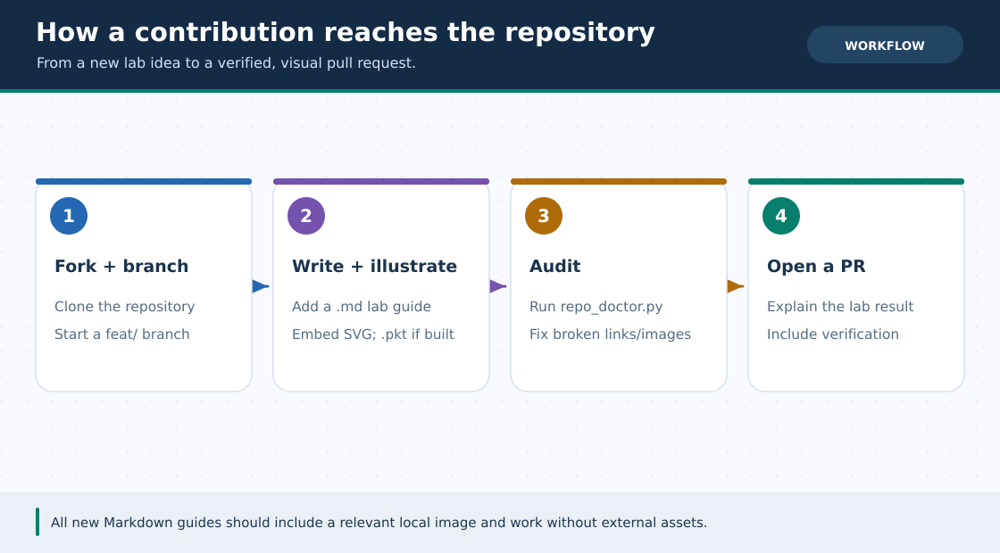

# 🤝 কীভাবে কন্ট্রিবিউট করবে (Contributing Guide)

> **নেভিগেশন:** [🏠 রেপো হোম](README.md) · [🗺️ রোডম্যাপ](ROADMAP.md) · [🛠️ স্ক্রিপ্ট গাইড](scripts/README.md)

**Cisco Packet Tracer Lab** রিপোজিটরিতে অবদান রাখার আগ্রহের জন্য ধন্যবাদ! বানান সংশোধন, নতুন ট্রাবলশুটিং সমস্যা, নতুন `.pkt` ল্যাব বা নতুন লেসন — যেকোনো গঠনমূলক অবদান স্বাগতম।

---

### 🖼️ চিত্রে বোঝো: নতুন ল্যাব যোগ করার পথ



> **ছবির সারকথা:** Fork → Markdown ও উপযুক্ত ছবি → strict audit → Pull Request।

---

## 🎯 কী কী যোগ বা উন্নত করতে পারো?

1. **🐛 ভুল বা টাইপো সংশোধন:** কোনো CLI কমান্ড, IP টেবিল বা বাংলা বানানে অসঙ্গতি পেলে ঠিক করা।
2. **🛠️ নতুন Problem Solve কেস:** ল্যাব করতে গিয়ে যে সমস্যায় আটকেছিলে তার সমাধান [`lessons/12-problem-solve.md`](lessons/12-problem-solve.md)-এ যোগ করা।
3. **📦 নতুন Extra Lab / build-along উন্নতি:** যেমন VoIP বা L2 security-র বর্তমান [গাইড](Extras/README.md) বাস্তবে Packet Tracer-এ যাচাই করে **নিজের তৈরি আসল `.pkt`** চাইলে যোগ করো; কল্পিত screenshot বা ফাইল নয়।
4. **🚀 অসমাপ্ত verification ও Pages:** [Phase 5 capstone](capstone/README.md) **নিজের Packet Tracer-এ বানিয়ে** [খালি worksheet-এ](capstone/VERIFICATION.md) আসল ফল লিখুন এবং [আসল `.pkt` সংরক্ষণ করুন](pkt-files/capstone/README.md)। [ROADMAP](ROADMAP.md)-এর Phase 4-এর বাকি GitHub Pages publishing / full verbatim translation-ও উন্নত করা যায়। v3.5-এর GIF/English adaptation এবং Phase 3-এর PT compatibility সংশোধন স্বাগত।

---

## ⚡ দ্রুত কাজের নিয়ম (Helper Script ব্যবহার করে)

### ১. রিপোজিটরি Fork ও Clone করো
```bash
git clone https://github.com/<your-username>/Cisco-Packet-Tracer-Lab.git
cd Cisco-Packet-Tracer-Lab
git checkout -b feat/my-new-lab
```

### ২. `lab_writer.py` দিয়ে স্ট্যান্ডার্ড ফরম্যাটে ফাইল তৈরি করো
যাতে রেপোর সব ফাইলের নেভিগেশন ও গঠন একই রকম থাকে:

```bash
# ভবিষ্যতের নতুন সিরিয়াল লেসন বানাতে (বিদ্যমান ০১–১৮ overwrite নয়):
python3 scripts/lab_writer.py lesson --num 19 --slug campus-backup --title "Campus Backup Routing"

# নতুন Extra Lab বানাতে (.pkt বাস্তবে তৈরি না থাকলে --pkt দেবে না):
python3 scripts/lab_writer.py extra --slug campus-routing-lab --title "Campus Routing Lab"

# লেসন ১২-তে নতুন সমস্যা যোগ করতে (০১–০৯ আগে থেকেই আছে):
python3 scripts/lab_writer.py problem --num 10 --title "তোমার সমস্যার শিরোনাম" --append
```

### ৩. লেখার স্টাইল গাইড (Style Checklist)
* **ভাষা:** সহজ, প্রাঞ্জল বাংলা + প্রমিত ইংরেজি টেকনিক্যাল শব্দ (`Router`, `Subnet Mask`, `Trunk`, `Default Gateway`)।
* **CLI কোড ব্লক:** সিসকো কমান্ডের জন্য ` ```cisco `, পিসি প্রম্পটের জন্য ` ```cmd `, এবং টপোলজি ডায়াগ্রামের জন্য ` ```text ` ব্যবহার করো।
* **`.pkt` নামকরণ:** সিরিয়াল লেসনের ফাইল হলে `pkt-files/labs/lesson-NN-<slug>.pkt` নামে রাখো।
* **ভিজ্যুয়াল:** প্রত্যেক নতুন `.md`-তে একটি **প্রাসঙ্গিক, লোকাল SVG/PNG/JPG/GIF** ও পরিষ্কার বাংলা alt text রাখো (যেমন প্র্যাকটিক্যাল লেসনে `../assets/diagrams/my-lab.svg` ফাইলটি সত্যি যোগ করে embed করবে)। খালি placeholder বা শুধু অনলাইন ছবি দিলে `repo_doctor.py --strict` ব্যর্থ হবে।
* **ডায়াগ্রাম + GIF আপডেট:** আগের ৫৬টি টপোলজি/IP বদলালে [`diagram_generator.py`](scripts/diagram_generator.py)-তে বদলে SVG regenerate করো, তারপর [`gif_walkthrough_generator.py`](scripts/gif_walkthrough_generator.py) দিয়ে সম্পর্কিত ৩০-সেকেন্ড GIF/manifest refresh করো। **v4 capstone-এর দুটি SVG ও নয়টি config-এর source আলাদা:** [`capstone/plan.json`](capstone/plan.json) + [`capstone_config_generator.py --write`](scripts/capstone_config_generator.py)। চিত্র শিক্ষামূলক, Packet Tracer recording নয়।
* **English track:** আগের ৩৫টি guide-এর সংশ্লিষ্ট [`en/lessons.yml`](en/lessons.yml), [`en/ccna-fundamentals.yml`](en/ccna-fundamentals.yml) বা [`en/Extras.yml`](en/Extras.yml)-এ prose আপডেট করে `python3 scripts/english_track_generator.py` চালাও; generated `.md`-তে সরাসরি edit করলে overwrite হবে। v4-এর [English capstone](en/capstone/README.md) আলাদা হাতে-লেখা guide। Bengali/English navigation ও বাস্তব PT limitation মিলিয়ে দেখো।
* **বাইরের GIF:** [GIF catalog](GIF-CATALOG.md)-এর topic search name/importance দেখো। অনুমতি ও attribution থাকলেই upload করো; PT footage না হলে তা PT recording বলে দেখাবে না।
* **ভেরিফিকেশন:** প্রতিটি ল্যাবে অবশ্যই `show` এবং `ping` কমান্ডের Expected Output ও একটি `✅ Final Checklist` রাখো।

### ৪. PR পাঠানোর আগে অটোমেটিক অডিট চালাও!
```bash
python3 scripts/diagram_generator.py --check
python3 scripts/capstone_config_generator.py --check  # v4 plan/config/SVG; PT test নয়
python3 scripts/repo_doctor.py --strict
# English/GIF/portal বদলালে Python 3.11+ দিয়ে অতিরিক্ত:
python3 -m pip install -r requirements-docs.txt
python3 scripts/english_track_generator.py --check
python3 scripts/gif_walkthrough_generator.py --check
python3 -m unittest discover -s tests -p 'test_*.py' -v
python3 scripts/portal_docs.py && python3 -m mkdocs build --strict -f mkdocs.yml
```
সব offline পরীক্ষা সফল এবং বর্তমান `96/96`-এর মতো ছবি/লিংক কভারেজ হলে Commit করে Pull Request খুলে দাও। **এগুলো Cisco PT-তে run/ping/failover নয়**; নতুন `.pkt`/feature claim করলে আসল project, version, [N01–F08-এর actual evidence](capstone/VERIFICATION.md) চাই। নতুন `.md` যোগ হলে মোট সংখ্যা বাড়বে; [পোর্টাল প্রকাশের ধাপ](PORTAL.md) দেখো। 🎉
