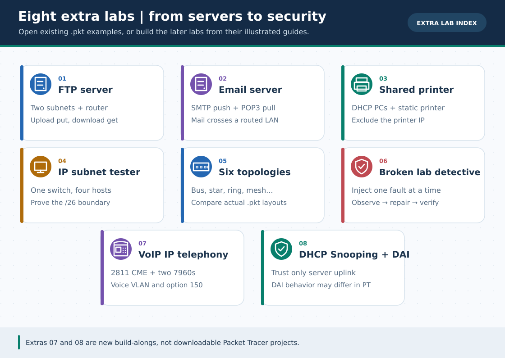

# 📦 Extra Practical Labs — বাড়তি প্র্যাকটিক্যাল ল্যাবসমূহ

> **নেভিগেশন:** [🏠 রেপো হোম](../README.md) · [📚 মূল লেসন (০১–১৮)](../lessons/README.md) · [🎓 CCNA Fundamentals](../ccna-fundamentals/README.md) · [📖 CLI Cheat-Sheet](../reference/cli-command-cheatsheet.md)

মূল ১৮টি লেসনের বাইরে অফিস ও CCNA অনুশীলনের **৮টি বিশেষ ল্যাব** আছে। প্রতিটিতে লোকাল SVG ও **নিজস্ব ৩০-সেকেন্ড GIF**; [English Extra Lab track](../en/Extras/README.md) এবং [GIF topic search names/গুরুত্ব](../GIF-CATALOG.md) দেখো। এগুলো শিক্ষামূলক অ্যানিমেশন, আসল Packet Tracer recording নয়। Extras ০১–০৫-এ প্রস্তুত `.pkt`, ০৬-এ বিদ্যমান `.pkt`-এ প্রয়োগের `.ios` fault script; **০৭–০৮-এ ছবি, CLI, IP table ও নিজের হাতে build-along**, কিন্তু native `.pkt` ফাইল এখনো নেই।

---

### 🖼️ চিত্রে বোঝো: ৮টি বাড়তি ল্যাবের কাজ

> **ছবির সারকথা:** প্রথম ছয়টি পূর্বের ল্যাব; এরপর 2811 IP Phone call ও বিশ্বাসযোগ্য DHCP/ARP policy নিয়ে হাতে-কলমে কাজ।

---

## 📋 ল্যাব তালিকা (ক্লিক করলেই গাইডে যাবে)

| # | ল্যাব গাইড | যা শিখবে | লেভেল | সংযুক্ত `.pkt` / স্ক্রিপ্ট |
| :---: | :--- | :--- | :---: | :--- |
| **০১** | [🌐 **FTP Server Configuration Lab**](ftp-server-lab.md) | আলাদা সাবনেটে FTP Server সেটআপ, ইউজার পারমিশন (`RWDNL`), `put`/`get`/`rename`/`delete` দিয়ে ফাইল আপলোড ও ডাউনলোড | 🟢→🟡 | [`FTP-Server.pkt`](../pkt-files/practice/FTP-Server.pkt) |
| **০২** | [📧 **Email Server Configuration Lab**](email-server-lab.md) | দুই LAN সাবনেটের মাঝে SMTP ও POP3 সার্ভিস কনফিগার, ডোমেন সেটআপ ও PC0 ↔ PC1 ইমেইল আদান-প্রদান | 🟡 Intermediate | [`Email-Server.pkt`](../pkt-files/practice/Email-Server.pkt) |
| **০৩** | [🖨️ **Office Shared Printer Network Lab**](office-shared-printer-lab.md) | অফিস LAN-এ Static IP নেটওয়ার্ক প্রিন্টার, DHCP Excluded Range সুরক্ষা ও সব PC থেকে শেয়ার্ড প্রিন্টার অ্যাক্সেস | 🟢 Beginner | [`office-shared-printer-network.pkt`](../pkt-files/practice/office-shared-printer-network.pkt) |
| **০৪** | [🧮 **IP Subnet Tester Lab**](ip-subnet-tester-lab.md) | `/24`, `/25`, `/26`, `/30` সাবনেট সীমানা Packet Tracer-এ সরাসরি পরীক্ষা — কখন সুইচেই Ping হয় আর কখন Router লাগে | 🟡 Intermediate | [`ip-subnet-tester.pkt`](../pkt-files/practice/ip-subnet-tester.pkt) |
| **০৫** | [🕸️ **6 Network Topologies Visual Lab**](network-topologies-lab.md) | Bus, Star, Ring, Mesh, Tree ও Hybrid — ৬টি টপোলজি Simulation Mode-এ প্যাকেট চালিয়ে তুলনা ও কেবল সূত্র যাচাই | 🟢 সবার জন্য | [`pkt-files/topologies/*.pkt`](../pkt-files/topologies/README.md) |
| **০৬** | [🔧 **Broken Network Detective Challenge (v2.5)**](broken-labs-challenge.md) | ৬টি ইচ্ছাকৃতভাবে ভাঙা নেটওয়ার্কে গোয়েন্দার মতো `show` কমান্ড চালিয়ে লুকানো বাগ খুঁজে বের করা ও মেরামত! | 🟡→🔴 | [`pkt-files/troubleshooting/*.ios`](../pkt-files/troubleshooting/README.md) |
| **০৭** | [☎️ **VoIP IP Telephony Lab (v3.0)**](voip-ip-telephony-lab.md) | Cisco 2811 CME + Voice VLAN20 + Option 150 দিয়ে দুটি 7960-এর `1001↔1002` কল | 🟠→🔴 | *দুটি SVG + CLI; `.pkt` নেই* |
| **০৮** | [🛡️ **DHCP Snooping + DAI Lab (v3.0)**](dhcp-snooping-dai-lab.md) | Rogue DHCP Offer আটকানোর পরীক্ষা, binding ও DAI policy; **PT-তে DAI enforcement অনিশ্চিত** | 🔴 Advanced | *দুটি SVG + CLI; `.pkt` নেই* |

---

## 🧭 কোন ল্যাবটি কখন করবে?

* **লেসন ০১ ও CCNA ০১ পড়ার সাথে:** [🕸️ 6 Network Topologies Lab](network-topologies-lab.md) খুলে Simulation Mode-এ প্যাকেট চলাচল দেখো।
* **লেসন ০৩ (DHCP) শেষ করার পর:** [🖨️ Office Shared Printer Network Lab](office-shared-printer-lab.md) অনুশীলন করো।
* **CCNA ০৫–০৬ (Subnetting) পড়ার পর:** [🧮 IP Subnet Tester Lab](ip-subnet-tester-lab.md) দিয়ে নিজের হিসাব Packet Tracer-এ প্রমাণ করো।
* **লেসন ০৪ (DNS/HTTP) শেষ করার পর:** [🌐 FTP Server Lab](ftp-server-lab.md) এবং [📧 Email Server Lab](email-server-lab.md) অনুশীলন করো।
* **লেসন ০৬ (VLAN/Trunk) শেষ করার পর:** [☎️ VoIP IP Telephony Lab](voip-ip-telephony-lab.md)-এ voice ও data VLAN আলাদা করে ফোন register করো।
* **লেসন ০৭ (Port Security) ও ০৩ (DHCP) শেষ করার পর:** [🛡️ DHCP Snooping + DAI Lab](dhcp-snooping-dai-lab.md)-এ trusted uplink, rogue DHCP ও DAI-এর simulator limitation শেখো।

---

> **নেভিগেশন:** [🏠 রেপো হোম](../README.md) · [📚 মূল লেসন (০১–১৮)](../lessons/README.md) · [🧰 বিদ্যমান .pkt ফাইল](../pkt-files/README.md) · [📖 CLI Cheat-Sheet](../reference/cli-command-cheatsheet.md)

**Tags:** `#extra-labs` `#ftp` `#email` `#voip` `#dhcp-snooping` `#dai` `#printer` `#topologies`
