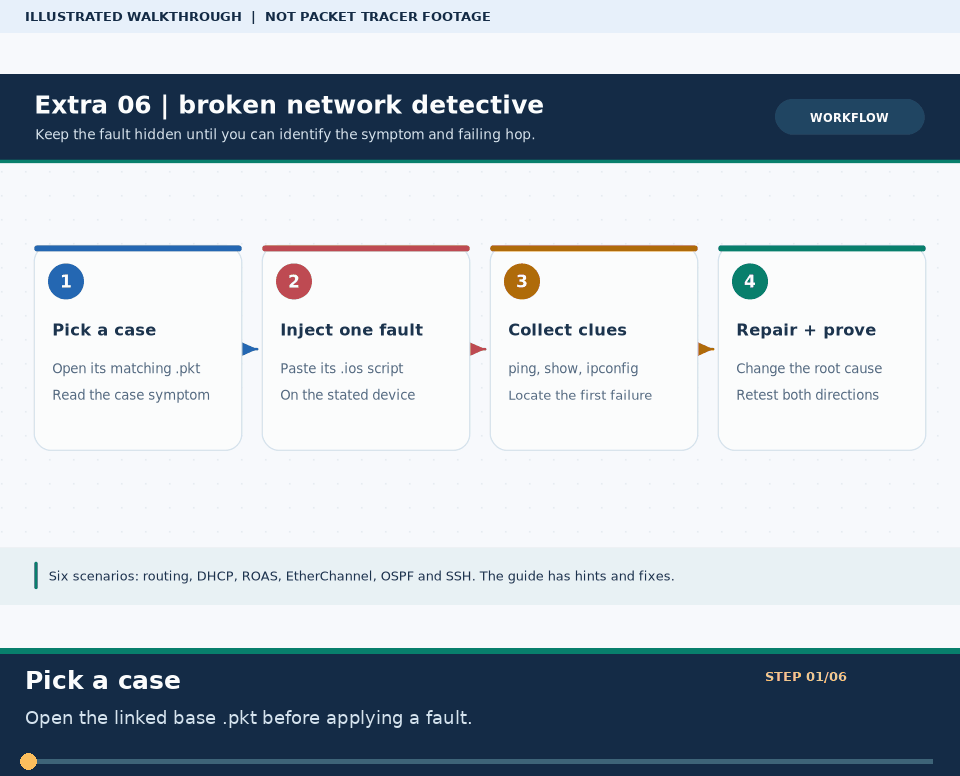

# 🔧 Extra Lab ০৬ · Broken Network Detective Challenge (৬টি ভাঙা ল্যাব চ্যালেঞ্জ)

> 🌐 **English:** [Read this guide in English](../en/Extras/broken-labs-challenge.md) · [English track index](../en/README.md)

> **নেভিগেশন:** [⬅ 6 Topologies Lab](network-topologies-lab.md) · [📦 Extra Labs সূচি](README.md) · [🏠 হোম](../README.md) · [🛠️ লেসন ১২ · Problem Bank](../lessons/12-problem-solve.md)

| 🎯 লক্ষ্য | ⏱️ সময় | 📊 লেভেল | 🧰 ফল্ট স্ক্রিপ্ট ফোল্ডার |
| :--- | :--- | :--- | :--- |
| ইচ্ছাকৃতভাবে ভাঙা ৬টি নেটওয়ার্কে গোয়েন্দার মতো `show` কমান্ড চালিয়ে আসল বাগ খুঁজে বের করা ও মেরামত করা | ~৬০ মিনিট | 🟡→🔴 Intermediate–Advanced | [`pkt-files/troubleshooting/`](../pkt-files/troubleshooting/README.md) |

**Tags:** `#troubleshooting` `#broken-lab` `#challenge` `#detective` `#ccna-exam` `#debugging`

---

### 🖼️ চিত্রে বোঝো: Broken Lab-এর গোয়েন্দা পদ্ধতি


> **ছবির সারকথা:** চ্যালেঞ্জ বাছো → ফল্ট দাও → `show` ও `ping`-এ প্রমাণ খোঁজো → ঠিক করে আবার পরীক্ষা করো।



> 🎞️ **৩০ সেকেন্ডে মনে রাখো:** এটি উপরের ডায়াগ্রামের ওপর ভিত্তি করে বানানো ছয় ধাপের ভিজ্যুয়াল সারাংশ; বাস্তব Packet Tracer run, packet capture বা ফলের প্রমাণ নয়। [সব GIF-এর topic search name ও গুরুত্ব](../GIF-CATALOG.md) দেখো।


---

## 🎯 আসল নেটওয়ার্ক ইঞ্জিনিয়ারের পরীক্ষা!

নতুন নেটওয়ার্ক বানানোর চেয়ে **ভাঙা নেটওয়ার্ক ৫ মিনিটে মেরামত করা** অনেক বেশি মূল্যবান দক্ষতা। এই ল্যাবে [`pkt-files/troubleshooting/`](../pkt-files/troubleshooting/README.md) ফোল্ডারে থাকা **৬টি রহস্যময় ভাঙা কনফিগ (`.ios`)** ব্যবহার করে তুমি নিজেকে পরীক্ষা করবে!

### 📌 খেলার নিয়ম (How to Play)
1. নিচের যেকোনো একটি **Case** বেছে নাও এবং বলা `.pkt` ফাইলটি Packet Tracer-এ খোলো।
2. সংযুক্ত `.ios` ফাইলটি **না পড়ে** কপি করে নির্দিষ্ট রাউটার/সুইচের CLI-তে পেস্ট করো (অথবা টার্মিনালে `python3 scripts/ios_config_generator.py broken-lab --case 1` চালিয়ে পেস্ট করো)।
3. এবার দেখবে নেটওয়ার্ক ভেঙে গেছে! `show` এবং `ping` কমান্ড চালিয়ে **নিজে কারণ খুঁজে বের করে ঠিক করো**।
4. ঠিক করার পর নিচের **🔽 আসল বাগ ও সমাধান** টগল খুলে মিলিয়ে নাও!

---

## 🕵️ Case ০১ · রহস্যময় নিরুদ্দেশ প্যাকেট (Static Routing Bug)

* **বেস ফাইল:** [`lesson-02-static-routing.pkt`](../pkt-files/labs/lesson-02-static-routing.pkt)
* **ফল্ট স্ক্রিপ্ট পেস্ট করো (`R2` CLI-তে):** [`broken-01-static-routing.ios`](../pkt-files/troubleshooting/broken-01-static-routing.ios)
* **❌ লক্ষণ (Symptom):** `PC0 (192.168.1.10)` থেকে `R1` এবং `10.0.0.2` পিং পায়, কিন্তু `PC1 (192.168.2.10)` পিং দিলে বারবার `Request timed out` আসে! অথচ `R2`-তে স্ট্যাটিক রুট লেখাই আছে!

<details>
<summary>💡 <b>হিন্ট দেখো</b></summary>

`R2`-তে `show ip route` এবং `show running-config | include ip route` চালিয়ে Next-Hop IP এবং Subnet Mask খুঁটিয়ে দেখো!
</details>

<details>
<summary>🔽 <b>আসল বাগ ও সমাধান দেখো</b></summary>

* **🐛 লুকানো বাগ:** `R2`-তে সঠিক রুট মুছে ভুল Next-Hop (`10.0.0.2` — নিজেরই IP!) অথবা ভুল সাবনেট (`192.168.10.0`) দেওয়া হয়েছে!
* **✅ সমাধান (`R2` CLI):**
  ```cisco
  configure terminal
  no ip route 192.168.10.0 255.255.255.0 10.0.0.1
  ip route 192.168.1.0 255.255.255.0 10.0.0.1
  end
  ```
</details>

---

## 🕵️ Case ০২ · সবাই পাচ্ছে `169.254.x.x`! (DHCP Sabotage)

* **বেস ফাইল:** [`lesson-03-dhcp.pkt`](../pkt-files/labs/lesson-03-dhcp.pkt)
* **ফল্ট স্ক্রিপ্ট পেস্ট করো (`R1` CLI-তে):** [`broken-02-dhcp-starvation.ios`](../pkt-files/troubleshooting/broken-02-dhcp-starvation.ios)
* **❌ লক্ষণ (Symptom):** অফিসের পিসিগুলোতে Static থেকে DHCP দিলেই `169.254.x.x` (APIPA) চলে আসছে, অথবা IP পেলেও ইন্টারনেট/গেটওয়ে পিং হচ্ছে না!

<details>
<summary>💡 <b>হিন্ট দেখো</b></summary>

`R1`-এ `show running-config | section dhcp` এবং `show ip interface brief` একসাথে মিলিয়ে দেখো — পুলের `network` আর `default-router` কি ইন্টারফেসের সাথে মিলছে?
</details>

<details>
<summary>🔽 <b>আসল বাগ ও সমাধান দেখো</b></summary>

* **🐛 লুকানো বাগ (২টি):** (১) DHCP পুলে `network 192.168.11.0` দেওয়া হয়েছে (অথচ ইন্টারফেস `192.168.1.1`!), এবং (২) `default-router 192.168.1.254` ভুল দেওয়া আছে!
* **✅ সমাধান (`R1` CLI):**
  ```cisco
  configure terminal
  no ip dhcp pool OFFICE
  ip dhcp pool OFFICE
   network 192.168.1.0 255.255.255.0
   default-router 192.168.1.1
   exit
  end
  ```
</details>

---

## 🕵️ Case ০৩ · উল্টাপাল্টা বিভাগ! (Router-on-a-Stick Tag Swap)

* **বেস ফাইল:** [`lesson-06-trunk-inter-vlan.pkt`](../pkt-files/labs/lesson-06-trunk-inter-vlan.pkt)
* **ফল্ট স্ক্রিপ্ট পেস্ট করো (`R1` CLI-তে):** [`broken-03-roas-vlan.ios`](../pkt-files/troubleshooting/broken-03-roas-vlan.ios)
* **❌ লক্ষণ (Symptom):** একই VLAN-এর পিসি নিজেদের মধ্যে পিং পাচ্ছে, কিন্তু VLAN 10 থেকে নিজের গেটওয়ে (`192.168.10.1`) বা VLAN 20 পিং হচ্ছে না! অথচ `show ip interface brief`-এ সব Subinterface `up/up`!

<details>
<summary>💡 <b>হিন্ট দেখো</b></summary>

`show ip int br` শুধু স্ট্যাটাস দেখায়, VLAN Tag দেখায় না! `R1`-এ `show running-config` চালিয়ে `G0/0.10` ও `G0/0.20`-এর `encapsulation dot1Q` সংখ্যাটি দেখো!
</details>

<details>
<summary>🔽 <b>আসল বাগ ও সমাধান দেখো</b></summary>

* **🐛 লুকানো বাগ:** `G0/0.10`-এ ভুল করে `encapsulation dot1Q 100` দেওয়া হয়েছে! ফলে VLAN 10-এর ফ্রেম রাউটার চিনতে পারছে না।
* **✅ সমাধান (`R1` CLI):**
  ```cisco
  configure terminal
  interface gigabitEthernet 0/0.10
   no ip address
   encapsulation dot1Q 10
   ip address 192.168.10.1 255.255.255.0
   exit
  end
  ```
</details>

---

## 🕵️ Case ০৪ · অলস EtherChannel! (LACP Mode Trap)

* **বেস ফাইল:** [`lesson-07-switching.pkt`](../pkt-files/labs/lesson-07-switching.pkt)
* **ফল্ট স্ক্রিপ্ট পেস্ট করো (`SW1` ও `SW2` CLI-তে):** [`broken-04-etherchannel-stp.ios`](../pkt-files/troubleshooting/broken-04-etherchannel-stp.ios)
* **❌ লক্ষণ (Symptom):** দুই সুইচের মাঝে ২টি কেবল লাগানো আছে, কিন্তু `Port-channel 1` ডাউন (`Po1(SD)`) হয়ে আছে!

<details>
<summary>💡 <b>হিন্ট দেখো</b></summary>

`show etherchannel summary` এবং `show running-config interface g0/1` দুই সুইচেই চালাও — দুপাশেই কে কথা শুরু করছে?
</details>

<details>
<summary>🔽 <b>আসল বাগ ও সমাধান দেখো</b></summary>

* **🐛 লুকানো বাগ:** দুই সুইচেই `channel-group 1 mode passive` দেওয়া হয়েছে! দুপাশেই `passive` থাকলে কেউই LACP আলোচনা শুরু করে না।
* **✅ সমাধান (`SW1` CLI):** কমপক্ষে এক পাশে `active` করে দাও:
  ```cisco
  configure terminal
  interface range gigabitEthernet 0/1 - 2
   no channel-group 1
   channel-group 1 mode active
   exit
  interface port-channel 1
   switchport mode trunk
  end
  ```
</details>

---

## 🕵️ Case ০৫ · নিঃসঙ্গ OSPF রাউটার! (OSPF Adjacency Failure)

* **বেস টপোলজি:** [লেসন ১৩ · Dynamic Routing (OSPF)](../lessons/13-dynamic-routing-ospf.md)
* **ফল্ট স্ক্রিপ্ট পেস্ট করো (`R2` CLI-তে):** [`broken-05-ospf-adjacency.ios`](../pkt-files/troubleshooting/broken-05-ospf-adjacency.ios)
* **❌ লক্ষণ (Symptom):** `R1` ও `R2`-এর মধ্যে সরাসরি `ping 10.0.12.2` কাজ করছে, কিন্তু `show ip ospf neighbor` একদম ফাঁকা — কোনো `O` রুট আসছে না!

<details>
<summary>💡 <b>হিন্ট দেখো</b></summary>

`R2`-তে `show ip protocols` চালাও — দুটি জিনিস খেয়াল করো: `Routing for Networks` কোন Area-তে আছে এবং `Passive Interface(s)` তালিকায় কোন পোর্ট ঢুকে বসে আছে!
</details>

<details>
<summary>🔽 <b>আসল বাগ ও সমাধান দেখো</b></summary>

* **🐛 লুকানো বাগ (২টি):** (১) WAN পোর্ট `G0/1`-কেও ভুল করে `passive-interface` করে দেওয়া হয়েছে, এবং (২) `10.0.12.0` নেটওয়ার্কটি `area 0`-এর বদলে `area 1`-এ দেওয়া হয়েছে!
* **✅ সমাধান (`R2` CLI):**
  ```cisco
  configure terminal
  router ospf 1
   no passive-interface gigabitEthernet 0/1
   no network 10.0.12.0 0.0.0.3 area 1
   network 10.0.12.0 0.0.0.3 area 0
   exit
  end
  ```
</details>

---

## 🕵️ Case ০৬ · তালাবদ্ধ রাউটার! (SSH Remote Access Failure)

* **বেস টপোলজি:** [লেসন ১৫ · SSH Hardening](../lessons/15-ssh-syslog-ntp.md)
* **ফল্ট স্ক্রিপ্ট পেস্ট করো (`R1` CLI-তে):** [`broken-06-ssh-lockout.ios`](../pkt-files/troubleshooting/broken-06-ssh-lockout.ios)
* **❌ লক্ষণ (Symptom):** Console কেবল দিয়ে `R1`-এ ঢোকা যাচ্ছে এবং `PC0` থেকে `ping 192.168.1.1` কাজ করছে, কিন্তু `ssh -l admin 192.168.1.1` দিলেই `Connection refused` দেখাচ্ছে!

<details>
<summary>💡 <b>হিন্ট দেখো</b></summary>

`R1`-এ Console দিয়ে ঢুকে `show running-config | section line vty` চালাও!
</details>

<details>
<summary>🔽 <b>আসল বাগ ও সমাধান দেখো</b></summary>

* **🐛 লুকানো বাগ:** `line vty 0 4`-এ `transport input none` দেওয়া হয়েছে (সব রিমোট প্রোটোকল বন্ধ!) এবং `login local` মুছে গেছে।
* **✅ সমাধান (`R1` CLI):**
  ```cisco
  configure terminal
  line vty 0 4
   transport input ssh
   login local
   exit
  end
  ```
</details>

---

## 🏆 তোমার গোয়েন্দা স্কোরকার্ড

| স্কোর | পদবি |
| :--- | :--- |
| **৬ / ৬ হিন্ট ছাড়াই সমাধান** | 🥇 **Senior Network Detective!** |
| **৪–৫টি সমাধান** | 🥈 **CCNA Troubleshooter!** |
| **১–৩টি সমাধান** | 🥉 **Junior Admin (লেসন ১২ আবার দেখে আবার চেষ্টা করো!)** |

---

> **নেভিগেশন:** [⬅ 6 Topologies Lab](network-topologies-lab.md) · [📦 Extra Labs সূচি](README.md) · [🏠 হোম](../README.md) · [🛠️ লেসন ১২ · Problem Bank](../lessons/12-problem-solve.md)

**Tags:** `#broken-labs` `#troubleshooting-pack` `#ccna-practice` `#fault-injection`
