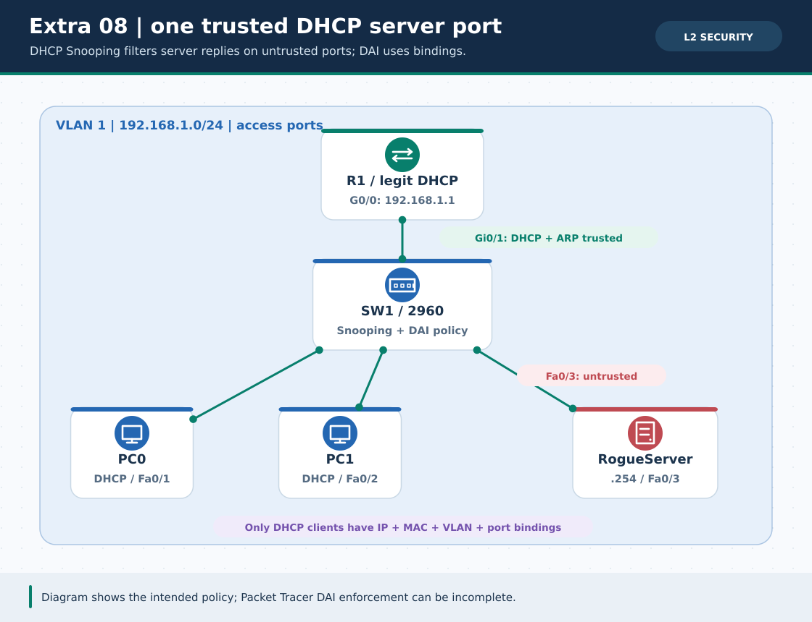
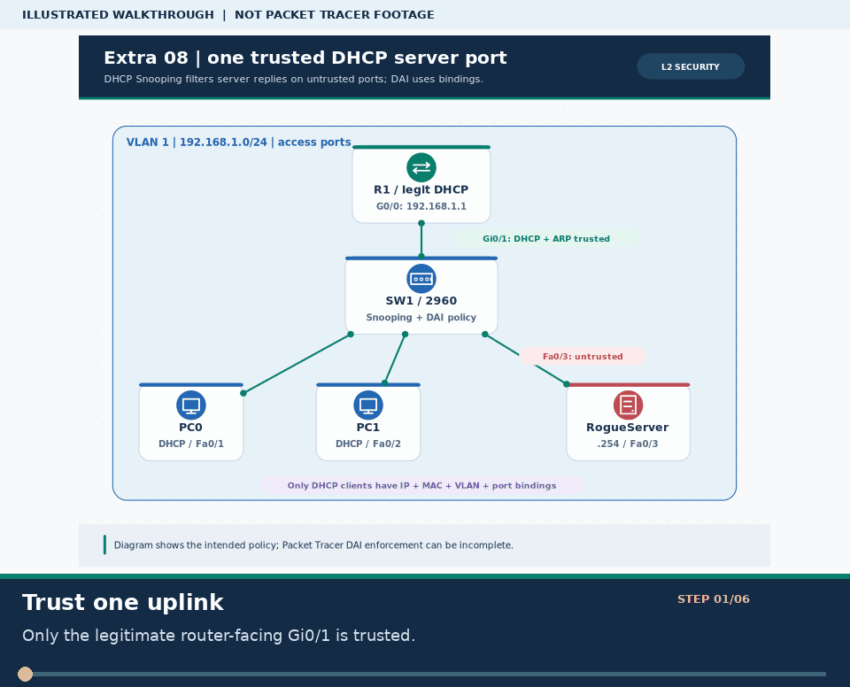
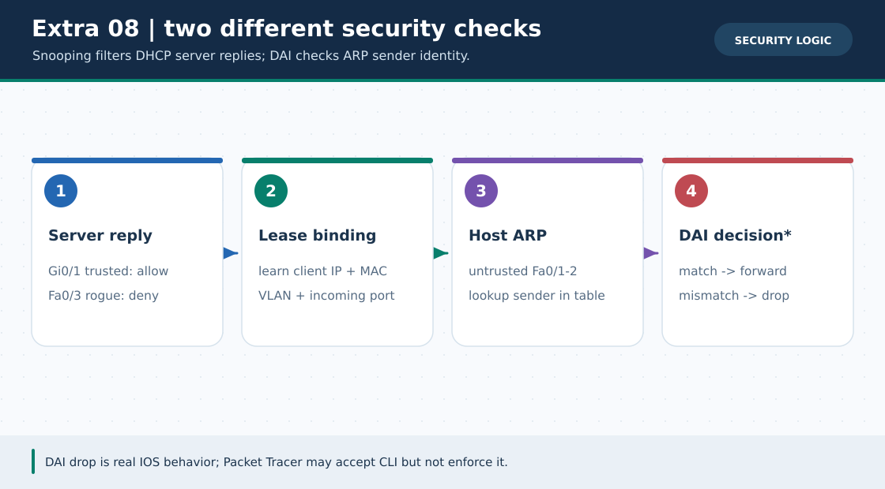

# Extra Lab ০৮ · Layer-2 Security: DHCP Snooping + DAI

> 🌐 **English:** [Read this guide in English](../en/Extras/dhcp-snooping-dai-lab.md) · [English track index](../en/README.md)

> **নেভিগেশন:** [📦 Extra Labs সূচি](README.md) · [⬅ Extra ০৭](voip-ip-telephony-lab.md) · [🏠 হোম](../README.md) · [📚 লেসন ০৭ · Port Security](../lessons/07-switching.md) · [📖 CLI Cheat-Sheet](../reference/cli-command-cheatsheet.md)

| 🎯 লক্ষ্য | ⏱️ সময় | 📊 লেভেল | 🧰 প্রয়োজন |
| :--- | :--- | :--- | :--- |
| ভুয়া DHCP Offer ঠেকানো, বৈধ client binding দেখা এবং **DAI-এর নীতি ও simulator সীমা** বোঝা | ৪০–৬০ মিনিট | 🔴 Advanced | Packet Tracer-এ **নিজে বানাবে**; এই ল্যাবের `.pkt` এখনো নেই |

**Tags:** `#dhcp-snooping` `#dai` `#arp-inspection` `#layer2-security` `#dhcp-binding` `#rogue-dhcp`

---

> ⚠️ **গুরুত্বপূর্ণ ফল-সীমা:** Packet Tracer-এর কিছু সংস্করণে `ip arp inspection vlan` **CLI-তে গ্রহণ করলেও DAI সত্যি সত্যি ARP আটকায় না**, এমনকি `show`-তে inactive দেখায়। তাই এই lab-এ **DHCP Snooping যাচাই** বাধ্যতামূলক; **DAI config/যুক্তি** শেখানো হচ্ছে, কিন্তু PT-তে MITM প্রতিরোধ **প্রমাণিত ধরে নেওয়া যাবে না**। সত্যিকারের enforcement যাচাই করতে DAI-সমর্থিত বাস্তব IOS সুইচ বা উপযুক্ত full-feature emulator-এ আলাদা পরীক্ষা দরকার।

### 🖼️ ছবি ১: কোন পোর্ট trusted আর কোনটি untrusted



> **ছবির সারকথা:** **শুধু R1-এর দিকে `Gi0/1` trusted**—PC0/PC1 ও RogueServer-এর পোর্ট **untrusted**। DHCP Snooping legitimate server-এর reply আসতে দেয়, rogue server-এর reply আটকে দেওয়ার নীতি প্রয়োগ করে। ছবি *প্রত্যাশিত নীতি* বোঝায়, কোনো live Packet Tracer capture নয়।



> 🎞️ **৩০ সেকেন্ডে মনে রাখো:** এটি উপরের ডায়াগ্রামের ওপর ভিত্তি করে বানানো ছয় ধাপের ভিজ্যুয়াল সারাংশ; বাস্তব Packet Tracer run, packet capture বা ফলের প্রমাণ নয়। [সব GIF-এর topic search name ও গুরুত্ব](../GIF-CATALOG.md) দেখো।


### 🖼️ ছবি ২: DHCP binding কীভাবে DAI-এর সিদ্ধান্তে কাজে লাগে



> **ছবির সারকথা:** DHCP Snooping দুটি কাজ করে: ভুয়া **DHCP server reply filter** ও বৈধ client-এর **IP–MAC–VLAN–port binding** তৈরি। DAI untrusted পোর্ট থেকে আসা ARP ওই database দিয়ে যাচাই করতে পারে; switch-এ command থাকা মানেই Packet Tracer-এ সত্যিকারের packet-drop ঘটেছে, এমন নয়।

---

## 🏷️ ধারণা এক নজরে

| শব্দ | কাজ |
| :--- | :--- |
| **DHCP Snooping** | Untrusted port থেকে DHCP server reply (Offer/ACK) ঠেকায় এবং বৈধ DHCP client binding শেখে। |
| **Trusted / Untrusted** | বিশ্বস্ত **server-facing uplink** trusted; user/rogue-facing port untrusted (ডিফল্ট)। |
| **Binding table** | একটি lease-এর IP + MAC + VLAN + interface তথ্য; `show ip dhcp snooping binding`। |
| **DAI** | Dynamic ARP Inspection; বাস্তব IOS-এ untrusted port-এর ARP-এ sender IP/MAC binding পরীক্ষা করে। |
| **Static IP host** | DHCP lease নেই → সাধারণত binding নেই; DAI-তে ARP ACL/অন্যান্য যাচাইযোগ্য policy দরকার। সব PC port-কে trusted করে ‘সমাধান’ করবে না। |

## 🧩 একটি বিচ্ছিন্ন VLAN 1 lab

এই *শুধু-শেখার* PT ফাইলে **1 × 2911 Router** (`R1`), **1 × 2960 Switch** (`SW1`), **2 × PCs** (`PC0`, `PC1`), **1 × Server-PT** (`RogueServer`)। Packet Tracer-এর পুরনো DHCP Snooping বাস্তবায়নে VLAN1 তুলনামূলক নির্ভরযোগ্য; VLAN10-এ যাওয়ার আগে model/version অনুযায়ী নিজে যাচাই করো। কোনো production network-এ rogue DHCP server বসাবে না।

| সংযোগ | IP / ভূমিকা | Trust state |
| :--- | :--- | :--- |
| R1 `G0/0` ↔ SW1 `Gi0/1` | `192.168.1.1/24` · **একমাত্র বৈধ DHCP server** | `Gi0/1`: DHCP + DAI trusted |
| PC0 ↔ SW1 `Fa0/1` | DHCP → আনুমানিক `.21` (lease-ভেদে) | Untrusted |
| PC1 ↔ SW1 `Fa0/2` | DHCP → আনুমানিক `.22` | Untrusted |
| RogueServer ↔ SW1 `Fa0/3` | Static `192.168.1.254/24` · DHCP pool start `.200` | **Untrusted** (কখনো trusted নয়) |

**পরীক্ষার ক্রম:** প্রথমে RogueServer-এর DHCP **OFF** রাখবে; R1/SW1/PCs সঠিক হলে পরে rogue DHCP ON করে পরীক্ষা করবে। PC0/PC1-এর gateway স্বাভাবিক অবস্থায় **`192.168.1.1`**। Rogue DHCP-র প্রস্তাবিত gateway `.254`—কেন ভুল তা সহজে দেখার জন্য।

## 🔧 Step 1 · R1-তে বৈধ DHCP চালু

**শুধু R1-তে:**

```cisco
enable
configure terminal
hostname R1
interface gigabitEthernet 0/0
 ip address 192.168.1.1 255.255.255.0
 no shutdown
exit
ip dhcp excluded-address 192.168.1.1 192.168.1.20
ip dhcp excluded-address 192.168.1.254
ip dhcp pool SAFE_LAN
 network 192.168.1.0 255.255.255.0
 default-router 192.168.1.1
exit
end
copy running-config startup-config
```

R1-এর DHCP `.21` থেকে শুরু হতে পারে, তবে lease order / পুরনো address reservation অনুযায়ী বদলাবে; **নিজের `ipconfig`-এর ফল লিখবে**, অন্ধভাবে `.21` ধরবে না।

## 🔧 Step 2 · SW1-তে DHCP Snooping; server-facing port-ই trusted

**শুধু SW1-তে:**

```cisco
enable
configure terminal
hostname SW1
ip dhcp snooping
ip dhcp snooping vlan 1
no ip dhcp snooping information option
interface gigabitEthernet 0/1
 ip dhcp snooping trust
 no shutdown
exit
interface fastEthernet 0/1
 switchport mode access
 switchport access vlan 1
 no shutdown
exit
interface fastEthernet 0/2
 switchport mode access
 switchport access vlan 1
 no shutdown
exit
interface fastEthernet 0/3
 switchport mode access
 switchport access vlan 1
 no shutdown
exit
end
copy running-config startup-config
```

`no ip dhcp snooping information option` এই সরল lab-এ option-82 insertion বন্ধ করে—কিছু PT/router combination-এ DHCP reply নিয়ে সমস্যা এড়াতে সহায়ক। যদি তোমার emulator এই command না চেনে, `?` দেখে বাদ দিয়ে DHCP ও binding আসলেই কাজ করছে কি না পরীক্ষা করো। **PC-facing port trusted করবে না**: তা করলে rogue DHCP Offer ঢুকে পড়ার রাস্তা খুলবে।

> 🛠️ ডিভাইসভিত্তিক preset: `python3 scripts/ios_config_generator.py dhcp-snooping --role R1` এবং `--role SW1`। `dai --role SW1` পরের ধাপের জন্য আলাদা; binding ছাড়া আগেই চালাবে না।

## ✅ Step 3 · প্রথমে বৈধ DHCP ও binding পরীক্ষা

1. **RogueServer-এ DHCP OFF** (Server → Services → DHCP) রাখো। PC0/PC1 → Desktop → IP Configuration → **DHCP**। PC `ipconfig` দেখো: `192.168.1.x/24`, gateway **`.1`**। PC0 → `ping 192.168.1.1`।
2. SW1-তে `show ip dhcp snooping`: VLAN 1 enabled এবং **শুধু Gi0/1 trusted** কিনা দেখো। `show ip dhcp snooping binding`: PC0/PC1-এর IP/MAC/VLAN1/Fa0/1–2 দেখা যাওয়ার কথা; এটি DAI-র prerequisite। Simulator মাঝে মাঝে binding table ভুল/ফাঁকা দেখাতে পারে—তাহলে DHCP renew করে আবার দেখো; তবুও ফাঁকা থাকলে **DAI stage চালু করবে না**।
3. R1-তে `show ip dhcp binding`-এ কোন PC কোন IP পেয়েছে দেখো। Switch-এর DHCP snooping table আর router-এর DHCP lease table **দুটি আলাদা জিনিস**।

## 🛡️ Step 4 · বিচ্ছিন্ন lab-এ rogue DHCP পরীক্ষা

RogueServer → **Desktop → IP Configuration**: static `192.168.1.254`, mask `255.255.255.0`, gateway `192.168.1.1`; **Services → DHCP**-তে pool নাম `ROGUE`, Default Gateway `192.168.1.254`, Start IP `192.168.1.200`, mask `255.255.255.0`, Maximum Users `20` দিয়ে **ON** করো। PC0/PC1-তে পুনরায় DHCP request করো (IP Configuration-এ Static → DHCP, অথবা Command Prompt-এর `/renew` যদি PT সংস্করণে কাজ করে)।

**প্রত্যাশিত নীতি:** SW1 `Fa0/3` untrusted হওয়ায় rogue server-এর **Offer/ACK** গ্রহণ করা উচিত নয়; PC-তে gateway `.1`-ই থাকবে। PC `.254` gateway পেলে `show ip dhcp snooping`, `Gi0/1` trusted কিনা, `Fa0/3` যেন trusted না হয়, এবং emulator support পরীক্ষা করো। Packet Tracer-এর UI-তে rogue reply না-দেখা একা DAI-র প্রমাণ নয়—এটি **DHCP Snooping** পরীক্ষা। কাজ শেষে rogue DHCP OFF করো।

## 🧪 Step 5 · Binding নিশ্চিত হওয়ার **পরে** DAI policy দেখো

> **সতর্কতা:** বাস্তব IOS-এ binding/ARP ACL ছাড়া DAI চালু করলে নিজের বৈধ DHCP client বা static host-এর ARP-ও drop হতে পারে। SW1-তে `show ip dhcp snooping binding`-এ দুই PC-এর binding না দেখলে এই ধাপ এড়িয়ে যাও। RogueServer static `.254`-র **কোনো DHCP binding নেই**, তাই তার ARP trusted ধরে নেওয়া যাবে না।

**শুধু SW1-তে** (যদি `ip arp inspection ?` CLI-তে পাও):

```cisco
configure terminal
ip arp inspection vlan 1
interface gigabitEthernet 0/1
 ip arp inspection trust
exit
end
show ip arp inspection
show ip arp inspection interfaces
show ip arp inspection statistics
```

`show ip arp inspection vlan 1` যদি সমর্থিত হয়, VLAN1-এর config/operational state দেখো। **Real IOS-এর নীতি:** R1-গামী `Gi0/1` থেকে ARP বিশ্বাসযোগ্য; PC-গামী `Fa0/1–2`-এর ARP binding-এর IP/MAC/VLAN/port-এর সাথে মিললে forwarded, না মিললে dropped। `Fa0/3` untrusted-ই রাখো; ভুয়া DHCP server-কে trusted বানানো যাবে না। `ip arp inspection validate src-mac dst-mac ip` ঐচ্ছিক অতিরিক্ত field check—এটি **DHCP binding-এর বিকল্প নয়**।

**নিরাপদ ধারণাগত পরীক্ষা:** PC1-এর DHCP lease ও binding নোট করো; কেবল নিজের *বিচ্ছিন্ন lab*-এ PC1-কে সাময়িক Static `192.168.1.150/24`, gateway `.1` দিয়ে fresh ARP/ping চেষ্টা করো। **বাস্তব DAI-তে** ওই static IP-র binding না থাকায় ARP reject হওয়ার কথা; **PT-তে pass হলেও DAI কাজ করছে ভাববে না**। পরে PC1 আবার DHCP করো, renew/binding পরীক্ষা করো। স্থায়ী static host রাখতে হলে সমর্থিত IOS-এ সঠিক MAC-সহ ARP ACL/policy plan করতে হবে—সব user port trusted করলে নিরাপত্তাই নষ্ট হবে।

### 📊 কোন ফলকে প্রমাণ ধরবে?

| পরীক্ষা | কী সিদ্ধান্ত নিতে পারো |
| :--- | :--- |
| PC0/PC1 R1 থেকে `.1` gateway পায়, rogue DHCP ON করেও `.254` পায় না | **এই run-এ** DHCP Snooping কাজ করেছে; config ও binding মিলিয়ে দেখো। |
| `show ip dhcp snooping binding`-এ দুই PC | এই run-এ DAI-র জন্য binding data আছে; সব PT সংস্করণে নির্ভরযোগ্য নয়। |
| `show ip arp inspection` config দেখায় কিন্তু `inactive` / drop কাউন্টার বাড়ে না | DAI enforcement **প্রমাণিত নয়**; PT limitation হতে পারে। |
| Static mismatch ARP বাস্তব DAI-তে drop + counters/log বাড়ে | **সেই IOS environment-এ** DAI filter কাজের শক্ত প্রমাণ (PT-তে নিশ্চয়তা নয়)। |

## 🧯 সমস্যা ও rollback

| উপসর্গ | করণীয় |
| :--- | :--- |
| PC DHCP পায় না | R1 `G0/0 up/up`, DHCP pool, SW1 `Gi0/1` **trusted**, VLAN 1, option-82 এবং কেবল পরীক্ষা। |
| Binding ফাঁকা | PC lease renew; `show ip dhcp snooping`; trust/port map যাচাই; নিশ্চিত না হলে **DAI enable করবে না**। |
| DAI enable-এর পর PC gateway পিং হারাল | `show ip dhcp snooping binding`; static host? সত্যিকারের IOS-এ ACL লাগতে পারে। জরুরি rollback: SW1 `configure terminal` → `no ip arp inspection vlan 1` → `end`। |
| `ip arp inspection vlan 1` unsupported বা `inactive` | Switch/PT version support সীমিত; DHCP Snooping stage সফল থাকলে সেটুকুই report করো। PC port trusted করে নকল success দেখিয়ো না। |

## ☑️ নিজের চেকলিস্ট

- [ ] R1-এর DHCP reply SW1-এর **trusted Gi0/1** দিয়ে এসেছে; PC/rogue port untrusted।
- [ ] PC দুটিতে gateway `.1` এবং `show ip dhcp snooping binding`-এ client entries যাচাই হয়েছে (না হলে সীমা লিখেছি)।
- [ ] Rogue DHCP ON করে নিজস্ব PT run-এর ফল লিখেছি; production network-এ চেষ্টা করিনি।
- [ ] DAI-তে **configuration** আর **packet enforcement**-এর প্রমাণ আলাদা করেছি; PT limitation থাকলে স্পষ্ট লিখেছি।

**আরও পড়ো:** [Cisco · Catalyst 2960 DHCP Snooping](https://www.cisco.com/c/en/us/td/docs/switches/lan/catalyst2960/software/release/12-2_55_se/configuration/guide/scg_2960/swdhcp82.html) · [Cisco · Catalyst 2960 DAI এবং static IP-এর ARP ACL](https://www.cisco.com/c/en/us/td/docs/switches/lan/catalyst2960/software/release/12-2_55_se/configuration/guide/scg_2960/swdynarp.html) · [CertSkills · Packet Tracer-এ DAI-এর পরীক্ষিত সীমা](https://www.certskills.com/clab345/)
