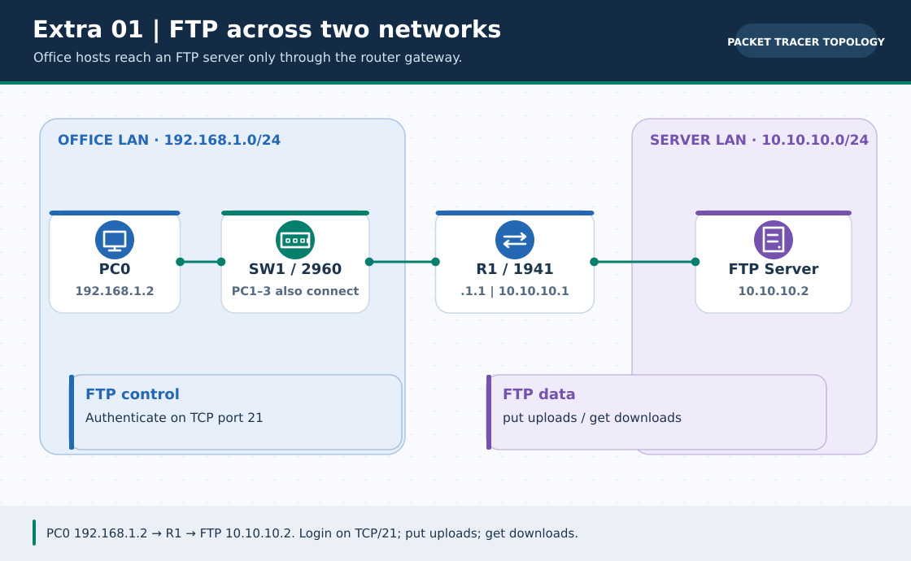
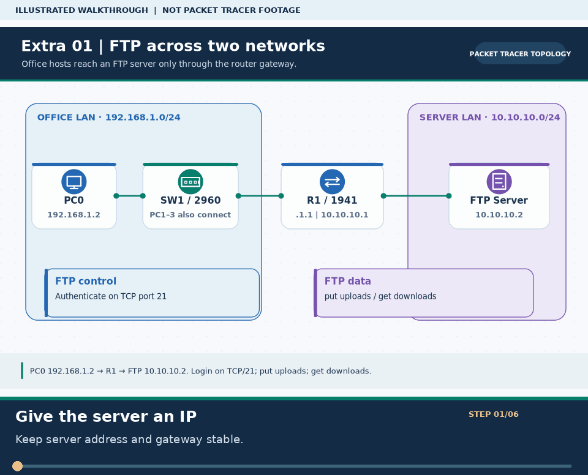

# 🌐 Extra Lab ০১ · FTP Server Configuration (File Upload ও Download)

> 🌐 **English:** [Read this guide in English](../en/Extras/ftp-server-lab.md) · [English track index](../en/README.md)

> **নেভিগেশন:** [📦 Extra Labs সূচি](README.md) · [🏠 হোম](../README.md) · [📖 Cheat-Sheet](../reference/cli-command-cheatsheet.md) · [পরের ল্যাব: Email Server ➡](email-server-lab.md)

| 🎯 লক্ষ্য | ⏱️ সময় | 📊 লেভেল | 🧰 ল্যাব ফাইল |
| :--- | :--- | :--- | :--- |
| আলাদা সাবনেটে FTP Server তৈরি করে PC থেকে ফাইল Upload (`put`) ও Download (`get`) করা | ~৪৫ মিনিট | 🟢→🟡 Beginner–Intermediate | [`FTP-Server.pkt`](../pkt-files/practice/FTP-Server.pkt) |

**Tags:** `#ftp` `#file-transfer` `#port-21` `#port-20` `#put-get` `#router` `#ccna-lab`

---

### 🖼️ চিত্রে বোঝো: FTP Server-এ Upload ও Download



> **ছবির সারকথা:** অফিস LAN-এর PC0 রাউটার পেরিয়ে আলাদা সার্ভার LAN-এ FTP সার্ভারে পৌঁছায়।



> 🎞️ **৩০ সেকেন্ডে মনে রাখো:** এটি উপরের ডায়াগ্রামের ওপর ভিত্তি করে বানানো ছয় ধাপের ভিজ্যুয়াল সারাংশ; বাস্তব Packet Tracer run, packet capture বা ফলের প্রমাণ নয়। [সব GIF-এর topic search name ও গুরুত্ব](../GIF-CATALOG.md) দেখো।


---

## 🎯 এই ল্যাবে যা শিখবে

1. দুটি ভিন্ন সাবনেট (`192.168.1.0/24` অফিস LAN এবং `10.10.10.0/24` সার্ভার নেটওয়ার্ক) রাউটার দিয়ে যুক্ত করা
2. Cisco Packet Tracer-এ **FTP Server** ও ইউজার পারমিশন (`Read`, `Write`, `Delete`, `Rename`, `List`) সেটআপ করা
3. PC-তে টেক্সট ফাইল তৈরি করে কমান্ড প্রম্পট থেকে `ftp 10.10.10.2`-এ লগইন করা
4. `put`, `get`, `dir`, `rename`, `delete` কমান্ড চালিয়ে বাস্তব ফাইল ট্রান্সফার পরীক্ষা করা

### 🏷️ মূল শব্দকোষ (Quick Glossary)

| শব্দ | সহজ অর্থ | পোর্ট / নোট |
| :--- | :--- | :--- |
| **FTP** (*File Transfer Protocol*) | নেটওয়ার্কের মাধ্যমে ক্লায়েন্ট ও সার্ভারের মধ্যে ফাইল আদান-প্রদানের প্রোটোকল | Layer 7 (TCP) |
| **Control Connection** | লগইন (Username/Password) ও কমান্ড পাঠানোর চ্যানেল | **`TCP Port 21`** |
| **Data Connection** | আসল ফাইল (`put`/`get`) ও ফোল্ডার লিস্ট (`dir`) পাঠানোর চ্যানেল | **`TCP Port 20`** |
| **RWDNL Permissions** | **R**ead, **W**rite, **D**elete, **R**e**N**ame, **L**ist — ইউজারের ৫টি ফাইল পারমিশন | PT FTP Server |
| **SFTP / FTPS** | সাধারণ FTP পাসওয়ার্ড এনক্রিপ্ট করে না; নিরাপদ বিকল্প হলো SFTP (`SSH Port 22`) ও FTPS (`TLS`) | Security |

---

## ১. Network Topology ও IP Addressing

### Topology Diagram

```text
                     [ FTP SERVER ]
                      10.10.10.2/24
                            │
                       G0/1 (10.10.10.1)
                     [ Router 1941 (R1) ]
                       G0/0 (192.168.1.1)
                            │
                     [ Switch 2960 (SW1) ]
                  ┌──────┬──────┬──────┐
                [PC0]  [PC1]  [PC2]  [PC3]
                 .1.2   .1.3   .1.4   .1.5
                  └── LAN: 192.168.1.0/24 ──┘
```

### IP Address Table

| Device | Interface | IP Address | Subnet Mask | Default Gateway |
| :--- | :--- | :--- | :--- | :--- |
| **Router (R1)** | `GigabitEthernet 0/0` | `192.168.1.1` | `255.255.255.0` | N/A |
| **Router (R1)** | `GigabitEthernet 0/1` | `10.10.10.1` | `255.255.255.0` | N/A |
| **FTP Server** | `FastEthernet 0` | `10.10.10.2` | `255.255.255.0` | `10.10.10.1` |
| **PC0** | `FastEthernet 0` | `192.168.1.2` | `255.255.255.0` | `192.168.1.1` |
| **PC1** | `FastEthernet 0` | `192.168.1.3` | `255.255.255.0` | `192.168.1.1` |
| **PC2** | `FastEthernet 0` | `192.168.1.4` | `255.255.255.0` | `192.168.1.1` |
| **PC3** | `FastEthernet 0` | `192.168.1.5` | `255.255.255.0` | `192.168.1.1` |

> ⚠️ **Important Note:** সার্ভারের IP `10.10.10.2` রাখা হয়েছে, কারণ `10.10.10.1` হলো রাউটারের Server-facing ইন্টারফেস (সার্ভারের Default Gateway)।

---

## ২. Router (R1) Configuration

Router-এ ক্লিক করে **CLI** ট্যাবে নিচের কমান্ডগুলো দাও:

```cisco
enable
configure terminal
hostname R1

! Configure Office LAN Interface
interface gigabitEthernet 0/0
 ip address 192.168.1.1 255.255.255.0
 no shutdown
 exit

! Configure Server Subnet Interface
interface gigabitEthernet 0/1
 ip address 10.10.10.1 255.255.255.0
 no shutdown
 exit

end
copy running-config startup-config
```

### 🔍 Verification
```cisco
R1# show ip interface brief
```
> নিশ্চিত করো `GigabitEthernet0/0` এবং `GigabitEthernet0/1` উভয় ইন্টারফেসই **`up / up`** অবস্থায় আছে।

---

## ৩. PC Configuration (LAN Clients)

প্রতিটি PC-তে **Desktop → IP Configuration → Static** সিলেক্ট করে বসাও:

| PC | IP Address | Subnet Mask | Default Gateway |
| :--- | :--- | :--- | :--- |
| **PC0** | `192.168.1.2` | `255.255.255.0` | `192.168.1.1` |
| **PC1** | `192.168.1.3` | `255.255.255.0` | `192.168.1.1` |
| **PC2** | `192.168.1.4` | `255.255.255.0` | `192.168.1.1` |
| **PC3** | `192.168.1.5` | `255.255.255.0` | `192.168.1.1` |

---

## ৪. FTP Server Configuration

### Step A: Server IP বসানো
* যাও: **FTP Server → Desktop → IP Configuration → Static**
  * **IP Address:** `10.10.10.2`
  * **Subnet Mask:** `255.255.255.0`
  * **Default Gateway:** `10.10.10.1` *(⚠️ এটি না দিলে অন্য সাবনেটের PC0 সার্ভারের উত্তর পাবে না!)*

### Step B: FTP Service ও User Account চালু করা
* যাও: **FTP Server → Services → FTP**
1. **Service:** `On` রেডিও বাটন সিলেক্ট করো।
2. **User Setup** সেকশনে নতুন ইউজার তৈরি করো:
   * **Username:** `admin`
   * **Password:** `5415@` *(বা তোমার পছন্দের পাসওয়ার্ড)*
   * **Permissions:** ✅ `Write` · ✅ `Read` · ✅ `Delete` · ✅ `Rename` · ✅ `List`
3. **`Add`** বাটনে ক্লিক করো (ইউজার তালিকায় `admin` ও পাশে `RWDNL` দেখা যাবে)।

---

## ৫. Connectivity ও Local File প্রস্তুতি

### ধাপ ১: Ping Test (PC0 → Command Prompt)
```cmd
C:\> ipconfig
C:\> ping 192.168.1.1
C:\> ping 10.10.10.2
```
**Expected Output:**
```text
Reply from 10.10.10.2: bytes=32 time<1ms TTL=127
```
*(একটি রাউটার পার হওয়ায় `TTL=128` থেকে ১ কমে `TTL=127` দেখাবে!)*

### ধাপ ২: আপলোডের জন্য ফাইল যাচাই বা তৈরি
PC0-এর Command Prompt-এ `dir` লিখে দেখো `sampleFile.txt` আছে কি না। নতুন ফাইল বানাতে চাইলে **PC0 → Desktop → Text Editor** খুলে কিছু লিখে `notes.txt` নামে সেভ করো।

> ⚠️ **সতর্কতা:** ফাইলের নামে কখনো **Space** দেবে না (যেমন `"my file.txt"` দিলে Packet Tracer FTP এরর দেয় — `myfile.txt` বা `sampleFile.txt` ব্যবহার করো)।

---

## ৬. FTP Login, Upload (`put`) ও Download (`get`)

### Step 1: PC0 থেকে FTP Server-এ লগইন
```cmd
C:\> ftp 10.10.10.2
```
```text
Trying to connect...10.10.10.2
Connected to 10.10.10.2
220- Welcome to PT Ftp server
Username: admin
331- Username ok, need password
Password: 5415@
230- Logged in (passive mode On)
ftp>
```

### Step 2: সব দরকারি FTP কমান্ড এক নজরে

| Command | উদাহরণ | কাজ |
| :--- | :--- | :--- |
| **`?` / `help`** | `ftp> ?` | সব সমর্থিত FTP কমান্ডের তালিকা দেখায় |
| **`dir`** | `ftp> dir` | FTP Server-এ থাকা ফাইলের তালিকা দেখায় |
| **`pwd`** | `ftp> pwd` | সার্ভারের বর্তমান ফোল্ডার দেখায় |
| **`put`** | `ftp> put sampleFile.txt` | **Upload:** নিজের PC থেকে সার্ভারে ফাইল পাঠায় |
| **`get`** | `ftp> get sampleFile.txt` | **Download:** সার্ভার থেকে অন্য PC-তে ফাইল নামায় |
| **`rename`** | `ftp> rename a.txt b.txt` | সার্ভারে থাকা ফাইলের নাম বদলায় |
| **`delete`** | `ftp> delete b.txt` | সার্ভার থেকে ফাইল মুছে ফেলে |
| **`quit`** | `ftp> quit` | FTP সেশন বন্ধ করে `C:\>` প্রম্পটে ফেরে |

### Step 3: PC0 থেকে ফাইল Upload (`put`) ও PC1 থেকে Download (`get`)
1. **PC0 (`ftp>` প্রম্পটে):**
   ```ftp
   ftp> put sampleFile.txt
   250 File transfer started
   226 Transfer complete
   ftp> dir
   ```
   *(এখন সার্ভারের তালিকায় `sampleFile.txt` দেখা যাবে!)*

2. **এবার PC1 থেকে পরীক্ষা করো!** **PC1 → Command Prompt** খুলে:
   ```cmd
   C:\> ftp 10.10.10.2
   Username: admin
   Password: 5415@
   ftp> dir
   ftp> get sampleFile.txt
   ftp> quit
   C:\> dir
   ```
   🎉 **দারুণ!** PC0-এর আপলোড করা ফাইলটি রাউটার পার হয়ে PC1 ডাউনলোড করে নিয়েছে!

---

## ৭. 🔁 পর্দার আড়ালে FTP যেভাবে কাজ করে

```text
PC0 (192.168.1.2)                                    FTP Server (10.10.10.2)
       │                                                        │
       ├─────── ১. Control Channel (TCP Port 21) ──────────────►│  (Login: admin / pass, put command)
       │◄────── ২. 230 Logged in / Passive Mode Ready ──────────┤
       ├─────── ৩. Data Channel (TCP Port 20 / Passive) ───────►│  (Actual bytes of sampleFile.txt)
       │◄────── ৪. 226 Transfer Complete ✅ ────────────────────┤
```

---

## ৮. ❌ Common Errors ও সমাধান

| Error Message | সম্ভাব্য কারণ | সমাধান |
| :--- | :--- | :--- |
| `Connection timed out` | IP/Gateway ভুল বা Router পোর্ট `shutdown` | PC ও FTP Server উভয়ের Default Gateway এবং `show ip int br` চেক করো |
| `Connection refused` | সার্ভারে FTP Service বন্ধ (`Off`) | Server → Services → FTP → **On** করো |
| `530 Login incorrect` | ভুল Username বা Password | Server-এর FTP User Setup থেকে ইউজারনেম/পাসওয়ার্ড মেলাও |
| `Error opening ... (No such file)` | PC-তে ওই নামের ফাইল নেই বা নামে Space আছে | `C:\> dir` দিয়ে সঠিক নাম দেখে স্পেস ছাড়া নাম দাও |
| `Permission denied` | ইউজারের `Write`/`Delete` পারমিশন নেই | Server-এ ইউজারের পাশে `RWDNL` চেকবক্সগুলো টিক দিয়ে Save করো |

---

## ৯. 🎓 CCNA Viva Questions & Answers

<details>
<summary><b>Q1. What are the default TCP port numbers used by FTP?</b></summary>

FTP দুটি আলাদা TCP পোর্ট ব্যবহার করে:
* **TCP Port 21:** Control Connection (কমান্ড ও লগইন প্রেরণ)।
* **TCP Port 20:** Data Connection (আসল ফাইল ট্রান্সফার)।
</details>

<details>
<summary><b>Q2. What is the difference between <code>put</code> and <code>get</code>?</b></summary>

* **`put`:** লোকাল ক্লায়েন্ট PC থেকে রিমোট FTP সার্ভারে ফাইল **Upload** করে।
* **`get`:** রিমোট FTP সার্ভার থেকে লোকাল ক্লায়েন্ট PC-তে ফাইল **Download** করে।
</details>

<details>
<summary><b>Q3. Is standard FTP secure? What should be used in production?</b></summary>

না! সাধারণ FTP ইউজারনেম, পাসওয়ার্ড ও ডেটা **Plain Text**-এ পাঠায় (Wireshark দিয়ে যে কেউ দেখতে পারে)। বাস্তব প্রোডাকশন নেটওয়ার্কে এনক্রিপ্টেড **SFTP (SSH File Transfer Protocol — Port 22)** বা **FTPS (FTP over TLS)** ব্যবহার করা উচিত।
</details>

---

## ✅ Final Checklist

| কাজ | যাচাই | অবস্থা |
| :--- | :--- | :---: |
| Router `G0/0` (`192.168.1.1`) ও `G0/1` (`10.10.10.1`) | `show ip interface brief` → `up/up` | ☐ |
| FTP Server IP ও Gateway (`10.10.10.1`) | PC0 থেকে `ping 10.10.10.2` সফল | ☐ |
| FTP User `admin` (`RWDNL` সহ) যোগ করা | User List-এ `RWDNL` দেখাচ্ছে | ☐ |
| PC0 থেকে ফাইল আপলোড | `ftp> put sampleFile.txt` → `226 Transfer complete` | ☐ |
| PC1 থেকে ওই ফাইল ডাউনলোড | `ftp> get sampleFile.txt` → `C:\> dir`-এ ফাইল দৃশ্যমান | ☐ |

---

> **নেভিগেশন:** [📦 Extra Labs সূচি](README.md) · [🏠 হোম](../README.md) · [📖 Cheat-Sheet](../reference/cli-command-cheatsheet.md) · [পরের ল্যাব: Email Server ➡](email-server-lab.md)

**Tags:** `#ftp-lab` `#port-21` `#file-server` `#put-get` `#packet-tracer` `#viva-prep`
