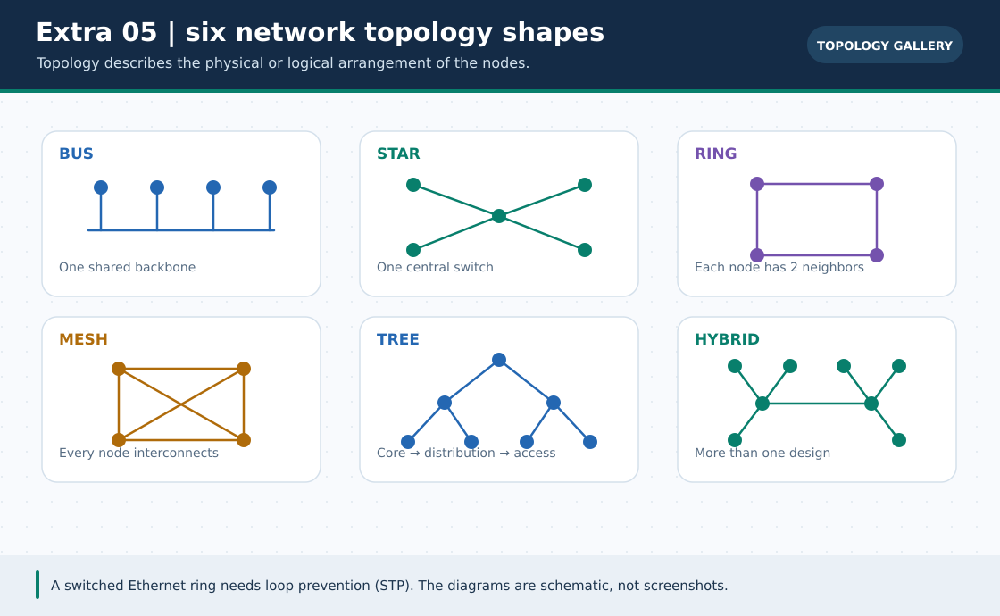
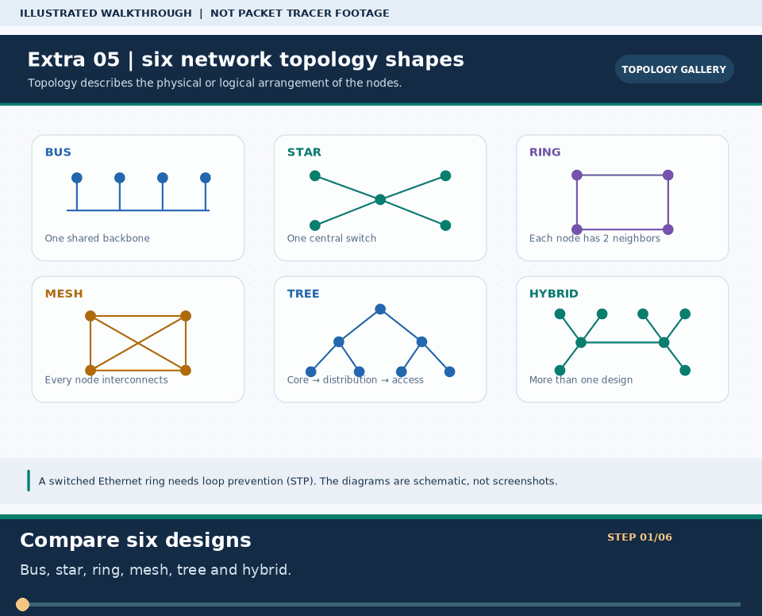

# 🕸️ Extra Lab ০৫ · 6 Network Topologies Visual & Simulation Guide

> 🌐 **English:** [Read this guide in English](../en/Extras/network-topologies-lab.md) · [English track index](../en/README.md)

> **নেভিগেশন:** [⬅ IP Subnet Tester](ip-subnet-tester-lab.md) · [📦 Extra Labs সূচি](README.md) · [🏠 হোম](../README.md) · [পরের ল্যাব: Broken Network Detective ➡](broken-labs-challenge.md)

| 🎯 লক্ষ্য | ⏱️ সময় | 📊 লেভেল | 🧰 ল্যাব ফাইলসমূহ (৬টি) |
| :--- | :--- | :--- | :--- |
| ৬ ধরনের ক্লাসিক নেটওয়ার্ক টপোলজি Packet Tracer Simulation Mode-এ চালিয়ে সুবিধা, অসুবিধা ও কেবলের সূত্র বোঝা | ~৩০ মিনিট | 🟢 সবার জন্য | [`pkt-files/topologies/`](../pkt-files/topologies/README.md) (নিচে প্রতিটি ফাইলের লিংক আছে) |

**Tags:** `#topology` `#bus` `#star` `#ring` `#mesh` `#tree` `#hybrid` `#simulation-mode`

---

### 🖼️ চিত্রে বোঝো: ৬ রকম নেটওয়ার্ক টপোলজির ছবি



> **ছবির সারকথা:** Bus, Star, Ring, Mesh, Tree ও Hybrid-এর কেবল সংযোগ এক নজরে তুলনা করো।



> 🎞️ **৩০ সেকেন্ডে মনে রাখো:** এটি উপরের ডায়াগ্রামের ওপর ভিত্তি করে বানানো ছয় ধাপের ভিজ্যুয়াল সারাংশ; বাস্তব Packet Tracer run, packet capture বা ফলের প্রমাণ নয়। [সব GIF-এর topic search name ও গুরুত্ব](../GIF-CATALOG.md) দেখো।


---

## 🎯 এই গাইডে যা শিখবে

বইয়ে টপোলজির ছবি দেখার চেয়ে Packet Tracer-এর **Simulation Mode**-এ প্যাকেট কীভাবে ছড়ায় তা নিজের চোখে দেখলে সারাজীবন মনে থাকে! এই গাইডে `pkt-files/topologies/` ফোল্ডারের **৬টি রেডিমেড `.pkt` ফাইল** এক জায়গায় তুলনা ও পরীক্ষা করার নিয়ম দেওয়া হলো।

---

## 📂 ৬টি টপোলজি ও সরাসরি `.pkt` ফাইল

### ১. 🚌 Bus Topology — [`bus-topology.pkt`](../pkt-files/topologies/bus-topology.pkt)
একটি মূল ব্যাকবোন তারের (Backbone Cable / Hub Chain) সাথে সব ডিভাইস যুক্ত থাকে।
```text
  [PC0]       [PC1]       [PC2]       [PC3]
    │           │           │           │
════╧═══════════╧═══════════╧═══════════╧════  ← মূল Backbone লাইন
```
* **সুবিধা:** তার কম লাগে, ছোট অস্থায়ী নেটওয়ার্কে সস্তা।
* **অসুবিধা:** মূল তার মাঝখানে ছিঁড়ে গেলে **পুরো নেটওয়ার্ক বন্ধ**; Collision বেশি হয়; আজকাল অপ্রচলিত।

---

### ২. ⭐ Star Topology — [`star-topology.pkt`](../pkt-files/topologies/star-topology.pkt)
সব ডিভাইস মাঝখানের একটি কেন্দ্রীয় **Switch** (বা Hub)-এর সাথে আলাদা কেবলে যুক্ত থাকে।
```text
        [PC0]       [PC1]
           \         /
          [ Switch0 ]   ← কেন্দ্রীয় ডিভাইস
           /         \
        [PC2]       [PC3]
```
* **সুবিধা:** একটি পিসির কেবল ছিঁড়লেও বাকি পুরো নেটওয়ার্ক সচল থাকে! সমস্যা খুঁজে বের করা সবচেয়ে সহজ। **আধুনিক প্রায় সব অফিস ও ল্যাব Star Topology ব্যবহার করে।**
* **অসুবিধা:** মাঝখানের মূল Switch নষ্ট হলে সবাই বিচ্ছিন্ন হয়ে যায় (Single Point of Failure)।
* **কেবল সংখ্যা:** $N$ সংখ্যক ডিভাইসের জন্য ঠিক **$N$ টি কেবল**।

---

### ৩. 💍 Ring Topology — [`ring-topology.pkt`](../pkt-files/topologies/ring-topology.pkt)
প্রতিটি নোড তার বাম ও ডান পাশের ঠিক দুটি নোডের সাথে যুক্ত হয়ে বৃত্ত (Ring) তৈরি করে।
```text
      [SW0] ───── [SW1]
       │             │
      [SW3] ───── [SW2]
```
* **সুবিধা:** ডেটা নির্দিষ্ট দিকে ঘোরে।
* **অসুবিধা:** সাধারণ একক রিংয়ে একটি লিংক বা নোড নষ্ট হলে বৃত্ত ভেঙে যায় *(আধুনিক সুইচে রিং করলে লুপ ঠেকাতে **STP** স্বয়ংক্রিয়ভাবে একটি পোর্ট কমলা/Blocking করে রাখে — ফাইলটি খুললেই দেখতে পাবে!)*।

---

### ৪. 🕸️ Mesh Topology — [`mesh-topology.pkt`](../pkt-files/topologies/mesh-topology.pkt)
প্রতিটি ডিভাইস বাকি সব ডিভাইসের সাথে সরাসরি আলাদা লিংকে যুক্ত থাকে (Full Mesh)।
```text
      [SW0] ═══════ [SW1]
       │  \       /  │
       │    \   /    │
       │    /   \    │
       │  /       \  │
      [SW3] ═══════ [SW2]
```
* **সুবিধা:** সর্বোচ্চ নির্ভরযোগ্যতা (Redundancy) — একটি বা দুটি লিংক ছিঁড়লেও বিকল্প পথে ডেটা চলে যায়! কোর রাউটার/ISP ব্যাকবোনে ব্যবহৃত হয়।
* **অসুবিধা:** প্রচুর কেবল ও পোর্ট লাগে, অত্যন্ত ব্যয়বহুল।
* **🧮 পরীক্ষার বিখ্যাত সূত্র (Full Mesh কেবল সংখ্যা):**
  $$\text{Total Cables} = \frac{N \times (N - 1)}{2}$$
  *(উদাহরণ: ৪টি নোড হলে $\frac{4 \times 3}{2} = 6$ টি কেবল; ৫টি নোড হলে $\frac{5 \times 4}{2} = 10$ টি কেবল; ১০টি নোড হলে **৪৫টি** কেবল!)*

---

### ৫. 🌳 Tree (Hierarchical) Topology — [`tree-topology.pkt`](../pkt-files/topologies/tree-topology.pkt)
একটি মূল (Core/Root) সুইচ থেকে শাখা-প্রশাখার মতো একাধিক Star নেটওয়ার্ক নিচে নেমে আসে।
```text
                 [ Core Switch ]
                  /           \
          [ Dept SW1 ]     [ Dept SW2 ]
            /      \         /      \
         [PC0]    [PC1]   [PC2]    [PC3]
```
* **সুবিধা:** বিশ্ববিদ্যালয় ক্যাম্পাস বা বহুতল অফিসের জন্য আদর্শ (Core → Distribution → Access লেয়ার)। সহজে নতুন ফ্লোর বা বিভাগ যোগ করা যায় (Scalable)।
* **অসুবিধা:** উপরের Root/Core সুইচ বন্ধ হলে দুই শাখার যোগাযোগ থেমে যায়।

---

### ৬. 🧬 Hybrid Topology — [`hybrid-topology.pkt`](../pkt-files/topologies/hybrid-topology.pkt)
দুই বা ততোধিক ভিন্ন টপোলজি (যেমন Star + Ring বা Star + Mesh) একসাথে মিলিয়ে তৈরি বড় নেটওয়ার্ক।
* **সুবিধা:** প্রতিষ্ঠানের প্রয়োজন অনুযায়ী কোর অংশে Mesh (নিরাপত্তা/Redundancy) এবং ইউজার অংশে Star (সহজ ব্যবস্থাপনা) ব্যবহার করা যায়। বাস্তব বড় এন্টারপ্রাইজ নেটওয়ার্ক সবই মূলত Hybrid!

---

## 📊 এক নজরে ৬ টপোলজির তুলনা (Viva Cheat Table)

| টপোলজি | কেবল খরচ | নির্ভরযোগ্যতা (Fault Tolerance) | একটি তার ছিঁড়লে কী হয়? | বাস্তবে কোথায় ব্যবহৃত হয়? |
| :--- | :---: | :---: | :--- | :--- |
| **Bus** | 🟢 খুব কম | 🔴 খুব খারাপ | মূল তার ছিঁড়লে পুরো নেটওয়ার্ক বন্ধ | পুরনো Coaxial LAN (এখন বিলুপ্ত) |
| **Star** | 🟡 মাঝারি ($N$) | 🟢 ভালো | শুধু ওই ১টি PC বিচ্ছিন্ন হয় | অফিস, বাসা, ভার্সিটি ল্যাব |
| **Ring** | 🟡 মাঝারি ($N$) | 🟡 মাঝারি (Dual/STP হলে ভালো) | একক রিং হলে ভেঙে যায়; STP থাকলে ব্যাকআপ চালু হয় | Metro Fiber Ring (SONET/SDH) |
| **Mesh** | 🔴 সর্বোচ্চ ($\frac{N(N-1)}{2}$) | 🟢 সর্বোচ্চ | কোনো সমস্যাই হয় না (বিকল্প পথ থাকে) | ISP Core, সামরিক নেটওয়ার্ক, WAN |
| **Tree** | 🟡 মাঝারি | 🟢 ভালো | নিচের তার ছিঁড়লে স্থানীয় প্রভাব | বহুতল ভবন, ক্যাম্পাস নেটওয়ার্ক |
| **Hybrid** | 🟠 বেশি | 🟢 খুব ভালো | অংশভেদে নির্ধারিত | ব্যাংক, ডেটা সেন্টার, বড় কোম্পানি |

---

## 🧪 Packet Tracer-এ কীভাবে পরীক্ষা করবে? (৩ মিনিটের ল্যাব)

1. `pkt-files/topologies/` থেকে যেকোনো একটি `.pkt` ফাইল (যেমন `star-topology.pkt` বা `mesh-topology.pkt`) Packet Tracer-এ খোলো।
2. ডান নিচের কোণায় **`Realtime`**-এর পাশের **`Simulation`** ট্যাবে ক্লিক করো।
3. উপরের টুলবার থেকে **✉️ Add Simple PDU (`P`)** নিয়ে একটি PC-তে ক্লিক করো এবং দূরের অন্য একটি PC-তে ক্লিক করো।
4. **`Capture / Forward`** বাটনে এক বার করে ক্লিক করো — দেখো খামটি (Packet) কোন পথে যাচ্ছে!
5. **মজার পরীক্ষা (`mesh-topology.pkt`-এ):** টুলবারের **`Delete (X)`** টুল দিয়ে মাঝখানের একটি কেবল কেটে দাও → ৩০ সেকেন্ড ফাস্ট-ফরওয়ার্ড (`Alt + D` বা Realtime-এ `Fast Forward Time`) চাপো → আবার Ping দাও! দেখবে অন্য লিংক ঘুরে প্যাকেট ঠিকই পৌঁছে যাচ্ছে! 🔥

---

## ✅ Final Checklist

| কাজ | অবস্থা |
| :--- | :---: |
| ৬টি `.pkt` ফাইল খুলে টপোলজির গঠন চোখে দেখা | ☐ |
| Simulation Mode-এ প্যাকেট ফ্লো (`Capture / Forward`) পরীক্ষা করা | ☐ |
| Full Mesh-এর সূত্র $\frac{N(N-1)}{2}$ দিয়ে ৬ ও ৮ নোডের কেবল সংখ্যা বের করা *(উত্তর: ১৫ ও ২৮)* | ☐ |
| Ring ও Mesh টপোলজিতে কমলা বাতি (STP Blocking পোর্ট) লক্ষ্য করা | ☐ |

---

> **নেভিগেশন:** [⬅ IP Subnet Tester](ip-subnet-tester-lab.md) · [📦 Extra Labs সূচি](README.md) · [🏠 হোম](../README.md) · [পরের ল্যাব: Broken Network Detective ➡](broken-labs-challenge.md)

**Tags:** `#network-topologies` `#star` `#mesh` `#bus` `#ring` `#tree` `#hybrid` `#viva-prep`
