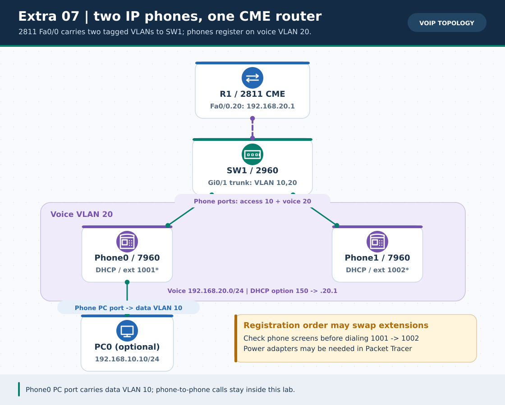
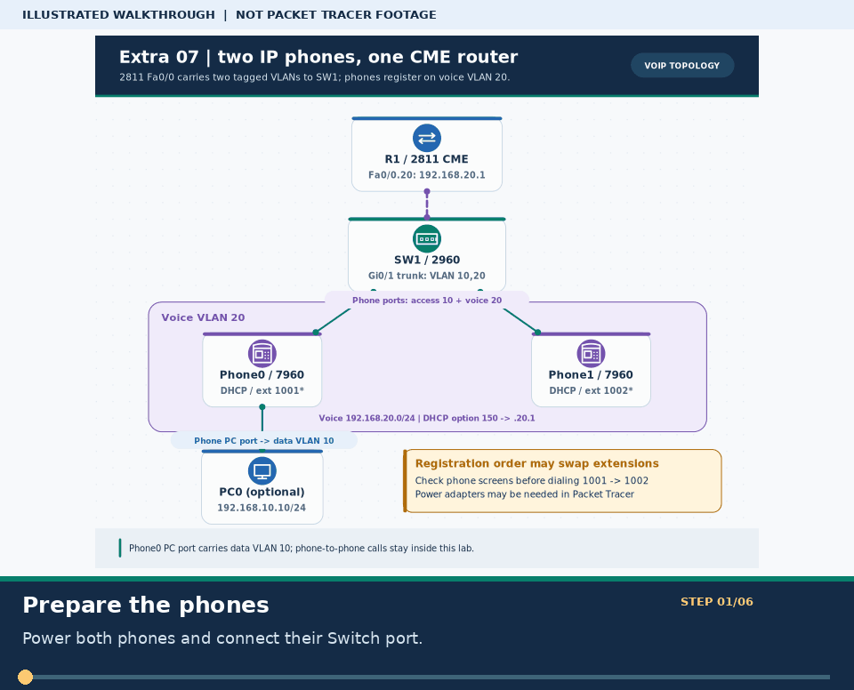
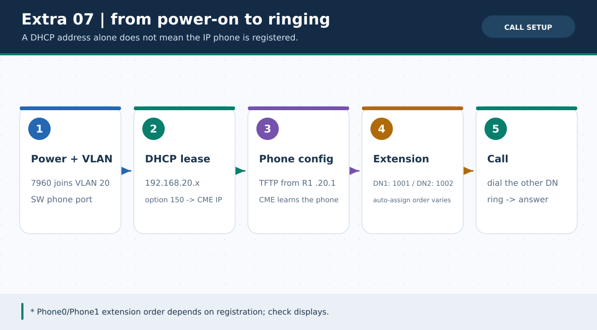

# Extra Lab ০৭ · VoIP IP Telephony: দুটি 7960 ফোনে কল

> 🌐 **English:** [Read this guide in English](../en/Extras/voip-ip-telephony-lab.md) · [English track index](../en/README.md)

> **নেভিগেশন:** [📦 Extra Labs সূচি](README.md) · [⬅ Extra ০৬](broken-labs-challenge.md) · [➡ Extra ০৮](dhcp-snooping-dai-lab.md) · [🏠 হোম](../README.md) · [📚 লেসন ০৬ · Trunk](../lessons/06-trunk-inter-vlan.md)

| 🎯 লক্ষ্য | ⏱️ সময় | 📊 লেভেল | 🧰 প্রয়োজন |
| :--- | :--- | :--- | :--- |
| 2811 CME-তে `1001` ও `1002` extension register করে এক ফোন থেকে অন্য ফোনে কল | ৫০–৬০ মিনিট | 🟠–🔴 Intermediate/Advanced | Packet Tracer-এ **নিজে বানাবে**; এই ল্যাবের `.pkt` এখনো নেই |

**Tags:** `#voip` `#cme` `#7960` `#option-150` `#voice-vlan` `#telephony-service` `#ip-phone`

---

### 🖼️ ছবি ১: voice VLAN 20 এবং data VLAN 10 একই switch-এ



> **ছবির সারকথা:** 2811-এর `Fa0/0.20` (`192.168.20.1`) হলো **voice gateway + DHCP/TFTP/CME**, আর `Fa0/0.10` (`192.168.10.1`) হলো PC0-এর data gateway। SW1→R1 link 802.1Q trunk; switch→phone port-এ `switchport access vlan 10` এবং `switchport voice vlan 20`—দুটি VLAN-এর ভূমিকা আলাদা। ছবিটি Packet Tracer screenshot নয়।



> 🎞️ **৩০ সেকেন্ডে মনে রাখো:** এটি উপরের ডায়াগ্রামের ওপর ভিত্তি করে বানানো ছয় ধাপের ভিজ্যুয়াল সারাংশ; বাস্তব Packet Tracer run, packet capture বা ফলের প্রমাণ নয়। [সব GIF-এর topic search name ও গুরুত্ব](../GIF-CATALOG.md) দেখো।


### 🖼️ ছবি ২: DHCP থেকে প্রথম কল পর্যন্ত পাঁচ ধাপ



> **ছবির সারকথা:** ফোনে IP পাওয়া এবং কল চালু হওয়া **একই জিনিস নয়**: DHCP option 150 ফোনকে TFTP/CME-এর ঠিকানা জানায়; তারপর configuration ও extension registration সম্পন্ন হলে `1001 → 1002` ডায়াল হবে। Packet Tracer-এর সংস্করণ/মডেলভেদে GUI ও registration status ভিন্ন হতে পারে।

---

## 🏷️ শব্দকোষ

| শব্দ | অর্থ |
| :--- | :--- |
| **CME** | Cisco Unified Communications Manager Express; এই lab-এ 2811 router-এ ছোট phone system। |
| **Voice VLAN** | ফোনের voice traffic-এর আলাদা VLAN; এখানে **20**। PC traffic access VLAN **10**। |
| **Option 150** | DHCP pool থেকে ফোনের TFTP server address (`192.168.20.1`) সরবরাহ করে। |
| **`ephone-dn`** | ফোনের dialable directory number; এখানে `1001` এবং `1002`। |
| **`ip source-address ... port 2000`** | এই lab-এ CME call-control registration-এর উৎস ঠিকানা ও port। |

## 🧩 টপোলজি, তার ও IP পরিকল্পনা

**1 × Router 2811** (`R1`), **1 × Switch 2960** (`SW1`), **2 × Cisco IP Phone 7960** (`Phone0`, `Phone1`), ঐচ্ছিক **1 × PC** (`PC0`)।

| সংযোগ | পোর্ট | কাজ |
| :--- | :--- | :--- |
| R1 ↔ SW1 | R1 `Fa0/0` ↔ SW1 `Gi0/1` | Voice 20 + Data 10 **trunk** |
| SW1 ↔ Phone0 | SW1 `Fa0/1` ↔ Phone0 **Switch** port | Voice VLAN20; phone-এ পাওয়ার দাও |
| SW1 ↔ Phone1 | SW1 `Fa0/2` ↔ Phone1 **Switch** port | Voice VLAN20; phone-এ পাওয়ার দাও |
| Phone0 ↔ PC0 (ঐচ্ছিক) | Phone0 **PC** port ↔ PC0 `Fa0` | Data VLAN10 |

| ডিভাইস | ঠিকানা | Gateway / নোট |
| :--- | :--- | :--- |
| R1 `Fa0/0.10` | `192.168.10.1/24` | Data VLAN 10 |
| R1 `Fa0/0.20` | `192.168.20.1/24` | Voice VLAN 20; option 150-ও `.20.1` |
| Phone0/Phone1 | Voice DHCP → `192.168.20.21+` | Gateway `.20.1`; extension `1001`/`1002` (assignment order দেখো) |
| PC0 (ঐচ্ছিক) | Static `192.168.10.10/24` | Gateway `.10.1` |

> Packet Tracer-এর `7960` ফোনে PoE না পেলে **Physical tab-এ পাওয়ার অ্যাডাপ্টার বসিয়ে** ফোন চালাও; power off থাকলে DHCP/রিং কোনোটিই কাজ করবে না। কোন ফোন আগে register করবে তার উপর auto-assign order বদলাতে পারে—ডিসপ্লেতে extension দেখে নাও, `Phone0=1001` অন্ধভাবে ধরে নিও না।

## 🔧 Step 1 · SW1: VLAN, trunk ও phone access/voice ports

**SW1-তে:**

```cisco
enable
configure terminal
hostname SW1
vlan 10
 name DATA
exit
vlan 20
 name VOICE
exit
interface gigabitEthernet 0/1
 switchport mode trunk
 no shutdown
exit
interface fastEthernet 0/1
 switchport mode access
 switchport access vlan 10
 switchport voice vlan 20
 spanning-tree portfast
 no shutdown
exit
interface fastEthernet 0/2
 switchport mode access
 switchport access vlan 10
 switchport voice vlan 20
 spanning-tree portfast
 no shutdown
exit
end
copy running-config startup-config
```

> `Fa0/1–2` **trunk বানাবে না**। ফোন voice traffic-এ VLAN20 tag ব্যবহার করতে পারে; phone-এর PC port থেকে আসা data untagged VLAN10-এ যায়। `show interfaces trunk`-এ কেবল `Gi0/1` প্রত্যাশিত।

## 🔧 Step 2 · R1: 802.1Q, DHCP Option 150 এবং CME

**R1-তে:**

```cisco
enable
configure terminal
hostname R1
interface fastEthernet 0/0
 no ip address
 no shutdown
exit
interface fastEthernet 0/0.10
 encapsulation dot1Q 10
 ip address 192.168.10.1 255.255.255.0
exit
interface fastEthernet 0/0.20
 encapsulation dot1Q 20
 ip address 192.168.20.1 255.255.255.0
exit
ip dhcp excluded-address 192.168.20.1 192.168.20.20
ip dhcp pool VOICE
 network 192.168.20.0 255.255.255.0
 default-router 192.168.20.1
 option 150 ip 192.168.20.1
exit
telephony-service
 max-ephones 2
 max-dn 2
 ip source-address 192.168.20.1 port 2000
 auto assign 1 to 2
exit
ephone-dn 1
 number 1001
exit
ephone-dn 2
 number 1002
exit
end
copy running-config startup-config
```

`create cnf-files` command যদি তোমার model-এর `telephony-service`-এ পাও, configuration file তৈরির জন্য সেখানে **ঐচ্ছিকভাবে** চালাতে পারো; `% Invalid input` এলে বাদ দিয়ে ফোনের registration দেখো। Packet Tracer/CME emulator-এ ঐচ্ছিক command সমর্থন একরকম নয়। PC0-র জন্য DHCP pool **দেওয়া হয়নি**—PC0-তে স্থির data IP বসাবে।

> 🛠️ ডিভাইসভিত্তিক আউটপুট: `python3 scripts/ios_config_generator.py voip-cme --role SW1` এবং `python3 scripts/ios_config_generator.py voip-cme --role R1`।

## 📞 Step 3 · ফোনে পাওয়ার, IP, extension এবং কল পরীক্ষা

1. দুই ফোনে **power on** করো; ফোনের *Switch* port-এর কেবল `Fa0/1–2`-এ আছে, *PC* port-এ নয়। DHCP হওয়ার জন্য কিছুক্ষণ অপেক্ষা করো।
2. R1-এ `show ip dhcp binding`; দুটি `192.168.20.21` **বা তার পরের** voice address পাওয়ার কথা। SW1-এ `show interfaces trunk` ও `show vlan brief`। Voice VLAN জানতে `show running-config interface fastEthernet 0/1` সমর্থিত হলে ব্যবহার করো; না হলে `show running-config`-এ `switchport voice vlan 20` খুঁজো।
3. ফোনের GUI/স্ক্রিনে `1001` ও `1002` extension **আসলেই register হয়েছে** কি না দেখো। R1-তে `show ephone` বা `show telephony-service ephone` সমর্থিত হলে ব্যবহার করো; unavailable হলে **ফোনের ডিসপ্লে + call test**-ই মূল যাচাই।
4. যে ফোনে `1001` দেখায় তার keypad-এ **1002** ডায়াল করো; অন্যটিতে ring আসার কথা। উত্তর দিয়ে voice call connected state দেখো; তারপর উল্টো দিক থেকেও চেষ্টা করো। Packet Tracer থেকে বাস্তব অডিও কল/ইন্টারনেট PSTN কল আশা করো না।
5. ঐচ্ছিক PC0-তে `192.168.10.10/24`, gateway `192.168.10.1` বসিয়ে `ping 192.168.10.1` দাও—**data VLAN**-ও কাজ করে কি না আলাদা প্রমাণ হবে।

### 🧯 সমস্যা হলে ধাপে ধাপে

| উপসর্গ | কোথায় সমস্যা → কী করবে |
| :--- | :--- |
| Phone-এ screen/power নেই | `7960`-এর Physical tab-এ পাওয়ার অ্যাডাপ্টার, `Switch` port-এর Ethernet cable, link light দেখো। |
| Phone DHCP IP পায় না | `SW1 Fa0/1–2` voice VLAN20, `Gi0/1` trunk, R1 `Fa0/0.20`, `show ip dhcp binding`, DHCP pool এবং option 150 পরীক্ষা। |
| Voice IP আছে, extension নেই | `option 150 ip 192.168.20.1`, `ip source-address`, `max-ephones`, `max-dn`, `ephone-dn` ও registration সময় পরীক্ষা। Emulator-ভেদে command unsupported হতে পারে। |
| `1001` ডায়াল করে নিজের ফোনই বাজে | **স্ক্রিনে** কোন ফোনে কোন extension এসেছে দেখো; `auto assign` registration order-নির্ভর। |
| PC0 data ping ফেল করে, ফোন register আছে | VLAN10 data access, router `Fa0/0.10` dot1Q10, PC0 static IP/gateway পরীক্ষা; VoIP সফল মানেই data ঠিক নয়। |

> ⚠️ **ভার্সন সীমা:** এই উদাহরণটি Packet Tracer-এর classic 2811 + 7960 CME path-এর জন্য। PT-এর সব edition/IOS image-এ `telephony-service`, `ephone-dn`, `create cnf-files` বা diagnostic `show` সমানভাবে সমর্থিত নয়। CLI-তে `?` দিয়ে যাচাই করে অসমর্থিত অংশের ফল মিথ্যা দাবি কোরো না। নিজস্ব `.pkt` বানালে save করে রাখবে; এই রেপোতে এই lab-এর native `.pkt` সংযুক্ত নয়।

## ☑️ চেকলিস্ট

- [ ] দুই ফোন power on এবং voice DHCP IP পেয়েছে।
- [ ] ডিসপ্লেতে `1001` ও `1002` পৃথকভাবে register হয়েছে।
- [ ] `1001 → 1002` এবং উল্টো দিকের call-এ ring/connected দেখা গেছে।
- [ ] ঐচ্ছিক PC0 data VLAN10 দিয়ে তার gateway ping করেছে।

**আরও পড়ো:** [লেসন ০৬ · 802.1Q Trunk/ROAS](../lessons/06-trunk-inter-vlan.md) · [Cisco · CME telephony-service reference](https://www.cisco.com/c/en/us/td/docs/voice_ip_comm/cucme/command/reference/cme_cr/cme_t1ht.pdf) · [Packet Tracer 2811 CME walkthrough](https://netest.in/blogsPub/PacketTracer811VoIPBasicConfigurationTutorial.html) · [Extra Lab ০৮ · L2 Security](dhcp-snooping-dai-lab.md)
