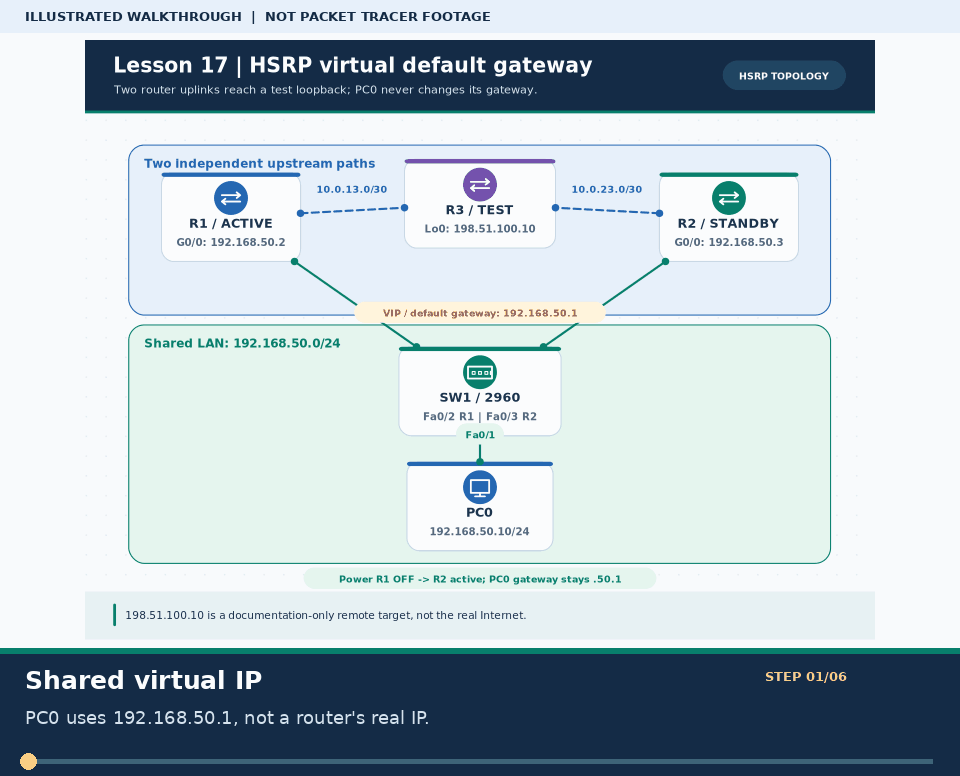

# 🎞️ GIF Catalog · 26 Labs / 30 Seconds Each

> **নেভিগেশন:** [🏠 রেপো হোম](README.md) · [🌐 English track](en/README.md) · [📚 মূল লেসন](lessons/README.md) · [📦 Extra Labs](Extras/README.md)

> **সতর্কতা:** এখানে থাকা ২৬টি GIF-ই নিজস্ব SVG থেকে তৈরি **শিক্ষামূলক অ্যানিমেটেড ইনফোগ্রাফিক**, Packet Tracer-এর screen recording বা বাস্তবে traffic/feature test নয়। প্রতিটি GIF-এর একটি সম্পূর্ণ loop **৩০ সেকেন্ড** (১২ frame × ২.৫ s); শেষে আবার শুরু হয়। ফোন registration, DAI enforcement বা failover-এর সফলতা কেবল GIF দেখে প্রমাণিত হয় না।

## 📌 কোন GIF আগে দেখব? কী নামে খুঁজব?

**গুরুত্ব P1:** মৌলিক নেটওয়ার্ক কনসেপ্ট, routing বা high-impact troubleshooting; **P2:** পরিপূরক অনুশীলন/সার্ভিস। লেসন ০৬-এর GIF-এর প্রথম দুই ধাপে **SW1–SW2 ট্রাঙ্ক**, পরের চার ধাপে **আলাদা SW1–R1 router-on-a-stick ল্যাব** দেখানো হয়েছে—একই SW1 Gi0/1 পোর্টে SW2 ও R1 একসঙ্গে যুক্ত নয়। নিচের **GIF search name**-গুলো আপনি নিজে কোনো বিকল্প GIF বা PT recording খুঁজতে ব্যবহার করতে পারেন। **সব ২৬টি GIF ইতিমধ্যেই আছে**; কোনো missing GIF ঢাকতে এই তালিকা বানানো হয়নি। বাইরের ফাইল আপলোড করলে লাইসেন্স ও attribution যাচাই করুন এবং আসল PT capture না হলে capture হিসেবে লেবেল দেবেন না।

| গুরুত্ব | টপিক ও গাইড | নিজের GIF | বিকল্প GIF খোঁজার নাম (`GIF search name`) |
| :---: | :--- | :--- | :--- |
| **P1** | [Router CLI and your first ping](lessons/01-router-cli-basics.md) | [▶ ৩০ সেকেন্ড](assets/gifs/01-router-cli-basics.gif) | `packet tracer router CLI modes first LAN ping gif` |
| **P1** | [Two routers and static routes](lessons/02-static-routing.md) | [▶ ৩০ সেকেন্ড](assets/gifs/02-static-routing.gif) | `packet tracer two routers static route return path ping gif` |
| **P1** | [Router DHCP and DORA](lessons/03-dhcp.md) | [▶ ৩০ সেকেন্ড](assets/gifs/03-dhcp.gif) | `packet tracer DHCP DORA discover offer request acknowledge gif` |
| **P1** | [DNS name to HTTP page](lessons/04-dns-http-server.md) | [▶ ৩০ সেকেন্ড](assets/gifs/04-dns-http-server.gif) | `packet tracer DNS A record HTTP web server name resolution gif` |
| **P1** | [VLAN isolation](lessons/05-vlan.md) | [▶ ৩০ সেকেন্ড](assets/gifs/05-vlan.gif) | `packet tracer switch VLAN 10 VLAN 20 access ports isolation gif` |
| **P1** | [802.1Q trunk and ROAS](lessons/06-trunk-inter-vlan.md) | [▶ ৩০ সেকেন্ড](assets/gifs/06-trunk-inter-vlan.gif) | `packet tracer VLAN trunk 802.1Q router on a stick ping gif` |
| **P1** | [STP, port security and EtherChannel](lessons/07-switching.md) | [▶ ৩০ সেকেন্ড](assets/gifs/07-switching.gif) | `packet tracer spanning tree blocked port security etherchannel gif` |
| **P1** | [Office network capstone](lessons/08-final-project.md) | [▶ ৩০ সেকেন্ড](assets/gifs/08-final-project.gif) | `packet tracer office VLAN trunk DHCP DNS HTTP router on a stick gif` |
| **P2** | [Physical network hardware](lessons/09-real-hardware.md) | [▶ ৩০ সেকেন্ড](assets/gifs/09-real-hardware.gif) | `router switch SFP patch panel fiber rack packet tracer equivalent gif` |
| **P2** | [Ten independent practice tasks](lessons/10-practice-lab.md) | [▶ ৩০ সেকেন্ড](assets/gifs/10-practice-lab.gif) | `packet tracer networking practice ten tasks verify before solution gif` |
| **P2** | [Practice ladder and checklist](lessons/11-practice-list.md) | [▶ ৩০ সেকেন্ড](assets/gifs/11-practice-list.gif) | `CCNA packet tracer practice list beginner intermediate advanced gif` |
| **P1** | [Network detective: nine cases](lessons/12-problem-solve.md) | [▶ ৩০ সেকেন্ড](assets/gifs/12-problem-solve.gif) | `packet tracer nine troubleshooting problems ping show commands gif` |
| **P1** | [RIPv2 and OSPFv2 failover](lessons/13-dynamic-routing-ospf.md) | [▶ ৩০ সেকেন্ড](assets/gifs/13-dynamic-routing-ospf.gif) | `packet tracer OSPFv2 RIP routing triangle failover neighbor gif` |
| **P1** | [Home Wi-Fi and enterprise WLC](lessons/14-wireless-lan.md) | [▶ ৩০ সেকেন্ড](assets/gifs/14-wireless-lan.gif) | `packet tracer WRT300N WPA2 WLC LAP CAPWAP wireless gif` |
| **P1** | [SSH, NTP and Syslog](lessons/15-ssh-syslog-ntp.md) | [▶ ৩০ সেকেন্ড](assets/gifs/15-ssh-syslog-ntp.gif) | `packet tracer ssh v2 ntp syslog device hardening gif` |
| **P1** | [3560 SVI inter-VLAN routing](lessons/16-multilayer-switch-svi.md) | [▶ ৩০ সেকেন্ড](assets/gifs/16-multilayer-switch-svi.gif) | `packet tracer 3560 multilayer switch SVI ip routing VLAN gif` |
| **P1** | [HSRP gateway failover](lessons/17-hsrp-gateway-redundancy.md) | [▶ ৩০ সেকেন্ড](assets/gifs/17-hsrp-gateway-redundancy.gif) | `packet tracer HSRP virtual gateway active standby power off return gif` |
| **P1** | [IPv6 SLAAC and OSPFv3](lessons/18-ipv6-slaac-routing.md) | [▶ ৩০ সেকেন্ড](assets/gifs/18-ipv6-slaac-routing.gif) | `packet tracer IPv6 router advertisement SLAAC static OSPFv3 gif` |
| **P2** | [FTP upload and download](Extras/ftp-server-lab.md) | [▶ ৩০ সেকেন্ড](assets/gifs/extra-01-ftp-server-lab.gif) | `packet tracer FTP server put get user permissions remote subnet gif` |
| **P2** | [SMTP send and POP3 receive](Extras/email-server-lab.md) | [▶ ৩০ সেকেন্ড](assets/gifs/extra-02-email-server-lab.gif) | `packet tracer email server SMTP POP3 two subnet send receive gif` |
| **P2** | [Office shared printer](Extras/office-shared-printer-lab.md) | [▶ ৩০ সেকেন্ড](assets/gifs/extra-03-office-shared-printer-lab.gif) | `packet tracer office printer static IP DHCP excluded address print test gif` |
| **P1** | [Subnet boundary tester](Extras/ip-subnet-tester-lab.md) | [▶ ৩০ সেকেন্ড](assets/gifs/extra-04-ip-subnet-tester-lab.gif) | `packet tracer subnet tester /24 /26 ping different subnets gif` |
| **P2** | [Six network topologies](Extras/network-topologies-lab.md) | [▶ ৩০ সেকেন্ড](assets/gifs/extra-05-network-topologies-lab.gif) | `packet tracer bus star ring mesh tree hybrid six topologies gif` |
| **P1** | [Six broken network challenges](Extras/broken-labs-challenge.md) | [▶ ৩০ সেকেন্ড](assets/gifs/extra-06-broken-labs-challenge.gif) | `packet tracer broken network detective six IOS fault scripts gif` |
| **P2** | [CME voice and data VLANs](Extras/voip-ip-telephony-lab.md) | [▶ ৩০ সেকেন্ড](assets/gifs/extra-07-voip-ip-telephony-lab.gif) | `packet tracer Cisco 2811 7960 CME option 150 voice VLAN call gif` |
| **P1** | [DHCP Snooping and DAI policy](Extras/dhcp-snooping-dai-lab.md) | [▶ ৩০ সেকেন্ড](assets/gifs/extra-08-dhcp-snooping-dai-lab.gif) | `packet tracer DHCP snooping DAI rogue DHCP ARP inspection binding gif` |

## 🛠️ GIF বদলানো বা পুনর্নির্মাণ

1. উল্লিখিত নাম দিয়ে খুঁজে পছন্দের নিজস্ব/অনুমতিপ্রাপ্ত ফাইল সংগ্রহ করুন; সম্ভব হলে নিজের Packet Tracer project-এর আসল capture নিন।
2. যেকোনো নিজের GIF আপলোড/যোগ করার পর guide-এর ছবি link, alt text, উৎস/লাইসেন্স ও দাবির ভাষা আপডেট করুন। **নিজে না চালিয়ে screenshot বা verified result দাবি করবেন না।**
3. এই রিপোর একই ধরনের original GIF আবার বানাতে [`scripts/gif_walkthrough_generator.py`](scripts/gif_walkthrough_generator.py) চালান (ঐচ্ছিক [Python dependencies](requirements-docs.txt) লাগবে); তারপর `--check` ও `repo_doctor.py --strict` চালান। Generated file hash, source SVG hash, frame count ও ৩০ সেকেন্ড duration [`manifest.json`](assets/gifs/manifest.json)-এ নথিভুক্ত।
4. এই GIF-গুলো description/animation only—শিক্ষার্থীর বাস্তব PT verification সবসময় সংশ্লিষ্ট guide-এর `show`/`ping`/GUI steps দিয়ে হবে।

> **নেভিগেশন:** [🏠 হোম](README.md) · [English index](en/README.md) · [লেসন ১৬ · SVI](lessons/16-multilayer-switch-svi.md) · [Extra ০৮ · DAI সীমা](Extras/dhcp-snooping-dai-lab.md)
