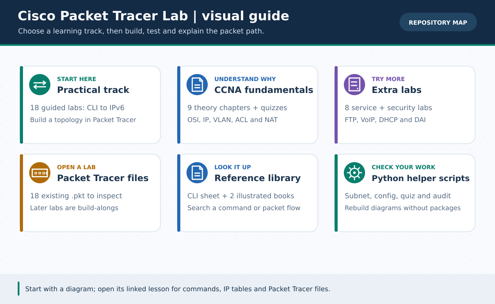
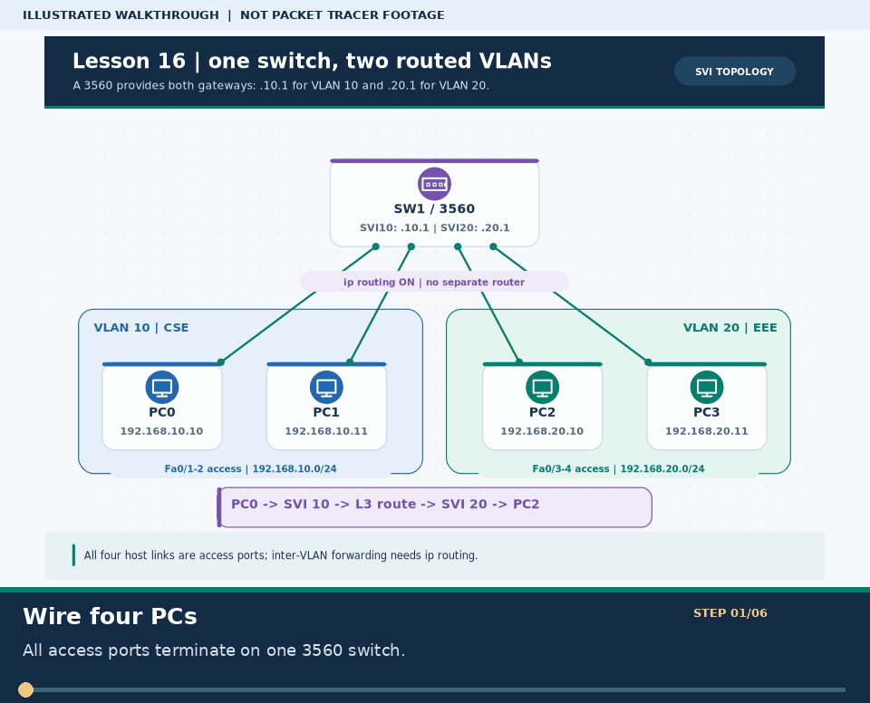

<div align="center">

# 🌐 Cisco Packet Tracer Lab `v4.0`

### 🇧🇩 বাংলা + 🌐 English · ছবিসহ নেটওয়ার্কিং ও CCNA ল্যাব ইকোসিস্টেম

*হাতে-কলমে Packet Tracer-এ নেটওয়ার্ক তৈরি করে শেখো — প্রথম CLI থেকে OSPF, HSRP, IPv6, VoIP, Layer-2 security ও নিজের দুই-branch enterprise capstone পর্যন্ত!*


-3776AB?style=for-the-badge&logo=python&logoColor=white)


[**🏆 Phase 5 v4.0 · Two-Branch Capstone**](capstone/README.md) · [**🌐 English: 35 guides + capstone**](en/README.md) · [**🎞️ ২৬টি GIF + search names**](GIF-CATALOG.md) · [**🖥️ ওয়েব পোর্টাল**](PORTAL.md) · [**🚦 শেখা শুরু**](#tracks) · [**📚 ১৮টি লেসন**](#lessons) · [**🎓 CCNA**](ccna-fundamentals/README.md) · [**📦 ৮টি Extra**](#extras) · [**📖 রেফারেন্স**](#books) · [**🛠️ স্ক্রিপ্ট**](#scripts) · [**🗺️ রোডম্যাপ**](ROADMAP.md)

</div>

---

### 🖼️ চিত্রে বোঝো: পুরো রিপোজিটরি এক ছবিতে



> **ছবির সারকথা:** ল্যাব, CCNA থিওরি, Extra Lab, .pkt ফাইল, রেফারেন্স ও Python টুল—কোথায় কী পাবে দেখো।
>
> **v3.0 ছবিসহ Phase 3 (ইতিহাস):** তখনকার **৪৯টি Markdown ফাইলে** প্রাসঙ্গিক লোকাল ছবি, মোট **৫৬টি নিজস্ব SVG**। এগুলো শিক্ষামূলক **লজিক্যাল ডায়াগ্রাম, Packet Tracer screenshot নয়**। আগের **১৮টি `.pkt`** আছে; লেসন ১৬–১৮ ও Extra ০৭–০৮ **নিজে বানানোর গাইড, নতুন `.pkt` নেই**। বিশেষ করে DAI-এর actual filtering PT-তে অনিশ্চিত।
>
> **v3.5 Phase 4 (আগের রিলিজ):** ৩৫টি English companion (১৮ practical + ৯ CCNA + ৮ Extra), ২৬টি নিজস্ব ৩০-সেকেন্ড GIF ও [topic search names/গুরুত্ব](GIF-CATALOG.md)। GIF-গুলো চিত্রভিত্তিক, **আসল Packet Tracer recording নয়**। [MkDocs Material portal](PORTAL.md)-এ বাংলা+English search, light/dark ও code-copy প্রস্তুত; **GitHub Pages-এ এখনো প্রকাশ/push হয়নি**। English guide-গুলো বিষয়ভিত্তিক অভিযোজন, দীর্ঘ বাংলা লেখার প্রতিটি বাক্য/কুইজের আক্ষরিক অনুবাদ নয়।
>
> **🆕 v4.0 Phase 5:** [HQ + ২ branch + ISP test + DMZ mega-capstone](capstone/README.md)-এর **৪টি পৃথক private WAN circuit**, OSPF, HQ HSRP, CME/VoIP, bridged Wi-Fi, PAT, static WEB TCP/80 ও extended ACL-সহ [৯টি device-wise config](capstone/README.md), [English guide](en/capstone/README.md), দুটি নতুন SVG এবং [খালি PT verification worksheet](capstone/VERIFICATION.md)। এখন **৯৬/৯৬ Markdown-এ লোকাল ছবি** (৫৮টি মূল SVG)। **নতুন native `.pkt` তৈরি/চালানো হয়নি**; চাইলে আপনি [নিজে বানানোর ধাপ](pkt-files/capstone/README.md) মেনে আসল `.pkt` যোগ করতে পারেন।

**ছবির সংযোগ-চিহ্ন:** 🟢 সলিড = তারের Ethernet · 🟣 ড্যাশ = 802.1Q ট্রাঙ্ক/CAPWAP · 🔵 ডট = Wi-Fi · 🔴 লাল ড্যাশ = ফেল করা লিংক · 🟠 কমলা ড্যাশ = STP-তে ব্লক থাকা পথ। শুধু রঙ নয়, ছবির লেখা আর নিচের বাংলা ব্যাখ্যাও পড়ো।



> **GIF-এর সারকথা:** এই ৩০-সেকেন্ডের ইনফোগ্রাফিক VLAN10/20, SVI, `ip routing` ও ping-এর ক্রম দেখায়; **আসল PT result নয়**। [আরও ২৫টি GIF ও topic search name](GIF-CATALOG.md)।

---

## ✨ এক নজরে এই রিপোজিটরিতে কী কী আছে? (`v4.0`)

এটি **EBAUB — Computer Networking Lab** এবং **CCNA (200-301) Practical** প্রস্তুতির বাংলা + English রিসোর্স হাব। এখানে মুখস্থ করার বদলে **কারণ বুঝে হাতে-কলমে বানানোর** ওপর জোর দেওয়া হয়েছে:

| বিভাগ | পরিমাণ | কী পাবে ভেতরে |
| :--- | :---: | :--- |
| **[📚 হাতে-কলমে কোর্স (`lessons/`)](lessons/README.md)** | **১৮টি লেসন** | CLI→Office Capstone; OSPF/WLC/SSH; **[L3 SVI](lessons/16-multilayer-switch-svi.md), [HSRP](lessons/17-hsrp-gateway-redundancy.md), [IPv6/SLAAC/OSPFv3](lessons/18-ipv6-slaac-routing.md)** ও ৯টি troubleshooting case |
| **[🎓 CCNA ফাউন্ডেশন (`ccna-fundamentals/`)](ccna-fundamentals/README.md)** | **৯টি অধ্যায় + ৬৮ কুইজ** | OSI, MAC/ARP, IPv4, VLSM, ACL/NAT ও University Capstone; practical-এ ১৮টি কুইজসহ **মোট ৮৬টি** |
| **[📦 এক্সট্রা ল্যাব (`Extras/`)](Extras/README.md)** | **৮টি গাইড** | FTP, Email, Printer, Subnet, Topologies, Broken Challenge, **[VoIP CME](Extras/voip-ip-telephony-lab.md)** ও **[DHCP Snooping + DAI](Extras/dhcp-snooping-dai-lab.md)** |
| **[📖 বই ও রেফারেন্স (`reference/`)](reference/README.md)** | **২টি বাংলা ই-বুক + ১টি চিট-শিট** | *Cisco CLI Cheat-Sheet*, *Practical Networking (30 Commands)* ও *OSI: From Search to Screen* (PDF/MD) |
| **[🧰 রেডিমেড ল্যাব ফাইল (`pkt-files/`)](pkt-files/README.md)** | **১৮টি আগের `.pkt` + ৬টি `.ios`** | ৮টি lesson + ৪টি service + ৬টি topology `.pkt`; ৬টি fault script। **Phase 3/5-এর নতুন native `.pkt` নেই**; [v4 build instructions](pkt-files/capstone/README.md) |
| **[🖼️ SVG Gallery (`assets/diagrams/`)](assets/diagrams/README.md)** | **৫৮টি SVG · ৯৬/৯৬ `.md`-তে ছবি** | আগের ৫৬টি ও v4.0-এর দুটি নতুন capstone/map ছবি; অফলাইনে SVG পড়া যায় |
| **[🎞️ GIF Catalog](GIF-CATALOG.md)** | **২৬টি ৩০-সেকেন্ড GIF** | ১৮ practical + ৮ Extra; প্রতিটির **topic search name ও গুরুত্ব**; PT screen recording নয় |
| **[🌐 English Track](en/README.md)** | **৩৫টি companion + ১টি v4 capstone + ৪টি index** | মূল ৩৫টি English adaptation এবং [নতুন standalone capstone build-along](en/capstone/README.md); বাংলা মূল লম্বা গাইড লিংকে আছে |
| **[🖥️ MkDocs Material Portal](PORTAL.md)** | **৯৬টি Markdown page** | দ্বিভাষিক instant search, light/dark, code copy; **লোকাল build প্রস্তুত, GitHub Pages live নয়** |
| **[🏆 Mega ISP + Multi-Campus Capstone](capstone/README.md)** | **১টি পূর্ণ build-along · ৯টি device config** | HQ+২ branch+ISP test+DMZ; OSPF, HSRP, VoIP, Wi-Fi, PAT ও ACL; [actual test log খালি](capstone/VERIFICATION.md), **নতুন `.pkt` নেই** |
| **[🛠️ অটোমেশন স্ক্রিপ্ট (`scripts/`)](scripts/README.md)** | **১০টি Python 3 script** | মূল ৬টি টুল (১৯ IOS preset, ৮৬ quiz, ২২ flashcard) + GIF/English/portal generator + v4 capstone validator |

> 🧠 **প্রতিটি লেসনের স্ট্যান্ডার্ড গঠন:**
> **ধারণা ও শব্দকোষ (Glossary)** → **ধাপে-ধাপে ল্যাব** → **`show`/`ping` ভেরিফিকেশন** → **প্যাকেট ফ্লো লজিক** → **ট্রাবলশুটিং** → **চেকলিস্ট / কুইজ**

---

<a id="tracks"></a>

## 🚦 কোথা থেকে শুরু করবে? (৩টি শেখার পথ)

তোমার বর্তমান অবস্থা ও হাতে থাকা সময় অনুযায়ী যেকোনো একটি পথ বেছে নাও:

| ট্র্যাক | কাদের জন্য সেরা | কীভাবে এগোবে |
| :--- | :--- | :--- |
| **🅰️ [হাতে-কলমে ল্যাব ট্র্যাক](lessons/01-router-cli-basics.md)**<br>*(Config-First)* | *"আজই Packet Tracer খুলে রাউটার ও নেটওয়ার্ক বানাতে চাই"* — ভার্সিটি ল্যাব চলছে এমন শিক্ষার্থী | **[লেসন ০১](lessons/01-router-cli-basics.md) → [লেসন ০৮](lessons/08-final-project.md)** → **[১৩–১৫](lessons/13-dynamic-routing-ospf.md)** → **[১৬–১৮ (SVI/HSRP/IPv6)](lessons/16-multilayer-switch-svi.md)** → [Extra Labs](Extras/README.md) |
| **🅱️ [তত্ত্ব-থেকে-ল্যাব ট্র্যাক](ccna-fundamentals/README.md)**<br>*(Theory-First)* | *"আগে একদম গোড়া থেকে OSI, IP ও Subnetting পরিষ্কার বুঝব, তারপর কমান্ড লিখব"* | **[CCNA ০১](ccna-fundamentals/01-network-basics.md) → [০৯](ccna-fundamentals/09-capstone-university-lab.md)** শেষে [লেসন ১৬–১৮](lessons/README.md) দিয়ে L3/IPv6-ও অনুশীলন |
| **🏆 [মাস্টার কম্বো ট্র্যাক](ROADMAP.md#student-roadmap)**<br>*(সবচেয়ে কার্যকর!)* | CCNA প্রস্তুতি (৩০ দিনের মূল রুটিন + ৫ দিনের ঐচ্ছিক Phase 3) | **CCNA ০১–০৬** → **লেসন ০১–১৫** → **CCNA ০৭–০৯** → **[দিন ৩১–৩৫: Phase 3](ROADMAP.md#student-roadmap)** → **[v4.0 HQ/২ branch capstone](capstone/README.md)** |

> ⏱️ **সামনেই ভার্সিটি ল্যাব ফাইনাল বা ভাইভা?** — সরাসরি দেখে নাও আমাদের **[⚡ ৭ দিনের ক্র্যাশ প্ল্যান (ROADMAP.md)](ROADMAP.md#student-roadmap)**!

---

<a id="lessons"></a>

## 📚 মূল কোর্স: ১৮টি সিরিয়াল লেসন (`lessons/`)

<table>
<tr>
<th>#</th>
<th>লেসন</th>
<th>কী শিখবে ও হাতে-কলমে কী বানাবে</th>
<th>লেভেল</th>
<th>ল্যাব ফাইল</th>
</tr>

<tr>
<td><b>০১</b></td>
<td><a href="lessons/01-router-cli-basics.md"><b>🖥️ Router CLI Basics ও প্রথম ল্যাব</b></a></td>
<td>CLI Mode (<code>&gt;</code>, <code>#</code>, <code>config</code>, <code>config-if</code>), কমান্ড শর্টকাট ফর্মুলা এবং ১ Router + ১ Switch + ২ PC দিয়ে প্রথম সফল Ping ল্যাব।</td>
<td>🟢 Beginner</td>
<td><a href="pkt-files/labs/lesson-01-router-cli-basics.pkt"><code>lesson-01.pkt</code></a></td>
</tr>

<tr>
<td><b>০২</b></td>
<td><a href="lessons/02-static-routing.md"><b>🛣️ Two Routers + Static Routing</b></a></td>
<td>দুটি আলাদা LAN (<code>192.168.1.0/24</code> ও <code>2.0/24</code>), <code>/30</code> WAN লিংক এবং <code>ip route</code> দিয়ে দ্বিমুখী Static Routing ও <code>show ip route</code> যাচাই।</td>
<td>🟢 Beginner</td>
<td><a href="pkt-files/labs/lesson-02-static-routing.pkt"><code>lesson-02.pkt</code></a></td>
</tr>

<tr>
<td><b>০৩</b></td>
<td><a href="lessons/03-dhcp.md"><b>🎫 Router DHCP Configuration</b></a></td>
<td>DORA প্রক্রিয়া, <code>ip dhcp pool</code> তৈরি, <code>excluded-address</code> দিয়ে Static IP সুরক্ষা, অটো IP ও <code>show ip dhcp binding</code> যাচাই।</td>
<td>🟢 Beginner</td>
<td><a href="pkt-files/labs/lesson-03-dhcp.pkt"><code>lesson-03.pkt</code></a></td>
</tr>

<tr>
<td><b>০৪</b></td>
<td><a href="lessons/04-dns-http-server.md"><b>🌍 DNS Server ও HTTP Web Server</b></a></td>
<td>Server-এ Static IP, DNS A-Record (<code>www.office.local</code>), HTTP ওয়েবসাইট হোস্টিং, একাধিক সার্ভার/ডোমেইন ও <i>"Host Name Unresolved"</i> সমাধান।</td>
<td>🟡 Beg–Int</td>
<td><a href="pkt-files/labs/lesson-04-dns-http-server.pkt"><code>lesson-04.pkt</code></a></td>
</tr>

<tr>
<td><b>০৫</b></td>
<td><a href="lessons/05-vlan.md"><b>🔀 VLAN Configuration ও Isolation</b></a></td>
<td>সুইচকে ভাগ করে VLAN 10 (CSE) ও VLAN 20 (EEE), <code>interface range</code> লজিক এবং প্রমাণ: একই VLAN Ping ✅, ভিন্ন VLAN Ping ❌।</td>
<td>🟡 Intermediate</td>
<td><a href="pkt-files/labs/lesson-05-vlan.pkt"><code>lesson-05.pkt</code></a></td>
</tr>

<tr>
<td><b>০৬</b></td>
<td><a href="lessons/06-trunk-inter-vlan.md"><b>🔗 Trunk Link ও Inter-VLAN Routing</b></a></td>
<td>802.1Q Trunk (অ্যানিমেটেড GIF সহ) + Router-on-a-Stick (<code>G0/0.10</code>, <code>encapsulation dot1Q</code>) দিয়ে ভিন্ন VLAN-এর মধ্যে সফল যোগাযোগ।</td>
<td>🟡 Intermediate</td>
<td><a href="pkt-files/labs/lesson-06-trunk-inter-vlan.pkt"><code>lesson-06.pkt</code></a></td>
</tr>

<tr>
<td><b>০৭</b></td>
<td><a href="lessons/07-switching.md"><b>⚡ Switching: STP · Port Security · EtherChannel</b></a></td>
<td>সুইচের ৩টি কোর প্রযুক্তি — STP Root Bridge ও লুপ প্রতিরোধ, Sticky MAC Port Security (<code>err-disabled</code>) এবং LACP EtherChannel (<code>Po1 SU</code>)।</td>
<td>🟠 Int–Adv</td>
<td><a href="pkt-files/labs/lesson-07-switching.pkt"><code>lesson-07.pkt</code></a></td>
</tr>

<tr>
<td><b>০৮</b></td>
<td><a href="lessons/08-final-project.md"><b>🎓 Final Project — সম্পূর্ণ অফিস নেটওয়ার্ক</b></a></td>
<td><b>Capstone:</b> VLAN + Trunk + Router-on-a-Stick + প্রতি VLAN-এ আলাদা DHCP Pool + DNS + HTTP Web Server — সব একসাথে! 🎉</td>
<td>🔴 Advanced</td>
<td><a href="pkt-files/labs/lesson-08-final-project.pkt"><code>lesson-08.pkt</code></a></td>
</tr>

<tr>
<td><b>০৯</b></td>
<td><a href="lessons/09-real-hardware.md"><b>📷 Real Network Hardware ও Datacenter Rack</b></a></td>
<td>বাস্তব Router (1941/4331), Switch (2960/2950), Hub, T568A/B কেবল পেয়ার, Console, SFP/Fiber, Crimping Kit ও <b>১০-অংশের Datacenter Rack Blueprint</b>!</td>
<td>🟢 সবার জন্য</td>
<td><i>ছবিসহ গাইড</i></td>
</tr>

<tr>
<td><b>১০</b></td>
<td><a href="lessons/10-practice-lab.md"><b>🧪 Practice Lab (১০টি টাস্ক — সমাধানসহ)</b></a></td>
<td>৬টি Simple + ৪টি Small Hard ল্যাব চ্যালেঞ্জ। সমাধান টগলে লুকানো — আগে নিজে চেষ্টা করো, আটকে গেলে খুলে শেখো।</td>
<td>🟢→🟠</td>
<td><i>নিজে বানাবে</i></td>
</tr>

<tr>
<td><b>১১</b></td>
<td><a href="lessons/11-practice-list.md"><b>📝 Practice List (২০টি টাস্ক — সমাধান ছাড়া)</b></a></td>
<td>Basic থেকে ৪৫-মিনিটের Exam Simulation পর্যন্ত ২০টি হোমওয়ার্ক চ্যালেঞ্জ (Progress Tracker সহ)।</td>
<td>🟢→🔴</td>
<td><i>নিজে বানাবে</i></td>
</tr>

<tr>
<td><b>১২</b></td>
<td><a href="lessons/12-problem-solve.md"><b>🛠️ Problem Solve — ৯টি বাস্তব ট্রাবলশুটিং ব্যাংক</b></a></td>
<td>VLAN পোর্ট ভুল, একমুখী রুট, ROAS ব্যর্থতা, DHCP APIPA, <code>err-disabled</code>, Trunk VLAN মিসিং, OSPF Neighbor, SSH RSA ও Laptop Wi-Fi এরর সমাধান!</td>
<td>🟢→🔴</td>
<td><a href="Extras/broken-labs-challenge.md"><code>Broken Pack</code></a></td>
</tr>

<tr>
<td><b>১৩</b></td>
<td><a href="lessons/13-dynamic-routing-ospf.md"><b>🧭 Dynamic Routing — RIPv2 ও Single-Area OSPF</b></a> <code>🆕 v2.5</code></td>
<td>৩টি রাউটারের ত্রিভুজ নেটওয়ার্কে <code>router ospf 1</code>, Wildcard Mask সূত্র, <code>router-id</code>, <code>passive-interface</code> এবং <b>কেবল কেটে অটো Failover পরীক্ষা</b>!</td>
<td>🟠 Intermediate</td>
<td><i>গাইড + CLI</i></td>
</tr>

<tr>
<td><b>১৪</b></td>
<td><a href="lessons/14-wireless-lan.md"><b>📡 Wireless LAN — Home Wi-Fi ও Enterprise WLC</b></a> <code>🆕 v2.5</code></td>
<td>বাসার <code>WRT300N</code> রাউটার (WPA2-PSK), ল্যাপটপে <code>WPC300N</code> মডিউল ট্রিক এবং কর্পোরেট <b><code>Cisco WLC-2504</code> + <code>LAP-PT</code> (CAPWAP)</b> সেটআপ!</td>
<td>🟡→🟠</td>
<td><i>গাইড + GUI</i></td>
</tr>

<tr>
<td><b>১৫</b></td>
<td><a href="lessons/15-ssh-syslog-ntp.md"><b>🔐 SSH Remote Access, Hardening, NTP ও Syslog</b></a> <code>v2.5</code></td>
<td>Telnet বন্ধ করে <code>RSA 2048</code> / <b>SSHv2</b> লগইন (<code>ssh -l admin</code>), পাসওয়ার্ড এনক্রিপশন, <b>NTP</b> ঘড়ি সিঙ্ক ও কেন্দ্রীয় <b>Syslog</b> লগিং!</td>
<td>🟠 Intermediate</td>
<td><i>গাইড + CLI</i></td>
</tr>

<tr>
<td><b>১৬</b></td>
<td><a href="lessons/16-multilayer-switch-svi.md"><b>🔀 Multilayer Switch SVI Inter-VLAN</b></a> <code>🆕 v3.0</code></td>
<td>Cisco 3560-এ <code>ip routing</code> + <code>interface vlan 10/20</code>, দুটি gateway এবং PC0↔PC2 ping; <b>টপোলজি ও প্যাকেট-পথের ২টি SVG</b>।</td>
<td>🟠 Intermediate</td>
<td><i>ছবিসহ build-along; .pkt নেই</i></td>
</tr>

<tr>
<td><b>১৭</b></td>
<td><a href="lessons/17-hsrp-gateway-redundancy.md"><b>🔄 HSRP Virtual Gateway Failover</b></a> <code>🆕 v3.0</code></td>
<td>R1/R2 একই <code>192.168.50.1</code> VIP; R1 পুরো OFF হলে R2 Active, R3 test loopback-এ ফেরত পথ; <b>২টি SVG</b>। বাস্তব Internet নয়।</td>
<td>🔴 Advanced</td>
<td><i>ছবিসহ build-along; .pkt নেই</i></td>
</tr>

<tr>
<td><b>১৮</b></td>
<td><a href="lessons/18-ipv6-slaac-routing.md"><b>🌐 IPv6 + SLAAC + Static/OSPFv3</b></a> <code>🆕 v3.0</code></td>
<td><code>2001:db8::</code> documentation prefix, <code>fe80::</code> link-local, RA/SLAAC; static সরিয়ে OSPFv3 route; <b>২টি SVG</b>।</td>
<td>🔴 Advanced</td>
<td><i>ছবিসহ build-along; .pkt নেই</i></td>
</tr>
</table>

---

<a id="extras"></a>

## 📦 এক্সট্রা প্র্যাকটিক্যাল ল্যাবসমূহ (`Extras/`)

মূল পাঠ্যক্রমের পাশাপাশি বাস্তব সার্ভার, টপোলজি, ফোন ও Layer-2 Security নিয়ে **৮টি বিশেষ ল্যাব**। নতুন ০৭–০৮-এর `.pkt` নেই; ছবির পাশে CLI/IP table দিয়ে নিজে বানাও:

| # | ল্যাব গাইড | প্রোটোকল / বিষয় | `.pkt` / স্ক্রিপ্ট |
| :---: | :--- | :--- | :--- |
| **০১** | [🌐 **FTP Server Configuration Lab**](Extras/ftp-server-lab.md) | TCP Port `21`/`20`, ইউজার পারমিশন (`RWDNL`), `put`/`get` ফাইল ট্রান্সফার | [`FTP-Server.pkt`](pkt-files/practice/FTP-Server.pkt) |
| **০২** | [📧 **Email Server Configuration Lab**](Extras/email-server-lab.md) | Inter-Subnet `SMTP` (Port 25) ও `POP3` (Port 110) ইমেইল আদান-প্রদান | [`Email-Server.pkt`](pkt-files/practice/Email-Server.pkt) |
| **০৩** | [🖨️ **Office Shared Printer Network Lab**](Extras/office-shared-printer-lab.md) | অফিস DHCP LAN + `excluded-address` + Static IP নেটওয়ার্ক প্রিন্টার | [`office-shared-printer-network.pkt`](pkt-files/practice/office-shared-printer-network.pkt) |
| **০৪** | [🧮 **IP Subnet Tester Lab**](Extras/ip-subnet-tester-lab.md) | `/24` বনাম `/26` সাবনেট সীমানা ও নিষিদ্ধ Broadcast/Network IP পরীক্ষা | [`ip-subnet-tester.pkt`](pkt-files/practice/ip-subnet-tester.pkt) |
| **০৫** | [🕸️ **6 Network Topologies Visual Guide**](Extras/network-topologies-lab.md) | Bus, Star, Ring, Mesh ($\frac{N(N-1)}{2}$), Tree ও Hybrid — Simulation পরীক্ষা | [`pkt-files/topologies/*.pkt`](pkt-files/README.md) |
| **০৬** | [🔧 **Broken Network Detective Challenge**](Extras/broken-labs-challenge.md) `v2.5` | ৬টি রহস্যময় ভাঙা নেটওয়ার্কে `show` কমান্ড চালিয়ে লুকানো বাগ ধরা ও মেরামত! | [`troubleshooting/*.ios`](pkt-files/troubleshooting/README.md) |
| **০৭** | [☎️ **VoIP IP Telephony**](Extras/voip-ip-telephony-lab.md) `🆕 v3.0` | 2811 CME + Voice VLAN 20 + DHCP option 150 → দুটি 7960-তে `1001↔1002` ডায়াল; ২টি ছবি | *ছবিসহ গাইড + CLI; `.pkt` নেই* |
| **০৮** | [🛡️ **DHCP Snooping + DAI**](Extras/dhcp-snooping-dai-lab.md) `🆕 v3.0` | বৈধ/rogue DHCP, binding, DAI; **Packet Tracer DAI filtering অনিশ্চিত**; ২টি ছবি | *ছবিসহ গাইড + CLI; `.pkt` নেই* |

---

<a id="books"></a>

## 📖 বাংলা নেটওয়ার্কিং ই-বুক ও রেফারেন্স লাইব্রেরি (`reference/`)

| রিসোর্স | বিবরণ | অনলাইনে পড়ো | PDF ডাউনলোড |
| :--- | :--- | :---: | :---: |
| **[⚡ Cisco CLI Command Cheat-Sheet](reference/cli-command-cheatsheet.md)** | সব লেসনের কমান্ড, CLI Shortcut নিয়ম, OSPF/RIP, SSH, ACL/NAT এবং **কমন IOS Error সমাধান** এক পাতায়! | [📄 **পড়ো**](reference/cli-command-cheatsheet.md) | — |
| **[📘 Practical Networking: 30 Essential Commands](reference/MaksDev-Practical-Networking.md)** | Linux, Windows ও macOS-এর ৩০টি অপরিহার্য নেটওয়ার্কিং কমান্ড (`ping`, `mtr`, `dig`, `nmap`, `ssh`, `tcpdump`, `wireshark`, `iptables`...) — প্রতিটির ৫টি উদাহরণসহ পূর্ণাঙ্গ বাংলা বই! | [📄 **পড়ো**](reference/MaksDev-Practical-Networking.md) | [📥 **PDF**](reference/MaksDev-Practical-Networking.pdf) |
| **[📕 OSI: From Search to Screen (Illustrated)](reference/OSI-Illustrated.md)** | ব্রাউজারে সার্চ লেখা থেকে স্ক্রিনে পেজ আসা পর্যন্ত ৭টি লেয়ারের পূর্ণ গল্প — ২৪টি অধ্যায় ও ৬টি কাস্টম SVG ভেক্টর ডায়াগ্রামসহ! | [📄 **পড়ো**](reference/OSI-Illustrated.md) | [📥 **PDF**](reference/OSI-Illustrated.pdf) |

---

<a id="scripts"></a>

## 🛠️ Python CLI অটোমেশন ও ওয়েব/মিডিয়া টুল (`scripts/` · `v4.0`)

**১০টি script:** আগের ৬টি CLI টুল ও নতুন [v4 capstone generator](scripts/capstone_config_generator.py) Python 3.10+ standard library দিয়ে চলে; ৩টি English/GIF/portal tool ও সাইটের জন্য [ঐচ্ছিক docs dependencies](requirements-docs.txt) (Python 3.11+) লাগবে। v4 generator [`plan.json`](capstone/plan.json) থেকে **৯টি পৃথক IOS study config + ২টি SVG** বানায়, `.pkt` নয়; `--check` বাস্তব Cisco IOS/PT test নয়। বিস্তারিত: **[`scripts/README.md`](scripts/README.md)**।

```bash
# ১. 🧮 যেকোনো IP/Subnet বিশ্লেষণ অথবা স্বয়ংক্রিয় VLSM অ্যাড্রেস প্ল্যান তৈরি করো!
python3 scripts/subnet_calculator.py 192.168.1.65/26
python3 scripts/subnet_calculator.py --vlsm 192.168.10.0/24 --departments "CSE:55,EEE:25,Admin:10,WAN:2"

# ২. ⚡ ১৯টি IOS preset; Phase 3-তে একবারে এক ডিভাইসের --role বেছে নাও!
python3 scripts/ios_config_generator.py --list
python3 scripts/ios_config_generator.py svi-switch
python3 scripts/ios_config_generator.py hsrp --role R1
python3 scripts/ios_config_generator.py ipv6-static --role R2
python3 scripts/ios_config_generator.py voip-cme --role SW1

# ৩. 🎯 ৮৬টি আসল প্রশ্ন ও ২২টি CLI ফ্ল্যাশকার্ড পরীক্ষা!
python3 scripts/quiz_trainer.py --track practical --lesson 18 --count 3
python3 scripts/quiz_trainer.py --mode cli --count 5

# ৪. ✍️ ভবিষ্যৎ লেসন/Extra Lab-এর খসড়া বানাও; লোকাল ছবি পরে অবশ্যই যোগ করবে!
python3 scripts/lab_writer.py lesson --num 19 --slug campus-backup --title "Campus Backup Routing"

# ৫. 🖼️ আগের ৫৬টি SVG + v4-এর ২টি SVG ও নয়টি role config যাচাই করো
python3 scripts/diagram_generator.py --check
python3 scripts/capstone_config_generator.py --check
python3 scripts/capstone_config_generator.py --role HQ1  # শুধু HQ1-এর study snippet

# ৬. 🩺 সব ৯৬টি Markdown-এর ছবি/লিংক ও offline tests যাচাই!
python3 scripts/repo_doctor.py --strict
python3 -m unittest discover -s tests -p 'test_*.py' -v

# ৭–৯. 🌐 English, 🎞️ ৩০-সেকেন্ড GIF, 🖥️ পোর্টাল (Python 3.11+; optional dependency)
python3 -m pip install -r requirements-docs.txt
python3 scripts/english_track_generator.py --check
python3 scripts/gif_walkthrough_generator.py --check
python3 scripts/portal_docs.py
python3 -m mkdocs build --strict -f mkdocs.yml
```

---

<a id="path"></a>

## 🗺️ ভিজ্যুয়াল লার্নিং ম্যাপ ও পূর্ণাঙ্গ রোডম্যাপ

```text
  🟢 Stage 1: Foundation      🟡 Stage 2: Services         🟠 Stage 3: VLAN & Switch     🔴 Stage 4: Core CCNA & Capstone
┌────────────────────────┐  ┌─────────────────────────┐  ┌──────────────────────────┐  ┌──────────────────────────────┐
│ • CCNA 01–06 (Theory)  │  │ • 03 Router DHCP        │  │ • 05 VLAN Isolation      │  │ • 13 OSPF & Auto-Failover 🧭 │
│ • 01 Router CLI Basics │─►│ • 04 DNS + HTTP Web     │─►│ • 06 802.1Q Trunk + ROAS │─►│ • 14 Wireless WLC + LAP 📡   │
│ • 02 Static Routing    │  │ • Extras: FTP, Email,   │  │ • 07 STP, Port Security, │  │ • 15 SSHv2 + NTP + Syslog 🔐 │
│ • 09 Real Hardware 📷  │  │   Shared Printer 🖨️     │  │      LACP EtherChannel   │  │ • 08 & CCNA 09 Capstones 🏆  │
└────────────────────────┘  └─────────────────────────┘  └──────────────────────────┘  └──────────────────────────────┘
```

**মূল ৩০ দিন শেষ?** [দিন ৩১–৩৫-এর ঐচ্ছিক Phase 3](ROADMAP.md#student-roadmap)-এ **SVI → HSRP → IPv6 → VoIP → DHCP Snooping/DAI** এগোও। এরপর [v4.0 Mega ISP + Multi-Campus build-along](capstone/README.md)-এ চার WAN ও ISP test network নিজে বানিয়ে [খালি worksheet](capstone/VERIFICATION.md)-এ বাস্তব ফল রাখো। নতুন `.pkt` আগে থেকে দেওয়া নেই।

👉 **৩০ দিনের দৈনিক স্টাডি রুটিন, CCNA 200-301 বিষয় ম্যাপিং এবং সম্পন্ন Phase 3-এর গাইড খুলতে দেখো:**
### 🗺️ [**পূর্ণাঙ্গ রোডম্যাপ দেখো (`ROADMAP.md`) ➡**](ROADMAP.md)

---

<a id="structure"></a>

## 🗂️ ফাইল স্ট্রাকচার (Repository Architecture `v4.0`)

```text
Cisco-Packet-Tracer-Lab/
├── README.md · ROADMAP.md · CONTRIBUTING.md · RENAME-MAP.md
├── PORTAL.md · GIF-CATALOG.md · mkdocs.yml · requirements-docs.txt
├── capstone/                       ← v4 বাংলা guide + plan.json + ৯ configs + খালি worksheet
├── lessons/                        ← মূল ১৮টি বাংলা practical; প্রতিটিতে SVG + GIF
├── ccna-fundamentals/              ← ৯টি বাংলা CCNA অধ্যায় (৬৮টি original quiz)
├── Extras/                         ← ৮টি বাংলা Extra Lab; প্রতিটিতে SVG + GIF
├── en/                             ← ৩৫টি English adaptation + ৪টি index + v4 capstone
│   ├── lessons/                     ← ১৮টি English practical
│   ├── ccna-fundamentals/           ← ৯টি English theory
│   ├── Extras/                      ← ৮টি English Extra Lab
│   ├── capstone/                    ← v4 English build-along
│   └── *.yml                        ← আগের ৩৫টি adaptation-এর curated source
├── assets/
│   ├── diagrams/                    ← ৫৮টি SVG + browsable gallery index
│   └── gifs/                        ← ২৬টি ৩০-সেকেন্ড GIF + manifest.json
├── pkt-files/                       ← আগের ১৮টি .pkt + ৬টি .ios; v4-এ নতুন .pkt নেই
│   ├── topologies/                  ← ৬টি .pkt-র নিজস্ব index
│   └── capstone/                    ← নিজের .pkt বানানো/সংরক্ষণের নিয়ম
├── reference/                       ← চিট-শিট + ২টি বাংলা বই (PDF/MD)
├── portal/assets/css/portal.css    ← Material theme-এর লোকাল style
├── scripts/                         ← ১০টি script, v4 plan/config/SVG generator-সহ
├── tests/                           ← v3.0/v3.5/v4.0 offline regression tests
└── .github/workflows/              ← রিপো audit + Pages-ready docs build/deploy

Generated build/docs + build/site Git-এ রাখা হয় না; মূল .md/SVG/GIF/config-ই source।
```

---

<a id="usage"></a>

## 🚀 কীভাবে শুরু করবে (Quick Start)

1. **[Cisco Packet Tracer](https://www.netacad.com/courses/packet-tracer)** ডাউনলোড ও ইনস্টল করো (ফ্রি NetAcad অ্যাকাউন্ট দিয়ে)।
2. রিপোজিটরিটি নিজের পিসিতে ক্লোন করো (যাতে `.pkt` ফাইল ও স্ক্রিপ্টগুলো অফলাইনেও চালাতে পারো):
   ```bash
   git clone https://github.com/MaksBloxX/Cisco-Packet-Tracer-Lab.git
   cd Cisco-Packet-Tracer-Lab
   ```
   > **রিলিজ নোট:** এই workspace-এর v4.0 ZIP/স্থানীয় commit GitHub-এ push না-হলে কেবল `git clone` করে নতুন capstone/English/GIF/portal পাওয়া যাবে না। ZIP খুলে বা remote revision মিলিয়ে ব্যবহার করো; এই কাজ থেকে GitHub Pages live-ও দাবি করা হচ্ছে না।
3. **[🚦 শেখার পথ](#tracks)** অথবা [🌐 English track](en/README.md) বেছে নাও; লেসন ০১–০৮-এর আগের `.pkt` খুলে, লেসন ১৬–১৮/Extra ০৭–০৮ ও [v4 capstone](capstone/README.md)-এর ছবি/CLI দেখে নিজে topology বানাও।
4. আগে [🎞️ ৩০-সেকেন্ড GIF ও topic search name](GIF-CATALOG.md) দেখো, তারপর নিজে Packet Tracer-এ `show`/`ping` পরীক্ষা করো। GIF-এ দেখানো ফলকে আসল PT run ধরে নেবে না।
5. [v4 capstone](capstone/README.md) বানালে [verification worksheet](capstone/VERIFICATION.md)-এর Actual কলাম নিজের PT-তে পূরণ করে [নিজের `.pkt` Save As](pkt-files/capstone/README.md) করো। এর আগে কোনো Phase 5 `.pkt` আছে বা যাচাই হয়েছে ধরে নিও না। অন্য লেসনের ✅ Final Checklist পূরণ করো; চাইলে [ওয়েব পোর্টাল লোকালি চালাও](PORTAL.md)।

---

<a id="contribute"></a>

## 🤝 অবদান রাখো (Contribute)

নতুন ল্যাব, ট্রাবলশুটিং কেস বা বানান সংশোধন পাঠাতে চাও? আমাদের **[🤝 Contributing Guide (`CONTRIBUTING.md`)](CONTRIBUTING.md)** দেখো — `lab_writer.py` ও `repo_doctor.py` ব্যবহার করে মাত্র কয়েক মিনিটেই PR প্রস্তুত করতে পারবে! পুরনো ফাইলের নাম ও `v2.0`–`v4.0` চেঞ্জলগ দেখতে খোলো **[📁 Rename Map ও Changelog (`RENAME-MAP.md`)](RENAME-MAP.md)**।

---

<div align="center">

**Created & Maintained for Bangla Networking Learners 🇧🇩**

**⭐ রিপোজিটরিটি উপকারে এলে একটি Star দিতে ভুলবে না — তোমার একটি Star আমাদের নতুন লেসন লিখতে উৎসাহ দেয়!**

*Happy Networking! 🌐🚀*

</div>
