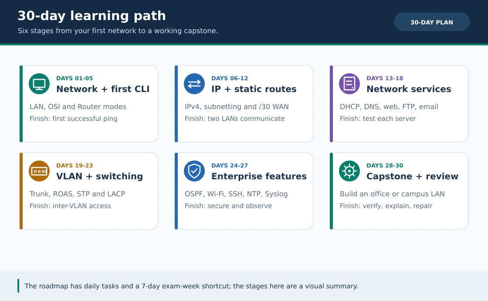

# 🗺️ পূর্ণাঙ্গ রোডম্যাপ (Master Learning & Repository Roadmap)

> **নেভিগেশন:** [🏠 রেপো হোম](README.md) · [🌐 English track](en/README.md) · [🎞️ GIF Catalog](GIF-CATALOG.md) · [🖥️ Portal](PORTAL.md) · [📚 মূল লেসন (০১–১৮)](lessons/README.md) · [🎓 CCNA Fundamentals (০১–০৯)](ccna-fundamentals/README.md) · [📦 Extra Labs](Extras/README.md) · [📚 বই ও চিট-শিট](reference/README.md) · [🛠️ স্ক্রিপ্টসমূহ](scripts/README.md)

এই রোডম্যাপটি **দুটি প্রধান অংশে** সাজানো হয়েছে:
1. **[Part A — 👨‍🎓 শিক্ষার্থীদের শেখার রোডম্যাপ](#student-roadmap):** শূন্য থেকে শুরু করে ৩০ দিনে পুরো নেটওয়ার্কিং ও Packet Tracer আয়ত্ত করার দৈনিক পরিকল্পনা + ৭ দিনের ভার্সিটি ল্যাব ফাইনাল ক্র্যাশ প্ল্যান।
2. **[Part B — 🚀 রেপোজিটরি উন্নয়নের রোডম্যাপ](#repo-roadmap):** এই প্রজেক্টটিকে বাংলাদেশের সেরা ওপেন-সোর্স নেটওয়ার্কিং ল্যাব প্ল্যাটফর্মে পরিণত করার **Phase 1 → Phase 5** মাস্টার প্ল্যান।

---

### 🖼️ চিত্রে বোঝো: ৩০ দিনের শেখার ছয় ধাপ



> **ছবির সারকথা:** প্রথম Ping থেকে শুরু করে VLAN, OSPF, Wi-Fi এবং Capstone পর্যন্ত ধাপে ধাপে এগোও।

---

<a id="student-roadmap"></a>

# 👨‍🎓 Part A — শিক্ষার্থীদের শেখার পূর্ণাঙ্গ রোডম্যাপ

## 🧭 ১. এক নজরে শেখার ৬টি ধাপ (Skill Progression)

```text
┌──────────────────────────────────────────────────────────────────────────────┐
│ STAGE 1: ভিত্তি ও প্রথম CLI (দিন ১–৫)                                         │
│   • নেটওয়ার্ক, টপোলজি, OSI 7 Layers, MAC ও ARP বোঝা                          │
│   • Router CLI মোড চেনা এবং প্রথম LAN তৈরি করে Ping সফল করা                    │
└──────────────────────────────────────┬───────────────────────────────────────┘
                                       ▼
┌──────────────────────────────────────────────────────────────────────────────┐
│ STAGE 2: IPv4, Subnetting ও Static Routing (দিন ৬–১২)                        │
│   • IPv4 ঠিকানা, /24 থেকে /30 হিসাব, Magic Block Size ও VLSM প্ল্যানিং          │
│   • দুটি রাউটারের মাঝে /30 WAN লিংক ও দ্বিমুখী Static Route কনফিগার             │
└──────────────────────────────────────┬───────────────────────────────────────┘
                                       ▼
┌──────────────────────────────────────────────────────────────────────────────┐
│ STAGE 3: নেটওয়ার্ক সার্ভিসসমূহ — DHCP, DNS, Web, FTP, Email, Printer (দিন ১৩–১৮)│
│   • স্বয়ংক্রিয় IP বিতরণ (DHCP), নাম থেকে IP (DNS), ওয়েবসাইট হোস্টিং (HTTP)      │
│   • বাস্তব অফিসের FTP ফাইল সার্ভার, SMTP/POP3 ইমেইল ও শেয়ার্ড প্রিন্টার         │
└──────────────────────────────────────┬───────────────────────────────────────┘
                                       ▼
┌──────────────────────────────────────────────────────────────────────────────┐
│ STAGE 4: VLAN, Trunk ও Enterprise Switching (দিন ১৯–২৩)                      │
│   • সুইচ ভাগ করে VLAN তৈরি, 802.1Q Trunk ও Router-on-a-Stick রাউটিং         │
│   • STP লুপ প্রতিরোধ, Port Security (Sticky MAC) ও LACP EtherChannel          │
└──────────────────────────────────────┬───────────────────────────────────────┘
                                       ▼
┌──────────────────────────────────────────────────────────────────────────────┐
│ STAGE 5: Security (ACL/NAT), Hardware ও Troubleshooting (দিন ২৪–২৭)          │
│   • Standard/Extended ACL ফিল্টারিং ও PAT/NAT দিয়ে ইন্টারনেট সংযোগ             │
│   • বাস্তব রাউটার/সুইচ/কেবল/র‍্যাক চেনা এবং ভাঙা নেটওয়ার্ক মেরামত করা             │
└──────────────────────────────────────┬───────────────────────────────────────┘
                                       ▼
┌──────────────────────────────────────────────────────────────────────────────┐
│ STAGE 6: চূড়ান্ত প্রজেক্ট ও পরীক্ষা প্রস্তুতি (দিন ২৮–৩০)                         │
│   • Office Capstone + University Mega Capstone + ৩০টি প্র্যাকটিস চ্যালেঞ্জ      │
└──────────────────────────────────────────────────────────────────────────────┘
```

---

## 📅 ২. ৩০ দিনের কমপ্লিট স্টাডি প্ল্যান (প্রতিদিন ৬০–৯০ মিনিট)

> 💡 **সেরা কৌশল:** অন্ধভাবে কমান্ড মুখস্থ না করে আমরা **তত্ত্ব (CCNA)** এবং **হাতে-কলমে ল্যাব (Lessons + Extras)** পরপর মিলিয়ে পড়ব!

### 🟢 সপ্তাহ ১: নেটওয়ার্কের ভিত্তি ও প্রথম CLI ল্যাব (দিন ১–৭)

| দিন | কী পড়বে / করবে | সংযুক্ত ফাইল / টুল | লক্ষ্য |
| :---: | :--- | :--- | :--- |
| **দিন ০১** | নেটওয়ার্ক কী, LAN/WAN, Switch বনাম Router | [CCNA ০১ · Network Basics](ccna-fundamentals/01-network-basics.md) | ১০টি কুইজ পাস |
| **দিন ০২** | ৬টি টপোলজি Simulation Mode-এ চালানো | [🕸️ 6 Topologies Lab](Extras/network-topologies-lab.md) | Mesh সূত্র যাচাই |
| **দিন ০৩** | OSI 7 Layers ও TCP/IP Encapsulation | [CCNA ০২ · OSI Model](ccna-fundamentals/02-osi-tcp-ip.md) + [📕 OSI বই (অধ্যায় ১–৬)](reference/OSI-Illustrated.md) | ৭ লেয়ারের কাজ মুখস্থ নয়, বোঝা |
| **দিন ০৪** | MAC Address, Ethernet Frame ও ARP | [CCNA ০৩ · MAC & ARP](ccna-fundamentals/03-mac-ethernet-arp.md) | `arp -a` ও MAC Table বোঝা |
| **দিন ০৫** | **প্রথম হাতে-কলমে CLI ল্যাব!** | [লেসন ০১ · Router CLI Basics](lessons/01-router-cli-basics.md) + [`lesson-01.pkt`](pkt-files/labs/lesson-01-router-cli-basics.pkt) | PC0 → PC1 Ping সফল ✅ |
| **দিন ০৬** | বাস্তব ডিভাইস, কেবল পেয়ার (T568B) ও র‍্যাক চেনা | [লেসন ০৯ · Real Hardware](lessons/09-real-hardware.md) | বাস্তব পোর্ট ও কেবল চেনা |
| **দিন ০৭** | **রিভিশন ও কুইজ পরীক্ষা** | `python3 scripts/quiz_trainer.py --count 15` | সপ্তাহ ১ ঝালিয়ে নেওয়া |

### 🟡 সপ্তাহ ২: IPv4, Subnetting মাস্টারি ও Static Routing (দিন ৮–১৪)

| দিন | কী পড়বে / করবে | সংযুক্ত ফাইল / টুল | লক্ষ্য |
| :---: | :--- | :--- | :--- |
| **দিন ০৮** | IPv4 গঠন, Private/Public IP, Loopback, APIPA | [CCNA ০৪ · IPv4 Addressing](ccna-fundamentals/04-ipv4-addressing.md) | ১০টি কুইজ পাস |
| **দিন ০৯** | Subnetting সূত্র ($2^n$, $2^h-2$, Block Size) | [CCNA ০৫ · Subnetting Basics](ccna-fundamentals/05-subnetting-basics.md) | খাতায় `/25`, `/26`, `/27` ভাগ করা |
| **দিন ১০** | Packet Tracer-এ সাবনেটিং প্রমাণ + ড্রিল | [🧮 IP Subnet Tester Lab](Extras/ip-subnet-tester-lab.md) + `subnet_calculator.py --drill 5` | কেন `/26`-এ `.65` পিং পায় না তা দেখা |
| **দিন ১১** | VLSM — বড় থেকে ছোট বিভাগ অনুযায়ী IP প্ল্যান | [CCNA ০৬ · VLSM](ccna-fundamentals/06-subnetting-vlsm.md) + `subnet_calculator.py --vlsm` | যেকোনো অফিসের IP চার্ট বানানো |
| **দিন ১২** | **দুই রাউটার ও Static Routing ল্যাব** | [লেসন ০২ · Static Routing](lessons/02-static-routing.md) + [`lesson-02.pkt`](pkt-files/labs/lesson-02-static-routing.pkt) | দ্বিমুখী `ip route` ও `/30` লিংক |
| **দিন ১৩** | রাউটিং ট্রাবলশুটিং (Return Route মিসিং কেস) | [লেসন ১২ · Problem ০২](lessons/12-problem-solve.md#problem-02) | না দেখে ২ রাউটার ল্যাব আবার বানানো |
| **দিন ১৪** | **সপ্তাহ ২ পরীক্ষা** | খাতায় ৫টি VLSM অঙ্ক + `quiz_trainer.py --lesson 5` | ১০০% সাবনেটিং আত্মবিশ্বাস |

### 🟠 সপ্তাহ ৩: নেটওয়ার্ক সার্ভিস ও VLAN / Inter-VLAN (দিন ১৫–২১)

| দিন | কী পড়বে / করবে | সংযুক্ত ফাইল / টুল | লক্ষ্য |
| :---: | :--- | :--- | :--- |
| **দিন ১৫** | Router DHCP Server ও DORA প্রক্রিয়া | [লেসন ০৩ · DHCP](lessons/03-dhcp.md) + [🖨️ Shared Printer Lab](Extras/office-shared-printer-lab.md) | Auto IP + প্রিন্টার Static IP |
| **দিন ১৬** | DNS (`A Record`) ও HTTP Web Server | [লেসন ০৪ · DNS & HTTP](lessons/04-dns-http-server.md) | `www.office.local` ব্রাউজারে খোলা |
| **দিন ১৭** | FTP ফাইল সার্ভার ও SMTP/POP3 ইমেইল সার্ভার | [🌐 FTP Lab](Extras/ftp-server-lab.md) + [📧 Email Lab](Extras/email-server-lab.md) | `put`/`get` ও ইমেইল আদান-প্রদান |
| **দিন ১৮** | Switch VLAN তৈরি ও Isolation প্রমাণ | [লেসন ০৫ · VLAN](lessons/05-vlan.md) + [Problem ০১](lessons/12-problem-solve.md#problem-01) | একই VLAN ✅, ভিন্ন VLAN ❌ |
| **দিন ১৯** | 802.1Q Trunk ও Router-on-a-Stick (ROAS) | [লেসন ০৬ · Trunk & Inter-VLAN](lessons/06-trunk-inter-vlan.md) | ভিন্ন VLAN-এ সফল Ping (`TTL=127`) |
| **দিন ২০** | STP, Port Security ও LACP EtherChannel | [লেসন ০৭ · Switching](lessons/07-switching.md) | Root Bridge, Sticky MAC, `Po1(SU)` |
| **দিন ২১** | **Mini-Capstone: সম্পূর্ণ অফিস নেটওয়ার্ক!** | [লেসন ০৮ · Final Project](lessons/08-final-project.md) | সব প্রযুক্তি এক টপোলজিতে! |

### 🔴 সপ্তাহ ৪: সিকিউরিটি, ট্রাবলশুটিং ও চূড়ান্ত প্রস্তুতি (দিন ২২–৩০)

| দিন | কী পড়বে / করবে | সংযুক্ত ফাইল / টুল | লক্ষ্য |
| :---: | :--- | :--- | :--- |
| **দিন ২২** | ডায়নামিক রাউটিং — RIPv2 ও Single-Area OSPF | [লেসন ১৩ · OSPF & RIPv2](lessons/13-dynamic-routing-ospf.md) | কেবল কেটে অটো Failover প্রমাণ |
| **দিন ২৩** | হোম Wi-Fi ও এন্টারপ্রাইজ WLC + Lightweight AP | [লেসন ১৪ · Wireless LAN](lessons/14-wireless-lan.md) | `WRT300N` + `WLC-2504` সেটআপ |
| **দিন ২৪** | SSH রিমোট লগইন, Hardening, NTP ও Syslog | [লেসন ১৫ · SSH, NTP & Syslog](lessons/15-ssh-syslog-ntp.md) + [CCNA ০৭ · ACL/NAT](ccna-fundamentals/07-acl-nat.md) | নিরাপদ নেটওয়ার্ক ও লগিং |
| **দিন ২৫** | পদ্ধতিগত নেটওয়ার্ক ট্রাবলশুটিং ও গোয়েন্দা চ্যালেঞ্জ | [CCNA ০৮](ccna-fundamentals/08-troubleshooting.md) + [লেসন ১২ (৯টি কেস)](lessons/12-problem-solve.md) + [🔧 Broken Labs](Extras/broken-labs-challenge.md) | ৬টি ভাঙা নেটওয়ার্ক মেরামত |
| **দিন ২৬** | বাস্তব Windows/Linux নেটওয়ার্কিং কমান্ড | [📘 Practical Networking: 30 Commands](reference/MaksDev-Practical-Networking.md) | নিজের পিসির টার্মিনালে অনুশীলন |
| **দিন ২৭** | ১০টি সমাধানসহ প্র্যাকটিস ল্যাব | [লেসন ১০ · Practice Lab](lessons/10-practice-lab.md) | না দেখে ৬ Simple + ৪ Hard সমাধান |
| **দিন ২৮–২৯** | ২০টি সমাধান ছাড়া চ্যালেঞ্জ (আসল পরীক্ষা!) | [লেসন ১১ · Practice List](lessons/11-practice-list.md) | টাইমার ধরে ৪৫ মিনিটে ল্যাব সম্পন্ন |
| **দিন ৩০** | **🏆 গ্র্যান্ড ফিনালে — University Mega Capstone!** | [CCNA ০৯ · University Capstone](ccna-fundamentals/09-capstone-university-lab.md) | সম্পূর্ণ ক্যাম্পাস নেটওয়ার্ক জয়! 🎉 |

---

## ⚡ ৩. ৭ দিনের ভার্সিটি ল্যাব পরীক্ষা ও ভাইভা ক্র্যাশ প্ল্যান (Exam Week!)

পরীক্ষার আগে সময় মাত্র ১ সপ্তাহ থাকলে এই ক্রমটি অনুসরণ করো:

* **Day 1:** [লেসন ০১ (CLI)](lessons/01-router-cli-basics.md) + [লেসন ০২ (Static Routing)](lessons/02-static-routing.md) হাতে-কলমে ১ বার করে বানানো।
* **Day 2:** [CCNA ০৫ (Subnetting)](ccna-fundamentals/05-subnetting-basics.md) + `python3 scripts/subnet_calculator.py --drill 10`।
* **Day 3:** [লেসন ০৩ (DHCP)](lessons/03-dhcp.md) + [লেসন ০৪ (DNS + Web)](lessons/04-dns-http-server.md) একসাথে অনুশীলন।
* **Day 4:** [লেসন ০৫ (VLAN)](lessons/05-vlan.md) + [লেসন ০৬ (Trunk + ROAS)](lessons/06-trunk-inter-vlan.md) হাতে-কলমে।
* **Day 5:** [লেসন ০৭ (STP + Port Security + EtherChannel)](lessons/07-switching.md) + [লেসন ১৩ (OSPF)](lessons/13-dynamic-routing-ospf.md) + [লেসন ১৫ (SSH/Syslog)](lessons/15-ssh-syslog-ntp.md)।
* **Day 6:** [লেসন ০৮ (Final Project)](lessons/08-final-project.md) না দেখে ৪৫ মিনিটে সম্পন্ন করা + [লেসন ০৯ (Real Hardware ছবি)](lessons/09-real-hardware.md) দেখা।
* **Day 7:** [📖 CLI Cheat-Sheet](reference/cli-command-cheatsheet.md) + [লেসন ১২ (Problem Solve)](lessons/12-problem-solve.md) রিভিশন!

---

### ⭐ ৩০ দিনের মূল কোর্সের পরে ঐচ্ছিক ৫ দিনের Phase 3 অ্যাডভান্সড ট্র্যাক

| অতিরিক্ত দিন | ছবি দেখে নিজে বানাবে | যা প্রমাণ/সীমা লিখবে |
| :---: | :--- | :--- |
| **৩১** | [লেসন ১৬ · 3560 SVI](lessons/16-multilayer-switch-svi.md) | `show ip route`-এ VLAN10/20 এবং cross-VLAN ping |
| **৩২** | [লেসন ১৭ · HSRP](lessons/17-hsrp-gateway-redundancy.md) | R1 OFF → R2 Active; VIP না বদলে R3 loopback ping (real Internet নয়) |
| **৩৩** | [লেসন ১৮ · IPv6 + SLAAC](lessons/18-ipv6-slaac-routing.md) | Static stage-এর `S` route, পরে OSPFv3-র `O` route ও FULL neighbor |
| **৩৪** | [Extra ০৭ · VoIP](Extras/voip-ip-telephony-lab.md) | DHCP option 150, দুই extension এবং Phone-to-Phone call |
| **৩৫** | [Extra ০৮ · Snooping + DAI](Extras/dhcp-snooping-dai-lab.md) | বৈধ binding/rogue Offer test; **PT-তে DAI filtering নিশ্চিত নয়** |

> এই পাঁচটি Phase 3 গাইডে ১০টি আসল লজিক্যাল SVG এবং build-along CLI আছে; প্রস্তুত `.pkt` নেই।
>
> **দিন ৩৫-এর পরে ঐচ্ছিক v4 চ্যালেঞ্জ:** [Mega ISP + Multi-Campus guide](capstone/README.md) দিয়ে HQ/২ branch/ISP-test নিজে তৈরি করো। [N01–N20 ও F01–F08](capstone/VERIFICATION.md)-এ *নিজের* PT ফল লিখে [নিজের `.pkt` সংরক্ষণ করো](pkt-files/capstone/README.md)। v4-এর আগে থেকে বানানো native project নেই।

---

## 🎯 ৪. Cisco CCNA (200-301) বিষয়ভিত্তিক কাভারেজ ম্যাপ *(v3.0)*

| CCNA 200-301 ডোমেইন | পরীক্ষার গুরুত্ব | এই রেপোতে প্র্যাকটিসের সূত্র | কী এখনো যাচাই/শিখতে হবে |
| :--- | :---: | :--- | :--- |
| **1.0 Network Fundamentals** | 20% | [CCNA ০১–০৬](ccna-fundamentals/README.md), [IPv6/SLAAC লেসন ১৮](lessons/18-ipv6-slaac-routing.md), হার্ডওয়্যার ০৯ | বর্তমান exam topics মিলিয়ে theory পুনরাবৃত্তি |
| **2.0 Network Access** | 20% | VLAN/STP/Trunk ০৫–০৭, [WLC ১৪](lessons/14-wireless-lan.md), [3560 SVI ১৬](lessons/16-multilayer-switch-svi.md) | বিভিন্ন model-এর port/IOS support যাচাই |
| **3.0 IP Connectivity** | 25% | [Static ০২](lessons/02-static-routing.md), [OSPFv2 ১৩](lessons/13-dynamic-routing-ospf.md), [HSRP ১৭](lessons/17-hsrp-gateway-redundancy.md), [IPv6 Route ১৮](lessons/18-ipv6-slaac-routing.md) | failover ও return route নিজে test |
| **4.0 IP Services** | 10% | DHCP/DNS ০৩–০৪, NAT/ACL, [NTP/Syslog ১৫](lessons/15-ssh-syslog-ntp.md), [VoIP ০৭](Extras/voip-ip-telephony-lab.md) *অতিরিক্ত অনুশীলন* | সব সার্ভিস ও Cisco blueprint এক নয় |
| **5.0 Security Fundamentals** | 15% | Port Security ০৭, SSH ১৫, [DHCP Snooping + DAI ০৮](Extras/dhcp-snooping-dai-lab.md) | **PT-তে DAI filtering অনিশ্চিত**; real IOS policy আলাদা verify |
| **6.0 Automation & Programmability** | 10% | [`scripts/`-এ ১৯টি IOS preset](scripts/README.md) ও অন্যান্য Python helper | REST/JSON/controller theory আলাদাভাবে পড়তে হবে |

> এই সূচি **পূর্ণ সিলেবাস কভারেজের শতকরা দাবি নয়**। পরীক্ষার আগে [Cisco-এর বর্তমান CCNA 200-301 exam topics](https://learningcontent.cisco.com/documents/marketing/exam-topics/200-301-CCNA-v1.1.pdf) দেখে নাও।

---

<a id="repo-roadmap"></a>

# 🚀 Part B — রেপোজিটরি উন্নয়নের পূর্ণাঙ্গ রোডম্যাপ (Phase 1 → Phase 5)

এই রেপোজিটরিটিকে ধাপে ধাপে কীভাবে আরও সমৃদ্ধ করা হবে তার সুস্পষ্ট পরিকল্পনা নিচে দেওয়া হলো:

---

## ✅ Phase 1 — v2.0: ডকুমেন্টেশন, ইকোসিস্টেম ও অটোমেশন আপগ্রেড *(সম্পন্ন!)*

- [x] সব ফোল্ডারে (`lessons/`, `ccna-fundamentals/`, `Extras/`, `reference/`, `pkt-files/`, `scripts/`) পরিষ্কার ইনডেক্স `README.md` ও নেভিগেশন যুক্ত করা
- [x] লেসন ০১–০৮ প্রতিটিতে **🏷️ মূল শব্দকোষ (Quick Glossary)** এবং CCNA তত্ত্বের ক্রস-লিংক সংযোজন
- [x] লেসন ০৯-এ **Datacenter Rack Infrastructure Blueprint** (`data-central-rack.jpg`)-এর ১০টি অংশের পূর্ণাঙ্গ বাংলা বিশ্লেষণ যোগ করা
- [x] লেসন ১২ (Problem Solve Bank) ১টি সমস্যা থেকে বাড়িয়ে **৬টি বাস্তব ট্রাবলশুটিং কেস**-এ উন্নীত করা
- [x] আনলিংকড `.pkt` ফাইলগুলোর জন্য ৩টি নতুন Extra Lab গাইড তৈরি (`Office Shared Printer`, `IP Subnet Tester`, `6 Network Topologies`)
- [x] রেফারেন্স ফোল্ডারের **২টি পূর্ণাঙ্গ বাংলা বই** (`Practical Networking` ও `OSI Illustrated`) মূল `README.md`-তে যুক্ত করা
- [x] **৫টি Python CLI অটোমেশন ও রাইটার স্ক্রিপ্ট** তৈরি (`lab_writer.py`, `ios_config_generator.py`, `subnet_calculator.py`, `quiz_trainer.py`, `repo_doctor.py`)
- [x] স্বয়ংক্রিয় লিংক ও স্বাস্থ্য পরীক্ষার জন্য **GitHub Actions CI** (`.github/workflows/repo-check.yml`) সংযোজন

---

## ✅ Phase 2 — v2.5: Dynamic Routing, Wireless ও Broken Troubleshooting প্যাক *(সম্পন্ন!)*

- [x] **[লেসন ১৩ · Dynamic Routing (RIPv2 & OSPFv2)](lessons/13-dynamic-routing-ospf.md):** ৩টি রাউটারের ত্রিভুজ টপোলজিতে `router ospf 1`, Wildcard Mask, `router-id`, `passive-interface` ও কেবল কেটে স্বয়ংক্রিয় লিংক Failover পরীক্ষা
- [x] **[লেসন ১৪ · Wireless LAN ও Enterprise WLC](lessons/14-wireless-lan.md):** Home Wireless Router (`WRT300N`, WPA2-PSK) এবং কর্পোরেট `Cisco WLC-2504` + `LAP-PT` (`CAPWAP`) কনফিগারেশন
- [x] **[লেসন ১৫ · SSH, Device Hardening ও Syslog/NTP](lessons/15-ssh-syslog-ntp.md):** Telnet বন্ধ করে RSA 2048 / SSHv2 রিমোট লগইন, পাসওয়ার্ড এনক্রিপশন, NTP ঘড়ি সিঙ্ক ও Syslog সার্ভারে লগ সংগ্রহ
- [x] **[🔧 Broken Network Detective Challenge](Extras/broken-labs-challenge.md) + [`.ios` Fault Scripts](pkt-files/troubleshooting/README.md):** ইচ্ছাকৃতভাবে ভুল করা ৬টি কনফিগারেশন ও গোয়েন্দা ট্রাবলশুটিং চ্যালেঞ্জ
- [x] **[লেসন ১২ · Problem Bank আপগ্রেড](lessons/12-problem-solve.md):** OSPF Neighbor মিসিং, SSH RSA এরর এবং Laptop Wi-Fi মডিউল পাওয়ার এররসহ মোট **৯টি বাস্তব কেস**
- [x] **`scripts/` v2.5 আপগ্রেড:** `ios_config_generator.py`-এ `ospf`, `ripv2`, `ssh-hardening`, `broken-lab` সহ মোট ১২টি প্রিসেট এবং `quiz_trainer.py`-এ ৭৭টি কুইজ + ১৫টি ফ্ল্যাশকার্ড!

---

## ✅ Visual Release — v2.6: প্রতিটি গাইডে শিক্ষামূলক ছবি *(সম্পন্ন!)*

- [x] রিপোর **৪৪/৪৪ Markdown** ফাইলে প্রাসঙ্গিক লোকাল SVG/ছবি ও বাংলা alt text/সারাংশ যোগ করা; আগের GIF/হার্ডওয়্যার ছবি ও OSI বইয়ের ৬টি SVG রেখে দেওয়া।
- [x] [৪৬টি নতুন, নিজস্ব SVG ডায়াগ্রাম](assets/diagrams/README.md) — আসল লেসনের IP/পোর্ট অনুযায়ী DHCP DORA, VLAN/Trunk/ROAS, Subnetting, OSPF Failover, Home Wi-Fi/WLC, FTP/Email, STP এবং ৬টি টপোলজি আঁকা। কোনো বাহ্যিক image CDN লাগে না।
- [x] [`diagram_generator.py`](scripts/diagram_generator.py) দিয়ে ছবি পুনর্নির্মাণ ও `--check`; [`repo_doctor.py --strict`](scripts/README.md) দিয়ে প্রতিটি `.md`-র সত্যিকারের লোকাল ছবির ফরম্যাট ও লিংক যাচাই; GitHub Actions-এ দুটোই যোগ করা।
- [x] প্রতিটি ডায়াগ্রামে English টেকনিক্যাল লেবেল ও Markdown-এ বাংলা ব্যাখ্যা; এগুলো শিক্ষামূলক লজিক্যাল চিত্র, Packet Tracer-এর screenshot নয়।

---

## ✅ Phase 3 — v3.0: Enterprise Layer-3, Redundancy ও IPv6 *(ছবিসহ গাইড সম্পন্ন)*

- [x] **[লেসন ১৬ · Multilayer Switch SVI](lessons/16-multilayer-switch-svi.md):** 3560-এ VLAN 10/20, `interface vlan`, `ip routing`, দুদিকের ping, সমস্যা সমাধান ও **২টি নিজস্ব SVG**।
- [x] **[লেসন ১৭ · Gateway Redundancy HSRP](lessons/17-hsrp-gateway-redundancy.md):** R1/R2-তে `standby 1 ip` virtual gateway, R3-তে দুইটি upstream return path, R1 সম্পূর্ণ OFF করে test target-এ failover পিং; **২টি SVG**। এটি প্রকৃত Internet সংযোগ নয়।
- [x] **[লেসন ১৮ · IPv6, SLAAC, Static ও OSPFv3](lessons/18-ipv6-slaac-routing.md):** `2001:db8:10::/64`, `12::/64`, `20::/64`, `fe80::` link-local, RA/SLAAC, দুদিকের static route এবং static সরিয়ে আলাদা OSPFv3 stage; **২টি SVG**।
- [x] **[Extra ০৭ · VoIP IP Telephony](Extras/voip-ip-telephony-lab.md):** 2811 CME, `switchport voice vlan 20`, DHCP option 150, দুই 7960-তে `1001↔1002` dial-এর *build-along* পদ্ধতি; **২টি SVG**।
- [x] **[Extra ০৮ · DHCP Snooping + DAI](Extras/dhcp-snooping-dai-lab.md):** trusted server port, rogue DHCP Offer, binding ও DAI-এর IOS policy; **২টি SVG**। **Packet Tracer-এ DAI traffic filtering কাজ নাও করতে পারে—সুরক্ষা বাস্তবে প্রমাণিত দাবি নয়।**
- [x] **টুল ও মান যাচাই:** IOS generator-এ ৭টি নতুন device-scoped preset (মোট ১৯), practical quiz-এ ৯টি MCQ (মোট ৮৬), ৭টি flashcard (মোট ২২), নতুন ডায়াগ্রামের `--check` ও `repo_doctor.py --strict`।

> **ভিত্তি বনাম ফল:** এই ফেজের ৫টি নতুন গাইডে *মোট ১০টি মূল টপোলজি/ধারণা SVG* ও উদাহরণ CLI আছে; এগুলো শিক্ষামূলক চিত্র, **Packet Tracer screenshot নয়**। নতুন লেসন ১৬–১৮ / Extra ০৭–০৮-এর **কোনো native `.pkt`** এই রেপোতে যোগ হয়নি। বিশেষত VoIP মডেল ও DAI enforcement ব্যবহারকারীর PT সংস্করণে যাচাই করতে হবে।

---

## 🌐 Phase 4 — v3.5: সার্চেবল ওয়েব পোর্টাল, GIF ও দ্বিভাষিক ট্র্যাক *(লোকাল রিলিজ; Pages প্রকাশ বাকি)*

- [x] **[MkDocs Material সাইট](PORTAL.md) লোকালি প্রস্তুত:** ৯২টি Markdown page; light/dark toggle, বাংলা+English corpus-এ client-side search, code block-এ ১-ক্লিক Copy, mobile navigation; `mkdocs build --strict` এবং Pages-ready workflow। বাংলা শব্দ exact Unicode term হিসেবে index হয়, English stemming সমর্থিত।
- [ ] **GitHub Pages-এ live প্রকাশ ও URL যাচাই:** এই workspace থেকে GitHub-এ push/Pages Settings পরিবর্তন করা হয়নি; maintainer-কে main push করে Settings → Pages → GitHub Actions চালু করতে হবে। Site ready মানেই live নয়।
- [x] **[২৬টি ৩০-সেকেন্ডের GIF](GIF-CATALOG.md):** ১৮টি practical + ৮টি Extra-তে প্রতিটিতে নিজস্ব মূল SVG-ভিত্তিক ছয়-ধাপের অ্যানিমেটেড ইনফোগ্রাফিক; topic **GIF search name** ও P1/P2 গুরুত্ব দেওয়া। এগুলো **Packet Tracer screen recording বা verified traffic result নয়**। চাইলে ব্যবহারকারী পরে নিজস্ব/অনুমতিপ্রাপ্ত GIF upload করতে পারবেন।
- [x] **[English parallel track (`en/`)](en/README.md):** ১৮ practical + ৯ CCNA + ৮ Extra = **৩৫টি English adaptation**, চারটি English index, মূল গাইডের সাথে দুদিকের link এবং ছবিসহ steps/verification।
- [ ] **শব্দে-শব্দে পূর্ণ অনুবাদ/সম্পূর্ণ quiz bank:** বাংলা দীর্ঘ লেখার প্রত্যেক অনুচ্ছেদ, ৮৬টি quiz বা প্রতিটি টেবিল এখনো আক্ষরিকভাবে English-এ রূপান্তরিত নয়; English pages বিষয়ভিত্তিক স্বতন্ত্র companion।

---

## 🏆 Phase 5 — v4.0: Mega ISP & Multi-Campus Enterprise Capstone *(build-along প্রস্তুত; PT রান বাকি)*

- [x] **[দুই branch + HQ + ISP-test master build-along](capstone/README.md):** চারটি স্বাধীন private /30 serial WAN, HQ-তে দুই HSRP gateway ও আলাদা VLAN 10/20/40/99, BR1 data/optional voice, BR2 data/bridged Wi-Fi; ISP-তে দুটি *পৃথক* documentation-range link। এটি বাস্তব ISP/Internet বা সত্যিকারের enterprise deployment নয়।
- [x] **[DMZ Web/DNS/Email/FTP](capstone/README.md) + OSPF/HSRP/VoIP/Wi-Fi/PAT/Extended ACL-এর অনুশীলন:** চারটি আলাদা Server-PT, 2811 CME + HQ phones, WRT300N LAN bridge, branch ACLs, প্রত্যেক HQ-র নিজের outside IP-তে TCP/80 WEB mapping। `ip nat` ও ACL rule বাস্তবে কাজ করেছে—এমন দাবি নয়।
- [x] **পুনর্গঠনযোগ্য ও দ্বিভাষিক নির্মাণসামগ্রী:** [`plan.json`](capstone/plan.json), [৯টি device-wise config text](capstone/README.md), [২টি ধারণামূলক SVG](assets/diagrams/README.md), [English build guide](en/capstone/README.md), [N01–N20/F01–F08 খালি evidence log](capstone/VERIFICATION.md) ও [নিজের `.pkt` বানানোর নিয়ম](pkt-files/capstone/README.md)। [`capstone_config_generator.py --check`](scripts/capstone_config_generator.py) ও offline tests-এর কাজ কেবল plan/config/media consistency যাচাই।
- [ ] **Native Packet Tracer `.pkt` এবং প্রকৃত verification:** এই workspace-এ PT নেই; **নতুন `.pkt` তৈরি বা OSPF/HSRP/CME/ACL/PAT/ফেলওভার চালিয়ে দেখা হয়নি**। পাঠক নিজের PT-তে build করে actual results লিখে চাইলে সত্যিকার `.pkt` অবদান রাখতে পারবেন। সরবরাহ করা expected tests-কে observed result ধরে নেবে না।

---

## 🛠️ লেখক/মেইনটেইনার কীভাবে ২ মিনিটে নতুন লেসন যোগ করবে?

নতুন কোনো ফেজের কাজ শুরু করতে আর শূন্য থেকে ফাইল সাজাতে হবে না! টার্মিনালে চালাও:

```bash
# ১. পরবর্তী নতুন লেসনের বাংলা খসড়া তৈরি করো (উদাহরণ: নম্বর ১৯)
python3 scripts/lab_writer.py lesson --num 19 --slug campus-backup \
    --title "Campus Backup Routing" --level "🔴 Advanced"

# ২. Markdown-এ উপযুক্ত লোকাল ছবি ও বাস্তব IP/CLI যাচাই যোগ করো।
# Packet Tracer-এ প্রকৃত .pkt বানালে তবেই pkt-files/labs/-এ যোগ করে লিংক দাও।

# ৩. পুশের আগে সব ডায়াগ্রাম ও লিংক অটোমেটিক পরীক্ষা করো!
python3 scripts/diagram_generator.py --check
python3 scripts/repo_doctor.py --strict
```

---

> **নেভিগেশন:** [🏠 রেপো হোম](README.md) · [📚 মূল লেসন](lessons/README.md) · [🎓 CCNA Fundamentals](ccna-fundamentals/README.md) · [🛠️ স্ক্রিপ্টসমূহ](scripts/README.md) · [🤝 কন্ট্রিবিউট গাইড](CONTRIBUTING.md)
