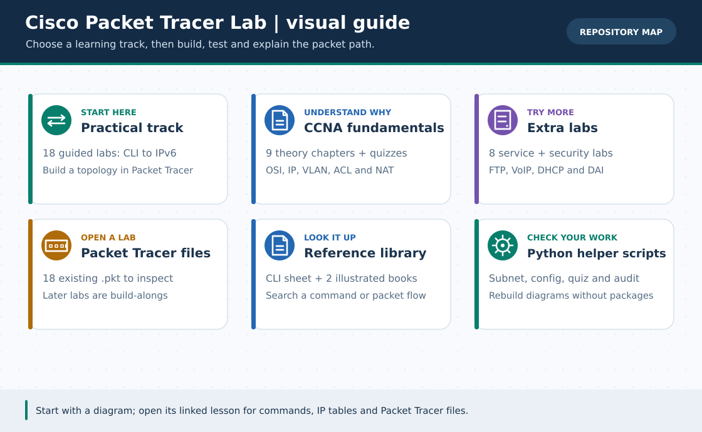

# 🖼️ Local SVG Diagram Gallery (v4.0)

> **নেভিগেশন:** [🏠 রেপো হোম](../../README.md) · [English track](../../en/README.md) · [🎞️ GIF Catalog](../../GIF-CATALOG.md) · [মূল লেসন](../../lessons/README.md)

**৫৮টি নিজস্ব SVG** আছে: আগের ৫৬টি [`scripts/diagram_generator.py`](../../scripts/diagram_generator.py) থেকে, v4 capstone-এর ২টি [`capstone/plan.json`](../../capstone/plan.json) ও [`scripts/capstone_config_generator.py`](../../scripts/capstone_config_generator.py) থেকে। আগের ৫৬টি পুনর্নির্মাণে `python3 scripts/diagram_generator.py` ও `--check`; নতুন দুটিতে `python3 scripts/capstone_config_generator.py --write` ও `--check` চালান। নতুন SVG পুরনো generator-এ নেই। এগুলো **লজিক্যাল শিক্ষামূলক চিত্র**, Packet Tracer screenshot বা traffic capture নয়। GIF-এ সেকেন্ডভিত্তিক ব্যাখ্যা চাইলে [২৬টি GIF ও topic search name](../../GIF-CATALOG.md) দেখুন।

## Practical lessons (23)

| ডায়াগ্রাম | SVG file |
| :--- | :--- |
| lesson 01 first ping | [lesson-01-first-ping.svg](lesson-01-first-ping.svg) |
| lesson 02 static routing | [lesson-02-static-routing.svg](lesson-02-static-routing.svg) |
| lesson 03 dhcp dora | [lesson-03-dhcp-dora.svg](lesson-03-dhcp-dora.svg) |
| lesson 04 dns http | [lesson-04-dns-http.svg](lesson-04-dns-http.svg) |
| lesson 05 vlan isolation | [lesson-05-vlan-isolation.svg](lesson-05-vlan-isolation.svg) |
| lesson 06 router on a stick | [lesson-06-router-on-a-stick.svg](lesson-06-router-on-a-stick.svg) |
| lesson 06 switch trunk | [lesson-06-switch-trunk.svg](lesson-06-switch-trunk.svg) |
| lesson 07 stp loop | [lesson-07-stp-loop.svg](lesson-07-stp-loop.svg) |
| lesson 08 office capstone | [lesson-08-office-capstone.svg](lesson-08-office-capstone.svg) |
| lesson 09 hardware chain | [lesson-09-hardware-chain.svg](lesson-09-hardware-chain.svg) |
| lesson 10 practice cycle | [lesson-10-practice-cycle.svg](lesson-10-practice-cycle.svg) |
| lesson 11 practice levels | [lesson-11-practice-levels.svg](lesson-11-practice-levels.svg) |
| lesson 12 debug path | [lesson-12-debug-path.svg](lesson-12-debug-path.svg) |
| lesson 13 ospf failover | [lesson-13-ospf-failover.svg](lesson-13-ospf-failover.svg) |
| lesson 14 enterprise wlc | [lesson-14-enterprise-wlc.svg](lesson-14-enterprise-wlc.svg) |
| lesson 14 home wifi | [lesson-14-home-wifi.svg](lesson-14-home-wifi.svg) |
| lesson 15 ssh ntp syslog | [lesson-15-ssh-ntp-syslog.svg](lesson-15-ssh-ntp-syslog.svg) |
| lesson 16 svi packet path | [lesson-16-svi-packet-path.svg](lesson-16-svi-packet-path.svg) |
| lesson 16 svi topology | [lesson-16-svi-topology.svg](lesson-16-svi-topology.svg) |
| lesson 17 hsrp failover | [lesson-17-hsrp-failover.svg](lesson-17-hsrp-failover.svg) |
| lesson 17 hsrp topology | [lesson-17-hsrp-topology.svg](lesson-17-hsrp-topology.svg) |
| lesson 18 ipv6 how it works | [lesson-18-ipv6-how-it-works.svg](lesson-18-ipv6-how-it-works.svg) |
| lesson 18 ipv6 topology | [lesson-18-ipv6-topology.svg](lesson-18-ipv6-topology.svg) |

## CCNA (10)

| ডায়াগ্রাম | SVG file |
| :--- | :--- |
| ccna 01 lan wan | [ccna-01-lan-wan.svg](ccna-01-lan-wan.svg) |
| ccna 02 osi tcpip | [ccna-02-osi-tcpip.svg](ccna-02-osi-tcpip.svg) |
| ccna 03 arp | [ccna-03-arp.svg](ccna-03-arp.svg) |
| ccna 04 ipv4 address | [ccna-04-ipv4-address.svg](ccna-04-ipv4-address.svg) |
| ccna 05 subnet 26 | [ccna-05-subnet-26.svg](ccna-05-subnet-26.svg) |
| ccna 06 vlsm plan | [ccna-06-vlsm-plan.svg](ccna-06-vlsm-plan.svg) |
| ccna 07 acl nat | [ccna-07-acl-nat.svg](ccna-07-acl-nat.svg) |
| ccna 08 troubleshoot tests | [ccna-08-troubleshoot-tests.svg](ccna-08-troubleshoot-tests.svg) |
| ccna 09 campus capstone | [ccna-09-campus-capstone.svg](ccna-09-campus-capstone.svg) |
| ccna course map | [ccna-course-map.svg](ccna-course-map.svg) |

## Extra Labs (11)

| ডায়াগ্রাম | SVG file |
| :--- | :--- |
| extra 07 voip call flow | [extra-07-voip-call-flow.svg](extra-07-voip-call-flow.svg) |
| extra 07 voip topology | [extra-07-voip-topology.svg](extra-07-voip-topology.svg) |
| extra 08 dhcp dai decision | [extra-08-dhcp-dai-decision.svg](extra-08-dhcp-dai-decision.svg) |
| extra 08 dhcp dai topology | [extra-08-dhcp-dai-topology.svg](extra-08-dhcp-dai-topology.svg) |
| extra broken detective | [extra-broken-detective.svg](extra-broken-detective.svg) |
| extra email smtp pop3 | [extra-email-smtp-pop3.svg](extra-email-smtp-pop3.svg) |
| extra ftp transfer | [extra-ftp-transfer.svg](extra-ftp-transfer.svg) |
| extra labs map | [extra-labs-map.svg](extra-labs-map.svg) |
| extra office printer | [extra-office-printer.svg](extra-office-printer.svg) |
| extra six topologies | [extra-six-topologies.svg](extra-six-topologies.svg) |
| extra subnet tester | [extra-subnet-tester.svg](extra-subnet-tester.svg) |

## v4.0 Mega ISP & Multi-Campus capstone (2)

| ডায়াগ্রাম | SVG file |
| :--- | :--- |
| HQ + দুই branch + চার private WAN + ISP/DMZ/voice/Wi-Fi-এর schematic | [capstone-v4-sites.svg](capstone-v4-sites.svg) · [বাংলা guide](../../capstone/README.md) |
| Private services, ACL/PAT, failover ও voice test plan (expected only) | [capstone-v4-paths.svg](capstone-v4-paths.svg) · [খালি worksheet](../../capstone/VERIFICATION.md) |

**অবস্থা:** এই দুই ছবির path/design শুধু planning। [নিজের PT-তে বানানোর নির্দেশ](../../pkt-files/capstone/README.md) দেওয়া আছে; নতুন `.pkt` বা observed test result নেই।

## Repo maps and tools (12)

| ডায়াগ্রাম | SVG file |
| :--- | :--- |
| contributing workflow | [contributing-workflow.svg](contributing-workflow.svg) |
| pkt fault script workflow | [pkt-fault-script-workflow.svg](pkt-fault-script-workflow.svg) |
| pkt lab catalog | [pkt-lab-catalog.svg](pkt-lab-catalog.svg) |
| practical course map | [practical-course-map.svg](practical-course-map.svg) |
| reference 30 command toolbox | [reference-30-command-toolbox.svg](reference-30-command-toolbox.svg) |
| reference cli modes | [reference-cli-modes.svg](reference-cli-modes.svg) |
| reference library map | [reference-library-map.svg](reference-library-map.svg) |
| reference osi search journey | [reference-osi-search-journey.svg](reference-osi-search-journey.svg) |
| rename map | [rename-map.svg](rename-map.svg) |
| repo overview | [repo-overview.svg](repo-overview.svg) |
| roadmap 30 day | [roadmap-30-day.svg](roadmap-30-day.svg) |
| scripts automation pipeline | [scripts-automation-pipeline.svg](scripts-automation-pipeline.svg) |

> **নেভিগেশন:** [হোম](../../README.md) · [Portal instructions](../../PORTAL.md) · [GIF catalog](../../GIF-CATALOG.md)
