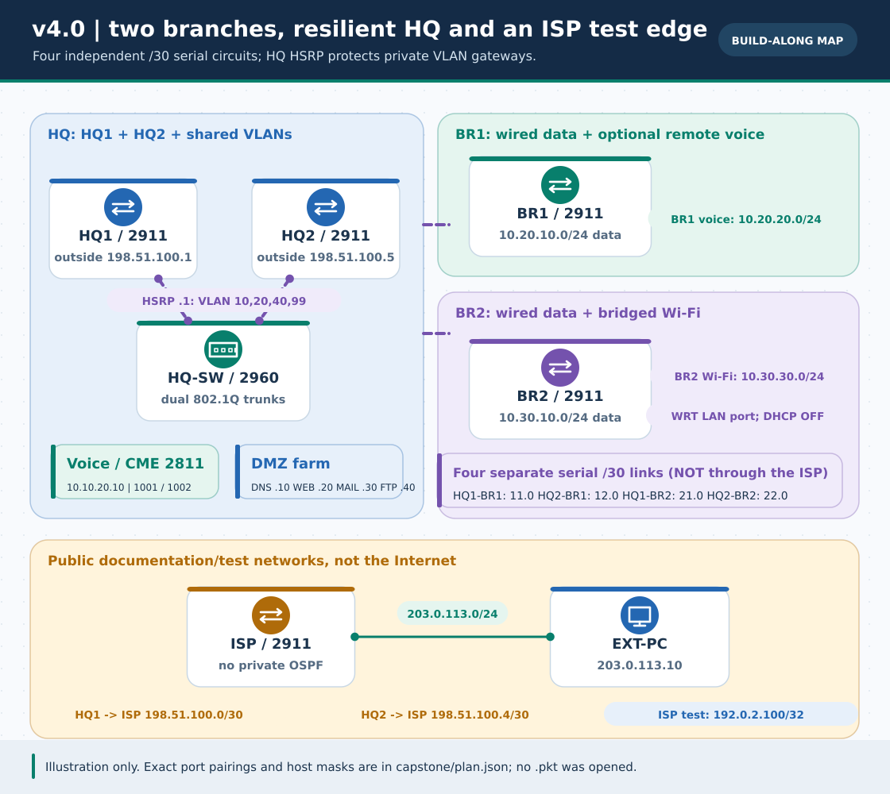
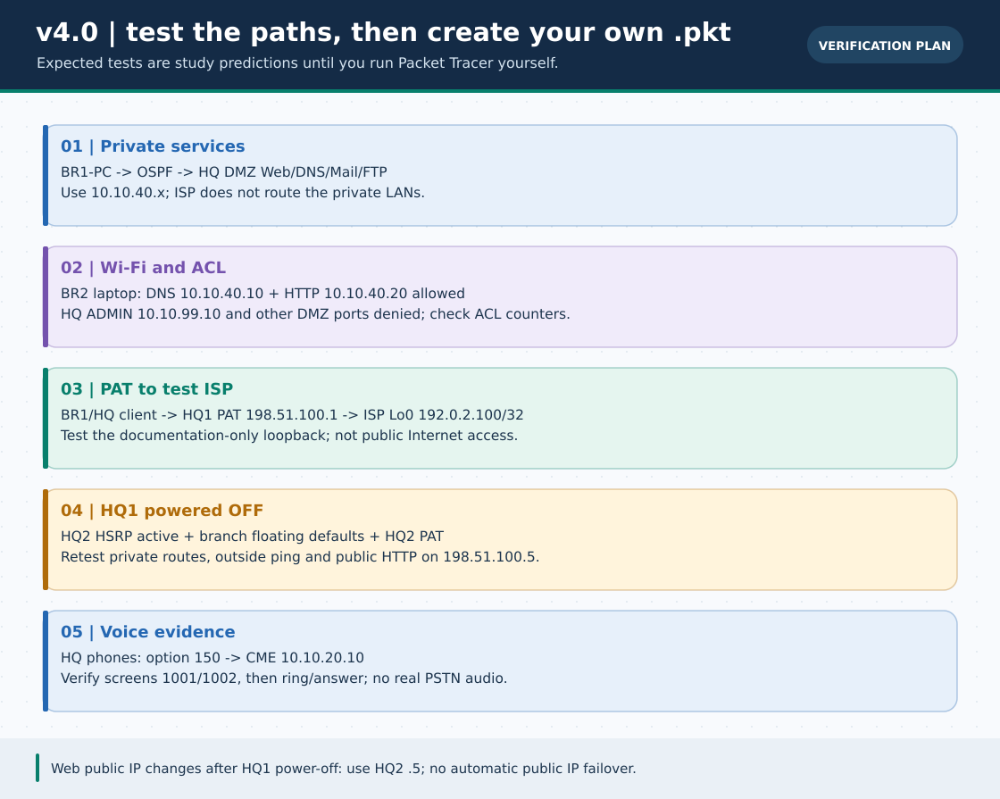

# 🏆 Phase 5 · v4.0 — Mega ISP & Multi-Campus Enterprise Capstone

> **নেভিগেশন:** [🏠 হোম](../README.md) · [🌐 English version](../en/capstone/README.md) · [🗺️ Roadmap](../ROADMAP.md) · [🔎 পরীক্ষা লগ](VERIFICATION.md) · [📦 নিজের `.pkt` রাখার নিয়ম](../pkt-files/capstone/README.md)



> **ছবির সীমা:** এটি হাতে বানানো *logical schematic*, Packet Tracer-এর screenshot, প্রস্তুত `.pkt` বা সফল traffic trace নয়। প্রতিটি cable, interface ও IP-এর নির্ভুল তালিকা নিচে এবং [`plan.json`](plan.json)-এ। ISP হলো **documentation-only test router**, বাস্তব ইন্টারনেট নয়।



> **অবস্থা:** কনফিগারেশন, ছবি, IP-plan ও offline validation প্রস্তুত; **এখানে Cisco Packet Tracer চালানো যায়নি। নতুন native `.pkt` বানানো/চালিয়ে যাচাই করা হয়নি।** আপনি পরে নিজের Packet Tracer-এ বানাতে চাইলে [ধাপে ধাপে `.pkt` সংরক্ষণ পদ্ধতি](../pkt-files/capstone/README.md) অনুসরণ করুন। `show`/GUI-তে যা দেখবেন তা [খালি evidence log](VERIFICATION.md)-এ লিখে রাখুন; প্রত্যাশিত ফলকে পর্যবেক্ষিত ফল মনে করবেন না।

## 🎯 লক্ষ্য ও স্থাপত্য

একটি **HQ**, দুটি আলাদা **Branch (BR1/BR2)**, দুটি HQ gateway (**HQ1/HQ2**), ISP-সদৃশ **ISP 2911**, HQ-তে চারটি আলাদা DMZ server (`DNS`, `WEB`, `MAIL`, `FTP`), HQ voice server **2811 CME**, HQ-তে দুইটি 7960 phone এবং BR2-তে bridged Wi-Fi। মূল বিষয়গুলি একই প্রকল্পে আছে:

- **OSPFv2 area 0** *শুধু চারটি private WAN circuit ও enterprise LAN-এ*; ISP কখনো private OSPF neighbor নয়।
- **HSRP** চারটি HQ VLAN-এর `.1` default gateway-এ; HQ1 priority `120`, HQ2 `100`, দুদিকেই `preempt`। এটি **HQ client/DMZ gateway** বাঁচায়, branch router-এর gateway নয়।
- **দুটি branch-এর floating static default** HQ1-কে অগ্রাধিকার দেয়, HQ1 physical power OFF হলে HQ2-কে বেছে নেয়। Internal inter-site route আসে OSPF থেকে, external test route আসে default থেকে।
- **PAT** HQ1/HQ2-এর নিজ নিজ ISP interface-এ; ISP loopback `192.0.2.100/32`-এ ping হলো বাহিরের পরীক্ষা, প্রকৃত ইন্টারনেট নয়। **Static TCP/80 port mapping**-এ কেবল WEB প্রকাশের পরীক্ষামূলক ব্যবস্থা।
- **Extended ACL** BR1/BR2-এর data PC থেকে HQ-ADMIN VLAN-এ প্রবেশ আটকায়; BR2 Wi-Fi থেকে DMZ-তে শুধু DNS/HTTP অনুমোদন করে। ACL source interface-এ inbound; একই VLAN-এ সরাসরি Layer-2 traffic এটি দেখে না।
- **Voice**: HQ-তে আলাদা **2811 CME** ও voice VLAN 20, DHCP option 150 = `10.10.20.10`, ফোনে প্রদর্শিত `1001/1002` নম্বর দেখে call test। BR1-এ তৃতীয় phone/`2001` **ঐচ্ছিক**; দূরবর্তী phone registration আপনার PT সংস্করণে নিজে যাচাই করতে হবে।
- **Wi-Fi**: BR2-র WRT300N-কে *LAN-port access point* হিসেবে রাখবে—`Internet` port ব্যবহার করবে না, WRT DHCP **বন্ধ**, router-এর ওপর আরেকটি NAT স্তর যোগ হবে না।

> **বাস্তব নেটওয়ার্ক নয়:** DMZ এখানে server VLAN, স্বয়ংসম্পূর্ণ firewall নয়। HTTP/FTP/POP3 এই শিক্ষামূলক অনুশীলনে plaintext; production security ধরে নেবেন না। দুইটি আলাদা public IP-তে WEB mapping config আছে, কিন্তু **normal অবস্থায় WEB-এর HSRP gateway HQ1**: তখন `.1`-ই বাইরের HTTP test-এর লক্ষ্য। HQ1 চালু থাকা অবস্থায় `.5`-তে inbound request HQ2 দিয়ে গেলেও WEB-এর reply HQ1 দিয়ে ফেরার কারণে *asymmetric NAT* হতে পারে—দুই address একসাথে কাজ করবে বলে দাবি নয়। HQ1 **পুরোপুরি বন্ধ** হয়ে HQ2 HSRP Active হলে `.5` দিয়ে নতুন test করুন; **একই public IP স্বয়ংক্রিয়ভাবে HQ2-তে যায় না**। Production inbound failover-এ সত্যিকারের DNS/routing/NAT নকশা দরকার।

## ১ · কী লাগবে ও ক্যাবল কোথায়

| ডিভাইস | সংখ্যা | Packet Tracer-এ কী দেখবে |
| :--- | :---: | :--- |
| Cisco `2911` | ৫ | HQ1, HQ2, BR1, BR2, ISP। প্রথম চারটিতে **একটি HWIC-2T** যোগ করে `Serial0/0/0` ও `Serial0/0/1` পাওয়ার কথা। ISP-তে তিনটি GigabitEthernet port ব্যবহার হবে। |
| Cisco `2960` | ৩ | HQ-SW, BR1-SW, BR2-SW; access ports Fa0/x, trunk Gi0/x। |
| Cisco `2811` | ১ | **CME**, `FastEthernet0/0`-তে voice VLAN 20 **access**; এটিকে HQ1/HQ2-এর বদলে CME বানাবে না। |
| PC, Server-PT | ৬ PC + ৪ Server | HQ-PC, HQ-ADMIN-PC, BR1-PC, BR2-PC, BR2-LAPTOP, EXT-PC; DNS/WEB/MAIL/FTP আলাদা server। |
| `7960` IP phone | HQ-তে ২, BR1-এ ঐচ্ছিক ১ | power না এলে PT Physical tab-এ power adapter দাও; ফোনের **Switch** port cable করবে। |
| WRT300N | ১ | BR2-SW Fa0/2 → WRT-এর **Ethernet 1 LAN**; Internet port নয়। |

**HQ ও Branch switch:** HQ1 `G0/0` ↔ HQ-SW `Gi0/1`, HQ2 `G0/0` ↔ HQ-SW `Gi0/2`, BR1/BR2 `G0/0` ↔ নিজ নিজ SW `Gi0/1`। নিচের প্রতিটি serial link *নিজের cable*; একটিমাত্র ISP বা SW port দিয়ে চারটি link একসঙ্গে করবেন না:

| পৃথক WAN | HQ interface / IP | Branch interface / IP | /30 |
| :--- | :--- | :--- | :--- |
| HQ1 ↔ BR1 | `HQ1 S0/0/0` · `10.255.11.1` | `BR1 S0/0/0` · `10.255.11.2` | `10.255.11.0/30` |
| HQ2 ↔ BR1 | `HQ2 S0/0/0` · `10.255.12.1` | `BR1 S0/0/1` · `10.255.12.2` | `10.255.12.0/30` |
| HQ1 ↔ BR2 | `HQ1 S0/0/1` · `10.255.21.1` | `BR2 S0/0/0` · `10.255.21.2` | `10.255.21.0/30` |
| HQ2 ↔ BR2 | `HQ2 S0/0/1` · `10.255.22.1` | `BR2 S0/0/1` · `10.255.22.2` | `10.255.22.0/30` |

**DCE clock:** HWIC লাগানোর আগে PT-এর router power OFF করো; module ও cable লাগিয়ে power ON করো। প্রতিটি serial cable-এর **DCE end HQ-তে** রাখলে সরবরাহকৃত HQ config-এর `clock rate 64000` ঠিক জায়গায় লাগবে। `show controllers serial 0/0/0`/`0/0/1` দিয়ে DCE/DTE ও আসল interface নাম দেখো। অন্য নাম/পাশ হলে [`plan.json`](plan.json) এবং generator বদলে **সংশ্লিষ্ট দুটি role পুনর্গঠন করো**; ভিন্ন port-এ অন্ধভাবে config পেস্ট নয়।

| ISP-facing সংযোগ | HQ port/IP | ISP port/IP |
| :--- | :--- | :--- |
| HQ1 ↔ ISP | `HQ1 G0/1` · `198.51.100.1/30` | `ISP G0/0` · `198.51.100.2/30` |
| HQ2 ↔ ISP | `HQ2 G0/1` · `198.51.100.5/30` | `ISP G0/1` · `198.51.100.6/30` |
| ISP ↔ EXT-PC | `ISP G0/2` · `203.0.113.1/24` | `EXT-PC 203.0.113.10/24` · GW `.1` |

ISP `Loopback0 = 192.0.2.100/32`। `198.51.100.0/24`, `203.0.113.0/24` ও `192.0.2.0/24` documentation/test prefix, বাস্তব রাউটেবল Internet নয়। ISP-তে `10.0.0.0/8`-এ কোনো route রাখা হয়নি—তাই external test পাস হলে HQ PAT/port mapping অংশের evidence আলাদা করে দেখা যায়।

### HQ access port ও VLAN

| HQ-SW port | peer / কাজ | VLAN |
| :--- | :--- | :--- |
| `Gi0/1`, `Gi0/2` | HQ1/HQ2 `G0/0` | ট্রাঙ্কে `10,20,40,99` |
| `Fa0/1` | HQ-PC `10.10.10.11` | access 10 |
| `Fa0/2–3` | HQ-PHONE1 / HQ-PHONE2 | data access 10 **+ voice 20** |
| `Fa0/4` | CME `Fa0/0 10.10.20.10` | access 20 |
| `Fa0/5–8` | DNS, WEB, MAIL, FTP | access 40 |
| `Fa0/9` | HQ-ADMIN-PC `10.10.99.10` | access 99 |

BR1-SW `Gi0/1` trunk `10,20`; `Fa0/1` data PC, `Fa0/2` ঐচ্ছিক phone (access10 + voice20)। BR2-SW `Gi0/1` trunk `10,30`; `Fa0/1` wired PC access10, `Fa0/2` WRT300N **LAN** port access30। Voice phone port-কে সাধারণ trunk বানাবে না।

## ২ · IP ও gateway তালিকা

| Site / VLAN | Network | Gateway / বাস্তব interface |
| :--- | :--- | :--- |
| HQ data · 10 | `10.10.10.0/24` | HSRP `10.10.10.1` · HQ1 `.2` · HQ2 `.3` |
| HQ voice · 20 | `10.10.20.0/24` | HSRP `10.10.20.1` · HQ1 `.2` · HQ2 `.3`; CME `.10` |
| HQ DMZ · 40 | `10.10.40.0/24` | HSRP `10.10.40.1` · HQ1 `.2` · HQ2 `.3` |
| HQ admin · 99 | `10.10.99.0/24` | HSRP `10.10.99.1` · HQ1 `.2` · HQ2 `.3` |
| BR1 data · 10 / voice · 20 | `10.20.10.0/24` / `10.20.20.0/24` | BR1 `10.20.10.1` / `10.20.20.1`; branch-এ HSRP নেই |
| BR2 data · 10 / Wi-Fi · 30 | `10.30.10.0/24` / `10.30.30.0/24` | BR2 `10.30.10.1` / `10.30.30.1`; WRT LAN management `.30.2` |

PC-তে static /24 mask `255.255.255.0` বসাও: HQ-PC `10.10.10.11/GW .10.1`, HQ-ADMIN-PC `10.10.99.10/GW .99.1`, BR1-PC `10.20.10.10/GW .10.1`, BR2-PC `10.30.10.10/GW .10.1`, BR2-LAPTOP (Wi-Fi) `10.30.30.50/GW .30.1`; প্রথম পাঁচটির **DNS `10.10.40.10`**। সাইট আলাদা বলে একই শেষ octet `.10` ব্যবহার করা IP collision নয়। সঠিক full address [`plan.json`](plan.json)-এ আছে।

## ৩ · নয়টি device-wise IOS config (এক role এক device)

আপনার Packet Tracer-এর interface label মিলিয়ে **প্রতি ডিভাইসে শুধু তার নিজের** snippet paste করুন। প্রত্যেক snippet-এ `enable`, `configure terminal`, role-specific commands ও `copy running-config startup-config` আছে। Password/real credential কোথাও hard-code করা নেই। বড় config একবারে পেস্ট না হলে CLI-তে অংশ করে দিন; `% Invalid input` এলে তৎক্ষণাৎ থামুন, unsupported command বাদ দিয়ে পরের test-এ ব্যর্থতা নথিভুক্ত করুন। শেষে `copy running-config startup-config`-এ `Destination filename [startup-config]?` এলে **Enter** দিয়ে Save সম্পন্ন করুন; তারপর Packet Tracer **File → Save As** দিয়ে আপনার project `.pkt` সংরক্ষণ করুন।

| Install order | ডিভাইসের ফাইল | বিশেষ কাজ |
| :---: | :--- | :--- |
| ১ | [HQ-SW.txt](configs/HQ-SW.txt), [BR1-SW.txt](configs/BR1-SW.txt), [BR2-SW.txt](configs/BR2-SW.txt) | VLAN/802.1Q trunk, phone ও AP access port |
| ২ | [ISP.txt](configs/ISP.txt) | দুই outside /30, EXT-PC network, test loopback; **OSPF নেই** |
| ৩ | [HQ1.txt](configs/HQ1.txt), [HQ2.txt](configs/HQ2.txt) | HQ HSRP, serial OSPF, PAT ও TCP/80 web mapping |
| ৪ | [BR1.txt](configs/BR1.txt), [BR2.txt](configs/BR2.txt) | দুই serial OSPF, floating default, inbound ACL; BR1 optional voice DHCP |
| ৫ | [CME.txt](configs/CME.txt) | 2811 voice DHCP, option150, `telephony-service`, ৩টি DN |

একটি role কনসোলে দেখাতে: `python3 scripts/capstone_config_generator.py --role BR2`। নয়টি লিখতে `--write`, পুরনো/ভুল IP ধরতে `--check`, roles দেখতে `--list`। **CLI template static analysis-এ মিলেছে; বাস্তব IOS parser/traffic এখানে চালানো হয়নি।**

### কেন HQ1/HQ2 একই public IP ভাগ করে না?

HQ1-এর `198.51.100.1`, HQ2-এর `198.51.100.5` আলাদা interface address। দুইটিই 10/8 source-এর জন্য PAT ব্যবহার করে; বাইরের WEB TCP/80-ও **নিজ নিজ** IP দিয়ে `.40.20`-তে পৌঁছায়। BR1/BR2-র HQ1 default ও HQ2 floating default-এর উদাহরণ (এরই সম্পূর্ণ role-scoped সংস্করণ config ফাইলে):

```cisco
! BR1 ONLY, after both private serial links are up
ip route 0.0.0.0 0.0.0.0 10.255.11.1
ip route 0.0.0.0 0.0.0.0 10.255.12.1 20
```

এটি **একই** public IP-তে inbound redundancy দেয় না। বাইরে থেকে failover test-এ URL-ও `.1` → `.5` করতে হবে।

## ৪ · GUI-তে DMZ-র চারটি Server-PT বানাও

HQ-SW Fa0/5–8-এর চারটি আলাদা Server-PT-তে **Desktop → IP Configuration**-এ static /24 দাও; সবার default gateway `10.10.40.1`, DNS `10.10.40.10`:

| Server-PT | IP | Services tab-এ ন্যূনতম কাজ | Client test (source নির্দিষ্ট) |
| :--- | :--- | :--- | :--- |
| DNS | `10.10.40.10` | **DNS → On**; `www.campus.lab → 10.10.40.20`, `mail.campus.lab → 10.10.40.30`, `ftp.campus.lab → 10.10.40.40` A records | BR1-PC browser-এ `http://www.campus.lab` বনাম `http://10.10.40.20` |
| WEB | `10.10.40.20` | **HTTP → On**, `index.html`-এ শনাক্তযোগ্য lab-only শিরোনাম রাখো | BR1-PC/BR2-PC-এর private HTTP; EXT-PC থেকে `http://198.51.100.1` (failover-এ `.5`) |
| MAIL | `10.10.40.30` | **EMAIL → SMTP + POP3 On**, domain `campus.lab`; `hq` ও `br1` নামে দুটি পরীক্ষামূলক account, আপনার নিজের lab-only password | BR1-PC E-Mail app থেকে `br1@campus.lab → hq@campus.lab`; HQ-PC Inbox-এ **Receive** |
| FTP | `10.10.40.40` | **FTP → On**, পরীক্ষামূলক account ও read/write permissions | BR2-PC Command Prompt: `ftp 10.10.40.40`; login-এর পর `dir`, ফাইল থাকলে `put/get` |

**Email client দুটিও সেট করো:** BR1-PC এবং HQ-PC-তে Desktop → **E-Mail → Configure Mail** (PT edition-ভেদে নাম আলাদা হতে পারে)। BR1-এর address `br1@campus.lab`/user `br1`, HQ-এর `hq@campus.lab`/user `hq`; উভয়ের incoming **POP3** ও outgoing **SMTP** server `10.10.40.30` (অথবা `mail.campus.lab` যদি DNS চলে)। Server-PT-তে বানানো account-এর নিজের lab password দিন; BR1 থেকে Send-এর পরে **HQ-PC-তে Receive চাপুন ও Inbox দেখুন**।

**FTP-তে আসল ফাইল রাখো:** BR2-PC Desktop → Text Editor-এ `lab.txt` লিখে Save করুন (UI সমর্থন না থাকলে আগের [FTP Lab](../Extras/ftp-server-lab.md) দেখুন)। BR2-PC Command Prompt-এ `ftp 10.10.40.40`, নিজের FTP account দিয়ে login → `dir` → `put lab.txt` → `dir` → `get lab.txt`। Server-PT FTP file list-এ upload হয়েছে কি না দেখুন; চাইলে BR1-PC থেকেও `get lab.txt` করে আলাদা client দিয়ে যাচাই করুন। শুধু FTP ping-কে file-transfer success বলা যাবে না।

প্রথমে client→gateway ping, তারপর client→server IP ping, **পরে** DNS name ও application test। BR2 **Wi-Fi laptop** থেকে DMZ-তে ping ব্যর্থ হওয়ার কথা: ACL শুধু UDP/TCP 53 ও TCP 80 দেয়। তাই Wi-Fi-তে `http://www.campus.lab` খুললেও `ping 10.10.40.20` ব্যর্থ হলে সেটি স্ববিরোধ নয়। FTP-র `put/get` যাচাইয়ে একটি পরীক্ষামূলক PC file থাকতে হবে; আগে [FTP Lab](../Extras/ftp-server-lab.md) পড়ুন। এই lab-এর MAIL/FTP/DNS বাইরের ISP segment-এ **ইচ্ছাকৃতভাবে publish করা হয়নি**।

## ৫ · CME voice ও BR2 Wi-Fi

1. HQ-SW Fa0/4 → 2811 `CME Fa0/0` **access VLAN20**, Fa0/2–3-তে IP phone **Switch** port। ফোনে ক্ষমতা না এলে Physical tab-এ adapter লাগান। `CME.txt`-এর voice DHCP pool `10.10.20.21+`, gateway **HSRP `.20.1`**, option150 **CME `.20.10`**; দুটি IP এক নয়।
2. CME-তে `show ip dhcp binding`; ফোনের **স্ক্রিনে actual** `1001/1002` extension দেখুন। Registration order বদলাতে পারে; *যে* ফোনে `1001` আছে, সেখান থেকে `1002` ডায়াল করে ring/answer GUI দেখুন। ফোনে address পাওয়া মানেই CME registration নয়। এটি real phone call/PSTN প্রমাণ করে না।
3. ঐচ্ছিক BR1-Phone বসালে BR1-SW Fa0/2 voice VLAN20, BR1-এর DHCP option150 `.20.10` HQ-CME-তে routed OSPF path দিয়ে যেতে হবে। CME-এর তৃতীয় DN `2001` order-নির্ভর; branch phone-এর screen-এ actual number না দেখে cross-branch call claim করবেন না। PT মডেলে remote registration না হলে HQ-র দুই-ফোনের baseline রাখুন।
4. BR2-SW Fa0/2 → **WRT300N Ethernet 1 (LAN port)**, Internet port খালি; GUI-তে LAN `10.30.30.2/24`, DHCP **Disabled**, SSID `BR2-Study`, **WPA2-PSK** এবং নিজের পছন্দের *lab-only* passphrase বসান। Laptop-এ compatible wireless module/power, একই SSID/PSK এবং static `10.30.30.50/24`, gateway `10.30.30.1`, DNS `10.10.40.10` দিন। WRT-কে অতিরিক্ত NAT router বানালে এই IP/ACL plan আর মিলবে না।

## ৬ · সত্যিকারের পরীক্ষা নিজের PT-তে চালাও

[বিস্তারিত খালি verification worksheet](VERIFICATION.md)-এ **Actual / evidence** কলাম পূরণ করুন। ন্যূনতম expected outcomes (এগুলো **এখনো observed নয়**):

| উৎস → লক্ষ্য | প্রত্যাশা / কোথায় দেখবে |
| :--- | :--- |
| HQ1/HQ2/BR1/BR2 `show ip ospf neighbor` | প্রত্যেক enterprise router-এ **দুটি** serial peer FULL; ISP-তে কোনো private OSPF neighbor নেই। `show ip route`-এ remote LAN-এ `O` route। |
| HQ1/HQ2 `show standby brief` | VLAN 10/20/40/99-এ HQ1 Active, HQ2 Standby; host gateways `.1`। |
| BR1-PC `10.20.10.10` → DMZ WEB `10.10.40.20` | IP ping, পরে `http://www.campus.lab` (DNS/HTTP আলাদা জেনেও test)। MAIL Inbox ও FTP `put/get` নিজস্ব UI-তে দেখো। |
| BR1-PC/BR2-PC → HQ-ADMIN-PC `10.10.99.10` | **Denied**; নিজ নিজ router-এর `show access-lists`-এ deny counter বাড়ে, link/gateway কাজ করে কি না আগে দেখো। HQ-PC → Admin ping কিন্তু **allowed**। |
| BR2-LAPTOP → WEB/DNS; তারপর ADMIN/FTP | ব্রাউজারে `www.campus.lab` **allowed**; admin/FTP **denied**। DMZ web-এ Wi-Fi থেকে ping **denied** (ICMP ACL-এ allow নয়)। |
| BR1-PC অথবা HQ-PC → `192.0.2.100` | ISP test loopback-এ ping প্রত্যাশিত; HQ1 `show ip nat translations`-এ নতুন 10/8→`198.51.100.1` translation দেখবে। এটি real Internet নয়। |
| EXT-PC → `http://198.51.100.1` | WEB-এর TCP/80 static port-map পরীক্ষা; EXT-PC থেকে private `10.10.40.20` ping **expected failure** (ISP-তে private route নেই)। |
| HQ1 **Physical power OFF** → আবার পরীক্ষা | HQ2 HSRP Active, BR1/BR2-এর backup default `.12.1`/`.22.1`, নতুন outbound PAT HQ2 `.100.5`, EXT-PC-তে `http://198.51.100.5`। পুরনো `.100.1` তখন down। |

**Failover ক্রম:** প্রথমে সব link/phone/service normal অবস্থা ও স্বাভাবিক test log রাখুন। তারপর **HQ1-এর সম্পূর্ণ power OFF** (শুধু HQ1 `G0/0` shutdown নয়), OSPF/HSRP convergence-এর জন্য অপেক্ষা, প্রতিটি probe নতুন করে পাঠান। `show ip route 0.0.0.0` BR1/BR2-তে HQ2 floating default-এ গেছে কি না দেখুন; `show ip nat translations` **HQ2**-তে নতুন flow-এর জন্য দেখুন। HQ1 পুনরায় চালু হলে preempt/default route ফিরে আসতে পারে, কিছু established NAT session ভাঙতে পারে—তাই নতুন connection দিয়ে retest। **ISP, HQ-SW বা DMZ server নষ্ট হলে এই নকশা নিজে বাঁচাবে না।**

## 🧯 সাধারণ fault isolation

| লক্ষণ | প্রথমে দেখবে |
| :--- | :--- |
| Serial down/down বা OSPF ১ neighbor | HWIC-2T, সঠিক দুই port, দুই প্রান্তে `no shutdown`, /30; HQ DCE-end-এ `clock rate`; `show controllers serial`, `show ip interface brief`, `show ip ospf neighbor`। |
| HSRP দুই HQ-তেই Active | HQ-SW-এর উভয় trunk-এ VLAN 10/20/40/99 permitted, এক VLAN-এ `.2/.3` ও একই VIP/group, `show interfaces trunk`, `show standby brief`। |
| DMZ IP ping চলে, নাম চলে না | PC DNS `.40.10`, DNS A-record, Services→DNS On; Wi-Fi laptop হলে ping-কে ACL-denied expected ধরে browser-এ test। |
| Phone voice lease আছে, DN নেই | voice switchport, ফোনে power, DHCP option150 `.20.10`, CME `ip source-address`, actual screen; আপনার PT edition-এ CLI support আলাদা হতে পারে। |
| BR2 wireless client unreachable | WRT uplink **LAN** port, DHCP Off, একই VLAN30/SSID/PSK, laptop static mask/gateway, Wi-Fi ACL। |
| OSPF private path চলে, ISP test ফেল | BR1/BR2 default route, HQ NAT inside serial/outside G0/1, ISP direct link, `show ip nat translations`, test loopback; ISP-তে private OSPF/static route যোগ করে ভুল ঢাকবে না। |
| HQ1 off-এ BR traffic এখনো HQ1-এ যায় | HQ1-branch serial **সত্যি** link-down কি না; BR1/BR2 `show ip route 0.0.0.0`; HQ2 link/route; শুধু HSRP বদল branch default বদলায় না। |

**আবার বানাও/যাচাই করো:**

```bash
python3 scripts/capstone_config_generator.py --write
python3 scripts/capstone_config_generator.py --check
python3 scripts/diagram_generator.py --check
python3 scripts/repo_doctor.py --strict
python3 -m unittest discover -s tests -p 'test_*.py' -v
python3 scripts/portal_docs.py && python3 -m mkdocs build --strict -f mkdocs.yml
```

এই command-গুলো repository source/config/media পরীক্ষা করে, **Cisco IOS চালায় না**। বাস্তব PT-তে প্রকল্প তৈরি হলে [`pkt-files/capstone/README.md`](../pkt-files/capstone/README.md) অনুসারে **নিজের কাজ করা `.pkt`** সংরক্ষণ/আপলোড করে এই Phase 5-এর বাকি native-simulator checklist পূরণ করতে পারেন।

> **আরও পড়ুন:** [HSRP](../lessons/17-hsrp-gateway-redundancy.md) · [OSPF](../lessons/13-dynamic-routing-ospf.md) · [VoIP](../Extras/voip-ip-telephony-lab.md) · [ACL/NAT](../ccna-fundamentals/07-acl-nat.md) · [WRT/WLC](../lessons/14-wireless-lan.md) · [English capstone](../en/capstone/README.md)
