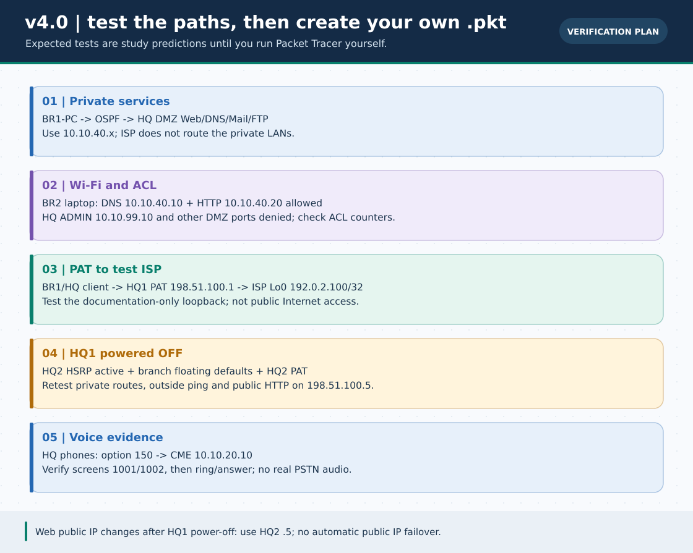

# 🧪 v4.0 Packet Tracer verification worksheet — FILL IN AFTER YOU RUN IT

> **নেভিগেশন:** [Phase 5 বাংলা গাইড](README.md) · [English guide](../en/capstone/README.md) · [নিজের `.pkt`-এর নিয়ম](../pkt-files/capstone/README.md) · [হোম](../README.md)

**এই শীটটি খালি।** নিচের `Expected` ফল design prediction; **কোনো Actual ফল এখানে আগে থেকে লেখা নেই**। এই workspace-এ Packet Tracer নেই। আপনার PT-তে নিজের topology বানিয়ে প্রমাণ সংগ্রহ না করা পর্যন্ত কোনো ধাপ PASS বলা যাবে না। ছবি বা CLI snippet `.pkt` ফাইল বা network test নয়।

## নিজের রান রেকর্ড করুন

| Field | আপনার ইনপুট |
| :--- | :--- |
| Packet Tracer version/OS | ______________________________ |
| `.pkt` ফাইলের নাম ও তারিখ | ______________________________ |
| Serial card/interface বাস্তব নাম | ______________________________ |
| Phone model, adapter ও CME support | ______________________________ |
| Tested by / machine | ______________________________ |
| Logs / screenshot / saved project location | ______________________________ |

**শৃঙ্খলা:** প্রথমে স্বাভাবিক অবস্থায় screen/CLI output সংরক্ষণ, তারপর **HQ1 physical OFF**, তারপর আবার প্রতিটি test। দেরিতে সফল হওয়া ping-কে শূন্য packet-loss failover বলে লিখবেন না। Failed/unsupported হলে error text লিখুন; “যাচাই করা হয়নি” লিখতে দ্বিধা নেই।

## Normal-state evidence (সব ডিভাইস ON)

| ID | উৎস ও চালানোর জায়গা | Expected *only* | Actual / command output / PASS-FAIL-UNSUPPORTED |
| :--- | :--- | :--- | :--- |
| N01 | HQ1 `show controllers serial 0/0/0` ও `0/0/1` | HQ serial দুইটি DCE, clock rate set; BR1/BR2-এর WAN-এ নিজস্ব /30 | ______________________________ |
| N02 | HQ1/HQ2/BR1/BR2 `show ip interface brief` | চারটি serial circuit-এর প্রতিটি দুই দিক up/up; HQ VLAN subinterfaces up/up | ______________________________ |
| N03 | HQ-SW/BR1-SW/BR2-SW `show interfaces trunk`, `show vlan brief` | HQ trunk দুটোতে 10,20,40,99; BR1 10,20; BR2 10,30; Fa ports সঠিক VLAN-এ | ______________________________ |
| N04 | HQ1/HQ2/BR1/BR2 `show ip ospf neighbor` | প্রত্যেক enterprise router-এ দুইটি serial neighbor FULL; ISP OSPF-তে নেই | ______________________________ |
| N05 | BR1 `show ip route 10.10.40.0`, BR2 `show ip route 10.10.40.0` | DMZ /24 একটি `O` route; ISP private route নয় | ______________________________ |
| N06 | HQ1/HQ2 `show standby brief` | HQ1 Active/HQ2 Standby (groups 10,20,40,99); `.1` VIP | ______________________________ |
| N07 | BR1-PC `ping 10.20.10.1`, `ping 10.10.40.20` | Local gateway ও private remote WEB host উত্তর দেয় | ______________________________ |
| N08 | BR1-PC browser `http://10.10.40.20` এবং `http://www.campus.lab` | IP-এ page, DNS A record পরে hostname-এ একই page | ______________________________ |
| N09 | BR1-PC mail GUI Send `br1@campus.lab → hq@campus.lab`; HQ-PC Receive/Inbox | Receiver Inbox-এ আসল message দেখায়; sender status একা যথেষ্ট নয় | ______________________________ |
| N10 | BR2-PC `ftp 10.10.40.40` → `dir`, local test file `put/get` | Auth, permissions, remote file ও download ফল পর্যবেক্ষণযোগ্য | ______________________________ |
| N11 | HQ-CME `show ip dhcp binding`; দুটি HQ phone display | দুটিতে voice lease `.20.21+`; screen-এ ভিন্ন extension `1001/1002` | ______________________________ |
| N12 | যে phone-এ `1001` দেখায় সেখান থেকে `1002` dial | অন্য phone-এ simulated ring এবং answer/connected GUI state; বাস্তব PSTN/audio নয় | ______________________________ |
| N13 | BR1-PHONE (ঐচ্ছিক) voice DHCP, displayed extension `2001` এবং call | আপনার PT-তে remote registration/routing *যদি* কাজ করে; না করলে UNSUPPORTED/NOT RUN | ______________________________ |
| N14 | BR2-LAPTOP wireless GUI, `ping 10.30.30.1` | `BR2-Study` WPA2 association, `.30.50/24`, local gateway reachable | ______________________________ |
| N15 | BR2-LAPTOP browser `http://www.campus.lab` | Wi-Fi ACL-এ DNS53 ও WEB80 permitted; page opens | ______________________________ |
| N16 | BR1-PC/BR2-PC `ping 10.10.99.10`, HQ-PC same target; `show access-lists` branches | Branch data denied + ACL deny counters; HQ-PC allowed | ______________________________ |
| N17 | BR2-LAPTOP `ping 10.10.40.20`, `ftp 10.10.40.40`, `ping 10.10.99.10` | Wi-Fi→DMZ ICMP/FTP/admin denied despite WEB/DNS allowed; counter evidence | ______________________________ |
| N18 | BR1-PC `ping 192.0.2.100`; HQ1 `show ip nat translations` | New ICMP flow succeeds; inside address translated to outside `198.51.100.1` (PT counters may vary) | ______________________________ |
| N19 | ISP `show ip route 10.10.40.0`, EXT-PC `ping 10.10.40.20` | ISP has **no** route to private DMZ; private ping fails | ______________________________ |
| N20 | EXT-PC browser `http://198.51.100.1`; HQ1 `show ip nat translations` | Public test TCP/80 maps to private WEB .40.20; mapping visible, browser result observed | ______________________________ |

**ACL caveat:** ACL counters may be zero until new packets are sent; an expected denied test is meaningful only if local link, routing and ACL match are independently established. BR2-Wi-Fi cannot ping WEB by design, but should open it in a browser if DNS and TCP80 work. ISP's lack of private route is intentional; don't add one merely to make N19 pass.

## Physical HQ1 power-off and recovery

1. Save all normal-state `show`/GUI evidence. In HQ1 **Physical tab power OFF**; do **not** only shut `G0/0` because WAN/public links would stay up.
2. Wait for HSRP + OSPF timers. During convergence some pings may time out. Send **new** requests; inspect each resulting path and configuration.

| ID | উৎস ও চালানোর জায়গা | Expected *only* | Actual / command output / PASS-FAIL-UNSUPPORTED |
| :--- | :--- | :--- | :--- |
| F01 | HQ2 `show standby brief` | HQ2 Active for each HQ group; PC gateway still each `.1` | ______________________________ |
| F02 | BR1 `show ip route 0.0.0.0` | Backup next hop **10.255.12.1** (administrative distance 20) | ______________________________ |
| F03 | BR2 `show ip route 0.0.0.0` | Backup next hop **10.255.22.1** (administrative distance 20) | ______________________________ |
| F04 | BR1/BR2 `show ip ospf neighbor` ও `show ip route 10.10.40.0` | Each has HQ2 serial neighbor; private DMZ `O` route remains | ______________________________ |
| F05 | HQ-PC/BR1-PC → `10.10.40.20`, `192.0.2.100` | Private WEB and outbound ISP-test traffic eventually resume after convergence | ______________________________ |
| F06 | HQ2 `show ip nat translations` after a **fresh** BR1-PC outside ping | New flow translated to **198.51.100.5**; stale HQ1 flow not counted as HQ2 proof | ______________________________ |
| F07 | EXT-PC browser `http://198.51.100.5`; then `.1` | New HQ2 address can serve WEB if static TCP/80 is supported; HQ1 address down. **No automatic public VIP** | ______________________________ |
| F08 | Power HQ1 back ON; `show standby brief` + BR1/BR2 defaults + a new outbound test | Preempt may restore HQ1 Active, defaults to HQ1; new NAT sessions may be required | ______________________________ |

> **সীমা:** 2811 CME, `HWIC-2T`, some IOS/GUI service commands, static TCP port map, radio adapter ও UI telemetry PT edition-ভেদে বদলাতে পারে। Input গ্রহণ মানেই traffic সফল নয়। পরীক্ষার আগে **`Expected`-এর কোনো লাইনকে test result হিসেবে উদ্ধৃত করবেন না**।

**Continue:** [বাংলা ল্যাব](README.md) · [English capstone](../en/capstone/README.md) · [নিজের আসল `.pkt` যোগ করুন](../pkt-files/capstone/README.md)
