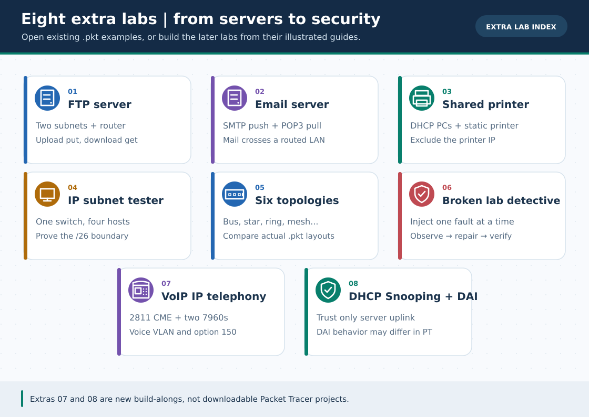

# 8 Extra Practical Labs · English Track

> **Navigation:** [English home](../README.md) · [বাংলা সূচি](../../Extras/README.md) · [26 GIFs and search priorities](../../GIF-CATALOG.md)

Practice services, subnetting, topology choices, fault isolation, VoIP and L2 security. Every Extra Lab has an original 30-second illustrated GIF.

**Interpretation:** These pages are independently readable English adaptations; the full-length Bengali originals and their extended tests remain available via a link at the top/bottom of every page. GIFs are conceptual illustrations, **not Packet Tracer recordings**.

| # | English guide | Bengali original | 30-second GIF |
| :---: | :--- | :--- | :--- |
| 01 | [FTP server: upload, download and permissions](ftp-server-lab.md) | [বাংলা গাইড](../../Extras/ftp-server-lab.md) | [▶ Watch GIF](../../assets/gifs/extra-01-ftp-server-lab.gif) |
| 02 | [Email across subnets with SMTP and POP3](email-server-lab.md) | [বাংলা গাইড](../../Extras/email-server-lab.md) | [▶ Watch GIF](../../assets/gifs/extra-02-email-server-lab.gif) |
| 03 | [Office network printer with DHCP clients](office-shared-printer-lab.md) | [বাংলা গাইড](../../Extras/office-shared-printer-lab.md) | [▶ Watch GIF](../../assets/gifs/extra-03-office-shared-printer-lab.gif) |
| 04 | [Subnet tester: /24 versus /26 on a switch](ip-subnet-tester-lab.md) | [বাংলা গাইড](../../Extras/ip-subnet-tester-lab.md) | [▶ Watch GIF](../../assets/gifs/extra-04-ip-subnet-tester-lab.gif) |
| 05 | [Six network topologies in Packet Tracer](network-topologies-lab.md) | [বাংলা গাইড](../../Extras/network-topologies-lab.md) | [▶ Watch GIF](../../assets/gifs/extra-05-network-topologies-lab.gif) |
| 06 | [Broken Network Detective: six fault scripts](broken-labs-challenge.md) | [বাংলা গাইড](../../Extras/broken-labs-challenge.md) | [▶ Watch GIF](../../assets/gifs/extra-06-broken-labs-challenge.gif) |
| 07 | [2811 CME and two 7960 IP phones](voip-ip-telephony-lab.md) | [বাংলা গাইড](../../Extras/voip-ip-telephony-lab.md) | [▶ Watch GIF](../../assets/gifs/extra-07-voip-ip-telephony-lab.gif) |
| 08 | [DHCP Snooping and optional DAI policy](dhcp-snooping-dai-lab.md) | [বাংলা গাইড](../../Extras/dhcp-snooping-dai-lab.md) | [▶ Watch GIF](../../assets/gifs/extra-08-dhcp-snooping-dai-lab.gif) |

> **Files/limits:** Existing .pkt examples cover early labs; Extra 07–08 are build-alongs without new .pkt. Packet Tracer may accept DAI commands without actually dropping ARP packets.

[English home](../README.md) · [Full GIF catalog and replacement search names](../../GIF-CATALOG.md) · [Bengali home](../../README.md)
