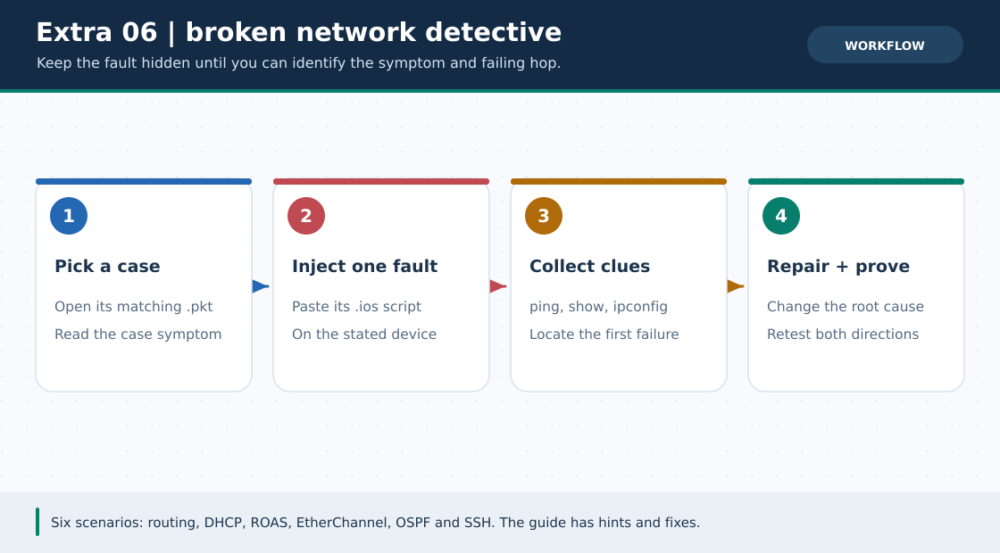
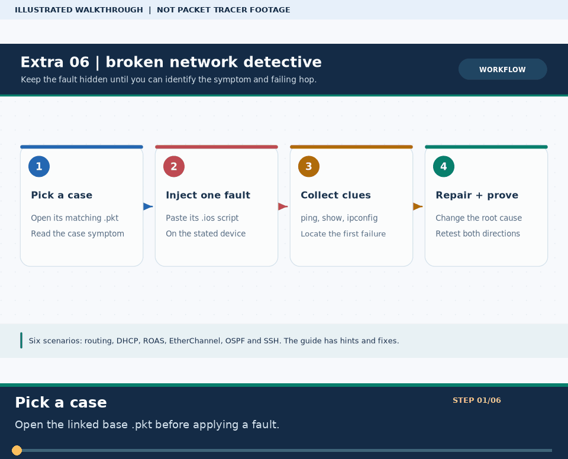

# Extra Lab 06: Broken Network Detective: six fault scripts

> **Navigation:** [English home](../README.md) · [Extra Lab index](README.md) · [Full Bengali guide](../../Extras/broken-labs-challenge.md)

**Learning goal.** Apply a deliberate .ios fault to a known base lab and diagnose it without reading the answer first.



> **About this visual:** Illustrated topology or concept map from the corresponding Bengali guide; a diagram, not a Packet Tracer capture.



> **30-second GIF:** six illustrated stages of the topology and checks. This is **not a Packet Tracer recording or proof of successful device behavior**. See the [GIF search names and study priorities](../../GIF-CATALOG.md) if you want to source your own alternative.

## Understand the design

Six existing .ios cases cover static routing, DHCP, ROAS tag swap, EtherChannel LACP, OSPF adjacency and SSH remote-access issues. They modify linked existing .pkt projects; no new pre-broken native .pkt is supplied for these six cases.

### Key ideas

- A fault script is text to paste on the named device, not a standalone Packet Tracer project.
- Keep the known-good baseline and the failure symptom so the repair can be verified.
- Read the source guide's hidden solution only after collecting show and ping evidence.

## Build or work through it

1. Choose a case in the original challenge and open the exact base .pkt it references. Save a separate working copy.
2. Apply the corresponding .ios script to the named router/switch; do not paste it across every device.
3. Observe the stated failure and inspect the appropriate interface, VLAN, route, DHCP, LACP or OSPF state.
4. Correct one cause and rerun the same failed command or service test, then compare with the hidden answer.

### Copyable study example

Read the comment or role label first: IOS commands, PC commands and shell commands run in **different places**. This example is not a verified Packet Tracer run.

```text
# Optional: read the six case summaries in the generator
python3 scripts/ios_config_generator.py broken-lab --case 5
# On the actual device use the relevant show command, e.g.
show ip ospf neighbor
```

## Verify; do not guess

- [ ] You can name the root cause and show the CLI output that led to it.
- [ ] The original failed ping, adjacency or service test now passes after the smallest fix.
- [ ] The unmodified baseline project remains available for a second attempt.

## If it fails

- A DHCP 169.254.x.x symptom needs a DHCP-path test; do not start by editing DNS.
- An EtherChannel member inconsistency requires comparing both ends, not just changing a single port's IP.

## Check your understanding

**Question.** Is a .ios fault script a ready-to-open pre-broken .pkt project?

<details><summary>Reveal the explanation</summary>

**Answer.** No. It is configuration text for a named device in an existing baseline project.

</details>

---

**Continue:** [English track](README.md) · [Full Bengali lesson, complete tables and additional exercises](../../Extras/broken-labs-challenge.md)
