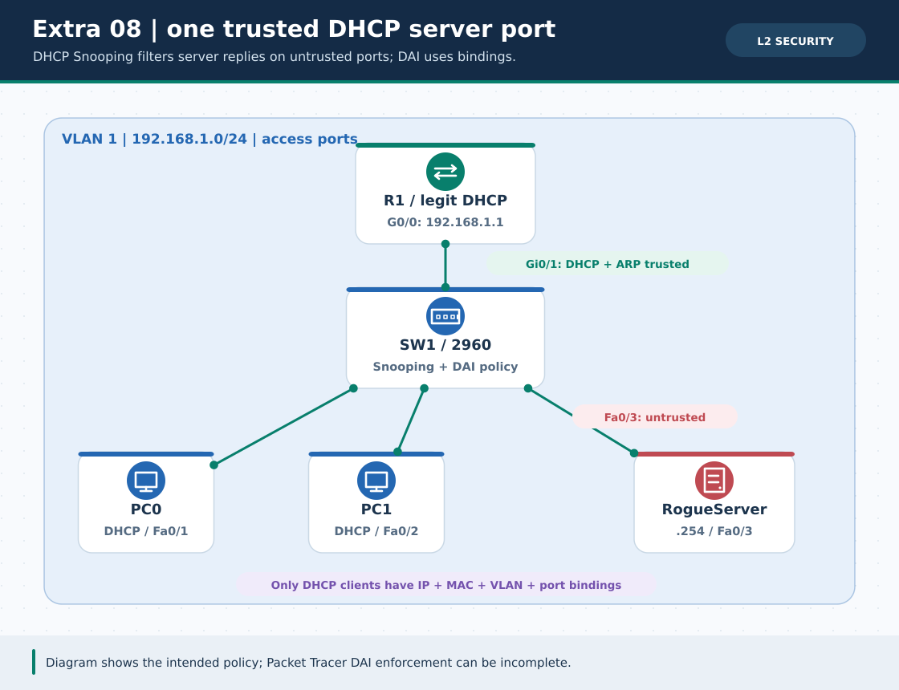
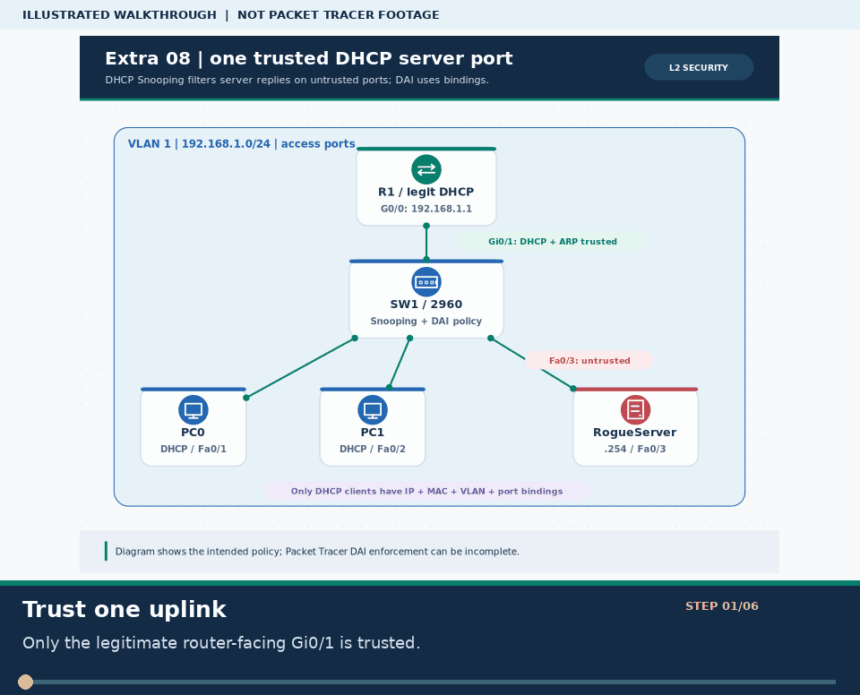
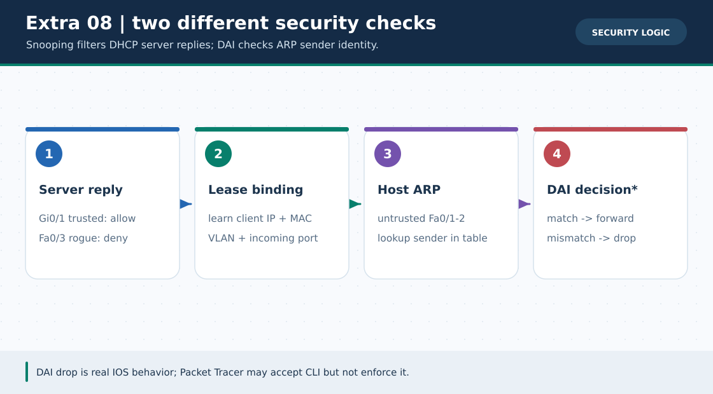

# Extra Lab 08: DHCP Snooping and optional DAI policy

> **Navigation:** [English home](../README.md) · [Extra Lab index](README.md) · [Full Bengali guide](../../Extras/dhcp-snooping-dai-lab.md)

**Learning goal.** Distinguish verified DHCP bindings from uncertain Packet Tracer DAI enforcement.



> **About this visual:** Illustrated topology or concept map from the corresponding Bengali guide; a diagram, not a Packet Tracer capture.



> **30-second GIF:** six illustrated stages of the topology and checks. This is **not a Packet Tracer recording or proof of successful device behavior**. See the [GIF search names and study priorities](../../GIF-CATALOG.md) if you want to source your own alternative.



> This second diagram separates the concept/flow from the physical topology. Compare its labels with the numbered build steps below.

## Understand the design

R1 legitimate DHCP at 192.168.1.1/24 faces SW1 Gi0/1 (the only trusted uplink). PC0/PC1 occupy untrusted Fa0/1-2; rogue server at 192.168.1.254/24 uses untrusted Fa0/3. Keep rogue DHCP OFF until ordinary leases are working.

### Key ideas

- DHCP Snooping permits a server reply from a trusted uplink and builds client IP/MAC/VLAN/port binding records.
- Do not mark the rogue/client ports trusted; doing so defeats the exercise.
- DAI can use trusted ports and the Snooping binding database, but Packet Tracer may accept a DAI command while not filtering ARP traffic.

## Build or work through it

1. Build the VLAN 1 baseline, configure R1 DHCP and trust only SW1 Gi0/1 for Snooping.
2. Renew PC0 and PC1, inspect their gateway .1 and confirm entries in show ip dhcp snooping binding.
3. Only then enable rogue DHCP on Fa0/3 and record actual lease/Offer behavior in your PT version.
4. Optionally inspect DAI command support and enable it on VLAN 1 only after bindings are proven; roll it back if clients lose reachability.

### Copyable study example

Read the comment or role label first: IOS commands, PC commands and shell commands run in **different places**. This example is not a verified Packet Tracer run.

```bash
# Print separate device roles before pasting; do not combine on one switch/router
python3 scripts/ios_config_generator.py dhcp-snooping --role R1
python3 scripts/ios_config_generator.py dhcp-snooping --role SW1
# Optional SW1 stage after real bindings exist:
python3 scripts/ios_config_generator.py dai --role SW1
```

## Verify; do not guess

- [ ] PCs have valid R1 leases and the binding table names their client ports.
- [ ] Only SW1 Gi0/1 is trusted; the rogue server's Fa0/3 stays untrusted.
- [ ] Any DAI ARP-drop claim must have actual packet evidence from a capable platform; command acceptance alone is not such evidence.

## If it fails

- If bindings are absent, inspect DHCP first; do not enable DAI merely because its command is accepted.
- If an optional DAI configuration blocks good clients, roll back with no ip arp inspection vlan 1 on SW1.

## Check your understanding

**Question.** Does ip arp inspection vlan 1 being accepted prove Packet Tracer blocks spoofed ARP?

<details><summary>Reveal the explanation</summary>

**Answer.** No. DAI traffic enforcement in Packet Tracer is version-dependent and unverified in this repository.

</details>

---

**Continue:** [English track](README.md) · [Full Bengali lesson, complete tables and additional exercises](../../Extras/dhcp-snooping-dai-lab.md)
