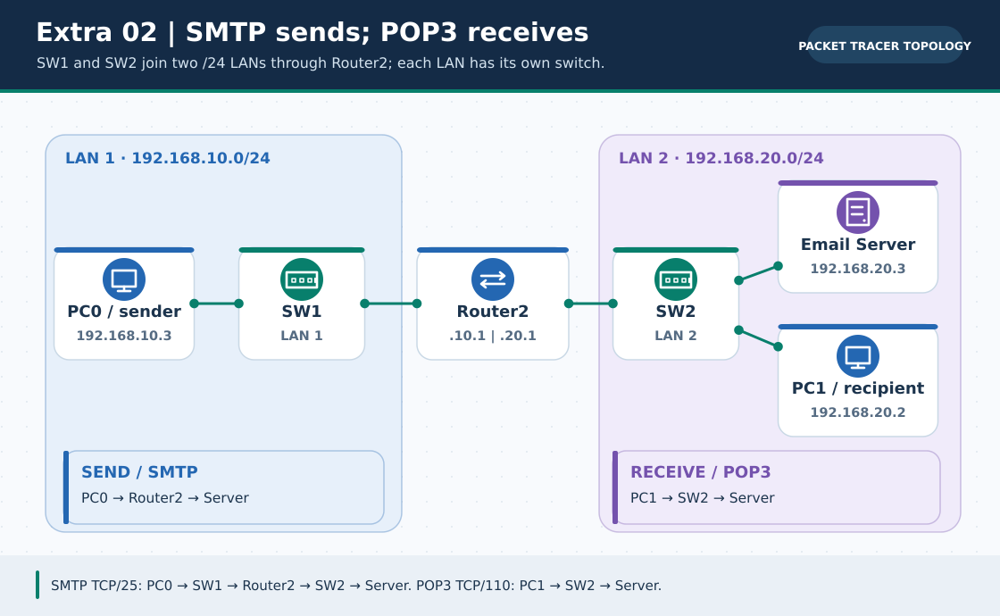
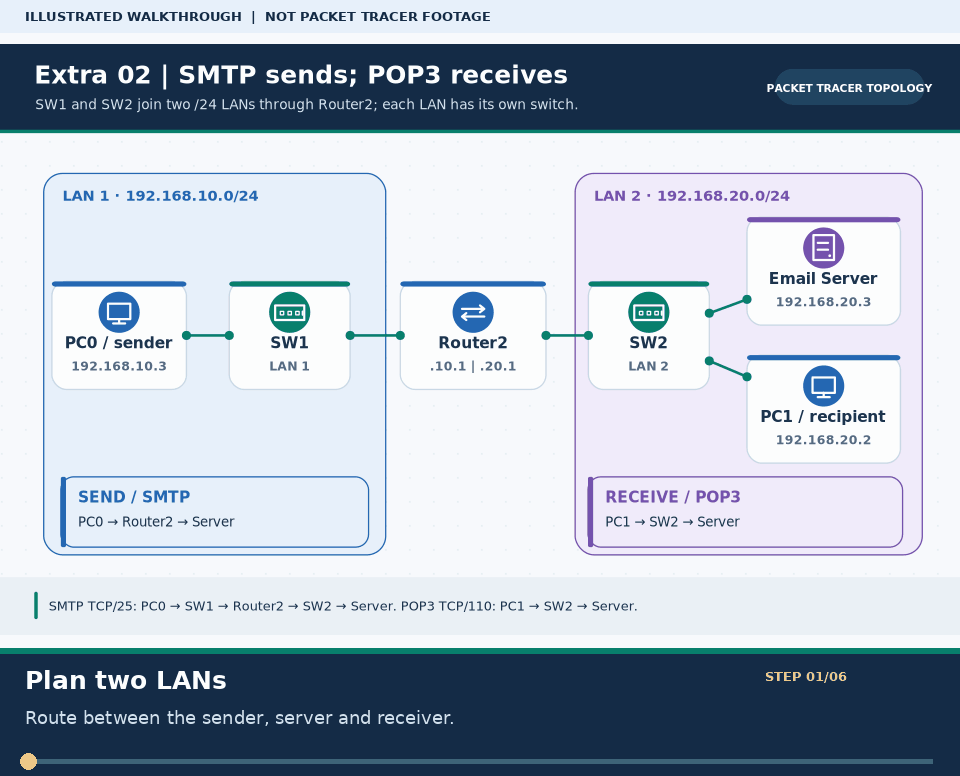

# Extra Lab 02: Email across subnets with SMTP and POP3

> **Navigation:** [English home](../README.md) · [Extra Lab index](README.md) · [Full Bengali guide](../../Extras/email-server-lab.md)

**Learning goal.** Send from one LAN and retrieve in another using separate mail clients and a local server.



> **About this visual:** Illustrated topology or concept map from the corresponding Bengali guide; a diagram, not a Packet Tracer capture.



> **30-second GIF:** six illustrated stages of the topology and checks. This is **not a Packet Tracer recording or proof of successful device behavior**. See the [GIF search names and study priorities](../../GIF-CATALOG.md) if you want to source your own alternative.

## Understand the design

Router2 has G0/0 192.168.10.1/24 and G0/1 192.168.20.1/24. PC0 192.168.10.3 is sender; PC1 192.168.20.2 and Email Server 192.168.20.3 are in the receiver LAN. Both PCs use 192.168.20.3 for mail/DNS where configured.

### Key ideas

- SMTP submits or relays mail; POP3 retrieves mail from a mailbox. Sending and receiving are separate tests.
- Clients must know the correct server/domain and have distinct account credentials.
- Router2 already has both LANs as directly connected networks; no extra static route is required in this simple design.

## Build or work through it

1. Open the included Email-Server.pkt or connect Router2, two switches, two PCs and an Email Server as pictured.
2. Assign the two router interfaces and each endpoint's static address, mask, gateway and DNS setting.
3. Under Server Services enable SMTP/POP3, set the chosen domain and create the sender and receiver user accounts.
4. Configure both PC mail clients with their own mailbox details and the mail server address. Send from PC0 and explicitly receive on PC1.

### Copyable study example

Read the comment or role label first: IOS commands, PC commands and shell commands run in **different places**. This example is not a verified Packet Tracer run.

```text
# In the PC command prompt, confirm connectivity before mail testing
ping 192.168.20.3
# In the mail GUI: Send from PC0; Receive on PC1; inspect Inbox
```

## Verify; do not guess

- [ ] PC0 can ping the server in the other subnet; Router2 G0/0 and G0/1 are up/up.
- [ ] The server has both SMTP and POP3 enabled with the two intended accounts.
- [ ] PC1's Inbox contains the message sent from PC0; an outgoing status alone is insufficient.

## If it fails

- If cross-LAN ping fails, check PC0 gateway .10.1, PC1/server gateway .20.1 and router interface state.
- If send succeeds but receive fails, inspect PC1's credentials, incoming server, POP3 state and recipient spelling.

## Check your understanding

**Question.** Which mail protocol is responsible for PC1 retrieving a stored message in this lab?

<details><summary>Reveal the explanation</summary>

**Answer.** POP3. SMTP is used for submission/delivery, not the retrieval action on PC1.

</details>

---

**Continue:** [English track](README.md) · [Full Bengali lesson, complete tables and additional exercises](../../Extras/email-server-lab.md)
