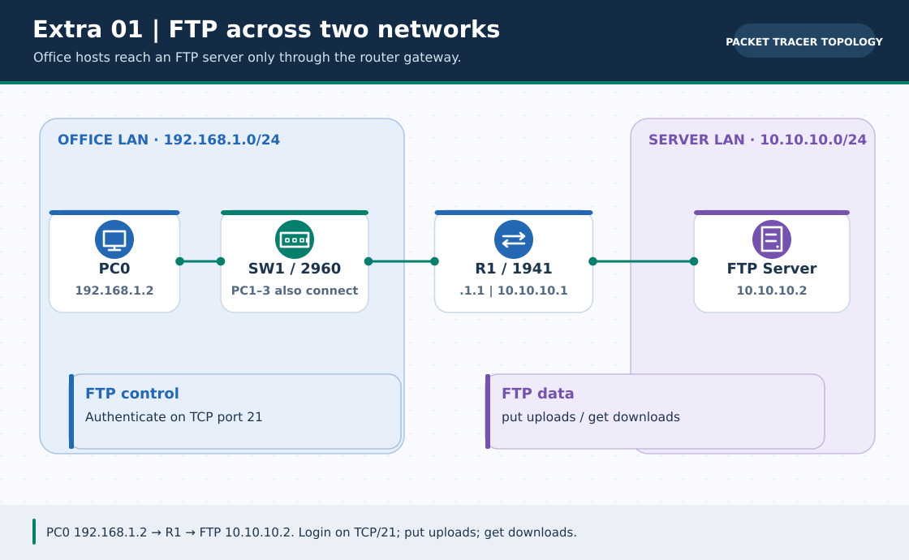
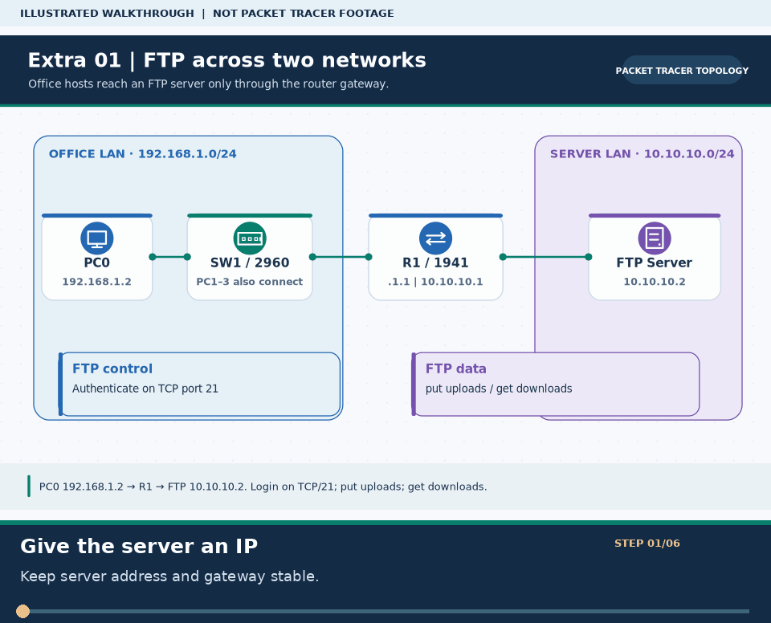

# Extra Lab 01: FTP server: upload, download and permissions

> **Navigation:** [English home](../README.md) · [Extra Lab index](README.md) · [Full Bengali guide](../../Extras/ftp-server-lab.md)

**Learning goal.** Configure a server on a separate subnet and confirm authenticated file transfers.



> **About this visual:** Illustrated topology or concept map from the corresponding Bengali guide; a diagram, not a Packet Tracer capture.



> **30-second GIF:** six illustrated stages of the topology and checks. This is **not a Packet Tracer recording or proof of successful device behavior**. See the [GIF search names and study priorities](../../GIF-CATALOG.md) if you want to source your own alternative.

## Understand the design

R1 G0/0 192.168.1.1/24 connects to four LAN PCs .2-.5; R1 G0/1 10.10.10.1/24 connects to FTP Server 10.10.10.2/24 with gateway 10.10.10.1. The provided FTP-Server.pkt may be opened as a starting lab.

### Key ideas

- FTP is a client-server file protocol; a successful ping is necessary but not sufficient for login.
- A server in another subnet needs a correct default gateway for its replies to reach the PC LAN.
- Permissions control operations such as reading, writing, deleting and renaming; a login alone does not grant every action.

## Build or work through it

1. Cable R1, SW1, four PCs and Server0 as shown; set both R1 interfaces and the server's static IP/gateway.
2. On Server0 enable the FTP service and create a named account with the permissions required for the test.
3. Ping 10.10.10.2 from a PC before starting FTP; fix routing/IP issues if it cannot be reached.
4. Open the PC command prompt, connect with ftp 10.10.10.2 and log in. Test put, get, directory listing and permission-limited actions.

### Copyable study example

Read the comment or role label first: IOS commands, PC commands and shell commands run in **different places**. This example is not a verified Packet Tracer run.

```text
# Run from a Packet Tracer PC command prompt, not on an IOS router
ping 10.10.10.2
ftp 10.10.10.2
# Inside the FTP session: dir, put <file>, get <file>
```

## Verify; do not guess

- [ ] show ip interface brief on R1 lists G0/0 and G0/1 up/up with the planned subnet addresses.
- [ ] A PC reaches 10.10.10.2 by ping and successfully logs in with the created FTP account.
- [ ] Uploaded and downloaded files appear on the expected device and disallowed actions are treated as permission outcomes.

## If it fails

- If ping fails, compare the FTP server's gateway 10.10.10.1, router G0/1 and PC gateway 192.168.1.1.
- If login fails but ping works, check whether FTP is on, the username/password and account permissions.

## Check your understanding

**Question.** Why is 10.10.10.1 the FTP server's default gateway instead of 192.168.1.1?

<details><summary>Reveal the explanation</summary>

**Answer.** The server is on 10.10.10.0/24 and must send off-subnet replies to its directly connected R1 interface 10.10.10.1.

</details>

---

**Continue:** [English track](README.md) · [Full Bengali lesson, complete tables and additional exercises](../../Extras/ftp-server-lab.md)
