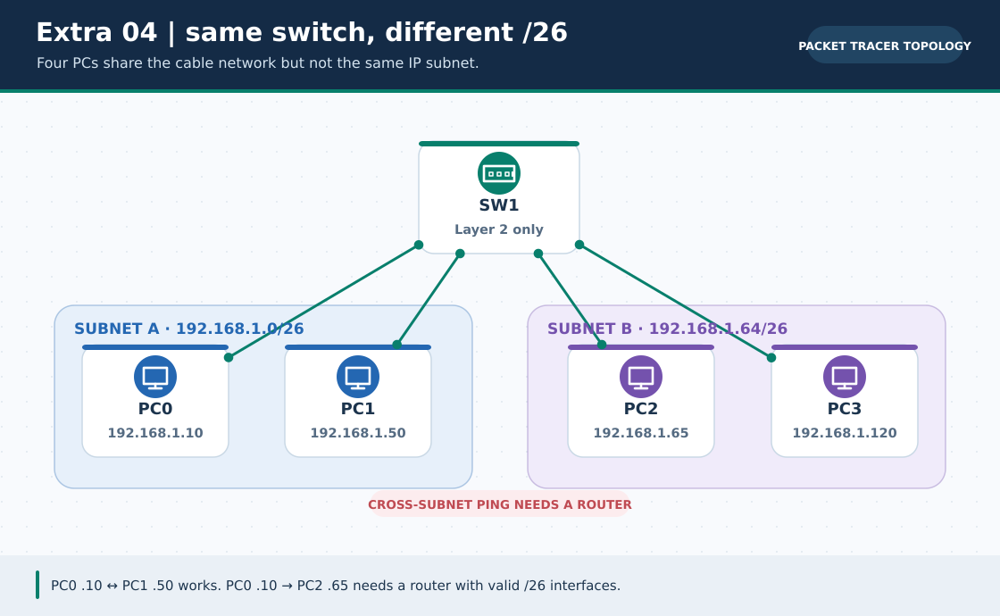
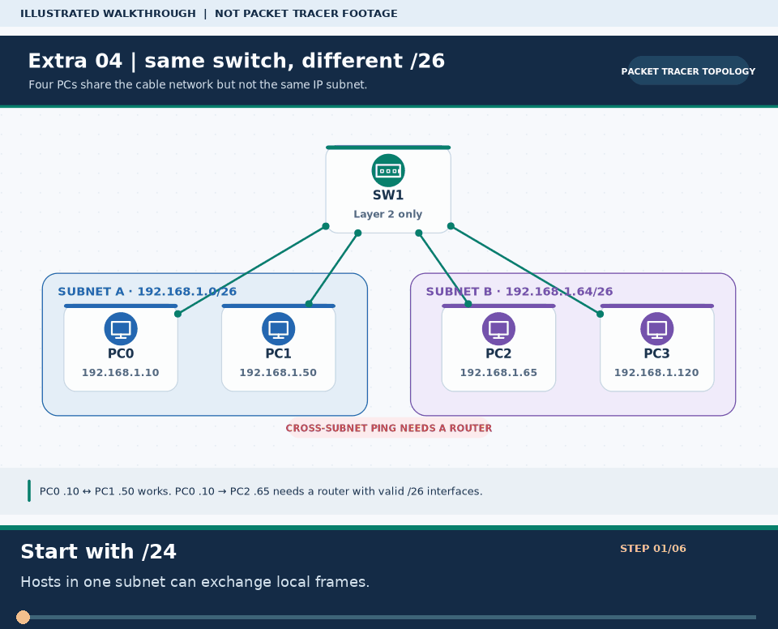

# Extra Lab 04: Subnet tester: /24 versus /26 on a switch

> **Navigation:** [English home](../README.md) · [Extra Lab index](README.md) · [Full Bengali guide](../../Extras/ip-subnet-tester-lab.md)

**Learning goal.** Use predictable ping results to prove that a subnet mask defines local reachability.



> **About this visual:** Illustrated topology or concept map from the corresponding Bengali guide; a diagram, not a Packet Tracer capture.



> **30-second GIF:** six illustrated stages of the topology and checks. This is **not a Packet Tracer recording or proof of successful device behavior**. See the [GIF search names and study priorities](../../GIF-CATALOG.md) if you want to source your own alternative.

## Understand the design

Place four PCs on one 2960 switch. Compare hosts in 192.168.1.0/26 (such as .10 and .50) with hosts in 192.168.1.64/26 (such as .65 and .120). Do not infer subnet membership just from the first three octets.

### Key ideas

- A /26 mask 255.255.255.192 makes blocks of 64 addresses.
- 192.168.1.0/26 has usable .1-.62 and broadcast .63; 192.168.1.64/26 has usable .65-.126 and broadcast .127.
- A switch alone forwards within a VLAN, but does not provide routing between two distinct /26 IPv4 networks.

## Build or work through it

1. Open ip-subnet-tester.pkt or cable one switch and four PCs, set .10/.50/.65/.120 all with /26.
2. Test .10 to .50 and .65 to .120; then test .10 to .65 and explain the expected cross-subnet failure.
3. Revisit the experiment with /24 masks only as a separate test and note the different network interpretation.
4. Try assigning a network or broadcast address and document simulator rejection/behavior without calling it a valid host.
5. For a legitimate /26-to-/26 ping, add a router with one correctly addressed gateway per subnet.

### Copyable study example

Read the comment or role label first: IOS commands, PC commands and shell commands run in **different places**. This example is not a verified Packet Tracer run.

```bash
python3 scripts/subnet_calculator.py 192.168.1.10/26
python3 scripts/subnet_calculator.py 192.168.1.65/26
```

## Verify; do not guess

- [ ] Same-/26 host pairs ping within their VLAN when ports and masks match.
- [ ] Cross-/26 hosts need a router; a mask change alone alters the experiment instead of adding routing.
- [ ] Calculate .63 and .127 as broadcast addresses and do not use them as ordinary hosts.

## If it fails

- If a predicted local ping fails, check both masks and the switch port/cable before changing a gateway.
- If a cross-/26 ping unexpectedly works, inspect a router/default gateway or an incorrect /24 mask.

## Check your understanding

**Question.** Are 192.168.1.10/26 and 192.168.1.65/26 in one subnet?

<details><summary>Reveal the explanation</summary>

**Answer.** No. They are in 192.168.1.0/26 and 192.168.1.64/26 respectively.

</details>

---

**Continue:** [English track](README.md) · [Full Bengali lesson, complete tables and additional exercises](../../Extras/ip-subnet-tester-lab.md)
