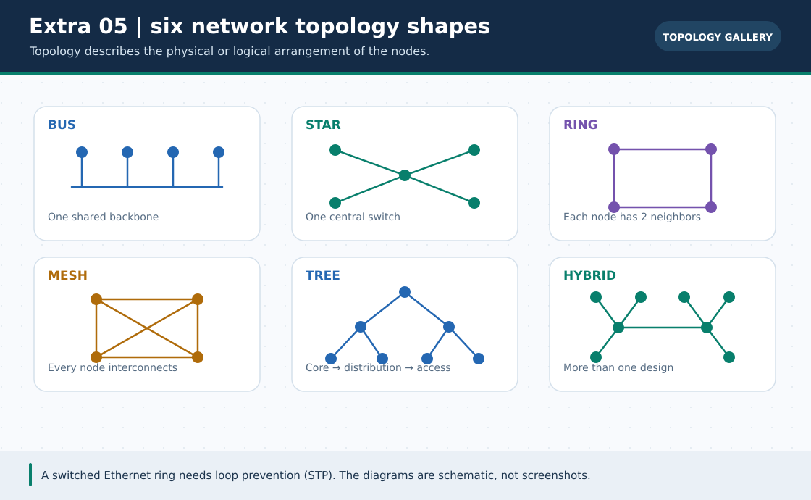
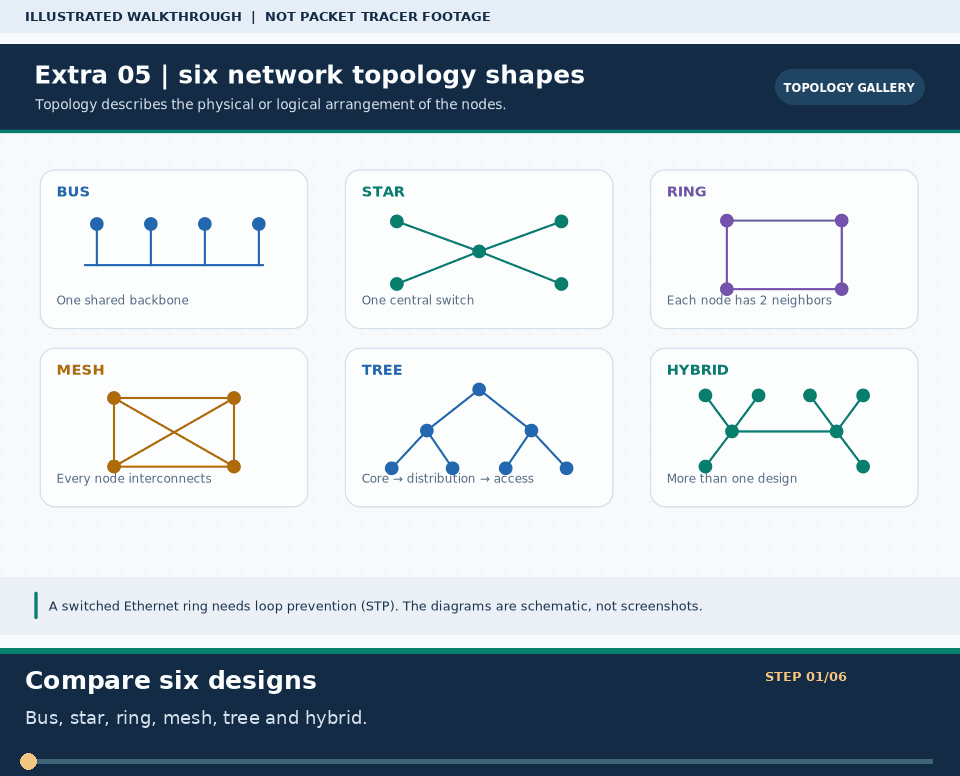

# Extra Lab 05: Six network topologies in Packet Tracer

> **Navigation:** [English home](../README.md) · [Extra Lab index](README.md) · [Full Bengali guide](../../Extras/network-topologies-lab.md)

**Learning goal.** Compare bus, star, ring, mesh, tree and hybrid designs using bundled example files.



> **About this visual:** Illustrated topology or concept map from the corresponding Bengali guide; a diagram, not a Packet Tracer capture.



> **30-second GIF:** six illustrated stages of the topology and checks. This is **not a Packet Tracer recording or proof of successful device behavior**. See the [GIF search names and study priorities](../../GIF-CATALOG.md) if you want to source your own alternative.

## Understand the design

Six existing .pkt examples live in pkt-files/topologies/. Open one at a time; their simulator approximations are learning models, not claims that Ethernet implements every classic physical topology literally.

### Key ideas

- Star attaches endpoints to a central device; a central failure can affect all branches.
- Ring and mesh emphasize alternate paths; forwarding depends on the actual L2/L3 protocol, not the drawing alone.
- A full mesh with N nodes uses N(N-1)/2 direct links; 5 nodes require 10 links.

## Build or work through it

1. Open bus-topology.pkt and sketch how the simulated shared segment differs from modern switched Ethernet.
2. Open star-topology.pkt and observe the effect of disconnecting the central device.
3. Inspect ring-topology.pkt and mesh-topology.pkt with Simulation Mode; record real observed PDU paths.
4. Compare tree-topology.pkt with hybrid-topology.pkt and identify the hierarchy or combined patterns.
5. Summarize each design's link count, cost, single points of failure and expected recovery path.

### Copyable study example

Read the comment or role label first: IOS commands, PC commands and shell commands run in **different places**. This example is not a verified Packet Tracer run.

```text
Full mesh direct links = N * (N - 1) / 2
N = 5: 5 * 4 / 2 = 10 links
```

## Verify; do not guess

- [ ] All six example names are in pkt-files/topologies/ and can be opened separately.
- [ ] A Simulation Mode event, not just the picture, supports each observed forwarding claim.
- [ ] Explain why two parallel links on a switch may be blocked by STP without an EtherChannel.

## If it fails

- If a redundant path does not forward, inspect STP or routing before assuming a broken cable.
- Do not claim a Packet Tracer star diagram proves real-world availability or a true shared-medium bus.

## Check your understanding

**Question.** How many direct links connect five nodes in a full mesh?

<details><summary>Reveal the explanation</summary>

**Answer.** Ten: 5(5-1)/2 = 10.

</details>

---

**Continue:** [English track](README.md) · [Full Bengali lesson, complete tables and additional exercises](../../Extras/network-topologies-lab.md)
