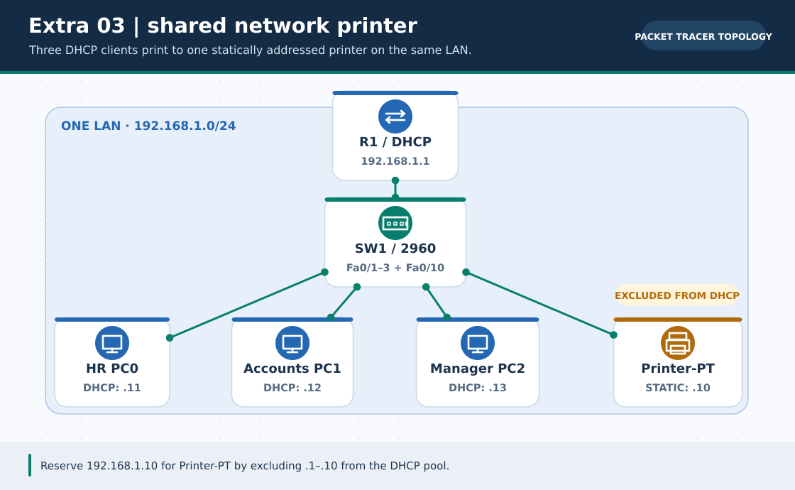
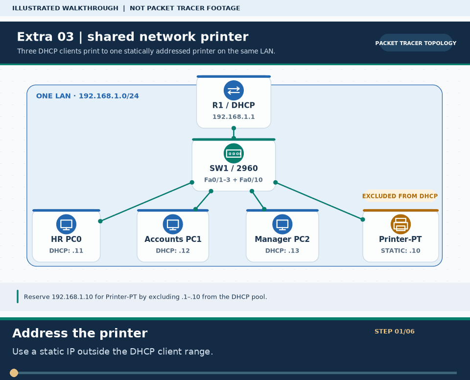

# Extra Lab 03: Office network printer with DHCP clients

> **Navigation:** [English home](../README.md) · [Extra Lab index](README.md) · [Full Bengali guide](../../Extras/office-shared-printer-lab.md)

**Learning goal.** Give a shared printer a stable IP and prevent the DHCP server from leasing it to a PC.



> **About this visual:** Illustrated topology or concept map from the corresponding Bengali guide; a diagram, not a Packet Tracer capture.



> **30-second GIF:** six illustrated stages of the topology and checks. This is **not a Packet Tracer recording or proof of successful device behavior**. See the [GIF search names and study priorities](../../GIF-CATALOG.md) if you want to source your own alternative.

## Understand the design

R1 G0/0 192.168.1.1/24 serves the office LAN. Printer0 on SW1 Fa0/10 has static 192.168.1.10/24 with gateway .1; three clients on Fa0/1-3 lease starting near .11. The included office-shared-printer-network.pkt is an example project.

### Key ideas

- A fixed printer address makes client configuration predictable across restarts.
- Exclude the gateway and printer from the router DHCP pool; overlap causes intermittent duplicate-address faults.
- Pinging a printer checks IP reachability but is separate from an application print-job test.

## Build or work through it

1. Connect router, 2960, Printer-PT and three PCs to the planned ports.
2. Give R1 G0/0 .1 and configure an OFFICE_LAN DHCP pool with excluded .1 through .10.
3. Set Printer0 to static .10/24 and gateway .1; choose DHCP on all three PCs.
4. Ping Printer0 from every PC. If supported by your PT version, send a simple PDU/print job and observe the result separately.

### Copyable study example

Read the comment or role label first: IOS commands, PC commands and shell commands run in **different places**. This example is not a verified Packet Tracer run.

```cisco
ip dhcp excluded-address 192.168.1.1 192.168.1.10
ip dhcp pool OFFICE_LAN
 network 192.168.1.0 255.255.255.0
 default-router 192.168.1.1
```

## Verify; do not guess

- [ ] PCs have distinct leases outside the excluded .1-.10 range.
- [ ] All PCs can ping the fixed printer IP 192.168.1.10.
- [ ] The printer keeps its .10 address after a restart rather than taking a new DHCP lease.

## If it fails

- If a PC has .10, correct the DHCP exclusion and renew that client lease.
- If printer ping fails, inspect the printer mask/gateway, cable and the switch port for Fa0/10.

## Check your understanding

**Question.** Why is the printer's .10 address excluded from DHCP?

<details><summary>Reveal the explanation</summary>

**Answer.** It is statically assigned to Printer0; leasing it to a PC would cause an address collision.

</details>

---

**Continue:** [English track](README.md) · [Full Bengali lesson, complete tables and additional exercises](../../Extras/office-shared-printer-lab.md)
