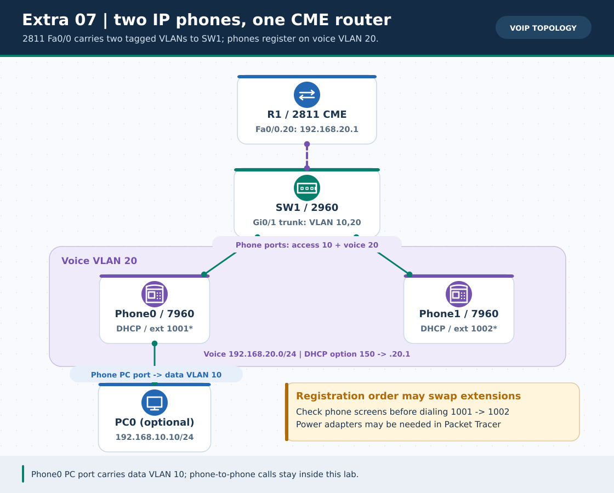
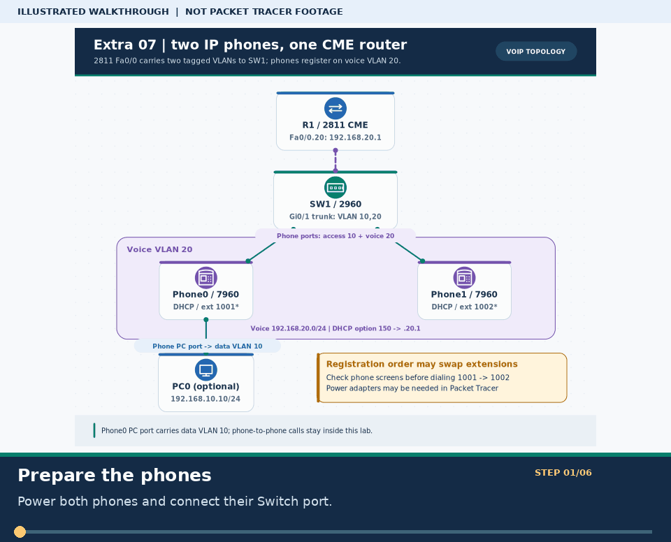
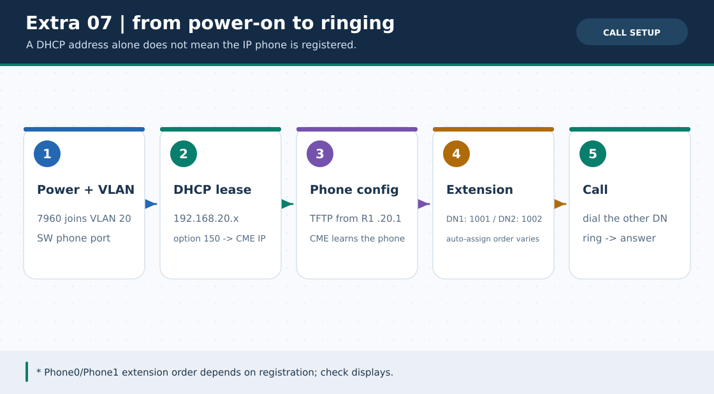

# Extra Lab 07: 2811 CME and two 7960 IP phones

> **Navigation:** [English home](../README.md) · [Extra Lab index](README.md) · [Full Bengali guide](../../Extras/voip-ip-telephony-lab.md)

**Learning goal.** Separate data and voice VLANs, register two extensions and test a simulated on-net call.



> **About this visual:** Illustrated topology or concept map from the corresponding Bengali guide; a diagram, not a Packet Tracer capture.



> **30-second GIF:** six illustrated stages of the topology and checks. This is **not a Packet Tracer recording or proof of successful device behavior**. See the [GIF search names and study priorities](../../GIF-CATALOG.md) if you want to source your own alternative.



> This second diagram separates the concept/flow from the physical topology. Compare its labels with the numbered build steps below.

## Understand the design

R1 2811 Fa0/0 trunks to SW1 Gi0/1. Data VLAN 10 gateway is 192.168.10.1/24; voice VLAN 20 gateway and DHCP option 150/CME address is 192.168.20.1/24. Two 7960 phones connect via their Switch ports; optional PC0 uses the phone PC port on data VLAN.

### Key ideas

- Switch access ports Fa0/1-2 carry untagged data VLAN 10 and voice VLAN 20, while Gi0/1 is the trunk.
- Option 150 supplies the CME/TFTP address; phones also need IP power, configuration and registration.
- Auto-assigned extensions 1001/1002 depend on registration order; check the phone display instead of assuming Phone0 is always 1001.

## Build or work through it

1. Place 2811, 2960 and two 7960s; ensure phones have power adapters where PT does not supply PoE.
2. Configure SW1 data and voice VLANs, its Gi0/1 trunk, and both phone access/voice ports.
3. Configure R1 dot1Q .10/.20 subinterfaces, voice DHCP with option 150 and CME telephony-service with two ephone-dns.
4. Wait for phones to receive a voice lease and show distinct registered extensions; dial 1002 from the phone showing 1001.

### Copyable study example

Read the comment or role label first: IOS commands, PC commands and shell commands run in **different places**. This example is not a verified Packet Tracer run.

```bash
# Use a shell for role-separated snippets; paste only on the named device
python3 scripts/ios_config_generator.py voip-cme --role SW1
python3 scripts/ios_config_generator.py voip-cme --role R1
```

## Verify; do not guess

- [ ] R1 show ip dhcp binding includes two voice leases at or after 192.168.20.21.
- [ ] Both phone displays show registered 1001/1002 and a simulated ring/connected state is observed.
- [ ] Optional PC0 on VLAN10 can ping 192.168.10.1 separately from the voice-call test.

## If it fails

- A dark phone screen needs power and the correct Switch port before any DHCP diagnosis.
- An IP with no extension calls for option 150, CME source-address and phone registration checks.

## Check your understanding

**Question.** Does a phone showing a voice IP prove it has registered with CME?

<details><summary>Reveal the explanation</summary>

**Answer.** No. Confirm distinct phone extension displays and a call-state test; IP assignment is a separate milestone.

</details>

---

**Continue:** [English track](README.md) · [Full Bengali lesson, complete tables and additional exercises](../../Extras/voip-ip-telephony-lab.md)
