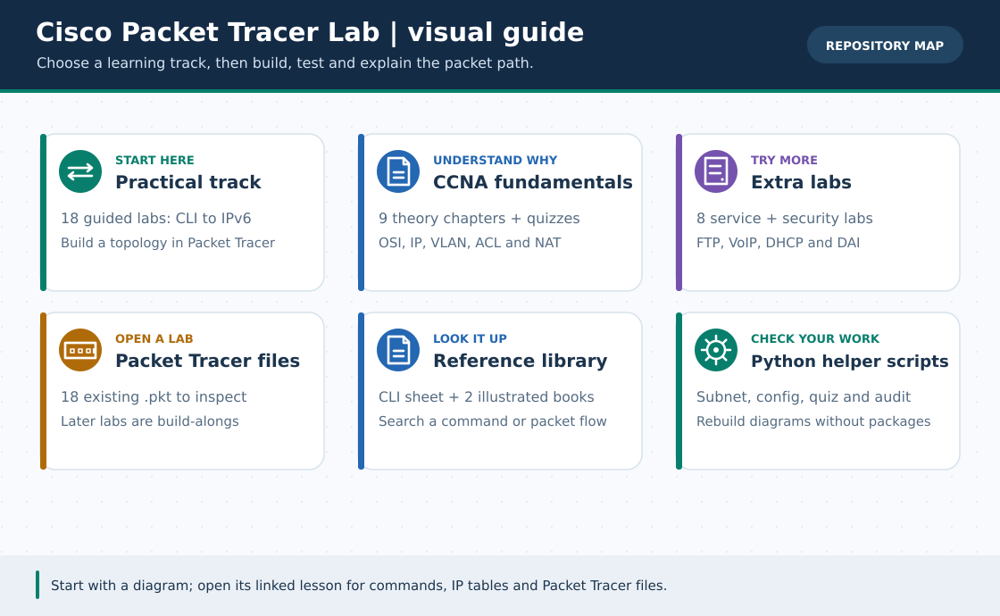

# Cisco Packet Tracer Lab · English Track (v4.0)

> **Navigation:** [বাংলা হোম / Bengali home](../README.md) · [v4.0 Enterprise Capstone](capstone/README.md) · [Practical 01–18](lessons/README.md) · [CCNA 01–09](ccna-fundamentals/README.md) · [Extra Labs 01–08](Extras/README.md) · [GIF search catalog](../GIF-CATALOG.md)

**Start here.** The parallel English track covers **35 core-topic companions**: 18 practical lessons, 9 CCNA theory chapters and 8 Extra Labs. v4.0 also adds a **[separate end-to-end two-branch capstone build guide](capstone/README.md)**, not a generated translation or a new core-topic lesson. Each of the 35 companions has a local diagram, independent English explanations, steps and verification; the 26 hands-on lessons/Extra Labs also embed original 30-second illustrated GIFs. The capstone has two new conceptual diagrams, nine role configs and a blank user-run worksheet, but **no new verified `.pkt`**.

> **Translation scope:** These are **curated English adaptations of the complete 35-topic curriculum**, not paragraph-for-paragraph translations of the much longer Bengali chapters. The corresponding [Bengali guide](../lessons/README.md) is linked from each page for full original tables, extended task sets and the full **86-question** Bengali quiz bank. Do not assume every Bengali example, screenshot, quiz or paragraph has been translated verbatim.

## Choose a track

| Track | Begin with | Why |
| :--- | :--- | :--- |
| **[18 Practical Lessons](lessons/README.md)** | [01 · Router CLI](lessons/01-router-cli-basics.md) | Place devices, configure IOS, verify actual outputs and advance to SVI/HSRP/IPv6. |
| **[9 CCNA Fundamentals](ccna-fundamentals/README.md)** | [01 · Network basics](ccna-fundamentals/01-network-basics.md) | Learn OSI, addressing, VLSM, ACL/NAT and a four-VLAN capstone first. |
| **[8 Extra Labs](Extras/README.md)** | [01 · FTP](Extras/ftp-server-lab.md) | Apply IP services, topology comparisons, VoIP and L2 security. |
| **[v4.0 Mega ISP + Multi-Campus Capstone](capstone/README.md)** | [Two-branch build order](capstone/README.md) | Assemble HQ/2 branches, four private WANs, ISP test router, DMZ and voice/Wi-Fi; use [blank evidence worksheet](../capstone/VERIFICATION.md). Not a finished `.pkt`. |
| **[26 GIF walk-throughs](../GIF-CATALOG.md)** | [HSRP 30-second example](../assets/gifs/17-hsrp-gateway-redundancy.gif) | See a six-stage visual; search by topic/priority if you want to replace one. |

## How to study safely

1. Read the diagram and IP/port plan; compare the English page with its detailed Bengali original when building a topology.
2. For every IOS block, check which **device role** it belongs to; never paste a switch snippet onto a router or mix R1/R2/R3 output.
3. Run the named `show`, `ping`, `ipconfig` or GUI verification **in your own Packet Tracer** before calling a lab successful.
4. The animated GIFs are original **illustrated infographics, not Packet Tracer recordings**. The site does not claim live simulator execution.
5. The repository retains **18 previously existing `.pkt` files**. Lessons 16–18, Extra Labs 07–08 and the [v4 capstone](capstone/README.md) are build-along guides with **no new native `.pkt`**; you can [save your own](../pkt-files/capstone/README.md). Packet Tracer DAI filtering and v4 simulator outcomes are **unverified**.

**Reuse and editing:** The 35 companion topics have English source prose in [`en/lessons.yml`](lessons.yml), [`en/ccna-fundamentals.yml`](ccna-fundamentals.yml) and [`en/Extras.yml`](Extras.yml); [`english_track_generator.py`](../scripts/english_track_generator.py) regenerates those 35 Markdown pages. The [v4 English capstone](capstone/README.md) is maintained separately alongside [its canonical plan](../capstone/plan.json); change the plan and regenerate the nine configs/two SVGs using [`capstone_config_generator.py`](../scripts/capstone_config_generator.py). The [GIF catalog](../GIF-CATALOG.md) covers the older 26 hands-on topics, **not** the unrecorded capstone.

> [v4 capstone](capstone/README.md) · [Back to Bangla](../README.md) · [Roadmap](../ROADMAP.md) · [Portal setup](../PORTAL.md)
