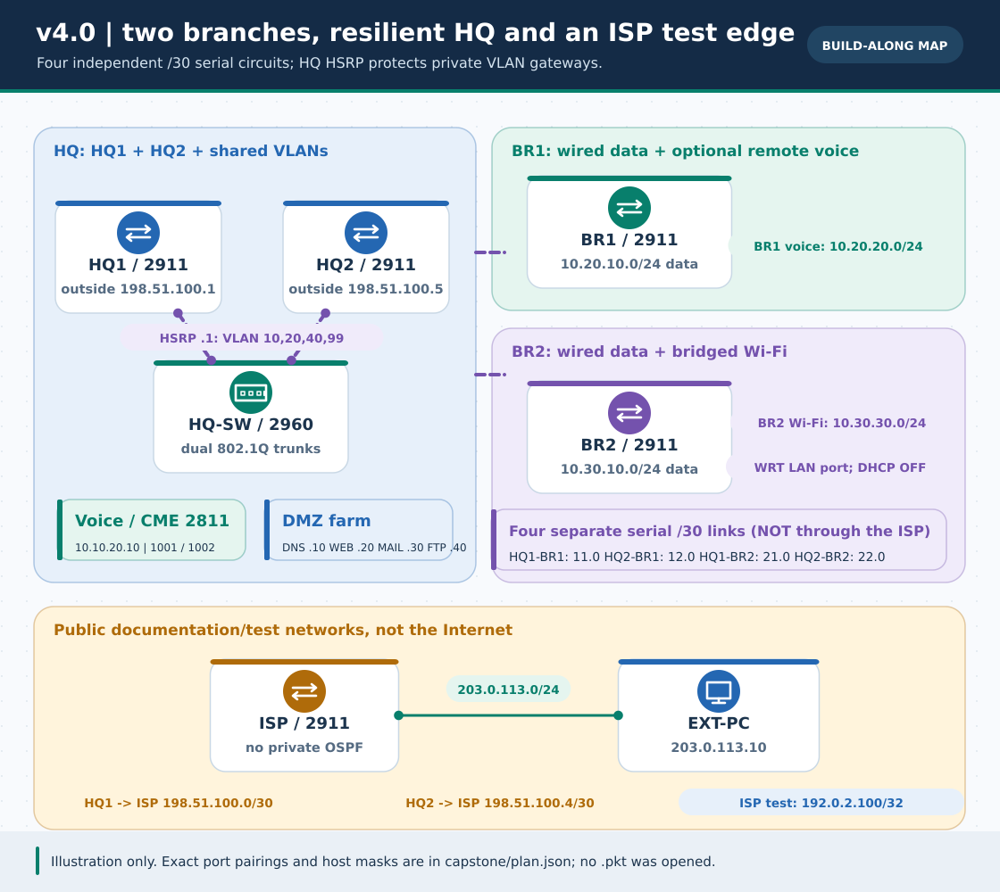
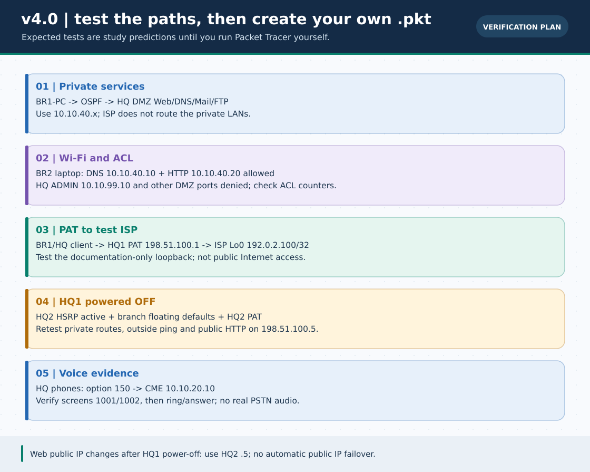

# Phase 5 · v4.0 — Two-Branch Enterprise and ISP Capstone (English)

> **Navigation:** [English track](../README.md) · [বাংলা পূর্ণ গাইড](../../capstone/README.md) · [Evidence worksheet](../../capstone/VERIFICATION.md) · [How to save your own `.pkt`](../../pkt-files/capstone/README.md) · [Roadmap](../../ROADMAP.md)



> **Status:** Original illustrated build plan and nine role-separated IOS examples. **Not a Packet Tracer recording, executed topology or a verified native `.pkt`.** Packet Tracer cannot run in this workspace. Build and test it in your own installation, then fill in the [blank evidence worksheet](../../capstone/VERIFICATION.md). The diagrams show intended behavior, not observed traffic.



## What you will build

An HQ with **HQ1/HQ2** gateway routers, a shared 2960 switch, four VLANs (DATA 10, VOICE 20, DMZ 40, ADMIN 99), **four individual DMZ servers** (DNS, Web, Mail, FTP), a separate **2811 CME** and two 7960 IP phones. Branches **BR1** and **BR2** each have a 2911 router and a 2960 switch. Each branch has its **own /30 serial link to each HQ router**, for four private WAN circuits total. BR2 also has a WRT300N bridged as an access point and a wireless laptop. An **ISP 2911** plus an outside PC and a loopback stand in for a provider/test destination; these documentation addresses do **not** represent the public Internet.

The single authoritative machine-readable inventory is [`capstone/plan.json`](../../capstone/plan.json). If your Packet Tracer module produces different port labels, correct the plan, regenerate the snippets and update your cabling before applying anything. The configuration generator performs offline plan checks, **not** actual IOS syntax validation or end-to-end simulation.

### Hardware and port pairs

| Purpose | Exact cable and address |
| :--- | :--- |
| HQ VLAN trunks | HQ1 `G0/0` ↔ HQ-SW `Gi0/1`; HQ2 `G0/0` ↔ HQ-SW `Gi0/2`. Both carry VLANs `10,20,40,99`. |
| BR1/BR2 VLAN trunks | Each branch router `G0/0` ↔ its own switch `Gi0/1`. BR1 carries 10/20; BR2 carries 10/30. |
| HQ1 ↔ BR1 | HQ1 `S0/0/0 10.255.11.1/30` ↔ BR1 `S0/0/0 10.255.11.2/30`. |
| HQ2 ↔ BR1 | HQ2 `S0/0/0 10.255.12.1/30` ↔ BR1 `S0/0/1 10.255.12.2/30`. |
| HQ1 ↔ BR2 | HQ1 `S0/0/1 10.255.21.1/30` ↔ BR2 `S0/0/0 10.255.21.2/30`. |
| HQ2 ↔ BR2 | HQ2 `S0/0/1 10.255.22.1/30` ↔ BR2 `S0/0/1 10.255.22.2/30`. |
| ISP links | HQ1 `G0/1 198.51.100.1/30` ↔ ISP `G0/0 .2`; HQ2 `G0/1 198.51.100.5/30` ↔ ISP `G0/1 .6`. These are **different /30s**, not one shared public VIP. |
| Outside test | ISP `G0/2 203.0.113.1/24` ↔ EXT-PC `203.0.113.10/24` (GW `.1`); ISP `Lo0 192.0.2.100/32`. |

Use **2911 + HWIC-2T** on HQ1/HQ2/BR1/BR2, one 2911 ISP, three 2960s, one **2811 CME**, four Server-PTs, two HQ 7960s, four wired PCs, one wireless laptop and EXT-PC. The 2811, **not** a 2911, supplies `telephony-service` in this design. Power a router off before inserting its serial card. Choose HQ as the **DCE side** of each serial cable so its generated `clock rate 64000` is on the correct endpoint; check `show controllers serial` to confirm which side is actually DCE. PT device models/slot numbers can differ, so confirm interfaces with `show ip interface brief`.

HQ-SW access map: `Fa0/1` HQ-PC/data10, `Fa0/2–3` HQ phones/data10+voice20, `Fa0/4` CME/access20, `Fa0/5–8` DNS/WEB/MAIL/FTP/access40, `Fa0/9` HQ-ADMIN-PC/access99. BR1-SW `Fa0/1` wired data and optional `Fa0/2` voice phone; BR2-SW `Fa0/1` wired data and `Fa0/2` **WRT300N Ethernet 1 LAN port**, not the Internet port. Phone access/voice ports are **not** ordinary 802.1Q switch trunks.

### Subnets, hosts and gateways

| Zone | IPv4 network | Default gateway and key static endpoints |
| :--- | :--- | :--- |
| HQ DATA · VLAN 10 | `10.10.10.0/24` | HSRP `10.10.10.1`; HQ1 `.2`, HQ2 `.3`; HQ-PC `.11`. |
| HQ VOICE · VLAN 20 | `10.10.20.0/24` | HSRP `.1`; HQ1 `.2`, HQ2 `.3`; CME `10.10.20.10`. |
| HQ DMZ · VLAN 40 | `10.10.40.0/24` | HSRP `.1`; DNS `.10`, WEB `.20`, MAIL `.30`, FTP `.40`. |
| HQ ADMIN · VLAN 99 | `10.10.99.0/24` | HSRP `.1`; HQ-ADMIN-PC `.10`. |
| BR1 DATA / VOICE | `10.20.10.0/24` / `10.20.20.0/24` | BR1 `.1` in each subnet; BR1-PC `.10` in DATA. No branch HSRP. |
| BR2 DATA / Wi-Fi | `10.30.10.0/24` / `10.30.30.0/24` | BR2 `.1` in each; BR2-PC `10.30.10.10`, AP `.30.2`, laptop `.30.50`. |

Use static /24 mask (`255.255.255.0`) and the matching subnet's gateway for the wired PCs. The wireless laptop is `10.30.30.50/24`, gateway `10.30.30.1`. Set **DNS `10.10.40.10`** on all enterprise PCs and the laptop; EXT-PC has no enterprise DNS. This is a deliberate static data/Wi-Fi plan; only HQ voice phones and the optional BR1 phone use router DHCP. Do not add a second DHCP/NAT server on WRT300N.

## Device configuration order

1. Build the exact cable map and add serial cards while powered off. Configure **[HQ-SW](../../capstone/configs/HQ-SW.txt), [BR1-SW](../../capstone/configs/BR1-SW.txt), [BR2-SW](../../capstone/configs/BR2-SW.txt)**. Check VLAN membership and allowed trunks *before* routing tests.
2. Configure **[ISP](../../capstone/configs/ISP.txt)** with two /30s, the external test LAN and its loopback. ISP has **no private OSPF, NAT or 10/8 return route**.
3. Configure **[HQ1](../../capstone/configs/HQ1.txt)** and **[HQ2](../../capstone/configs/HQ2.txt)**. Their VLAN subinterfaces have distinct `.2/.3` addresses and the same `.1` HSRP VIP; priority 120/100 with preempt. Both advertise HQ VLANs and two serial links in **OSPFv2 area 0**, with the VLAN interfaces passive. Each also has PAT inside on its serial/VLANs and outside on its separate ISP link.
4. Configure **[BR1](../../capstone/configs/BR1.txt)** and **[BR2](../../capstone/configs/BR2.txt)**. Their two serials run OSPF area 0 to HQ1/HQ2. A normal static default to HQ1 and a *higher-distance* floating default to HQ2 support the outside test when HQ1's serial link is down. Branch user ACLs are inbound on DATA VLAN10; the stricter BR2 Wi-Fi ACL is inbound on VLAN30.
5. Configure **[CME](../../capstone/configs/CME.txt)** on 2811 FastEthernet0/0 at `10.10.20.10`. Connect this physical port as **access VLAN20**, not a trunk. The HQ voice DHCP default router is the **HSRP `.20.1`**, whereas **option 150 and CME source address are `.20.10`**.

Every device file is distinct and starts with `enable`, `configure terminal` and that role's `hostname`. **Never paste all nine snippets onto one device.** If `copy running-config startup-config` prompts `Destination filename [startup-config]?`, press **Enter**, then use Packet Tracer **File → Save As** to save your actual `.pkt`. To print or regenerate:

```bash
python3 scripts/capstone_config_generator.py --list
python3 scripts/capstone_config_generator.py --role HQ1
python3 scripts/capstone_config_generator.py --check
# After changing capstone/plan.json:
python3 scripts/capstone_config_generator.py --write
```

If your PT IOS rejects a command, stop and investigate that particular feature; acceptance of the other commands is not evidence that the entire enterprise works. The generator cannot parse or execute Packet Tracer IOS.

## Configure the four DMZ services in the Server-PT GUI

Set the four Server-PT endpoints on HQ-SW `Fa0/5–8` to their respective static IP/24, default gateway `10.10.40.1` and DNS `10.10.40.10`:

- **DNS `10.10.40.10`**: Services → DNS → On. Add A records `www.campus.lab → 10.10.40.20`, `mail.campus.lab → 10.10.40.30`, `ftp.campus.lab → 10.10.40.40`. In this lab these names resolve to **private** DMZ addresses for internal clients.
- **WEB `10.10.40.20`**: Services → HTTP → On. Edit `index.html` to show a recognizable lab-only page. Try `http://10.10.40.20`, then `http://www.campus.lab` from a wired enterprise PC; isolate DNS from HTTP if only the first works.
- **MAIL `10.10.40.30`**: Services → EMAIL → SMTP and POP3 On; use domain `campus.lab` and create two *lab-only* accounts, `br1` and `hq`, with passwords you choose locally. In BR1-PC and HQ-PC **Desktop → E-Mail → Configure Mail** (UI wording can vary), set the respective addresses `br1@campus.lab` / `hq@campus.lab`, user names `br1` / `hq`, their matching lab passwords and **both incoming POP3 and outgoing SMTP server `10.10.40.30`** (or `mail.campus.lab` after confirming DNS). BR1-PC sends to `hq@campus.lab`; HQ-PC explicitly presses **Receive** and checks its Inbox. Merely clicking Send is not the receiving test.
- **FTP `10.10.40.40`**: Services → FTP → On; create a lab account with read/write permission. On **BR2-PC**, make `lab.txt` with Desktop → Text Editor and save it (if that UI is unavailable in your edition, follow the [FTP Lab](../../Extras/ftp-server-lab.md)). First ping the FTP IP; in Command Prompt run `ftp 10.10.40.40`, log in, `dir`, `put lab.txt`, `dir`, `get lab.txt`. Confirm the uploaded file on Server-PT; optionally fetch it from a separate wired BR1-PC. A ping does not demonstrate file transfer. This cleartext service is for learning, not production.

Only **WEB TCP/80** has static NAT mappings on the two HQ outside IPs. **This does not mean both are reachable at the same time:** normally WEB's HSRP gateway is HQ1, so test public HTTP on `198.51.100.1`. If you try `.5` while HQ1 is active, inbound traffic could use HQ2 while replies leave through HQ1 and break the stateful NAT path. After **HQ1 is fully powered off** and HQ2 becomes Active, start a fresh HTTP test on `198.51.100.5`. The original public IP does not move to HQ2. DNS, email and FTP remain **private** to the enterprise. The DMZ is a *service subnet*, not a firewall with comprehensive host isolation.

## Voice and wireless setup

- Two powered HQ IP phones plug their **Switch** ports into HQ-SW `Fa0/2–3` (data access10 + voice20). CME DHCP leases `10.10.20.21+`, option 150 points to `10.10.20.10`, and `telephony-service` assigns DN 1001/1002 (the third DN 2001 is reserved for the optional BR1 phone). Check `show ip dhcp binding`, actual displayed extensions and call GUI ring/answer. Registration order may swap which phone shows 1001 or 1002. DHCP success **does not prove** registration or voice-call success. There is no real PSTN or guaranteed simulator audio.
- An optional BR1 phone receives BR1 voice DHCP `10.20.20.21+`, gateway `.20.1`, **option 150 = HQ CME `10.10.20.10`**. Confirm an OSPF route to HQ voice and read its actual DN before trying a cross-site call. Remote registration is version-dependent and not required for the two-phone HQ baseline.
- On BR2, put **WRT300N Ethernet 1 (LAN)** on BR2-SW Fa0/2 access VLAN30. In its GUI set LAN `10.30.30.2/24`, turn its DHCP server **Off**, use SSID `BR2-Study`, set **WPA2 Personal** with your own *lab-only* passphrase, and leave Internet/WAN unconnected. Give the laptop a compatible wireless adapter, join the SSID and set the static address, gateway and DNS from the table. In this bridged layout BR2—not WRT—routes the wireless subnet and enforces its ACL.

## Expected results (not yet observed)

Record the *actual* timestamp, source device, command/UI and result in the [worksheet](../../capstone/VERIFICATION.md). Essential independent checks:

| Source → destination | Expected if your build succeeds |
| :--- | :--- |
| HQ1/HQ2/BR1/BR2 `show ip ospf neighbor` | Two enterprise serial neighbors per router; remote VLANs appear with `O` in `show ip route`; **not** on ISP. |
| HQ1/HQ2 `show standby brief` | HQ1 Active, HQ2 Standby on VLANs 10/20/40/99, with stable `.1` client gateways. |
| BR1-PC `10.20.10.10` → DMZ WEB `10.10.40.20` | Ping IP, then browse `www.campus.lab` using internal DNS; try MAIL Inbox and FTP separately from wired clients. |
| BR1-PC and BR2-PC → HQ-ADMIN-PC `10.10.99.10` | **Denied** by their inbound data ACL; `show access-lists` deny counter rises. HQ-PC → ADMIN is **allowed**. |
| BR2-LAPTOP → DMZ | DNS (UDP/TCP 53) and HTTP/TCP 80 to the named servers **allowed**. DMZ ping, FTP and admin host **denied** by Wi-Fi ACL; browser success plus ping failure is intentional. |
| BR1-PC or HQ-PC → ISP `192.0.2.100` | Ping the **documentation-only loopback**; generate a new flow and inspect HQ1 `show ip nat translations` for 10/8 inside → `198.51.100.1` outside. |
| EXT-PC → `http://198.51.100.1` | Static WEB TCP/80 mapping; `ping 10.10.40.20` from EXT-PC **fails** because ISP knows no private route. |
| **Physically power off HQ1** | HQ2 HSRP Active, BR1/BR2 floating static default to HQ2, new PAT on HQ2 `.100.5`; use **`http://198.51.100.5`** externally. Old `.100.1` is no longer reachable. |

Powering off **only HQ1's LAN interface** does not prove dual-WAN and ISP failover. Wait for HSRP/OSPF, send *new* pings and browser sessions, inspect BR1/BR2 `show ip route 0.0.0.0` and HQ2 NAT translations, then restore HQ1 and retest. Priority preemption and NAT session interruption are expected considerations; this layout does not protect against ISP, HQ-SW, DMZ-server, or an individual branch-router failure.

### Troubleshooting sequence

1. **Links:** hardware module inserted while powered off, serial interfaces match the plan, HQ DCE clock present, `show ip interface brief` up/up; switches have correct VLAN/trunk membership. Change the port plan if PT assigns different interface numbers.
2. **Private routes:** each router's two OSPF peers FULL; look for the correct remote /24; don't add private OSPF to ISP to hide a broken route. Use PC→local gateway→remote IP before application tests.
3. **Apps:** Server-PT service enabled, static address/gateway/DNS record and client IP correct. On BR2 Wi-Fi **HTTP success with ICMP failure** is compatible with the ACL; check the named ACL counters instead of disabling policy blindly.
4. **Voice:** power, voice VLAN, DHCP binding, option 150/CME source, displayed extension, then ring/answer. Unsupported `create cnf-files` or `show ephone` may differ by PT edition.
5. **Failover:** HQ1 fully off so both serial and ISP links drop; BR1/BR2 floating default must change, HQ2 must have NAT inside/outside and a valid ISP link. The public WEB address **changes** to `.5`; never claim one static public address survived.

**Next:** [fill the worksheet](../../capstone/VERIFICATION.md), then [save and optionally contribute your own tested `.pkt`](../../pkt-files/capstone/README.md). For background lessons see [OSPF](../../lessons/13-dynamic-routing-ospf.md), [HSRP](../../lessons/17-hsrp-gateway-redundancy.md), [VoIP](../../Extras/voip-ip-telephony-lab.md), [Wireless](../../lessons/14-wireless-lan.md), and [ACL/PAT](../../ccna-fundamentals/07-acl-nat.md).
