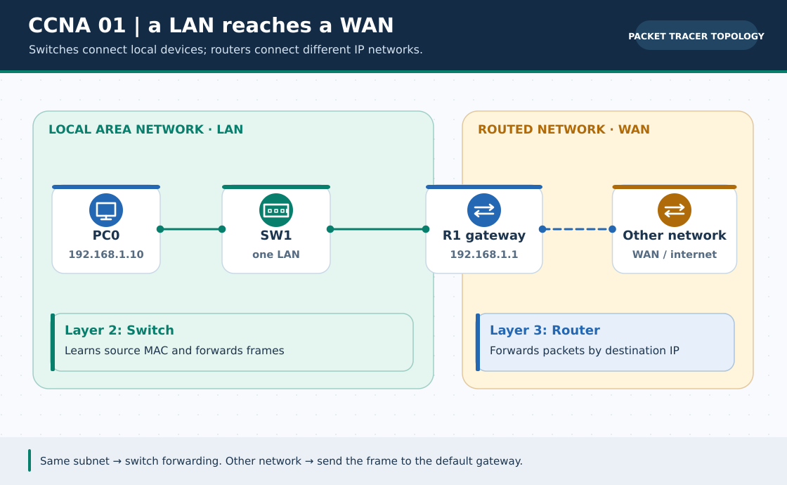

# CCNA Chapter 01: What is a network? LAN, WAN, switches and routers

> **Navigation:** [English home](../README.md) · [CCNA Chapter index](README.md) · [Full Bengali guide](../../ccna-fundamentals/01-network-basics.md)

**Learning goal.** Explain why devices connect, how a small LAN forwards traffic and what makes a WAN different.



> **About this visual:** Illustrated topology or concept map from the corresponding Bengali guide; a diagram, not a Packet Tracer capture.

## Understand the design

Start with three PCs and a 2960 switch on one subnet. Then imagine a router linking that LAN to a second network. The source chapter includes comparisons of bus, star and ring designs and a longer self-test.

### Key ideas

- A host sends or receives data; a client requests a service while a server provides it. These are roles, not always distinct hardware.
- A switch uses Layer-2 MAC information to forward Ethernet frames inside a LAN; a router uses Layer-3 IP networks to connect different LANs.
- A LAN is a local network; a WAN connects distant sites, often over a provider's infrastructure.
- Star is simple to extend but its central device is a common failure point; mesh improves redundancy with more links.

## Build or work through it

1. Give three connected PCs unique addresses in one /24, such as 192.168.1.10, .11 and .12. No router is required for local switching.
2. Ping from the first PC to the second. Observe that the switch learns source MACs and forwards toward the destination.
3. Add a second subnet on the far side of a router; explain why hosts now need a gateway.
4. Draw a star and a small full mesh; for N nodes, a full mesh requires N(N-1)/2 links.

### Copyable study example

Read the comment or role label first: IOS commands, PC commands and shell commands run in **different places**. This example is not a verified Packet Tracer run.

```text
# On a PC command prompt: local reachability
ipconfig
ping 192.168.1.11
```

## Verify; do not guess

- [ ] Distinguish host, NIC, link, switch, router, LAN and WAN without conflating their roles.
- [ ] Explain how a same-subnet ping differs from a cross-subnet ping.
- [ ] For four nodes, calculate a full mesh link count of six.

## If it fails

- If local PCs cannot ping, check addresses/masks, cables and live switch ports before adding routing.
- Do not call a router a replacement for a switch's local MAC-learning function.

## Check your understanding

**Question.** Can two correctly addressed PCs on the same VLAN and /24 ping through one switch without a router?

<details><summary>Reveal the explanation</summary>

**Answer.** Yes. They can exchange local frames directly; a router is needed only to leave the subnet.

</details>

---

**Continue:** [English track](README.md) · [Full Bengali lesson, complete tables and additional exercises](../../ccna-fundamentals/01-network-basics.md)
