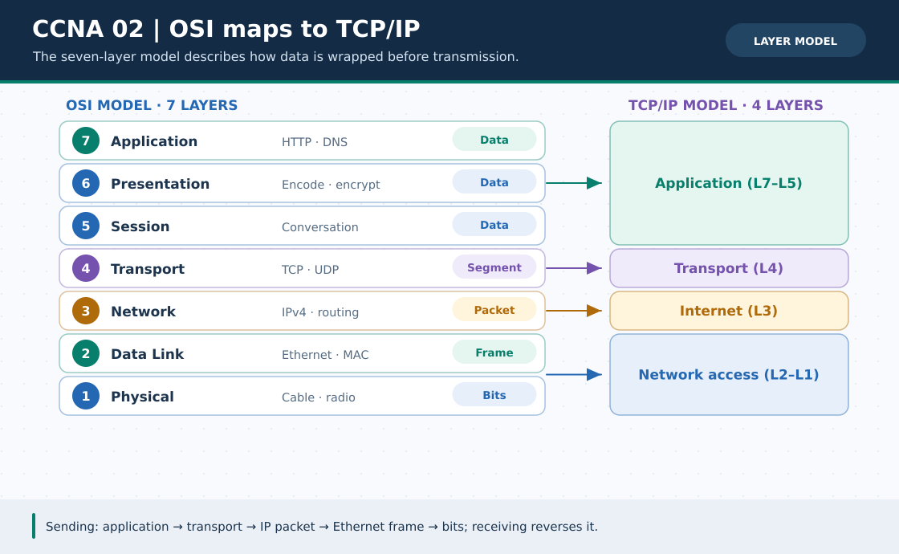

# CCNA Chapter 02: OSI layers, TCP/IP model and encapsulation

> **Navigation:** [English home](../README.md) · [CCNA Chapter index](README.md) · [Full Bengali guide](../../ccna-fundamentals/02-osi-tcp-ip.md)

**Learning goal.** Trace a user's request through protocol layers and name the data unit at each relevant stage.



> **About this visual:** Illustrated topology or concept map from the corresponding Bengali guide; a diagram, not a Packet Tracer capture.

## Understand the design

Read the seven-layer OSI diagram from bottom (physical) to top (application). Compare it with the operational TCP/IP model, which groups several OSI layers.

### Key ideas

- OSI layers 1-7 are Physical, Data Link, Network, Transport, Session, Presentation and Application.
- On sending, application data gains transport, network and link headers; the receiver removes them in reverse.
- Ethernet frames carry MAC addresses on the local link; IP packets carry source/destination IPs across networks; TCP/UDP use ports.
- TCP provides ordered, reliable transport; UDP is connectionless and suits applications that handle loss differently.

## Build or work through it

1. Start with a browser requesting a page; identify the application protocol and the destination transport port.
2. At transport, identify a TCP segment; at network, an IP packet; at data link, an Ethernet frame; at physical, bits.
3. In a two-router path, explain which addressing fields remain end-to-end and which link-layer header changes per hop.
4. Use Packet Tracer Simulation Mode to watch a PDU; compare the protocol layers in the event details.

### Copyable study example

Read the comment or role label first: IOS commands, PC commands and shell commands run in **different places**. This example is not a verified Packet Tracer run.

```text
Application:  HTTP request
Transport:    TCP segment with port numbers
Network:      IP packet with source/destination IP
Data Link:    Ethernet frame with local-hop MACs
Physical:     transmitted bits
```

## Verify; do not guess

- [ ] Recite the seven OSI layers in order and match switch (mostly L2) and router (L3) to their forwarding roles.
- [ ] Explain encapsulation as adding headers, not converting an IP packet into a permanent MAC address.
- [ ] Identify a browser's HTTP/TCP flow separately from a DNS query, which might use UDP or TCP.

## If it fails

- If layers feel arbitrary, trace one actual ping or HTTP event instead of memorizing isolated lists.
- Do not treat the OSI model as a strict claim that every real application uses every layer as a separate program.

## Check your understanding

**Question.** At which layer is the end-to-end destination IP address used for routing?

<details><summary>Reveal the explanation</summary>

**Answer.** The Network layer (OSI Layer 3); link-layer MAC addressing is rewritten for each local link.

</details>

---

**Continue:** [English track](README.md) · [Full Bengali lesson, complete tables and additional exercises](../../ccna-fundamentals/02-osi-tcp-ip.md)
