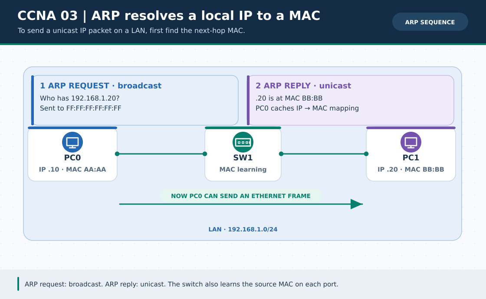

# CCNA Chapter 03: MAC addresses, Ethernet frames and ARP

> **Navigation:** [English home](../README.md) · [CCNA Chapter index](README.md) · [Full Bengali guide](../../ccna-fundamentals/03-mac-ethernet-arp.md)

**Learning goal.** Follow an ARP broadcast and explain how a switch learns and delivers an Ethernet frame.



> **About this visual:** Illustrated topology or concept map from the corresponding Bengali guide; a diagram, not a Packet Tracer capture.

## Understand the design

Use two PCs, a switch and, for a remote-subnet comparison, a router. An unknown same-LAN IPv4 neighbor triggers ARP to learn a MAC address. The attached image shows Request and Reply directions.

### Key ideas

- A MAC address identifies a network interface on a local Ethernet link; an IPv4 address identifies the Layer-3 host or interface.
- An ARP Request asks who owns an IPv4 address and is broadcast on the VLAN; a matching ARP Reply is normally unicast.
- A switch's MAC table learns source MAC-to-port mappings; an ARP cache maps IPv4 addresses to MACs. They are not the same table.
- When sending to a remote network, a host ARPs for its local gateway's MAC, not the remote destination MAC.

## Build or work through it

1. Give PC0 and PC1 addresses on the same VLAN and subnet; clear ARP if your simulator version provides the control.
2. Send a first ping in Simulation Mode and note the initial broadcast ARP Request.
3. Observe the Reply and subsequent unicast ICMP frames; inspect the switch MAC table.
4. Move PC1 to another subnet behind a router and identify how the next-hop gateway changes the ARP target.

### Copyable study example

Read the comment or role label first: IOS commands, PC commands and shell commands run in **different places**. This example is not a verified Packet Tracer run.

```text
# Useful checks on hosts and switches, where supported
arp -a
show mac address-table
```

## Verify; do not guess

- [ ] State why an ARP broadcast stays within its VLAN and does not cross a router as-is.
- [ ] Identify the destination MAC on a local ping versus the first hop of a remote ping.
- [ ] Show a learned MAC-to-port entry rather than treating ARP cache output as a switch MAC table.

## If it fails

- If the first ping times out but subsequent pings pass, allow initial ARP and link startup before assuming a route fault.
- If the switch learned a MAC on the wrong port, confirm cabling and VLAN membership.

## Check your understanding

**Question.** What MAC does PC0 need to send IPv4 traffic to a remote subnet?

<details><summary>Reveal the explanation</summary>

**Answer.** The MAC of its configured local gateway, learned using ARP on the local VLAN.

</details>

---

**Continue:** [English track](README.md) · [Full Bengali lesson, complete tables and additional exercises](../../ccna-fundamentals/03-mac-ethernet-arp.md)
