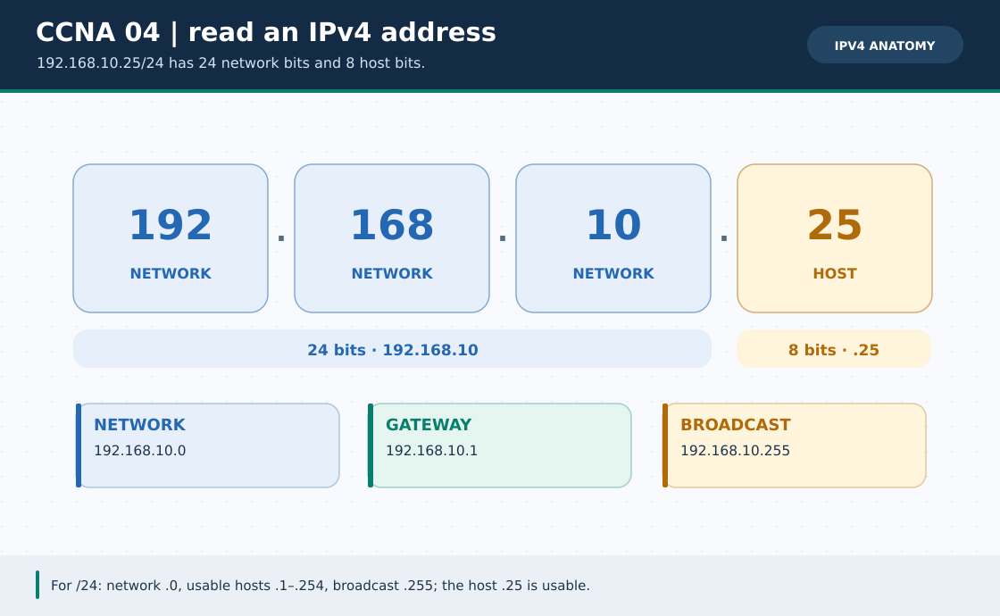

# CCNA Chapter 04: IPv4 addresses, private ranges and special cases

> **Navigation:** [English home](../README.md) · [CCNA Chapter index](README.md) · [Full Bengali guide](../../ccna-fundamentals/04-ipv4-addressing.md)

**Learning goal.** Read an IPv4 address with its prefix and distinguish network, host and special-purpose addresses.



> **About this visual:** Illustrated topology or concept map from the corresponding Bengali guide; a diagram, not a Packet Tracer capture.

## Understand the design

An IPv4 address has four 8-bit octets. In 192.168.10.25/24 the first 24 bits are the subnet portion; 192.168.10.0 is the subnet ID and 192.168.10.255 its directed broadcast address.

### Key ideas

- An address is meaningful together with its subnet mask; hosts with different masks can disagree about local reachability.
- Private IPv4 space includes 10.0.0.0/8, 172.16.0.0/12 and 192.168.0.0/16; public Internet reachability needs a valid network policy.
- 127.0.0.0/8 is loopback, 169.254.0.0/16 is IPv4 link-local/APIPA and 0.0.0.0/0 denotes the default route.
- Documentation-only example ranges such as 203.0.113.0/24 must not be mistaken for a real ISP connection.

## Build or work through it

1. Write 192.168.10.25 as four binary octets and compare the /24 boundary with the host bits.
2. Find the network, broadcast and ordinary host range for 192.168.10.25/24.
3. Repeat for 192.168.10.65/26 and notice how the same address can land in a smaller network.
4. Classify a sample as private, loopback, APIPA, documentation or ordinary public allocation.

### Copyable study example

Read the comment or role label first: IOS commands, PC commands and shell commands run in **different places**. This example is not a verified Packet Tracer run.

```text
192.168.10.25/24
Network:   192.168.10.0
Broadcast: 192.168.10.255
Hosts:     192.168.10.1 through 192.168.10.254
```

## Verify; do not guess

- [ ] Given address plus mask, find the network and broadcast without relying on an old class label.
- [ ] Explain why 169.254.x.x often signals DHCP lease failure in a simple Packet Tracer lab.
- [ ] Distinguish a private host address from NAT's externally visible address.

## If it fails

- If PCs with similar-looking IPs cannot ping, compare their prefix lengths and actual network IDs.
- Do not assign a subnet's network or broadcast address to a normal host.

## Check your understanding

**Question.** Is 192.168.10.255 usable as a PC address in 192.168.10.0/24?

<details><summary>Reveal the explanation</summary>

**Answer.** No. It is that /24 subnet's directed broadcast address.

</details>

---

**Continue:** [English track](README.md) · [Full Bengali lesson, complete tables and additional exercises](../../ccna-fundamentals/04-ipv4-addressing.md)
