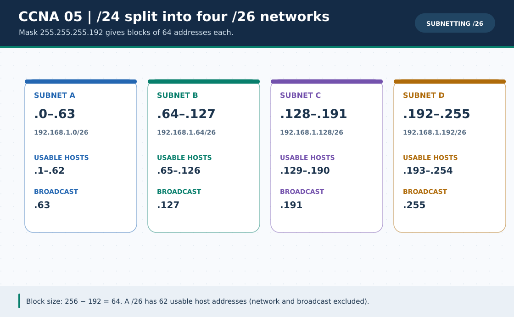

# CCNA Chapter 05: Subnetting basics: prefix, block and usable hosts

> **Navigation:** [English home](../README.md) · [CCNA Chapter index](README.md) · [Full Bengali guide](../../ccna-fundamentals/05-subnetting-basics.md)

**Learning goal.** Split a /24 into smaller subnets and calculate each network and broadcast bound.



> **About this visual:** Illustrated topology or concept map from the corresponding Bengali guide; a diagram, not a Packet Tracer capture.

## Understand the design

Use 192.168.1.0/24 as a parent. A /26 gives four blocks of 64 addresses: .0-.63, .64-.127, .128-.191 and .192-.255. Each ordinary /26 has 62 usable host addresses.

### Key ideas

- A prefix /n leaves (32-n) host bits and 2^(32-n) total IPv4 addresses per block.
- For conventional subnets with network and broadcast reserved, usable hosts are 2^h-2; /31 and /32 have special uses.
- Block size in a relevant octet is 256 minus that mask octet; /26 uses 255.255.255.192 and block size 64.
- The next subnet's network ID is not a host in the previous subnet.

## Build or work through it

1. Write /26 as mask 255.255.255.192 and mark boundaries .0, .64, .128 and .192.
2. For 192.168.1.65/26, locate its block .64-.127; its usable range is .65-.126.
3. Practice with /25, /27 and /30; calculate first, last and broadcast for each sample.
4. Place two PCs on the same /26 and two on different /26s; predict ping before using Packet Tracer.

### Copyable study example

Read the comment or role label first: IOS commands, PC commands and shell commands run in **different places**. This example is not a verified Packet Tracer run.

```bash
# Offline calculator cross-check AFTER solving by hand
python3 scripts/subnet_calculator.py 192.168.1.65/26
```

## Verify; do not guess

- [ ] For 192.168.1.65/26, network is .64, broadcast .127 and first usable .65.
- [ ] For a standard /30, identify two usable host addresses in a four-address block.
- [ ] Explain why two /26 hosts on separate blocks need a router to communicate.

## If it fails

- If a block boundary looks wrong, recalculate 256-mask-octet instead of guessing from the last host number.
- Do not use an untested 2^h-2 shortcut for point-to-point /31 cases with different addressing rules.

## Check your understanding

**Question.** What is the broadcast address of 192.168.1.65/26?

<details><summary>Reveal the explanation</summary>

**Answer.** 192.168.1.127, the last address in the 192.168.1.64/26 block.

</details>

---

**Continue:** [English track](README.md) · [Full Bengali lesson, complete tables and additional exercises](../../ccna-fundamentals/05-subnetting-basics.md)
