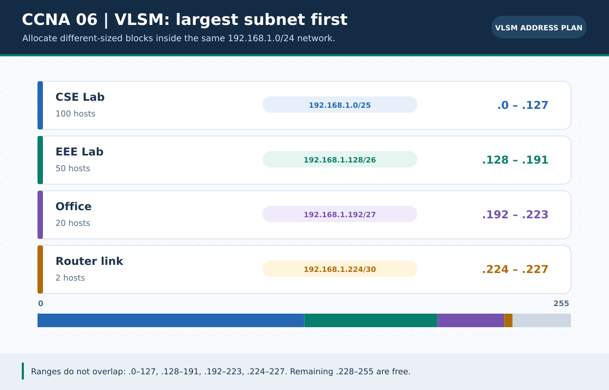

# CCNA Chapter 06: VLSM: allocate different subnet sizes

> **Navigation:** [English home](../README.md) · [CCNA Chapter index](README.md) · [Full Bengali guide](../../ccna-fundamentals/06-subnetting-vlsm.md)

**Learning goal.** Plan nonoverlapping networks for departments of different sizes within one parent block.



> **About this visual:** Illustrated topology or concept map from the corresponding Bengali guide; a diagram, not a Packet Tracer capture.

## Understand the design

Example requirement: CSE needs 55 hosts, EEE 25, and a WAN point-to-point link two. Begin with 192.168.10.0/24 and allocate largest to smallest to avoid overlap.

### Key ideas

- 55 hosts require a /26 (62 usable); 25 require a /27 (30 usable); two conventional WAN endpoints fit a /30.
- Allocate complete blocks on aligned boundaries; assigning .64/27 after .0/26 is valid, but .32/27 would overlap the /26.
- VLSM conserves space compared with giving every requirement the same large mask.
- Leave room for future growth and record gateway, first/last host and broadcast for each block.

## Build or work through it

1. Sort requirements by host count and select the smallest prefix that satisfies each.
2. Reserve 192.168.10.0/26 for CSE: hosts .1-.62, broadcast .63.
3. Reserve 192.168.10.64/27 for EEE: hosts .65-.94, broadcast .95.
4. Reserve 192.168.10.96/30 for WAN: endpoints .97 and .98, broadcast .99.
5. Check remaining free space and rerun your result in the optional calculator.

### Copyable study example

Read the comment or role label first: IOS commands, PC commands and shell commands run in **different places**. This example is not a verified Packet Tracer run.

```bash
python3 scripts/subnet_calculator.py --vlsm 192.168.10.0/24 \
  --departments "CSE:55,EEE:25,WAN:2"
```

## Verify; do not guess

- [ ] All three allocations are inside the parent /24, disjoint and aligned on their own block boundary.
- [ ] The usable count of each block meets its requested host requirement.
- [ ] Your router/PC IP choices exclude all three network and broadcast addresses.

## If it fails

- If two blocks overlap, go back to the current block's broadcast and start the next at the following boundary.
- If the number of hosts fits only the total address count, subtract network/broadcast before selecting a prefix.

## Check your understanding

**Question.** What is the smallest conventional IPv4 subnet for 55 ordinary host addresses?

<details><summary>Reveal the explanation</summary>

**Answer.** A /26, offering 64 total addresses and 62 ordinary usable host addresses.

</details>

---

**Continue:** [English track](README.md) · [Full Bengali lesson, complete tables and additional exercises](../../ccna-fundamentals/06-subnetting-vlsm.md)
