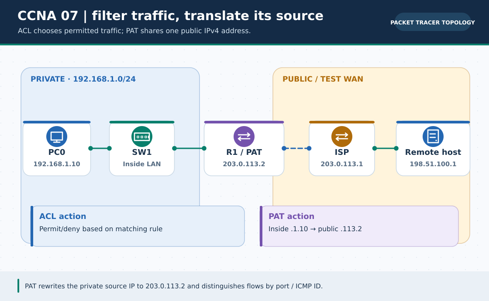

# CCNA Chapter 07: Access control lists, NAT and PAT

> **Navigation:** [English home](../README.md) · [CCNA Chapter index](README.md) · [Full Bengali guide](../../ccna-fundamentals/07-acl-nat.md)

**Learning goal.** Predict how IOS filters a packet and translates private addresses toward an outside network.



> **About this visual:** Illustrated topology or concept map from the corresponding Bengali guide; a diagram, not a Packet Tracer capture.

## Understand the design

Use a small inside LAN behind a router and a separate documentation-only outside/test segment. The original chapter contrasts standard versus extended ACLs and static/dynamic NAT versus PAT.

### Key ideas

- ACL entries are evaluated in order; the first match decides, followed by an implicit deny if nothing matches.
- A standard ACL primarily matches source IPv4; an extended ACL can match protocol, source, destination and ports.
- PAT (NAT overload) lets many inside hosts share one outside address by distinguishing transport ports.
- An ACL policy and NAT translation solve different problems: permission and address rewriting.

## Build or work through it

1. Write a specific permit/deny policy in words, then translate it to ordered ACL entries before attaching it.
2. For an extended ACL, identify where the traffic enters an interface and check the direction with a test packet.
3. Mark inside and outside interfaces for a lab NAT/PAT example and send permitted inside traffic toward a simulated test network.
4. Inspect ACL match counters and translations; a command accepted by IOS is not proof that the intended packet matched.

### Copyable study example

Read the comment or role label first: IOS commands, PC commands and shell commands run in **different places**. This example is not a verified Packet Tracer run.

```cisco
! Example policy: do NOT paste before checking real addressing/direction
ip access-list extended DENY-CSE-TO-ADMIN
 deny ip 192.168.10.0 0.0.0.255 192.168.30.0 0.0.0.255
 permit ip any any
! Verify after the lab's traffic is generated
show access-lists
show ip nat translations
```

## Verify; do not guess

- [ ] Predict which of three example packets matches the deny and which matches the later permit.
- [ ] Observe a translation only after a qualifying packet crosses the configured NAT boundary.
- [ ] Confirm a blocked flow is blocked for the intended ACL reason rather than an unrelated routing fault.

## If it fails

- If nothing is permitted, inspect the rule order, masks, application point and implicit deny.
- If translations are absent, check inside/outside marks, NAT match rule, next hop and traffic generation.

## Check your understanding

**Question.** Why can many LAN clients share one outside IPv4 address under PAT?

<details><summary>Reveal the explanation</summary>

**Answer.** Their flows are distinguished by port numbers as well as translated addresses.

</details>

---

**Continue:** [English track](README.md) · [Full Bengali lesson, complete tables and additional exercises](../../ccna-fundamentals/07-acl-nat.md)
