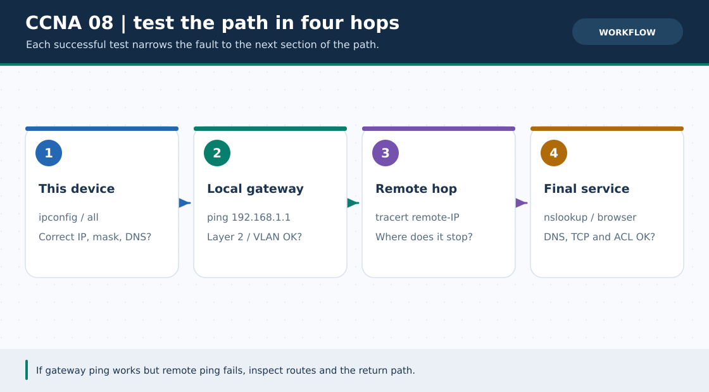

# CCNA Chapter 08: Bottom-up network troubleshooting

> **Navigation:** [English home](../README.md) · [CCNA Chapter index](README.md) · [Full Bengali guide](../../ccna-fundamentals/08-troubleshooting.md)

**Learning goal.** Isolate common addressing, VLAN, route and service faults with a repeatable command sequence.



> **About this visual:** Illustrated topology or concept map from the corresponding Bengali guide; a diagram, not a Packet Tracer capture.

## Understand the design

The original chapter walks through seven high-value checks and six broken exercises. Begin at the host and proceed through link, local gateway, remote route and application; avoid changing unrelated settings together.

### Key ideas

- The shortest failing test is most useful: local gateway, next router, remote host by IP, then service by name.
- A correct route-table entry does not prove the return route or end-host gateway.
- An IP-level success with a domain-name failure points toward DNS; a name resolved with no page points toward HTTP or server state.
- Keep before/after evidence so a repaired symptom is not merely a different one.

## Build or work through it

1. On the PC inspect its IP, mask, gateway and DNS settings; confirm the physical link is live.
2. On the switch check expected VLAN membership, trunking and MAC learning.
3. On each router check interface up/up, next-hop reachability and routes for both directions.
4. Test the application only after lower-layer checks pass and repeat the original failed test after one justified fix.

### Copyable study example

Read the comment or role label first: IOS commands, PC commands and shell commands run in **different places**. This example is not a verified Packet Tracer run.

```text
# Choose the relevant command on the right device
ipconfig
ping 192.168.1.1
show ip interface brief
show vlan brief
show interfaces trunk
show ip route
show ip dhcp binding
```

## Verify; do not guess

- [ ] For one broken case, state the observed symptom, failing layer, evidence and minimal fix.
- [ ] Run both PC-to-gateway and remote end-to-end ping rather than citing a single device's config.
- [ ] After repairing a DNS issue, test the exact failed name again.

## If it fails

- Do not rewrite routing when the router interface is administratively down.
- Do not declare a service broken until its server is reachable by IP and its service is on.

## Check your understanding

**Question.** If the web page opens by IP but not its configured name, what should you inspect first?

<details><summary>Reveal the explanation</summary>

**Answer.** Check the PC's DNS-server address, the server's DNS service and its A record spelling.

</details>

---

**Continue:** [English track](README.md) · [Full Bengali lesson, complete tables and additional exercises](../../ccna-fundamentals/08-troubleshooting.md)
