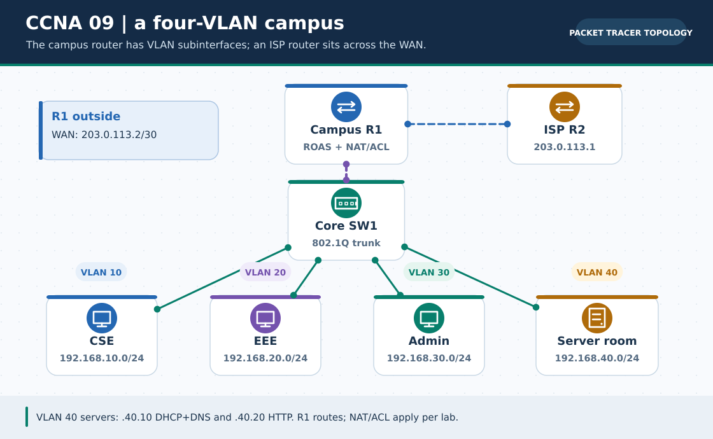

# CCNA Chapter 09: University network integration capstone

> **Navigation:** [English home](../README.md) · [CCNA Chapter index](README.md) · [Full Bengali guide](../../ccna-fundamentals/09-capstone-university-lab.md)

**Learning goal.** Combine department VLANs, DHCP relay, DNS/web, PAT and a targeted interdepartment ACL.



> **About this visual:** Illustrated topology or concept map from the corresponding Bengali guide; a diagram, not a Packet Tracer capture.

## Understand the design

Four /24 VLANs: CSE 192.168.10.0/24, EEE 192.168.20.0/24, Administration 192.168.30.0/24 and Servers 192.168.40.0/24; each .1 is its router subinterface gateway. Server0 .40.10 offers DHCP/DNS and Server1 .40.20 hosts HTTP. R1 routes locally and meets R2 on a documentation-only WAN.

### Key ideas

- DHCP Discover is a local broadcast; ip helper-address on client VLAN gateways relays it to Server0 in VLAN 40.
- DNS and HTTP are separate services; both depend on functioning inter-VLAN paths.
- PAT should be tested toward a simulated ISP/test network, not described as live Internet.
- An extended ACL on the CSE-facing gateway blocks CSE-to-Administration while still allowing approved server access.

## Build or work through it

1. Create VLANs 10, 20, 30 and 40 and the corresponding access/trunk port plan on SW1.
2. Configure R1 802.1Q subinterfaces .10/.20/.30/.40 with gateway .1 for each /24; verify all four local pings.
3. Give Server0 fixed .40.10, set DHCP pools for client VLANs and helper-address .40.10 on VLAN 10/20/30 subinterfaces.
4. Give Server1 fixed .40.20, add the DNS A record and enable HTTP; test by IP, then host name.
5. Add R1-R2 static paths and PAT toward the test WAN, then apply the documented ACL denying only CSE-to-Admin.

### Copyable study example

Read the comment or role label first: IOS commands, PC commands and shell commands run in **different places**. This example is not a verified Packet Tracer run.

```cisco
! On R1's VLAN 10 subinterface after its IP/gateway is set
interface gigabitEthernet 0/0.10
 encapsulation dot1Q 10
 ip address 192.168.10.1 255.255.255.0
 ip helper-address 192.168.40.10
! Other client VLANs need their own .1 and helper commands
```

## Verify; do not guess

- [ ] Each department PC leases an address in the correct VLAN with correct .1 gateway and .40.10 DNS.
- [ ] CSE reaches Server0/Server1 but cannot reach an Admin host under the targeted policy.
- [ ] After a permitted test packet to R2, show ip nat translations has a corresponding entry.

## If it fails

- If DHCP works only in VLAN 40, inspect helper-address on client subinterfaces and the server's DHCP pools.
- If CSE cannot reach any server, an ACL permit may be missing or applied in the wrong direction.

## Check your understanding

**Question.** Why place ip helper-address on the client VLAN subinterfaces?

<details><summary>Reveal the explanation</summary>

**Answer.** Their DHCP Discover broadcasts cannot cross the router; relay sends requests to Server0 in VLAN 40.

</details>

---

**Continue:** [English track](README.md) · [Full Bengali lesson, complete tables and additional exercises](../../ccna-fundamentals/09-capstone-university-lab.md)
