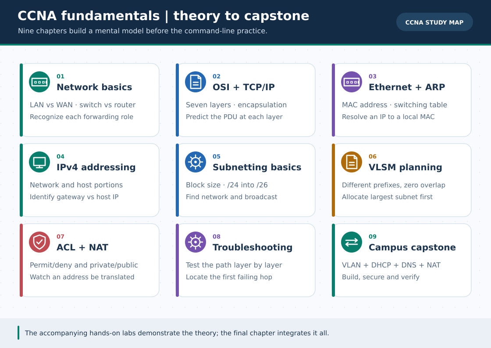

# 9 CCNA Fundamentals Chapters · English Track

> **Navigation:** [English home](../README.md) · [বাংলা সূচি](../../ccna-fundamentals/README.md) · [26 GIFs and search priorities](../../GIF-CATALOG.md)

Theory-first English companions, one diagram and an independent worked example per chapter. For the full 68-question original CCNA bank use the linked Bengali chapters.

**Interpretation:** These pages are independently readable English adaptations; the full-length Bengali originals and their extended tests remain available via a link at the top/bottom of every page. GIFs are conceptual illustrations, **not Packet Tracer recordings**.

| # | English guide | Bengali original | 30-second GIF |
| :---: | :--- | :--- | :--- |
| 01 | [What is a network? LAN, WAN, switches and routers](01-network-basics.md) | [বাংলা গাইড](../../ccna-fundamentals/01-network-basics.md) | Concept diagram in guide |
| 02 | [OSI layers, TCP/IP model and encapsulation](02-osi-tcp-ip.md) | [বাংলা গাইড](../../ccna-fundamentals/02-osi-tcp-ip.md) | Concept diagram in guide |
| 03 | [MAC addresses, Ethernet frames and ARP](03-mac-ethernet-arp.md) | [বাংলা গাইড](../../ccna-fundamentals/03-mac-ethernet-arp.md) | Concept diagram in guide |
| 04 | [IPv4 addresses, private ranges and special cases](04-ipv4-addressing.md) | [বাংলা গাইড](../../ccna-fundamentals/04-ipv4-addressing.md) | Concept diagram in guide |
| 05 | [Subnetting basics: prefix, block and usable hosts](05-subnetting-basics.md) | [বাংলা গাইড](../../ccna-fundamentals/05-subnetting-basics.md) | Concept diagram in guide |
| 06 | [VLSM: allocate different subnet sizes](06-subnetting-vlsm.md) | [বাংলা গাইড](../../ccna-fundamentals/06-subnetting-vlsm.md) | Concept diagram in guide |
| 07 | [Access control lists, NAT and PAT](07-acl-nat.md) | [বাংলা গাইড](../../ccna-fundamentals/07-acl-nat.md) | Concept diagram in guide |
| 08 | [Bottom-up network troubleshooting](08-troubleshooting.md) | [বাংলা গাইড](../../ccna-fundamentals/08-troubleshooting.md) | Concept diagram in guide |
| 09 | [University network integration capstone](09-capstone-university-lab.md) | [বাংলা গাইড](../../ccna-fundamentals/09-capstone-university-lab.md) | Concept diagram in guide |

[English home](../README.md) · [Full GIF catalog and replacement search names](../../GIF-CATALOG.md) · [Bengali home](../../README.md)
