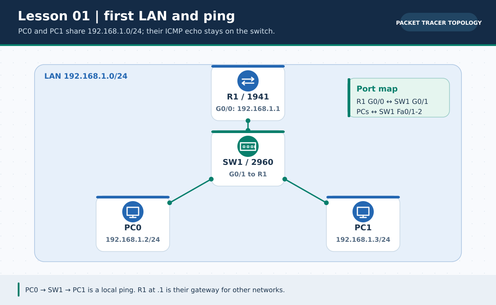
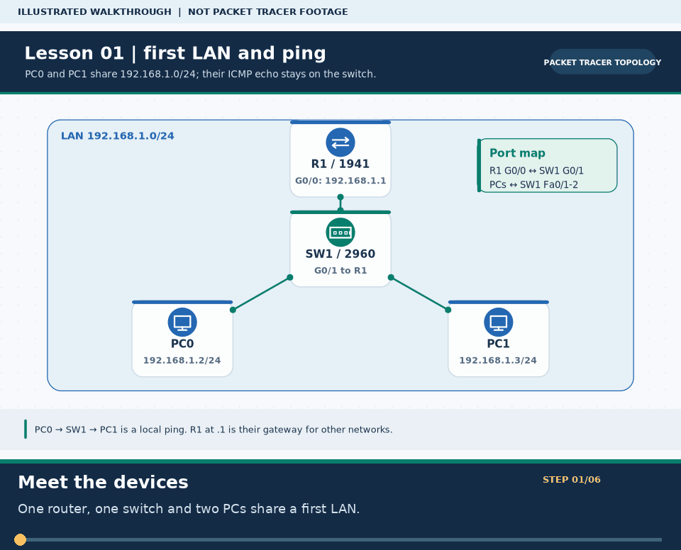

# Practical Lesson 01: Router CLI basics and the first LAN

> **Navigation:** [English home](../README.md) · [Practical Lesson index](README.md) · [Full Bengali guide](../../lessons/01-router-cli-basics.md)

**Learning goal.** Learn the Cisco CLI hierarchy and build a small LAN whose PCs can ping each other.



> **About this visual:** Illustrated topology or concept map from the corresponding Bengali guide; a diagram, not a Packet Tracer capture.



> **30-second GIF:** six illustrated stages of the topology and checks. This is **not a Packet Tracer recording or proof of successful device behavior**. See the [GIF search names and study priorities](../../GIF-CATALOG.md) if you want to source your own alternative.

## Understand the design

Connect PC0 and PC1 to a 2960 switch and R1 to the same LAN. R1 G0/0 is 192.168.1.1/24; PC0 is .2 and PC1 is .3, each with gateway .1. The included lesson-01 .pkt is a starting point, not a substitute for building the topology.

### Key ideas

- The prompt changes as you enter user EXEC, privileged EXEC, global configuration and interface configuration modes.
- Hosts in the same /24 exchange frames through the switch; a default gateway is for a different network.
- Router interfaces may start administratively down, so no shutdown and an up/up link are both required.

## Build or work through it

1. Place one router, one switch and two PCs. Cable the PCs to separate access ports and connect R1 G0/0 to the switch.
2. On R1 enter privileged and global configuration modes, name the device and give G0/0 its LAN IP address.
3. Set each PC's unique /24 host address and the router's .1 address as gateway; never assign the same IP twice.
4. Ping PC1 from PC0, then ping R1 from each PC. Save the router configuration only after the tests make sense.

### Copyable study example

Read the comment or role label first: IOS commands, PC commands and shell commands run in **different places**. This example is not a verified Packet Tracer run.

```cisco
enable
configure terminal
hostname R1
interface gigabitEthernet 0/0
 ip address 192.168.1.1 255.255.255.0
 no shutdown
end
show ip interface brief
```

## Verify; do not guess

- [ ] On R1, show ip interface brief must report G0/0 up/up with 192.168.1.1.
- [ ] On PC0, ipconfig shows 192.168.1.2/24; ping 192.168.1.3 reaches PC1.
- [ ] If PC0 can ping PC1 but not R1, separate the L2 test from the gateway/interface test.

## If it fails

- An administratively down router port needs no shutdown; a down/down port also needs a good cable and live peer.
- A missing same-LAN reply often means wrong mask, duplicate address or an unplugged switch port.

## Check your understanding

**Question.** Must a same-subnet PC0-to-PC1 ping cross the router?

<details><summary>Reveal the explanation</summary>

**Answer.** No. The switch forwards local Ethernet frames; the router is used only for traffic leaving the subnet.

</details>

---

**Continue:** [English track](README.md) · [Full Bengali lesson, complete tables and additional exercises](../../lessons/01-router-cli-basics.md)
