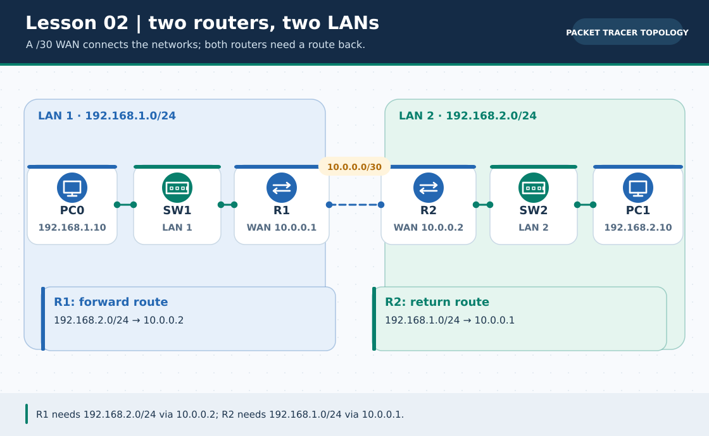
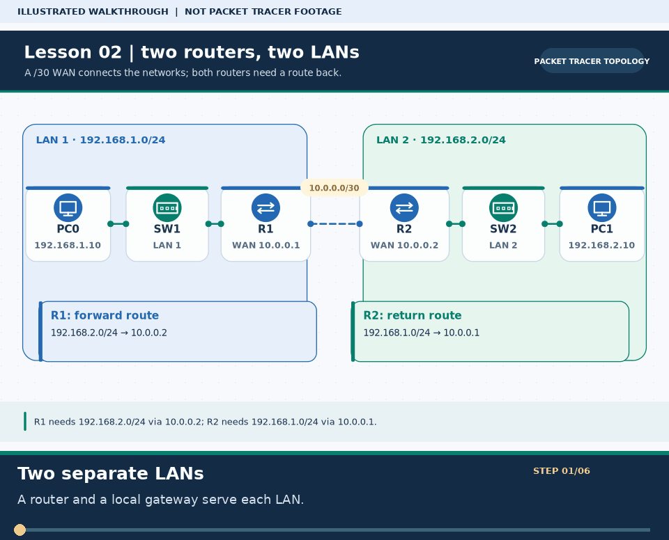

# Practical Lesson 02: Two routers and bidirectional static routing

> **Navigation:** [English home](../README.md) · [Practical Lesson index](README.md) · [Full Bengali guide](../../lessons/02-static-routing.md)

**Learning goal.** Join two /24 LANs through a /30 transit link and explain why replies need their own route.



> **About this visual:** Illustrated topology or concept map from the corresponding Bengali guide; a diagram, not a Packet Tracer capture.



> **30-second GIF:** six illustrated stages of the topology and checks. This is **not a Packet Tracer recording or proof of successful device behavior**. See the [GIF search names and study priorities](../../GIF-CATALOG.md) if you want to source your own alternative.

## Understand the design

PC0 192.168.1.10/24 uses R1 LAN gateway 192.168.1.1; PC1 192.168.2.10/24 uses R2 gateway 192.168.2.1. R1 and R2 meet at 10.0.0.1/30 and 10.0.0.2/30.

### Key ideas

- An ip route destination mask defines which remote network is matched, not just one host.
- A successful request cannot return if R2 has no route back toward 192.168.1.0/24.
- A /30 transit subnet supplies exactly two usable addresses for a point-to-point example.

## Build or work through it

1. Build two switched LANs and cable the router-to-router WAN link. Give every router interface the address shown in the plan.
2. Configure the PC gateway on its own LAN, then test each PC-to-local-gateway ping before adding remote routes.
3. On R1 add 192.168.2.0/24 via 10.0.0.2. On R2 add 192.168.1.0/24 via 10.0.0.1.
4. Inspect both routing tables and ping from PC0 to PC1 and back; a one-way configuration is not a complete lab.

### Copyable study example

Read the comment or role label first: IOS commands, PC commands and shell commands run in **different places**. This example is not a verified Packet Tracer run.

```text
! R1 ONLY, after its interfaces are up
ip route 192.168.2.0 255.255.255.0 10.0.0.2
! R2 ONLY, on the other router
ip route 192.168.1.0 255.255.255.0 10.0.0.1
```

## Verify; do not guess

- [ ] R1 and R2 show the remote network with an S code in show ip route.
- [ ] R1 pings R2 at 10.0.0.2 before attempting end-to-end PC traffic.
- [ ] PC0 ping 192.168.2.10 and PC1 ping 192.168.1.10 both succeed after both static routes are installed.

## If it fails

- If WAN ping fails, fix interface state, cable and /30 mask before touching static routes.
- If the forward path works but replies fail, inspect the opposite router's return route and the host gateway.

## Check your understanding

**Question.** Why does adding a route only to R1 not guarantee PC0-to-PC1 ping?

<details><summary>Reveal the explanation</summary>

**Answer.** R2 still needs a path to 192.168.1.0/24 to deliver the ICMP reply.

</details>

---

**Continue:** [English track](README.md) · [Full Bengali lesson, complete tables and additional exercises](../../lessons/02-static-routing.md)
