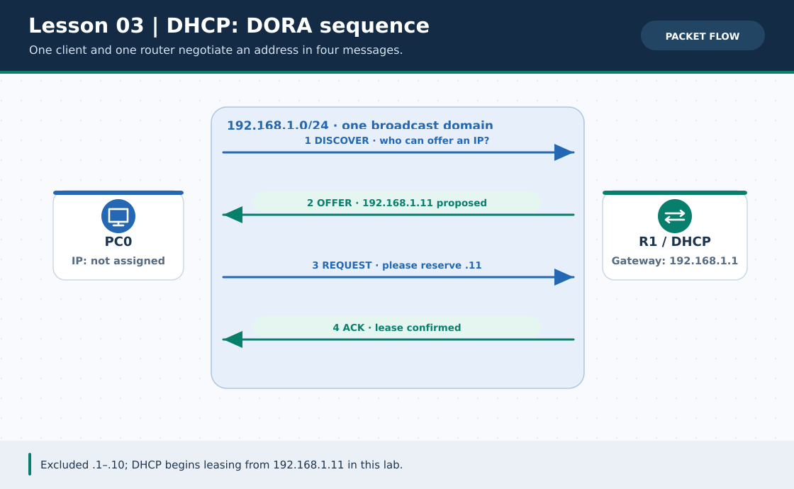
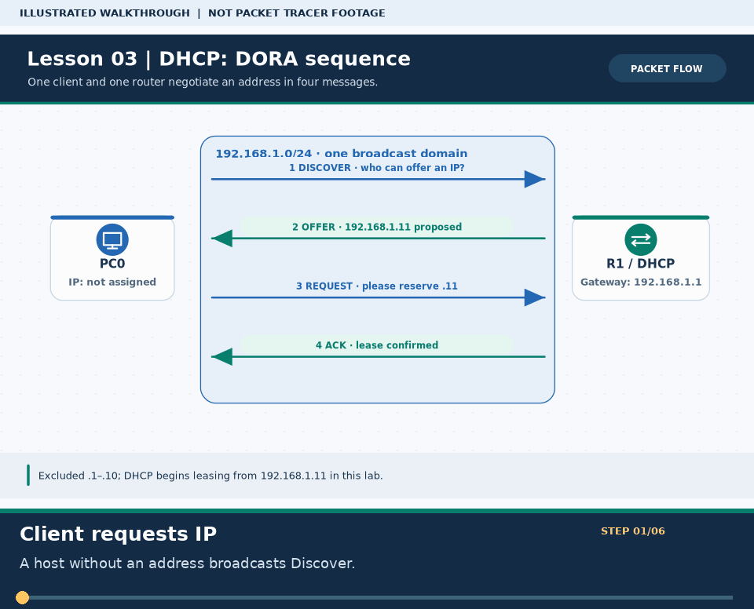

# Practical Lesson 03: Router DHCP server and the DORA exchange

> **Navigation:** [English home](../README.md) · [Practical Lesson index](README.md) · [Full Bengali guide](../../lessons/03-dhcp.md)

**Learning goal.** Make a router lease addresses to clients while reserving infrastructure IPs.



> **About this visual:** Illustrated topology or concept map from the corresponding Bengali guide; a diagram, not a Packet Tracer capture.



> **30-second GIF:** six illustrated stages of the topology and checks. This is **not a Packet Tracer recording or proof of successful device behavior**. See the [GIF search names and study priorities](../../GIF-CATALOG.md) if you want to source your own alternative.

## Understand the design

R1 serves 192.168.1.0/24 on G0/0 (192.168.1.1). Several PCs attach through the switch and use DHCP rather than fixed addresses. Exclude 192.168.1.1 through 192.168.1.10 from the pool.

### Key ideas

- The client sends Discover, receives Offer, sends Request and receives ACK; this is DORA.
- The DHCP default-router option must be a reachable gateway in the same subnet as the offered address.
- An excluded range prevents accidental leasing of a router or another statically addressed device.

## Build or work through it

1. Cable R1 to the switch and PCs to separate switch access ports; bring R1 G0/0 up as 192.168.1.1/24.
2. Exclude .1 through .10; create a DHCP pool for 192.168.1.0/24 with default-router 192.168.1.1.
3. Set PC0 and PC1 to DHCP/Automatic in Desktop IP Configuration; wait for an offer and record their distinct leases.
4. Inspect the binding table, then ping the gateway and another leased PC.

### Copyable study example

Read the comment or role label first: IOS commands, PC commands and shell commands run in **different places**. This example is not a verified Packet Tracer run.

```cisco
ip dhcp excluded-address 192.168.1.1 192.168.1.10
ip dhcp pool OFFICE
 network 192.168.1.0 255.255.255.0
 default-router 192.168.1.1
```

## Verify; do not guess

- [ ] PC ipconfig shows a 192.168.1.x/24 lease with gateway .1, never an excluded address.
- [ ] show ip dhcp binding on R1 lists each client after ACK.
- [ ] PC0 can ping 192.168.1.1; a lease alone does not prove connectivity.

## If it fails

- If a client has 169.254.x.x or no address, check pool, interface state, cable and DHCP mode.
- If DHCP assigns a lease but gateway ping fails, check the leased mask/gateway and R1 interface.

## Check your understanding

**Question.** Why reserve the router's .1 address outside the DHCP pool?

<details><summary>Reveal the explanation</summary>

**Answer.** The router must keep a stable gateway IP; handing that address to a client creates a duplicate address.

</details>

---

**Continue:** [English track](README.md) · [Full Bengali lesson, complete tables and additional exercises](../../lessons/03-dhcp.md)
