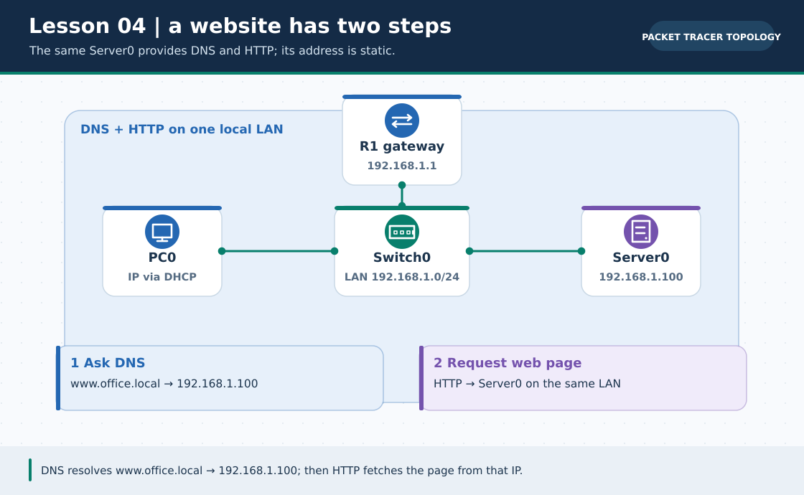
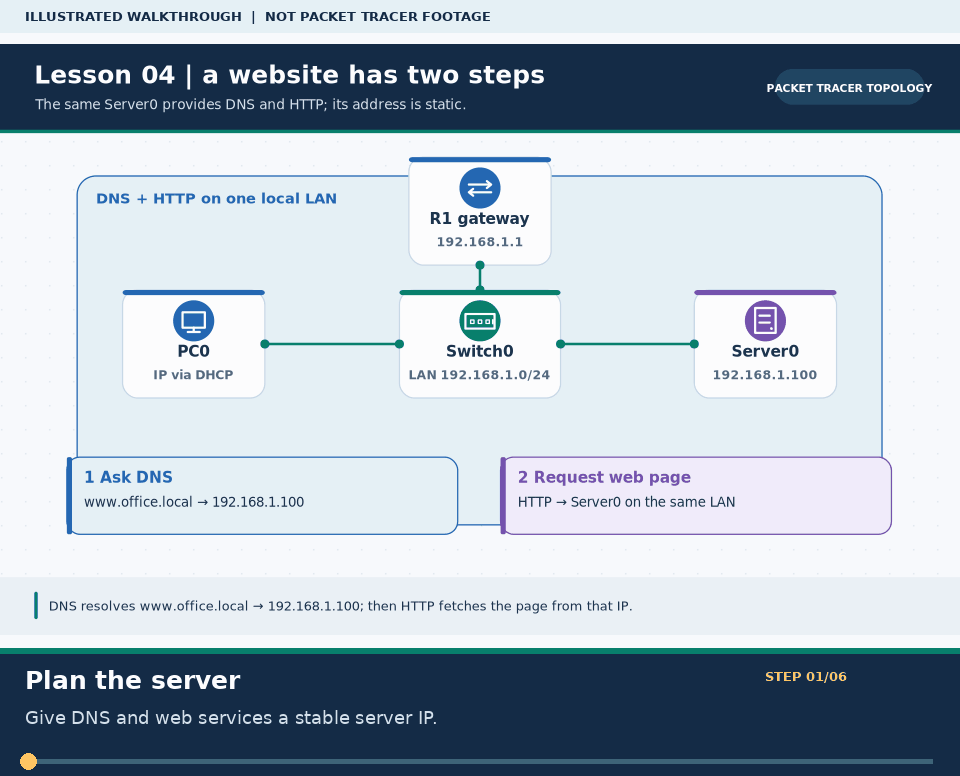

# Practical Lesson 04: DNS lookup and an HTTP server

> **Navigation:** [English home](../README.md) · [Practical Lesson index](README.md) · [Full Bengali guide](../../lessons/04-dns-http-server.md)

**Learning goal.** Follow a user from typing a host name to loading a locally hosted web page.



> **About this visual:** Illustrated topology or concept map from the corresponding Bengali guide; a diagram, not a Packet Tracer capture.



> **30-second GIF:** six illustrated stages of the topology and checks. This is **not a Packet Tracer recording or proof of successful device behavior**. See the [GIF search names and study priorities](../../GIF-CATALOG.md) if you want to source your own alternative.

## Understand the design

R1 is gateway 192.168.1.1/24. Server0 has static 192.168.1.100/24, gateway .1 and DNS .100. PCs obtain leases in the same LAN; their DNS server is .100.

### Key ideas

- DNS A records map a host name to an IPv4 address; DNS lookup is not the HTTP request itself.
- A server IP should remain stable so the A record does not silently become wrong.
- Testing by IP first isolates connectivity from name-resolution and HTTP-service problems.

## Build or work through it

1. Connect server and clients to the switched LAN. Configure R1 and exclude the gateway and static server range from DHCP.
2. Set Server0's static address and turn on DNS and HTTP under its Services tab.
3. Add the example host-name A record that points to 192.168.1.100; confirm the PCs know .100 as their DNS server.
4. Ping .100 by IP, ping the chosen name, then open the same name in the PC web browser.

### Copyable study example

Read the comment or role label first: IOS commands, PC commands and shell commands run in **different places**. This example is not a verified Packet Tracer run.

```cisco
! R1 DHCP options for clients; Server0 remains static
ip dhcp pool OFFICE
 network 192.168.1.0 255.255.255.0
 default-router 192.168.1.1
 dns-server 192.168.1.100
```

## Verify; do not guess

- [ ] Server0 answers ping at 192.168.1.100 before name resolution is tested.
- [ ] The PC resolves the exact host name entered on Server0 to 192.168.1.100.
- [ ] The browser displays the page from Server0 after the HTTP service is enabled.

## If it fails

- Host Name Unresolved means check the DNS setting on the PC, A record spelling and DNS service state.
- If name ping works but browser fails, inspect HTTP rather than changing routes at random.

## Check your understanding

**Question.** Does an HTTP page opening by IP prove DNS is configured correctly?

<details><summary>Reveal the explanation</summary>

**Answer.** No. It proves reachability and HTTP only; test the name separately to prove DNS.

</details>

---

**Continue:** [English track](README.md) · [Full Bengali lesson, complete tables and additional exercises](../../lessons/04-dns-http-server.md)
