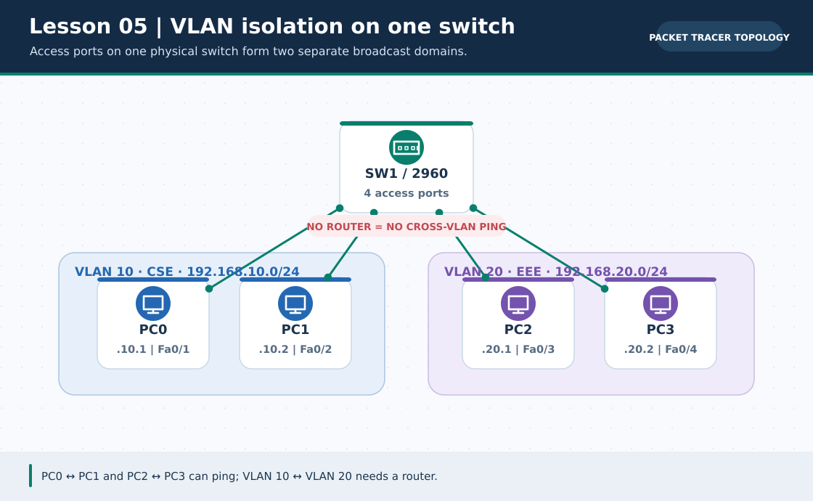
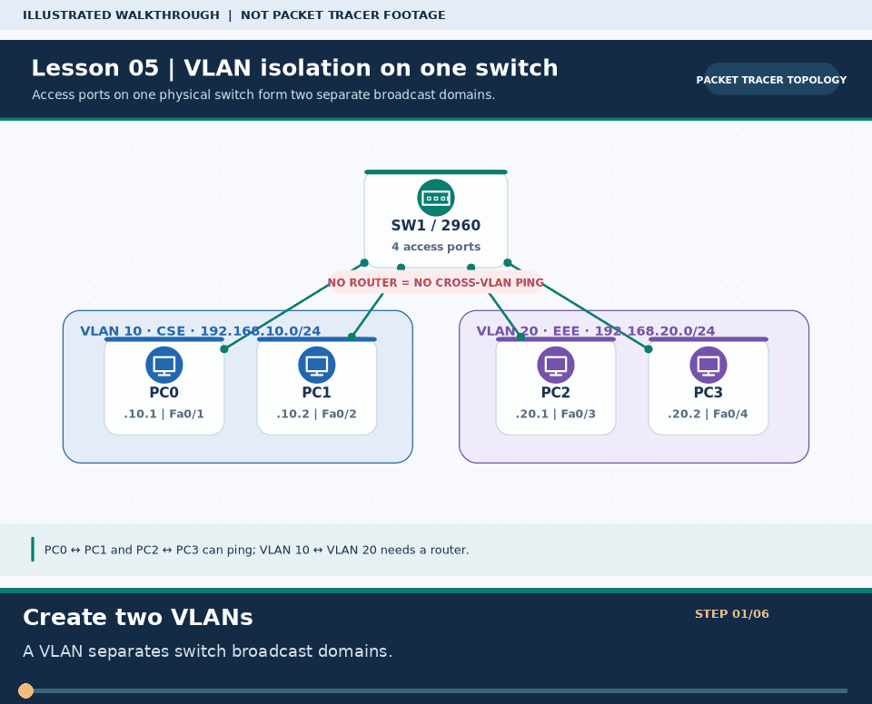

# Practical Lesson 05: VLAN segmentation and access ports

> **Navigation:** [English home](../README.md) · [Practical Lesson index](README.md) · [Full Bengali guide](../../lessons/05-vlan.md)

**Learning goal.** Separate four PCs into two switch broadcast domains and observe the routing boundary.



> **About this visual:** Illustrated topology or concept map from the corresponding Bengali guide; a diagram, not a Packet Tracer capture.



> **30-second GIF:** six illustrated stages of the topology and checks. This is **not a Packet Tracer recording or proof of successful device behavior**. See the [GIF search names and study priorities](../../GIF-CATALOG.md) if you want to source your own alternative.

## Understand the design

PC0/PC1 use 192.168.10.1/24 and .2/24 on VLAN 10; PC2/PC3 use 192.168.20.1/24 and .2/24 on VLAN 20. SW1 Fa0/1-2 serve VLAN 10 and Fa0/3-4 serve VLAN 20. This isolated lesson does not configure a router.

### Key ideas

- A VLAN is a Layer-2 broadcast domain; hosts on different VLANs cannot communicate through a Layer-2 switch alone.
- An access port carries one intended data VLAN to its attached host.
- A trunk transports multiple VLANs between devices, but by itself does not route between them.

## Build or work through it

1. Cable four PCs to SW1 and set the four host IPs in two nonoverlapping /24 networks.
2. Create VLAN 10 and VLAN 20; put Fa0/1-2 in 10 and Fa0/3-4 in 20 using access-port mode.
3. Run a same-VLAN ping on each pair, then a cross-VLAN ping. A failure across VLANs is expected in this stage.
4. Only in the next lessons add a router-on-a-stick or multilayer switch if cross-VLAN traffic is required.

### Copyable study example

Read the comment or role label first: IOS commands, PC commands and shell commands run in **different places**. This example is not a verified Packet Tracer run.

```cisco
vlan 10
 name CSE
vlan 20
 name EEE
interface range fastEthernet 0/1 - 2
 switchport mode access
 switchport access vlan 10
interface range fastEthernet 0/3 - 4
 switchport mode access
 switchport access vlan 20
```

## Verify; do not guess

- [ ] show vlan brief lists the correct four ports under VLAN 10 or 20.
- [ ] PC0-to-PC1 and PC2-to-PC3 pings pass if masks, ports and links are correct.
- [ ] PC0-to-PC2 ping is expected to fail until inter-VLAN routing is configured.

## If it fails

- Check the actual port receiving each cable; an IP in VLAN 10 plugged into a VLAN 20 access port will fail local tests.
- Do not mark cross-VLAN failure as a defect if this isolation-only topology has no Layer-3 gateway.

## Check your understanding

**Question.** Does putting a link in trunk mode automatically allow PC0 to ping PC2?

<details><summary>Reveal the explanation</summary>

**Answer.** No. Tagged frame transport and Layer-3 inter-VLAN routing are different functions.

</details>

---

**Continue:** [English track](README.md) · [Full Bengali lesson, complete tables and additional exercises](../../lessons/05-vlan.md)
