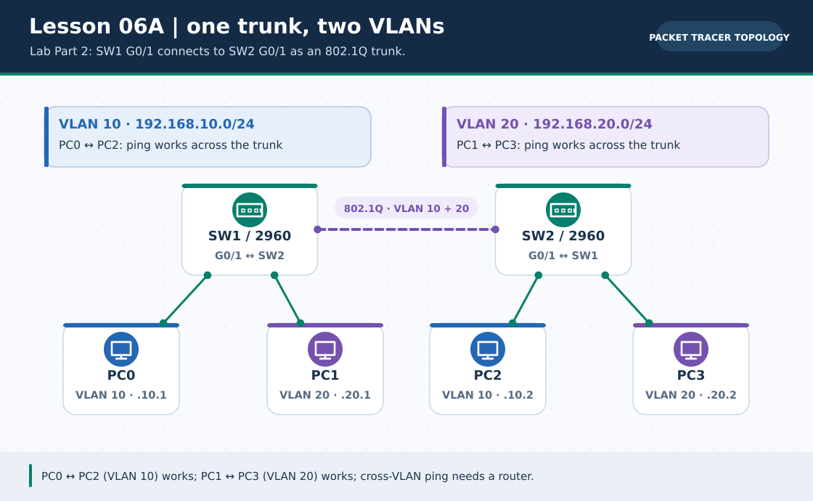
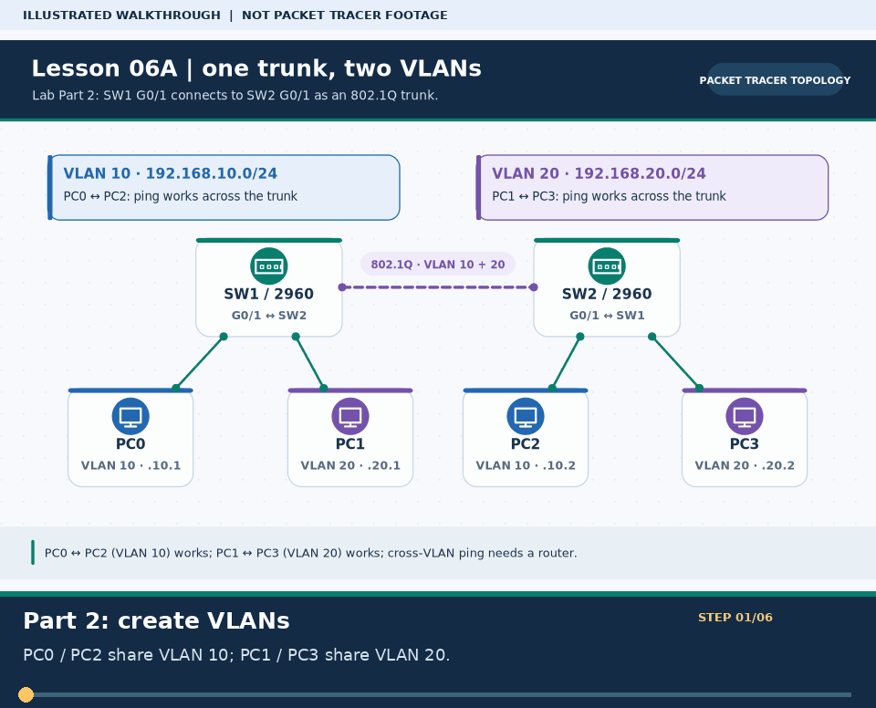
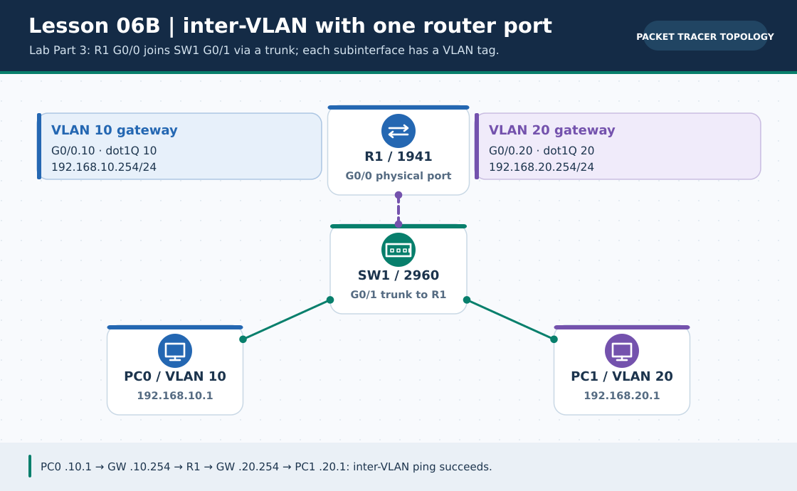

# Practical Lesson 06: 802.1Q trunks and router-on-a-stick

> **Navigation:** [English home](../README.md) · [Practical Lesson index](README.md) · [Full Bengali guide](../../lessons/06-trunk-inter-vlan.md)

**Learning goal.** Carry multiple VLANs across switches and route between them with one router link.



> **About this visual:** Illustrated topology or concept map from the corresponding Bengali guide; a diagram, not a Packet Tracer capture.



> **30-second GIF:** six illustrated stages of the topology and checks. This is **not a Packet Tracer recording or proof of successful device behavior**. See the [GIF search names and study priorities](../../GIF-CATALOG.md) if you want to source your own alternative.



> This second diagram separates the concept/flow from the physical topology. Compare its labels with the numbered build steps below.

## Understand the design

Part 2 carries VLAN 10 (PC0 192.168.10.1, PC2 .2) and VLAN 20 (PC1 192.168.20.1, PC3 .2) across an SW1-SW2 trunk; cross-VLAN ping still fails. Part 3 is a SEPARATE router-on-a-stick build: R1 gateways are 192.168.10.254 and 192.168.20.254, with PC0 .10.1 and PC1 .20.1. Do not connect SW2's trunk and R1 to the same single Gi0/1 port.

### Key ideas

- An 802.1Q tag identifies VLAN 10 or VLAN 20 on the shared physical trunk link.
- Router subinterface .10 must encapsulate dot1Q 10; subinterface .20 must encapsulate dot1Q 20.
- Same-VLAN traffic may stay on switches, but different-VLAN traffic reaches the router gateway.

## Build or work through it

1. Create VLAN 10 and VLAN 20 on each participating switch, then assign PC-facing access ports.
2. In Part 2, connect SW1 Gi0/1 to SW2 Gi0/1 as a trunk and check same-VLAN ping across switches; different VLANs stay isolated.
3. For the separate Part 3, connect SW1 Gi0/1 to R1 G0/0 as a trunk; enable the router parent interface and add .10/.20 subinterfaces with .254 gateways.
4. Give clients an IP and gateway appropriate to their own VLAN, then ping locally and across VLANs.

### Copyable study example

Read the comment or role label first: IOS commands, PC commands and shell commands run in **different places**. This example is not a verified Packet Tracer run.

```cisco
! Router R1 only: parent G0/0 must be enabled
interface gigabitEthernet 0/0
 no shutdown
interface gigabitEthernet 0/0.10
 encapsulation dot1Q 10
 ip address 192.168.10.254 255.255.255.0
interface gigabitEthernet 0/0.20
 encapsulation dot1Q 20
 ip address 192.168.20.254 255.255.255.0
```

## Verify; do not guess

- [ ] show interfaces trunk on the switch lists the correct tagged uplink for that part's physical topology.
- [ ] R1 subinterfaces and both PC gateways use VLAN-matched prefixes.
- [ ] In Part 2, PC0-to-PC2 (same VLAN 10) succeeds across SW1-SW2; PC0-to-PC1 (different VLANs) does not.
- [ ] In the separate Part 3, PC0-to-PC1 (VLAN 10 to VLAN 20) succeeds through R1 once both .254 gateways are configured.

## If it fails

- If same-VLAN works but cross-VLAN fails, inspect trunk tagging, router parent interface and the host gateway.
- If only one VLAN works, check the VLAN IDs and allowed VLAN list on every trunk along its path.

## Check your understanding

**Question.** Why are .10 and .20 two logical interfaces on one cable?

<details><summary>Reveal the explanation</summary>

**Answer.** The router separates VLAN-tagged frames into distinct Layer-3 interfaces and gateways.

</details>

---

**Continue:** [English track](README.md) · [Full Bengali lesson, complete tables and additional exercises](../../lessons/06-trunk-inter-vlan.md)
