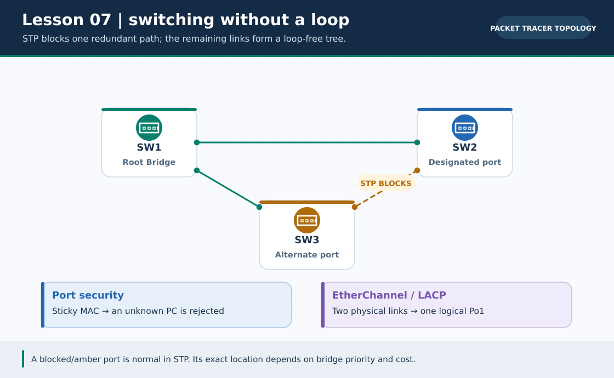
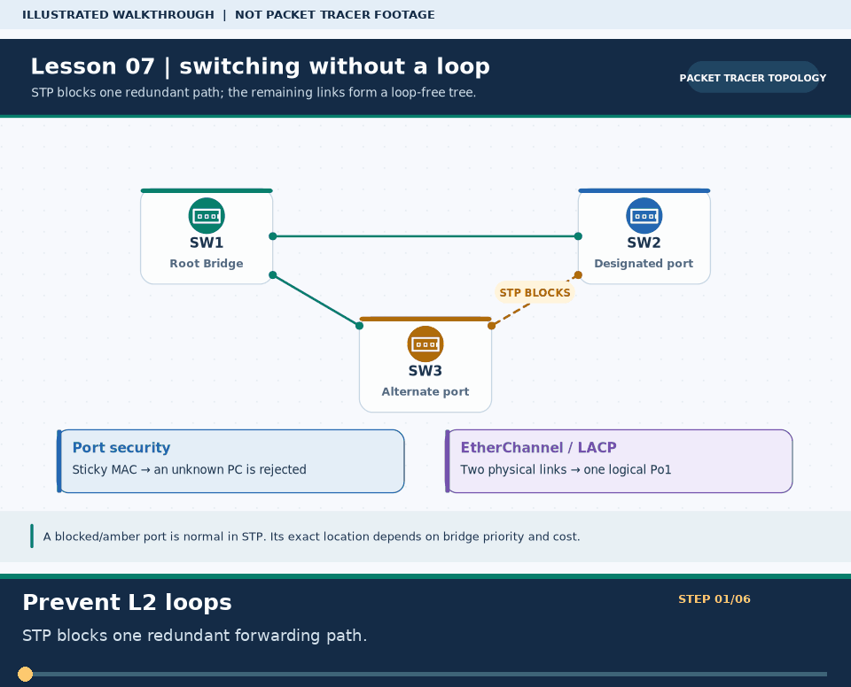

# Practical Lesson 07: STP, port security and EtherChannel

> **Navigation:** [English home](../README.md) · [Practical Lesson index](README.md) · [Full Bengali guide](../../lessons/07-switching.md)

**Learning goal.** Understand how a switch prevents loops, limits host MACs and bundles redundant links.



> **About this visual:** Illustrated topology or concept map from the corresponding Bengali guide; a diagram, not a Packet Tracer capture.



> **30-second GIF:** six illustrated stages of the topology and checks. This is **not a Packet Tracer recording or proof of successful device behavior**. See the [GIF search names and study priorities](../../GIF-CATALOG.md) if you want to source your own alternative.

## Understand the design

Use the original switching lab diagrams as the physical plan. Keep loop tests separate from port-security and EtherChannel tests; test one feature at a time before combining them.

### Key ideas

- A Layer-2 loop can multiply broadcasts; STP chooses a root and blocks redundant forwarding paths.
- Port security is a switchport access-control policy for learned or configured MAC addresses, not IP routing.
- EtherChannel treats matching physical members as one logical link, but member mode, speed and VLAN policy must agree.

## Build or work through it

1. Connect switches with a redundant path and use show spanning-tree to note the root and blocked port.
2. Configure a known host-facing access port's MAC limit; observe the port-security status before changing host MACs.
3. On a separate link pair, configure a consistent EtherChannel protocol/channel-group on both ends.
4. Remove one member or change one attachment in a controlled test; compare link behavior with the original baseline.

### Copyable study example

Read the comment or role label first: IOS commands, PC commands and shell commands run in **different places**. This example is not a verified Packet Tracer run.

```cisco
! SW1 root-bridge demonstration; apply only in the STP segment
configure terminal
spanning-tree vlan 1 root primary
end
show spanning-tree
```

## Verify; do not guess

- [ ] show spanning-tree identifies the root and any blocked port in the redundant design.
- [ ] show port-security interface <access-port> reports the configured security state, if the command is supported.
- [ ] show etherchannel summary shows the bundle and participating ports for the independent channel lab.

## If it fails

- If the bundle will not form, check mismatched VLAN/trunk/access settings and channel mode on both switches.
- If a host stops communicating after a MAC change, inspect port-security violation state before editing its IP.

## Check your understanding

**Question.** Why does STP intentionally prevent one redundant link from forwarding?

<details><summary>Reveal the explanation</summary>

**Answer.** It eliminates a Layer-2 loop while preserving a backup path for a later topology change.

</details>

---

**Continue:** [English track](README.md) · [Full Bengali lesson, complete tables and additional exercises](../../lessons/07-switching.md)
