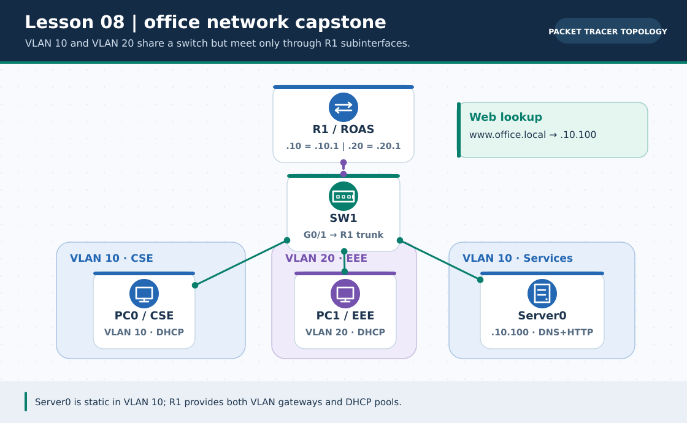
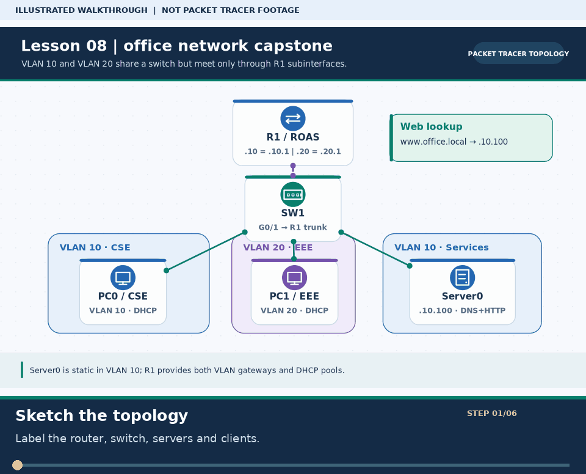

# Practical Lesson 08: Office network integration project

> **Navigation:** [English home](../README.md) · [Practical Lesson index](README.md) · [Full Bengali guide](../../lessons/08-final-project.md)

**Learning goal.** Integrate a small office's VLANs, router-on-a-stick, DHCP and server services.



> **About this visual:** Illustrated topology or concept map from the corresponding Bengali guide; a diagram, not a Packet Tracer capture.



> **30-second GIF:** six illustrated stages of the topology and checks. This is **not a Packet Tracer recording or proof of successful device behavior**. See the [GIF search names and study priorities](../../GIF-CATALOG.md) if you want to source your own alternative.

## Understand the design

SW1 Fa0/1 has PC0 on VLAN 10, Fa0/2 PC1 on VLAN 20, and Fa0/3 Server0 on VLAN 10. SW1 G0/1 trunks to R1 G0/0. VLAN 10 gateway is 192.168.10.1 and server is 192.168.10.100; VLAN 20 gateway is 192.168.20.1.

### Key ideas

- Build the network layer by layer: link, VLAN, gateway, lease and application service.
- The same router physical interface can provide two VLAN gateways through 802.1Q subinterfaces.
- A service cannot work through a broken lower-layer path; verify IP routing before DNS or web browsing.

## Build or work through it

1. Place router, switch, two PCs and a server and cable exactly the planned access and trunk ports.
2. Create both VLANs and assign PC0/Server0 to 10, PC1 to 20; configure SW1-to-R1 trunk.
3. Configure R1 .10/.20 tagged gateways and DHCP pools without leasing the static server address.
4. Give Server0 its fixed IP and enable the required DNS/HTTP services; test name resolution after basic pings pass.

### Copyable study example

Read the comment or role label first: IOS commands, PC commands and shell commands run in **different places**. This example is not a verified Packet Tracer run.

```cisco
! On SW1 only; R1 requires matching .10 and .20 subinterfaces
interface gigabitEthernet 0/1
 switchport mode trunk
interface fastEthernet 0/3
 switchport mode access
 switchport access vlan 10
```

## Verify; do not guess

- [ ] show vlan brief puts Fa0/1 and Fa0/3 in VLAN 10 and Fa0/2 in VLAN 20.
- [ ] show interfaces trunk includes G0/1; both PCs ping their own gateway before cross-VLAN tests.
- [ ] PC0/PC1 can reach Server0 by IP; the named HTTP service is a separate last test.

## If it fails

- A PC that has a lease but cannot ping its gateway may sit on the wrong VLAN or have the wrong DHCP default-router.
- If server IP works but domain name fails, check DNS server setting and A record, not the trunk first.

## Check your understanding

**Question.** What should be proved before troubleshooting the office browser page?

<details><summary>Reveal the explanation</summary>

**Answer.** First prove L2 port/trunk state, PC gateway ping and Server0 IP ping; then isolate DNS and HTTP.

</details>

---

**Continue:** [English track](README.md) · [Full Bengali lesson, complete tables and additional exercises](../../lessons/08-final-project.md)
