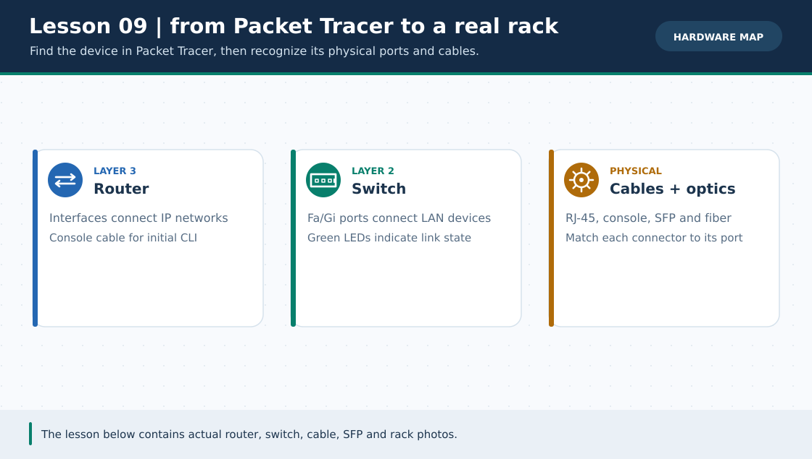
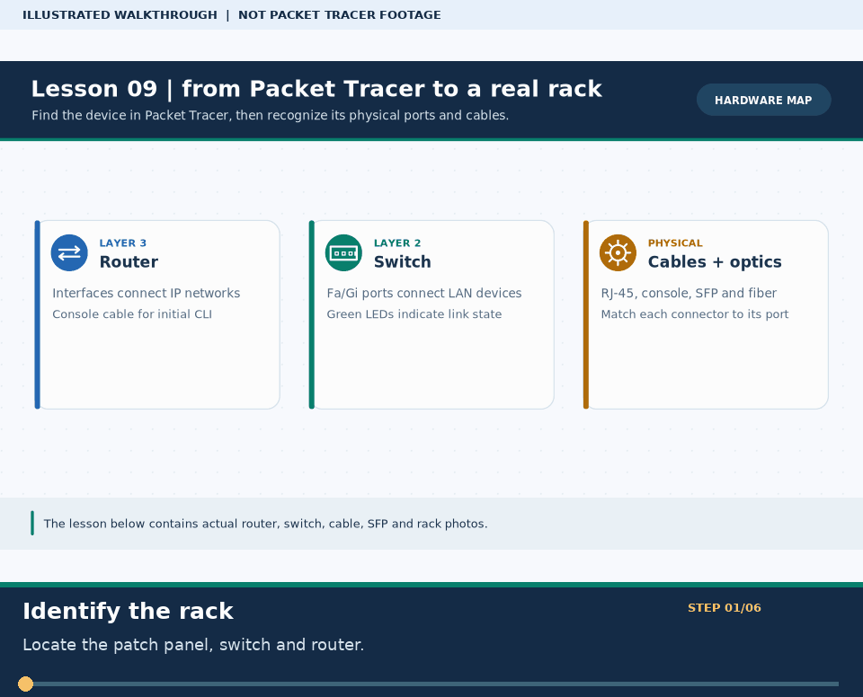
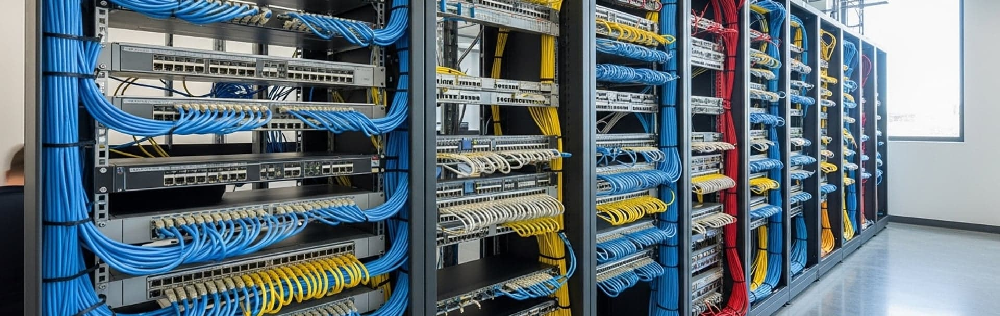
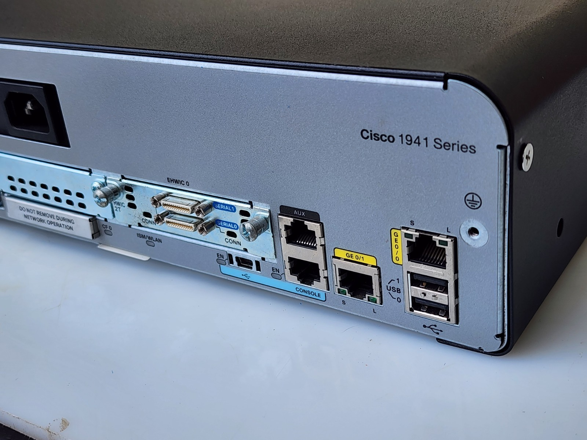
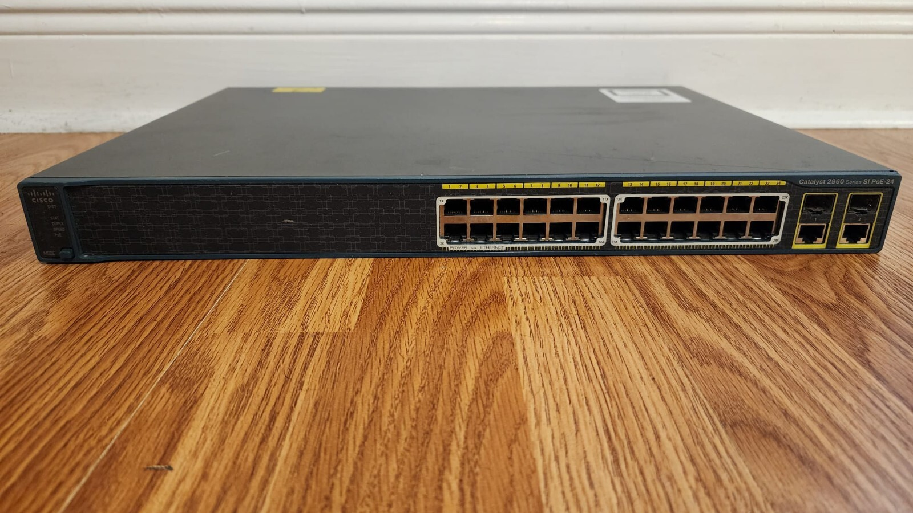
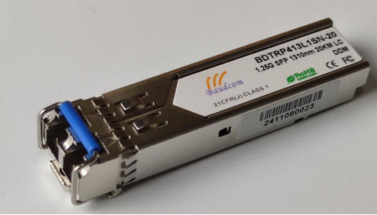

# Practical Lesson 09: Real network hardware and rack infrastructure

> **Navigation:** [English home](../README.md) · [Practical Lesson index](README.md) · [Full Bengali guide](../../lessons/09-real-hardware.md)

**Learning goal.** Connect Packet Tracer logical icons to physical ports, media and rack components.

> **About this visual:** Illustrated topology or concept map from the corresponding Bengali guide; a diagram, not a Packet Tracer capture.

> **30-second GIF:** six illustrated stages of the topology and checks. This is **not a Packet Tracer recording or proof of successful device behavior**. See the [GIF search names and study priorities](../../GIF-CATALOG.md) if you want to source your own alternative.

## Understand the design

Study the included hardware reference images: endpoint, patch panel, switch, router, copper/fiber uplink and SFP module. This is a hardware literacy guide, not a new .pkt configuration.

### Key ideas

- A patch panel terminates structured cabling; it is not a powered Ethernet switch.
- An SFP transceiver and appropriate fiber can form an optical uplink when both ends and media are compatible.
- A port label, cable type and link light convey physical facts missing from a simplified logical icon.

## Real-device photo references

These pre-existing reference images illustrate physical components; they are not proof of a particular lab setup or a definitive hardware model/port map.

*Trace a cable from a passive patch-panel port to an active switch port; rack views are references, not a measured live facility.*

*Compare the router's Ethernet, console and expansion areas with the model-specific labeling on your own device; do not assume every revision has identical ports.*

*Locate access ports and possible uplinks. The number and kind of ports depend on the specific hardware revision.*

*An SFP is the transceiver, not the fiber itself; both link ends must support the module and matching optical media.*

## Build or work through it

1. Follow a PC connection to a wall jack, then a patch-panel port, patch cable and live switch interface.
2. Locate the switch uplink toward a router or higher-level switch, and distinguish copper and fiber transceivers.
3. In the rack reference image and the detailed Bengali rack blueprint, identify cabling, switching and power/cooling roles without assuming each unit is a router.
4. Translate the same path into Packet Tracer nodes, noting details the simulator cannot reproduce.

## Verify; do not guess

- [ ] Point to the actual patch panel, switch and router and explain each role in one sentence.
- [ ] Describe why a switch port may be down even when an IP plan is correct: power, cable, optics or peer state.
- [ ] Match at least one physical interface label to the analogous Packet Tracer port.

## If it fails

- A dark link light is a physical-layer clue; do not change routing before checking the media and port state.
- Never treat a simulator icon as proof that the matching real device has the same ports, speed or power behavior.

## Check your understanding

**Question.** Is a patch panel an active device that learns MAC addresses?

Reveal the explanation

**Answer.** No. A patch panel is a passive cabling termination; a switch learns and forwards Ethernet frames.

---

**Continue:** [English track](README.md) · [Full Bengali lesson, complete tables and additional exercises](../../lessons/09-real-hardware.md)
