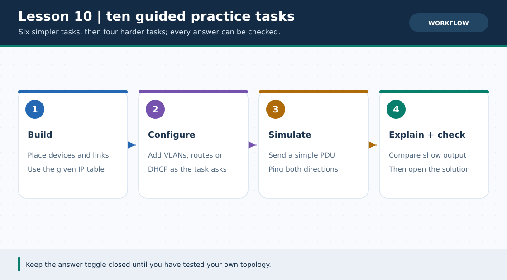
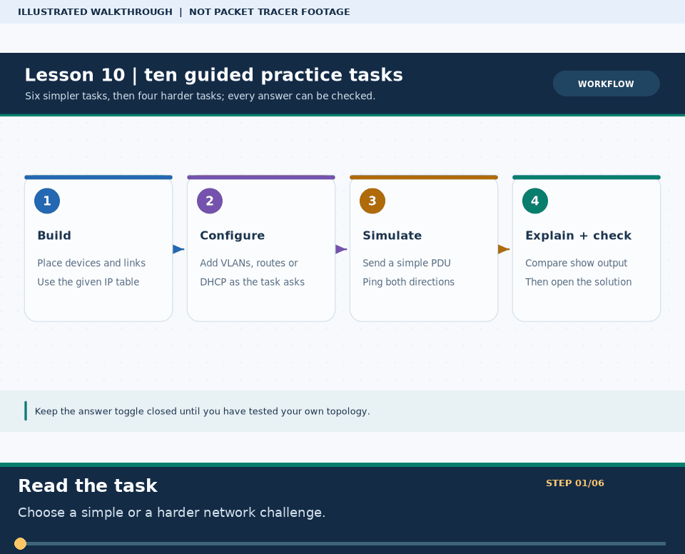

# Practical Lesson 10: Ten practice labs: attempt, check, then reveal

> **Navigation:** [English home](../README.md) · [Practical Lesson index](README.md) · [Full Bengali guide](../../lessons/10-practice-lab.md)

**Learning goal.** Work through ten progressively harder tasks, six basic and four harder, before opening solutions.



> **About this visual:** Illustrated topology or concept map from the corresponding Bengali guide; a diagram, not a Packet Tracer capture.



> **30-second GIF:** six illustrated stages of the topology and checks. This is **not a Packet Tracer recording or proof of successful device behavior**. See the [GIF search names and study priorities](../../GIF-CATALOG.md) if you want to source your own alternative.

## Understand the design

Create your own .pkt project for each task rather than claiming a bundled practice-lab.pkt. The original guide contains the full ten task statements, IP tables, hints and hidden answers; this English version provides the common workflow and representative starter case.

### Key ideas

- A task is solved only after its stated ping or show command confirms the goal.
- Checking hints after an attempt builds troubleshooting skills; opening solutions first does not.
- Keep separate saved builds for LAN, static routing, DHCP, DNS, VLAN and later integrated cases.

## Build or work through it

1. Read the requirements of one task and make a device/port/IP table before placing nodes.
2. For the starter LAN task, connect one router and switch to PC0 192.168.1.2 and PC1 192.168.1.3, with gateway 192.168.1.1/24.
3. Configure from the bottom up: cable, link, IP, gateway, routing, then application services if needed.
4. Run the exact verification step from the original task. Only after a failed honest attempt open the hint and then its answer.

### Copyable study example

Read the comment or role label first: IOS commands, PC commands and shell commands run in **different places**. This example is not a verified Packet Tracer run.

```cisco
! Starter task on R1, not a solution for all ten cases
interface gigabitEthernet 0/0
 ip address 192.168.1.1 255.255.255.0
 no shutdown
```

## Verify; do not guess

- [ ] PC0 ping 192.168.1.3 and R1 show ip interface brief prove the starter case.
- [ ] For routing tasks, confirm both routers know the remote LAN before running the PC-to-PC ping.
- [ ] Keep a short log for each case: requirement, command output, correction, final result.

## If it fails

- A successful ping to a local gateway but not the distant PC points toward routes or the remote gateway.
- A service that does not open by name but does by IP points toward the client DNS address or A record.

## Check your understanding

**Question.** When should the hidden answer for one practice task be opened?

<details><summary>Reveal the explanation</summary>

**Answer.** After you have built the topology, run the stated test and tried to diagnose any failure.

</details>

---

**Continue:** [English track](README.md) · [Full Bengali lesson, complete tables and additional exercises](../../lessons/10-practice-lab.md)
