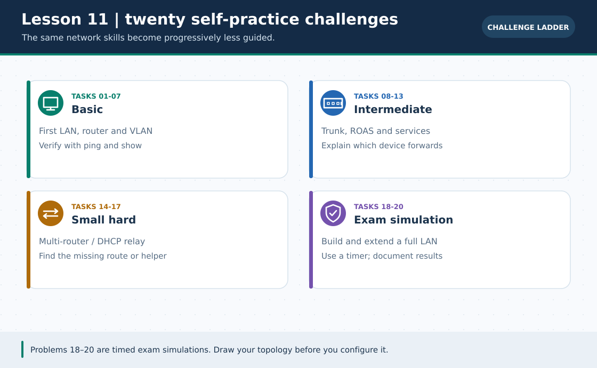
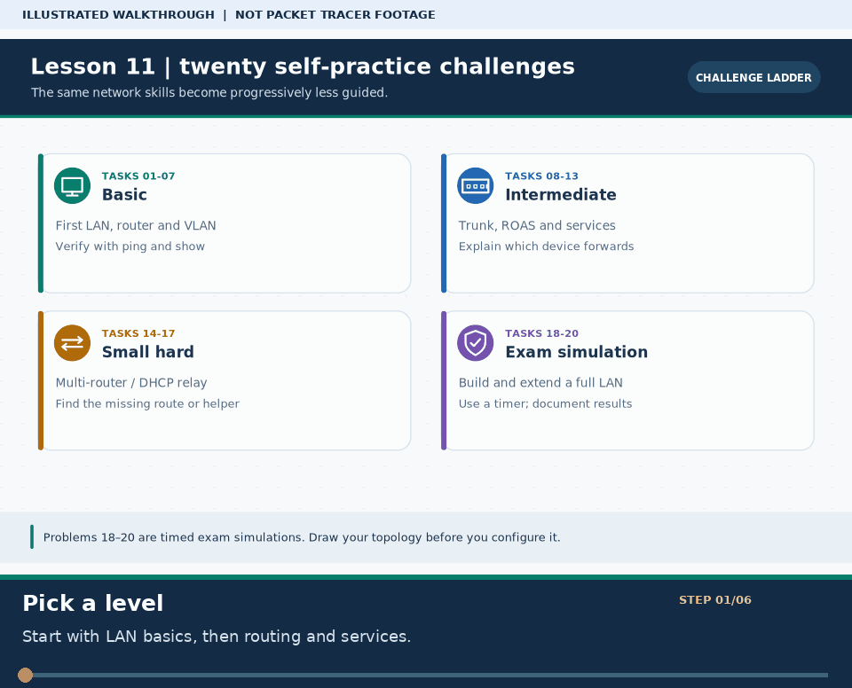

# Practical Lesson 11: Skill ladder and independent practice list

> **Navigation:** [English home](../README.md) · [Practical Lesson index](README.md) · [Full Bengali guide](../../lessons/11-practice-list.md)

**Learning goal.** Choose networking exercises by difficulty, measure progress and avoid random configuration.



> **About this visual:** Illustrated topology or concept map from the corresponding Bengali guide; a diagram, not a Packet Tracer capture.



> **30-second GIF:** six illustrated stages of the topology and checks. This is **not a Packet Tracer recording or proof of successful device behavior**. See the [GIF search names and study priorities](../../GIF-CATALOG.md) if you want to source your own alternative.

## Understand the design

The source index lists beginner, intermediate and advanced challenges. Start with router CLI and same-LAN ping; then add static routes, DHCP, VLANs, services and integrated fault isolation. Addresses in individual tasks are examples, not one shared topology.

### Key ideas

- Learning has a sequence: a Layer-3 failure is easier to diagnose after Layer-1/2 checks are routine.
- A lab goal should be falsifiable, such as a specific ping, lease or route-table entry.
- Writing down what changed between attempts prevents configuration drift and unearned success claims.

## Build or work through it

1. Pick one challenge and its original lesson link from the Bangla practice table; do not merge unrelated addresses into one project.
2. Sketch the smallest topology and calculate masks/network IDs before configuring devices.
3. Build one network function at a time; confirm each milestone with the matching show, ipconfig, ping or GUI action.
4. Record a failure, make one justified fix, repeat the same test and save your own .pkt if it now works.

### Copyable study example

Read the comment or role label first: IOS commands, PC commands and shell commands run in **different places**. This example is not a verified Packet Tracer run.

```bash
# Optional offline cross-check; run in a shell, not on an IOS device
python3 scripts/subnet_calculator.py 192.168.1.65/26
python3 scripts/quiz_trainer.py --track practical --count 5
```

## Verify; do not guess

- [ ] Describe each selected task's topology, addressing and expected result before opening a solution.
- [ ] Explain which command proves Layer-2 membership, the local gateway and a learned remote route.
- [ ] Repeat a previously finished task without reading your saved commands.

## If it fails

- If a /30 or /26 design does not fit the hosts, recalculate network and broadcast bounds first.
- If all tasks feel difficult, return to one smaller lab and verify it completely instead of adding devices.

## Check your understanding

**Question.** Is a task complete when the configuration was pasted without any test?

<details><summary>Reveal the explanation</summary>

**Answer.** No. An observable success criterion and its output are part of the exercise.

</details>

---

**Continue:** [English track](README.md) · [Full Bengali lesson, complete tables and additional exercises](../../lessons/11-practice-list.md)
