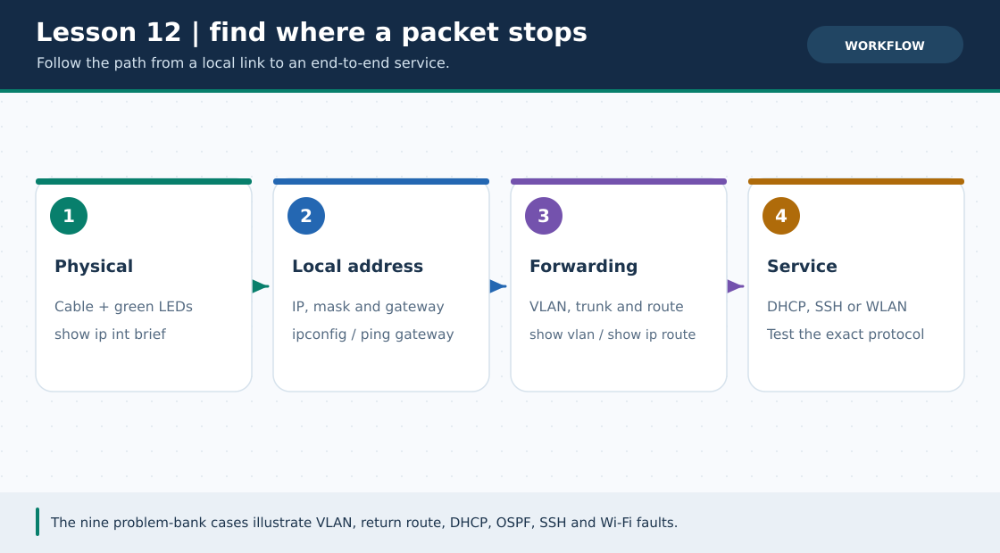
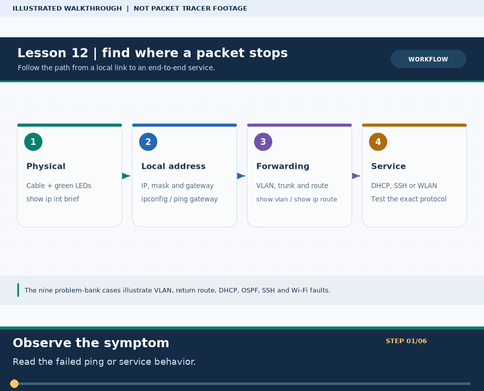

# Practical Lesson 12: Troubleshooting problem bank: nine cases

> **Navigation:** [English home](../README.md) · [Practical Lesson index](README.md) · [Full Bengali guide](../../lessons/12-problem-solve.md)

**Learning goal.** Use symptoms and CLI evidence to solve nine realistic network problems.



> **About this visual:** Illustrated topology or concept map from the corresponding Bengali guide; a diagram, not a Packet Tracer capture.



> **30-second GIF:** six illustrated stages of the topology and checks. This is **not a Packet Tracer recording or proof of successful device behavior**. See the [GIF search names and study priorities](../../GIF-CATALOG.md) if you want to source your own alternative.

## Understand the design

The original problem bank includes static-route errors, VLAN/trunk issues, DHCP, DNS, OSPF neighbor formation, SSH/RSA and wireless adapter/power mistakes. Cases are independent; open each linked base lab and do not paste every fix into one device.

### Key ideas

- A failed end-to-end ping has many possible causes; move systematically from endpoint to gateway to remote path.
- An OSPF neighbor failure should be checked on the participating interfaces before changing unrelated host IPs.
- A wireless client cannot associate if the adapter or power is missing even with a correct SSID.

## Build or work through it

1. Select one of the nine cases and write down the exact failure symptom and original working expectation.
2. Inspect local host IP/mask/gateway, cable and switch state; then inspect the router interface and route table.
3. For a service problem, separate transport reachability from name lookup or application availability.
4. For OSPF/SSH/Wi-Fi, run the feature-specific check from that case and change one fault at a time.
5. Repeat the original failed check after repair; document the smallest explanation that fits the evidence.

### Copyable study example

Read the comment or role label first: IOS commands, PC commands and shell commands run in **different places**. This example is not a verified Packet Tracer run.

```text
Router R1 (run each relevant command separately):
show ip interface brief
show ip route
show ip ospf neighbor
Switch SW1 (run each relevant command separately):
show vlan brief
show interfaces trunk
```

## Verify; do not guess

- [ ] The exact ping or service check that failed before the fix succeeds afterward.
- [ ] The relevant show output supports your claimed root cause rather than a guess.
- [ ] You can say which layer was broken and why the applied fix repaired it.

## If it fails

- An APIPA 169.254/16 host likely needs DHCP-path diagnosis, not an OSPF rewrite.
- Two hosts in different VLANs may need a Layer-3 gateway; changing a switch trunk alone cannot route them.

## Check your understanding

**Question.** Why rerun the original failed test after a repair?

<details><summary>Reveal the explanation</summary>

**Answer.** It is the simplest evidence that the root symptom has been fixed, rather than a different symptom hidden.

</details>

---

**Continue:** [English track](README.md) · [Full Bengali lesson, complete tables and additional exercises](../../lessons/12-problem-solve.md)
