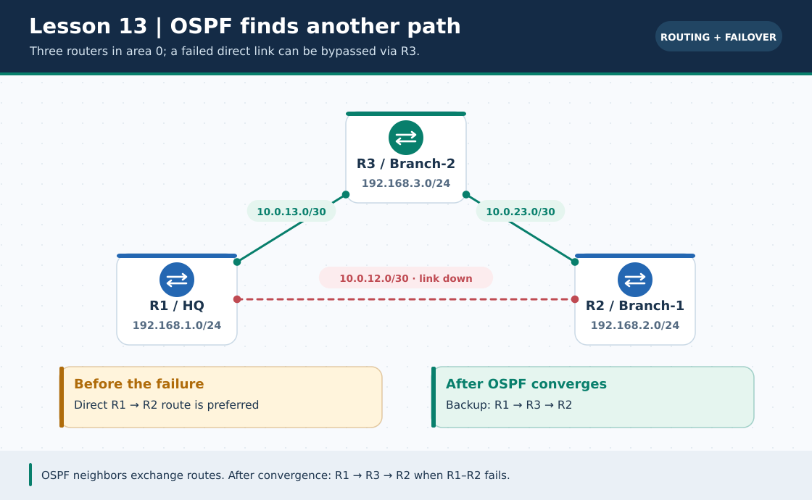
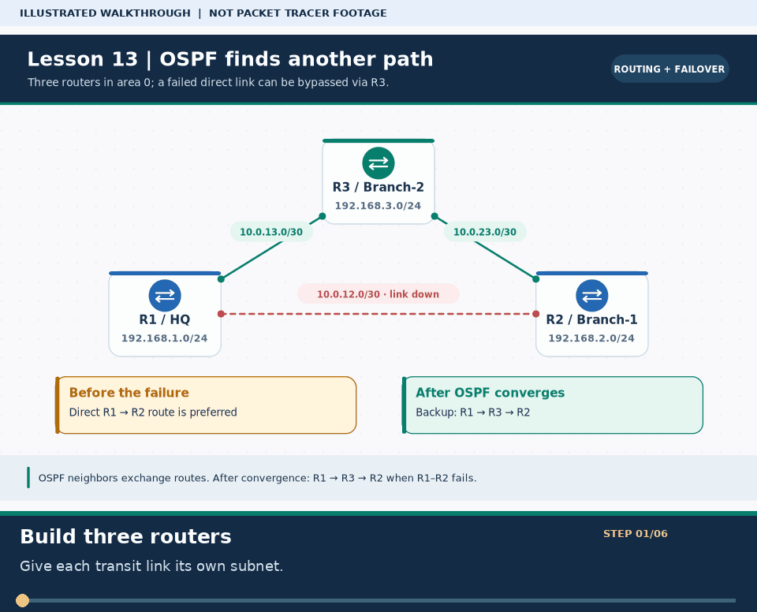

# Practical Lesson 13: RIPv2, OSPFv2 and link failover

> **Navigation:** [English home](../README.md) · [Practical Lesson index](README.md) · [Full Bengali guide](../../lessons/13-dynamic-routing-ospf.md)

**Learning goal.** Compare two dynamic-routing protocols on a three-router triangle and inspect convergence.



> **About this visual:** Illustrated topology or concept map from the corresponding Bengali guide; a diagram, not a Packet Tracer capture.



> **30-second GIF:** six illustrated stages of the topology and checks. This is **not a Packet Tracer recording or proof of successful device behavior**. See the [GIF search names and study priorities](../../GIF-CATALOG.md) if you want to source your own alternative.

## Understand the design

R1-R2 uses 10.0.12.0/30, R2-R3 10.0.23.0/30 and R1-R3 10.0.13.0/30. Each router also has its own LAN: 192.168.1.0/24, 192.168.2.0/24 or 192.168.3.0/24.

### Key ideas

- OSPFv2 forms neighbors on compatible router interfaces and advertises the associated IP networks.
- Wildcard masks invert subnet masks: /24 is 0.0.0.255; /30 is 0.0.0.3.
- An alternate physical path is useful only when routing reconverges and the destination has a return path.

## Build or work through it

1. Build the triangle, set three unique transit /30s and LAN /24s, then confirm adjacent-router pings.
2. Test RIPv2 and OSPFv2 as separate exercises or remove the previous protocol before evaluating the next.
3. Advertise only the appropriate directly connected networks on each router; set explicit OSPF router IDs.
4. Check neighbors and route-table codes before disconnecting a primary link; wait for protocol reconvergence afterward.

### Copyable study example

Read the comment or role label first: IOS commands, PC commands and shell commands run in **different places**. This example is not a verified Packet Tracer run.

```cisco
! R1 sample process; adapt networks and interface names on R2/R3
router ospf 1
 router-id 1.1.1.1
 network 192.168.1.0 0.0.0.255 area 0
 network 10.0.12.0 0.0.0.3 area 0
 network 10.0.13.0 0.0.0.3 area 0
```

## Verify; do not guess

- [ ] show ip ospf neighbor reaches FULL where adjacency is expected.
- [ ] show ip route marks remote OSPF routes O when OSPF is the active source.
- [ ] End-to-end ping recovers through the alternate transit link after the original path is disabled.

## If it fails

- A missing neighbor may be caused by wrong area, /30 mask, interface down or a passive transit interface.
- A learned route with no working ping still requires gateway, reverse routing and end-host IP checks.

## Check your understanding

**Question.** What wildcard mask corresponds to a /30 transit link?

<details><summary>Reveal the explanation</summary>

**Answer.** 0.0.0.3, the bitwise inverse of 255.255.255.252.

</details>

---

**Continue:** [English track](README.md) · [Full Bengali lesson, complete tables and additional exercises](../../lessons/13-dynamic-routing-ospf.md)
