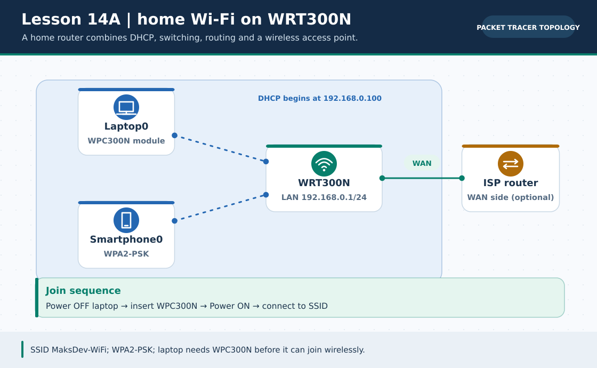
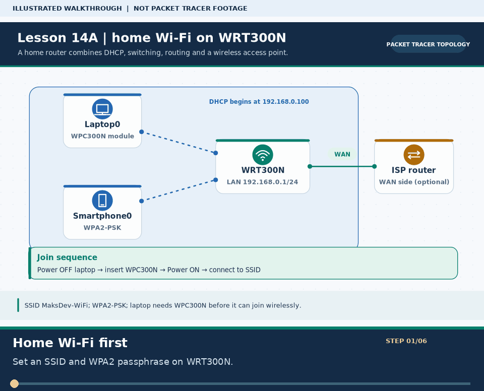
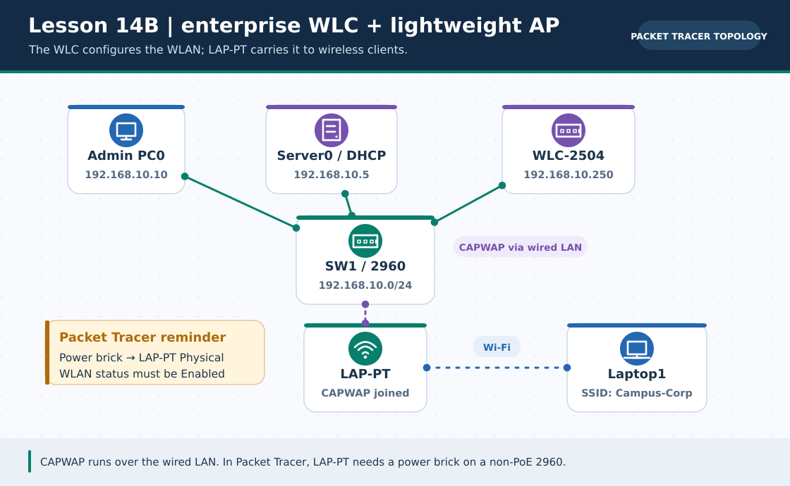

# Practical Lesson 14: Home Wi-Fi and enterprise WLC

> **Navigation:** [English home](../README.md) · [Practical Lesson index](README.md) · [Full Bengali guide](../../lessons/14-wireless-lan.md)

**Learning goal.** Contrast a WPA2 home wireless router with a controller-based campus WLAN.



> **About this visual:** Illustrated topology or concept map from the corresponding Bengali guide; a diagram, not a Packet Tracer capture.



> **30-second GIF:** six illustrated stages of the topology and checks. This is **not a Packet Tracer recording or proof of successful device behavior**. See the [GIF search names and study priorities](../../GIF-CATALOG.md) if you want to source your own alternative.



> This second diagram separates the concept/flow from the physical topology. Compare its labels with the numbered build steps below.

## Understand the design

Home: WRT300N LAN 192.168.0.1/24, wireless client adapter and SSID. Enterprise: admin PC 192.168.10.10/24, DHCP server 192.168.10.5/24, WLC management 192.168.10.250/24, switch and powered LAP.

### Key ideas

- A correct SSID alone is insufficient; security key, wireless adapter, power and DHCP also matter.
- A lightweight AP associates to a WLC for enterprise control; its join process is not the same as a home router.
- Documentation address 203.0.113.1 used in a simulated ISP link is not real Internet access.

## Build or work through it

1. For the home stage, configure WRT300N LAN, SSID and WPA2-PSK, then give the laptop a compatible wireless module.
2. Connect the laptop and inspect its lease and gateway ping before claiming web connectivity.
3. In a separate enterprise stage, wire admin PC, DHCP server, WLC-2504 and LAP-PT to SW1.
4. Supply power to LAP where required, set WLC management/SSID/security and inspect AP join and client association.

### Copyable study example

Read the comment or role label first: IOS commands, PC commands and shell commands run in **different places**. This example is not a verified Packet Tracer run.

```text
# Home client checks in Packet Tracer PC command prompt
ipconfig
ping 192.168.0.1
# Enterprise admin reaches WLC management separately
ping 192.168.10.250
```

## Verify; do not guess

- [ ] Home client shows a valid DHCP lease and can ping 192.168.0.1.
- [ ] The enterprise LAP appears joined to the controller and a client receives the expected LAN settings.
- [ ] Both SSID and authentication method match on each client and its chosen wireless system.

## If it fails

- If a laptop has no Wireless0 interface, check installed hardware module and device power first.
- If the LAP cannot join, check PoE/power adapter, DHCP, management VLAN/IP and controller reachability.

## Check your understanding

**Question.** Does setting the right SSID prove the laptop can reach its gateway?

<details><summary>Reveal the explanation</summary>

**Answer.** No. Check adapter/power, security association, DHCP lease and an actual gateway ping.

</details>

---

**Continue:** [English track](README.md) · [Full Bengali lesson, complete tables and additional exercises](../../lessons/14-wireless-lan.md)
