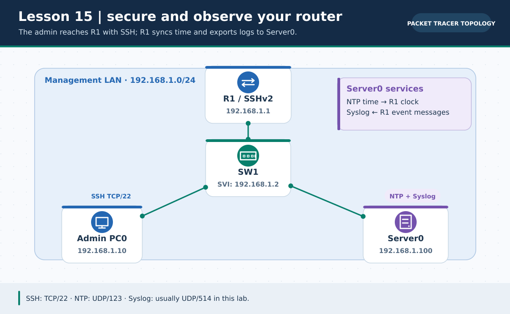
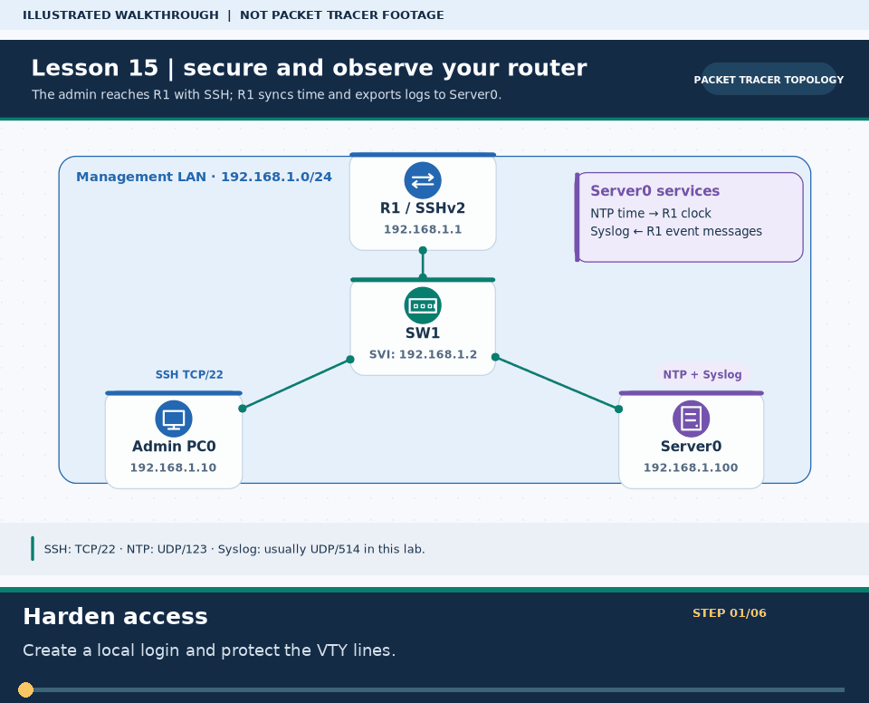

# Practical Lesson 15: Secure remote access, NTP and Syslog

> **Navigation:** [English home](../README.md) · [Practical Lesson index](README.md) · [Full Bengali guide](../../lessons/15-ssh-syslog-ntp.md)

**Learning goal.** Configure SSHv2 remote login, synchronize time and send audit events to a server.



> **About this visual:** Illustrated topology or concept map from the corresponding Bengali guide; a diagram, not a Packet Tracer capture.



> **30-second GIF:** six illustrated stages of the topology and checks. This is **not a Packet Tracer recording or proof of successful device behavior**. See the [GIF search names and study priorities](../../GIF-CATALOG.md) if you want to source your own alternative.

## Understand the design

R1 G0/0 is 192.168.1.1/24, SW1 management SVI .2, Admin PC0 .10 and Server0 .100 on the same LAN. Server0 provides the NTP and Syslog services in the simulator.

### Key ideas

- SSHv2 encrypts management sessions; Telnet transmits them without equivalent encryption.
- RSA keys require a hostname and domain name before crypto key generate rsa.
- Consistent NTP time makes Syslog event ordering useful during troubleshooting.

## Build or work through it

1. Cable and address the management LAN, then ping both the router and server from Admin PC0.
2. On R1 set hostname/domain, local admin account, enable secret, RSA keys and VTY login local with SSH transport.
3. Turn on NTP and Syslog services on Server0; point R1 at 192.168.1.100 for time and logs.
4. SSH from PC0 to R1, verify the clock status and generate one harmless event to inspect on the Syslog server.

### Copyable study example

Read the comment or role label first: IOS commands, PC commands and shell commands run in **different places**. This example is not a verified Packet Tracer run.

```cisco
! R1 example after LAN interface is reachable
hostname R1
ip domain-name office.local
username admin secret LabOnlyStrongPassword
crypto key generate rsa modulus 2048
ip ssh version 2
line vty 0 4
 login local
 transport input ssh
ntp server 192.168.1.100
logging 192.168.1.100
```

## Verify; do not guess

- [ ] SSH from the PC succeeds with the local credentials; Telnet should not be the approved management method.
- [ ] show ip ssh reports the supported SSH version and show ntp status indicates synchronization if PT supports it.
- [ ] A Syslog event appears at Server0 with a plausible timestamp; diagnose NTP separately if unsynchronized.

## If it fails

- If RSA generation fails, set domain/hostname first and check the chosen device's IOS support.
- If logs do not arrive, test PC/R1-to-server reachability and the logging host IP before changing credentials.

## Check your understanding

**Question.** What must be set before generating RSA keys for an SSH-enabled IOS router?

<details><summary>Reveal the explanation</summary>

**Answer.** Set a hostname and ip domain-name, then generate RSA keys and permit SSH on the VTY lines.

</details>

---

**Continue:** [English track](README.md) · [Full Bengali lesson, complete tables and additional exercises](../../lessons/15-ssh-syslog-ntp.md)
