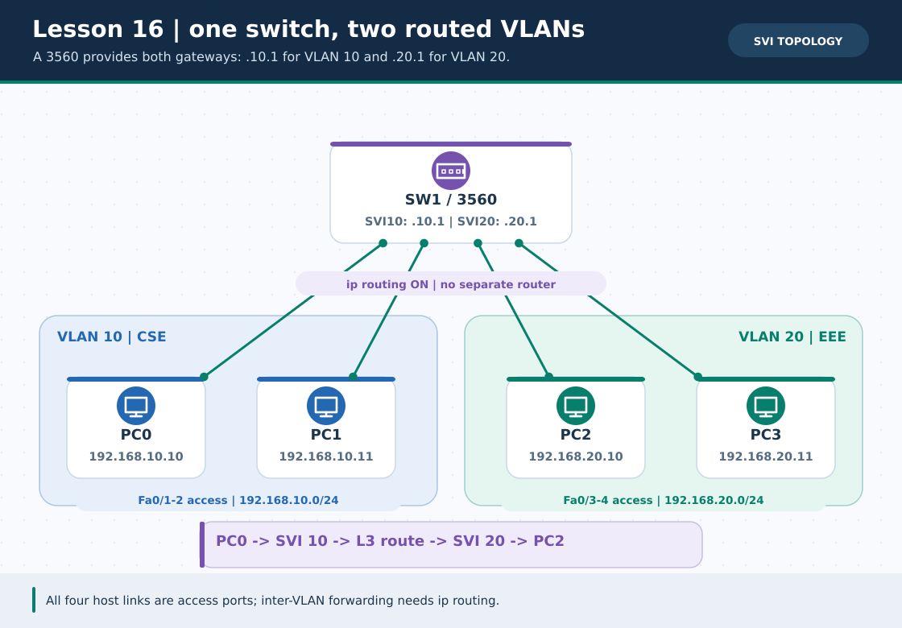
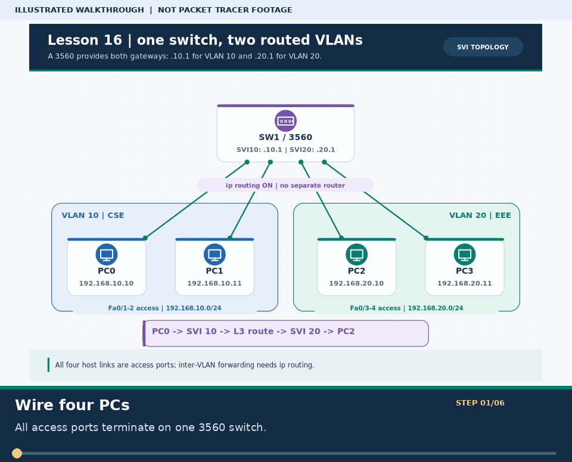
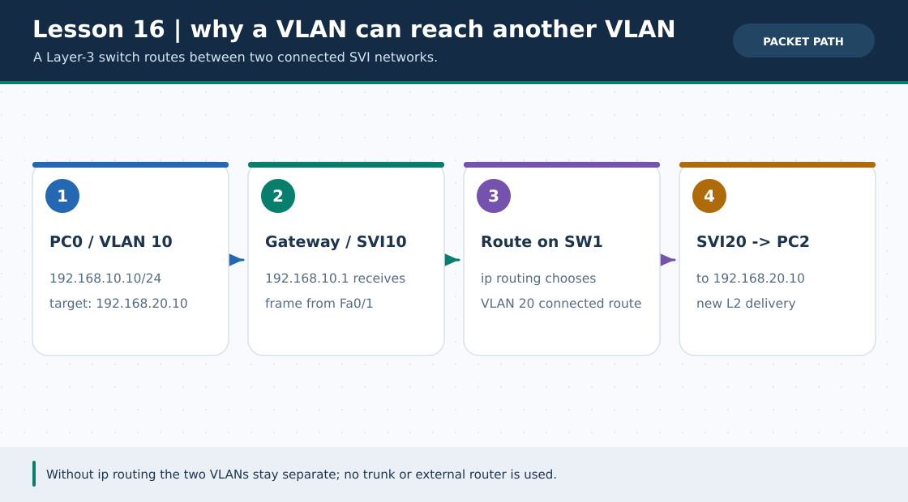

# Practical Lesson 16: 3560 multilayer-switch SVI inter-VLAN routing

> **Navigation:** [English home](../README.md) · [Practical Lesson index](README.md) · [Full Bengali guide](../../lessons/16-multilayer-switch-svi.md)

**Learning goal.** Route between two VLANs entirely inside a single 3560; no trunk or external router is needed.



> **About this visual:** Illustrated topology or concept map from the corresponding Bengali guide; a diagram, not a Packet Tracer capture.



> **30-second GIF:** six illustrated stages of the topology and checks. This is **not a Packet Tracer recording or proof of successful device behavior**. See the [GIF search names and study priorities](../../GIF-CATALOG.md) if you want to source your own alternative.



> This second diagram separates the concept/flow from the physical topology. Compare its labels with the numbered build steps below.

## Understand the design

PC0/PC1 attach to 3560 Fa0/1-2 in VLAN 10 (192.168.10.10/.11). PC2/PC3 attach to Fa0/3-4 in VLAN 20 (192.168.20.10/.11). Vlan10 gateway is 192.168.10.1/24 and Vlan20 gateway 192.168.20.1/24.

### Key ideas

- An SVI is the Layer-3 gateway for its VLAN and must be up/up to route packets.
- The global ip routing command enables inter-VLAN forwarding on the multilayer switch.
- With all PCs on the same 3560, adding a trunk or separate router changes the intended lesson.

## Build or work through it

1. Cable four PCs to the named 3560 access ports; create VLANs 10 and 20 and assign Fa0/1-4 correctly.
2. Set interface vlan 10 and vlan 20 to the corresponding .1 gateway and issue no shutdown.
3. Enable global ip routing; give each PC the gateway in its own /24 subnet.
4. Ping PC0-to-PC1 and PC2-to-PC3 first, then PC0-to-PC2 to prove routing.

### Copyable study example

Read the comment or role label first: IOS commands, PC commands and shell commands run in **different places**. This example is not a verified Packet Tracer run.

```cisco
! 3560 SW1 only; access-port assignments are separate
ip routing
interface vlan 10
 ip address 192.168.10.1 255.255.255.0
 no shutdown
interface vlan 20
 ip address 192.168.20.1 255.255.255.0
 no shutdown
```

## Verify; do not guess

- [ ] show vlan brief shows Fa0/1-2 in VLAN10 and Fa0/3-4 in VLAN20.
- [ ] show ip interface brief shows both SVIs up/up after at least one host port in each VLAN is active.
- [ ] PC0 192.168.10.10 pings PC2 192.168.20.10 via the two SVIs.

## If it fails

- An SVI stuck down/down may have no active member port in its VLAN.
- Same-VLAN ping with failed cross-VLAN ping suggests missing ip routing or incorrect PC gateway.

## Check your understanding

**Question.** What command allows the 3560 to forward packets between its two SVIs?

<details><summary>Reveal the explanation</summary>

**Answer.** The global configuration command ip routing.

</details>

---

**Continue:** [English track](README.md) · [Full Bengali lesson, complete tables and additional exercises](../../lessons/16-multilayer-switch-svi.md)
